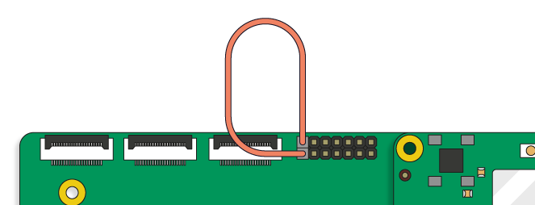
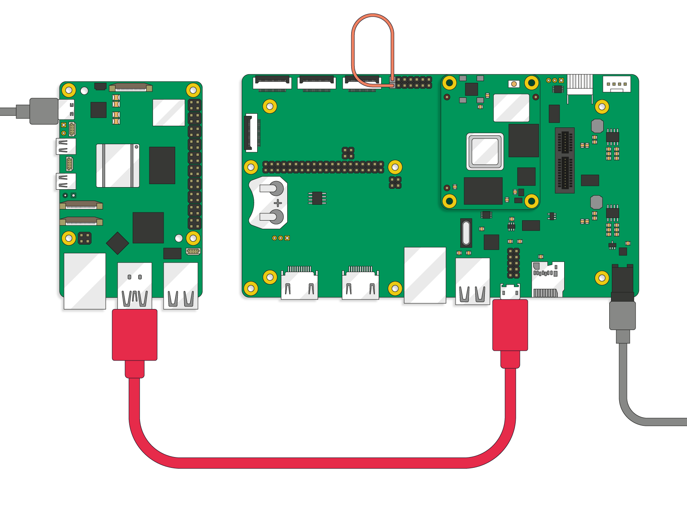

# 安全启动配置器

本页介绍树莓派 **安全启动配置器**（`rpi-sb-provisioner`）。安全启动配置器可自动完成安全（验证）启动（Secure Boot）和磁盘加密的设置过程，并支持配置多台树莓派设备。作为其工作流程的一部分，安全启动配置器会自动执行原本需要手动、多步骤完成的任务，包括刷写固件、写入操作系统镜像、生成密钥以及激活硬件级保护机制。

>**重要**
>
>此工具正在积极开发中，这意味着它目前正在改进和更新。如果你发现任何错误，或想建议新功能，请在 GitHub 上告诉我们：[https://github.com/raspberrypi/rpi-sb-provisioner](https://github.com/raspberrypi/rpi-sb-provisioner)。

## 安全启动配置

配置是指为设备安装操作系统（OS）、配置安全设置并确认设备可以使用，从而让设备做好使用准备的过程。对多台设备手动执行这一过程既耗时，又容易出错。

树莓派安全启动配置器是一款自动执行这些配置步骤的工具，让你无需手动操作，并可配置多台树莓派设备。它确保每台客户端设备都获得受信任的操作系统镜像、安全设置和加密密钥。

### 主要特性

使用树莓派安全启动配置器，你可以为每台客户端设备准备以下内容：

* **安全启动保护。** 安全启动确保在每台设备的启动序列期间，只有使用受信任密码学密钥签名的固件和操作系统镜像才能运行。安全启动链会在运行每个组件之前进行验证，从引导加载程序一直到操作系统。这可以防止未经授权的软件在设备上运行。安全启动配置器会烧录并配置初始化设备的底层固件，为安全（验证）启动过程奠定基础。更多信息，请参阅本页的[安全（验证）启动](#安全验证启动)。
* **加密存储。** 为了保护数据，你可以配置安全启动配置器，使用全盘加密来加密每台设备的存储。建议这样做，因为即使有人绕过启动介质或移除存储，加密也能确保数据无法访问。加密密钥是唯一的，并与硬件绑定，因此数据在其他系统上仍受保护且无法读取。更多信息，请参阅本页的[磁盘加密](#磁盘加密)。
* **安全的操作系统部署。** 安全启动配置器将自定义操作系统镜像打包到一个只有设备固件才能加载的安全加密容器中，从而安全地安装该镜像。配置器会在设置期间自动安装此操作系统镜像，确保部署过程可信且可重复。你只需创建一个基础（母版）镜像，该工具便会将其复制到所有客户端设备，并应用相应的安全修改。
* **制造记录。** 安全启动配置器维护一个制造数据库，记录每台客户端设备的序列号、MAC 地址、配置时间戳和安全配置。这些记录可支持库存跟踪、保修验证和客户支持操作。
* **一致的配置。** 使用安全启动配置器准备的每台设备都会获得相同的配置，从而消除人为错误和配置漂移。这确保客户端设备之间行为一致，并简化日常管理和技术支持操作。
* **Raspberry Pi Connect for Organisations。** 你可以配置安全启动配置器，将配置好的设备自动注册到 Raspberry Pi Connect for Organisations。更多信息，请参阅[批量配置](https://www.raspberrypi.com/documentation/services/connect-for-organisations.html#bulk-provisioning)。

### 使用场景

安全启动配置器适用于：

* 使用树莓派设备构建产品的企业。
* 大规模生产设备的制造商。
* 部署安全系统的系统集成商。
* 需要为多台树莓派设备配置安全功能的任何人。

由于该工具自动处理密码学操作和安全配置，安全启动配置器具有以下优势：

* **安全性。** 提供可信启动和加密数据存储。
* **效率。** 加快配置过程，无需手动处理密码学或具备固件知识。
* **可靠性。** 确保一致性，并减少手动设置可能出现的错误。
* **简单性。** 操作无需安全专业知识。不需要了解加密算法或启动链的实现。

### 核心安全概念

安全启动配置器依靠两种互补机制来保护设备：[安全（验证）启动](#安全验证启动)，以及使用 LUKSv2 的[磁盘加密](#磁盘加密)，概述如下。有关树莓派安全启动和加密实现的更多详细信息，请参阅[安全架构](an-quan-jia-gou.md)。

#### 安全（验证）启动

树莓派安全启动是一种安全机制，它从不可变硬件开始进行顺序验证，以检查启动过程的每个阶段是否经过身份验证。启用安全启动后，你的树莓派设备只会启动你用私钥签名的软件。没有你的签名，任何人都无法修改固件或操作系统镜像（`boot.img`）。

使用安全启动配置器在树莓派设备上启用安全启动后，设备会在操作系统启动之前验证每个启动阶段二进制文件（例如引导加载程序）是否带有受信任私钥的密码学签名。你的树莓派设备将对应公钥的哈希值存储在其安全存储（OTP 内存）中，并在启动前用它验证签名。这确保启动期间只能运行受信任的已签名二进制文件，防止从本地存储或网络加载被篡改或未签名的代码。

有关树莓派安全启动实现的更多详细信息，请参阅[安全架构](an-quan-jia-gou.md)。

#### 磁盘加密

我们强烈建议将安全启动与加密结合使用。如果不加密，一旦存储介质被移除或遭到入侵，树莓派设备上的数据仍可能被访问。反过来说，没有安全启动的加密无法阻止拥有 root 权限的人读取存储在 OTP 中的私钥。启用安全启动后，启动过程的每个阶段都会经过密码学验证，因此在访问私钥之前，树莓派设备上只能运行已签名的软件。

你可以使用安全启动配置器为树莓派设备准备以下内容：

* **LUKSv2（Linux Unified Key Setup）** 加密，这是 Linux 上磁盘加密的标准格式。
* 树莓派设备 **一次性可编程（OTP）** 内存区域中的设备唯一密钥。

树莓派设备 OTP 中的设备唯一密钥会在启动过程早期加载，然后用于解锁 LUKS 加密文件系统，使树莓派设备无需你输入密码即可解密其存储。

有关树莓派磁盘加密实现的更多详细信息，请参阅[安全架构](an-quan-jia-gou.md)。

#### 应用层加固

在使用安全启动和磁盘加密配置设备后，我们强烈建议你考虑使用软件组件来加固操作系统。更多信息，请参阅[树莓派系统中的软件组件](an-quan-jia-gou.md#树莓派系统中的软件组件)。

### 安全级别

在安全启动配置器的设置过程中，你可以选择三种操作模式，它们的区别在于为客户端设备应用的安全启动与加密组合不同，以契合你的安全需求。

*可为安全启动配置器选择的三种安全模式*

| 模式 | 作用 | 使用时机 |
| --- | --- | --- |
| `secure-boot` | **完整安全（安全启动 + 加密 + 设备唯一密钥）。** 确保启动期间只有受信任的软件能在设备上运行。它为客户端设备创建唯一的加密密钥，对存储进行分区和格式化，创建 **LUKSv2** 加密容器，将操作系统镜像放入该加密容器，并在设备的启动分区中放置一个已签名、定制化的预启动身份验证环境。 | 用于需要最高安全性的生产设备。这还会将客户密钥的哈希值写入 OTP，并将更新后的固件写入 EEPROM。 |
| `fde-only` | **无安全启动的全盘加密。** 执行与 `secure-boot` 相同的操作，但定制化的预启动身份验证环境未签名。 | 当你需要加密但不需要安全启动限制时使用。我们不建议选择此选项，因为第三方仍然可以读取加密密钥。 |
| `naked` | **无加密、无安全启动。** 自动对存储进行分区和格式化，并将操作系统镜像直接放入所连接设备的存储中，不进行加密，也没有预启动环境。 | 通常用于开发和测试，或用于没有安全要求的最小化设置。 |

## 前提条件

在开始配置过程之前，请确保具备以下条件：

### 软件资源

* **要配置的操作系统镜像。** 可以是树莓派系统（我们建议使用 Trixie），也可以是包含你自己的软件、设置和配置的自定义操作系统镜像。你可以使用树莓派官方的操作系统镜像构建工具 `rpi-image-gen` 创建自定义操作系统镜像。有关 `rpi-image-gen` 的信息，请参阅 [GitHub 中的 rpi-image-gen 文档](https://github.com/raspberrypi/rpi-image-gen)。
* **RSA 密钥对。** 用于为引导加载程序镜像签名的 RSA 2048 位公私钥对。请妥善保管此私钥。操作说明请参阅本页的[准备安全启动密钥对](#准备安全启动密钥对一次性)。

### 配置（主机）服务器

你必须有一台 64 位树莓派设备充当服务器；我们建议使用 **树莓派 5**。该设备需满足以下要求：

* **电源。** 官方树莓派 27 W USB-C 电源。
* **操作系统。** 安装树莓派系统 Trixie 或更高版本。
* **存储。** 至少 32 GB 的可用存储空间，用于临时工作文件。
* **连接器。** 请参阅下文[客户端树莓派设备与线缆](#客户端树莓派设备与线缆)中的表格。

配置服务器还必须有一份操作系统的“母版”副本，作为待配置设备的模板。你需要按照本页[设置你的配置服务器](#设置你的配置服务器一次性)中概述的步骤，将此操作系统镜像上传到配置服务器。

### 客户端树莓派设备与线缆

你必须至少有一台支持 RPIBOOT 的客户端设备连接到配置服务器。这样你就能通过 USB 连接修改设备，而这也是启用和配置安全启动的机制。

我们强烈建议使用计算模块 4 或 5 作为客户端设备，但你也可以使用安全启动配置器来准备以下任何支持 RPIBOOT 的树莓派设备。所需连接器取决于你要准备的设备。

*按推荐顺序排列的支持的客户端设备，以及使用安全启动配置器配置这些客户端设备所需的线缆和附件*

| 客户端设备 | 配置所需物品 |
| --- | --- |
| 计算模块 5（CM5） | USB-A 转 USB-C 线缆、计算模块 5 IO 板（CM5IO）和一根跳线 |
| 计算模块 4（CM4） | USB-A 转 micro USB-B 线缆、计算模块 4 IO 板（CM4IO）和一根跳线 |
| 计算模块 4S（CM4S） | USB-A 转 micro USB-B 线缆和计算模块 IO 板第 3 版（CMIO3） |
| 树莓派 5、500 和 500+ | USB-A 转 USB-C 线缆 |

## 配置过程

创建操作系统镜像（树莓派系统或你自己的自定义镜像，概述见[前提条件](#前提条件)）后，使用安全启动配置器准备树莓派设备的总体流程如下，其中最后一步需要对你想要配置的每台设备重复执行：

* [准备安全启动密钥对](#准备安全启动密钥对一次性)
* [设置你的配置服务器](#设置你的配置服务器一次性)
* [连接并配置你的客户端设备](#连接并配置你的客户端设备)

### 准备安全启动密钥对（一次性）

安全启动需要 2048 位 RSA 公私钥对：

* 私钥（`private.pem`）由配置服务器使用，在配置期间将引导加载程序镜像写入每台客户端设备之前对其签名。妥善保管私钥非常重要，因为当客户端设备锁定到此密钥后，只有用该密钥签名的镜像才能启动树莓派设备。
* 公钥的哈希值会在配置期间注入每台客户端设备，然后在启动时用于验证引导加载程序签名。该哈希值用于验证用你的私钥签名的镜像，并存储在 OTP 中。

客户端设备启动时，会计算引导加载程序镜像上签名所对应公钥的哈希值，并将其与存储在 OTP 中的哈希值进行比较。如果哈希值匹配，签名即通过验证，启动继续。

你可以使用现有的密钥对，也可以生成新的密钥对。以下说明将引导你使用 OpenSSL 生成新的 RSA 2048 位公私钥对。

如果你已有合适的密钥对，可以跳过这些说明。

1. 生成 2048 位 RSA 私钥，并将其保存到主目录下的 `private.pem` 文件中：

    ```bash
    $ cd $HOME
    $ openssl genrsa 2048 > private.pem
    ```

2. 从刚创建的私钥中提取公钥；此公钥的哈希值将存储在客户端设备的 OTP 中，用于验证用私钥签名的引导加载程序镜像：

    ```bash
    $ openssl rsa -in private.pem -pubout -out public.pem
    ```

>**警告**
>
>你必须妥善保管私钥。如果无法访问私钥，你的设备将无法再通过受信任的引导加载程序镜像进行更新或恢复。如果有人获取了私钥，你的设备就不再安全。我们建议结合使用加密存储、访问限制和硬件安全模块（HSM）。

### 设置你的配置服务器（一次性）

在配置客户端设备之前，你必须先将一台主机（例如树莓派 5）设置为 **配置服务器** 设备。然后使用此配置服务器来配置一台或多台支持 RPIBOOT 的 **客户端设备**（例如计算模块 4 或 5）。有关适用硬件的信息，请参阅本页的[前提条件](#前提条件)。

客户端设备上的存储如何准备以及如何应用安全功能，取决于你在设置配置服务器时选择的配置风格（`PROVISIONING_STYLE`）。共有三种操作模式可供选择：`secure-boot`、`fde-only` 或 `naked`。有关这些配置风格的信息，请参阅[安全级别](#安全级别)。

以下说明将引导你在配置服务器上安装安全启动配置器（`rpi-sb-provisioner`）、导入 RSA 密钥对、上传操作系统镜像，并配置其他选项，包括引导加载程序签名设置。

首先，在用于准备和配置其他树莓派设备的配置服务器上运行以下命令：

1. 将配置服务器更新到最新软件：

    ```bash
    $ sudo apt update && sudo apt full-upgrade -y
    ```

2. 安装安全启动配置器：

    ```bash
    $ sudo apt install -y rpi-sb-provisioner
    ```

3. 在浏览器中打开配置界面（http://localhost:3142）。以下命令会在 Web 浏览器中打开 `rpi-sb-provisioner` Web 界面的本地配置页面：

    ```bash
    $ xdg-open http://localhost:3142
    ```

接下来，打开 Web 界面的 **选项** 标签页，并完成以下各个部分。

1. 在 **操作系统镜像** 下，选择或上传要配置的操作系统（OS）文件。有关创建自己的操作系统镜像文件的信息，请参阅本页的[前提条件](#前提条件)。
2. 在 **设备与固件 > 设备系列** 下，选择你希望配置服务器准备的树莓派设备（例如计算模块 4）。
3. 在 **设备与固件 > 存储类型** 下，选择客户端设备使用的存储类型：**SD 卡**（标准 microSD 卡）、**eMMC**（计算模块上的嵌入式闪存）或 **NVMe**（NVMe SSD 存储）。
4. （可选）在 **设备与固件 > 设备固件** 下，选择要部署到客户端设备的引导加载程序版本。此更改可能影响客户端设备的性能或安全性。我们建议选择最新的默认版本。
5. （可选）在 **设备与固件 > 引导加载程序配置** 下，指定自定义引导加载程序配置文件的路径。这允许你定义树莓派安全启动配置器未提供的其他 EEPROM 参数。更多信息，请参阅[树莓派引导 EEPROM](../shu-mei-pai/shu-mei-pai-ying-jian.md#树莓派引导-eeprom)。
6. 在 **安全配置 > 配置风格** 下，选择三种配置选项之一。有关这些选项的详细信息，请参阅本页的[安全级别](#安全级别)。
7. 在 **安全配置 > 加密算法** 下，从以下选项中选择。较新的树莓派设备使用硬件加速器。更多信息，请参阅[安全架构](an-quan-jia-gou.md)页面中的[磁盘加密启动流程](an-quan-jia-gou.md#磁盘加密启动流程)。
    * **AES-XTS。** 如果你的树莓派上的 SoC 是 BCM2711 或 BCM2712，请选择此选项。
    * **Adiantum。** 如果你的树莓派上的 SoC 是 BCM2837B0 或更早版本，请选择此选项。
8. 在 **安全配置 > 引导加载程序签名密钥（RSA 2048 位）** 下，创建或上传 2048 位 RSA 公私钥对。仅当你选择 `secure-boot` 作为配置风格时，此项才相关。
    * 如果你还没有 RSA 密钥对，请按照屏幕上的说明创建签名密钥。
    * 如果你已按照[准备安全启动密钥对](#准备安全启动密钥对一次性)所述创建了 RSA 密钥对，请将文件上传到此部分。
9. 在 **存储与输出** 下，设置配置数据和日志的存储位置。你需要在此输入：
    * **工作目录（推荐）。** 在多次配置运行之间缓存操作系统资源的位置。
    * **制造数据库。** 存储设备信息（序列号、MAC 地址和硬件详情）的 SQLite 数据库。仅使用本地存储。
    * **密钥对存储目录（可选）。** 存储配置期间生成的每台客户端设备唯一密码学密钥对的目录。设备密钥对属于敏感信息，因此你必须确保采取恰当的访问控制措施。将此部分留空，可将密钥与日志一起存储在工作目录中。
10. 如果你希望客户端设备自动注册到 **Raspberry Pi Connect for Organisations**，请在配置期间启用设备注册。在 **云服务** 下，输入你所在组织的管理 API 访问令牌，你可以在 Raspberry Pi Connect 组织的 **设置** 标签页中找到该令牌。更多信息，请参阅[批量配置](https://www.raspberrypi.com/documentation/services/connect-for-organisations.html#bulk-provisioning)。
11. （可选）在 **硬件安全** 下，使用开关在客户端设备上永久启用以下选项。这些设置无法在已配置的客户端设备上还原；只有在确认配置无误时才启用它们。
    * **锁定 JTAG 访问。** 这会限制对客户端设备的调试访问。默认关闭，因为启用后将阻止树莓派工程师协助进行硬件调试。
    * **启用 EEPROM 写保护。** 这会防止修改已配置设备的 EEPROM，从而保护安全启动配置。有关 EEPROM 写保护的更多信息，请参阅 [`eeprom_write_protect`](../shu-mei-pai/config.txt.md#eeprom_write_protect)。

配置到此完成，你可以开始配置第一台设备了。

### 连接并配置你的客户端设备

使用安全启动配置器设置好配置服务器后，即可配置客户端设备。

第一步是将每台客户端设备以 RPIBOOT 模式连接到配置服务器。将配置服务器连接到处于 RPIBOOT 模式的设备会自动启动配置软件 `rpi-sb-provisioner`，它会安装安全操作系统镜像、烧录固件，并应用密钥和加密。

>**注意**
>
>RPIBOOT 模式是 USB 设备模式的工程名称，它使配置服务器能够通过 USB 与客户端设备通信。

连接设备的方式取决于客户端设备型号及其进入 RPIBOOT 模式的方式：

* 计算模块 4 和 5 通过相应的 IO 板连接到配置服务器，并使用跳线进入 RPIBOOT 模式。操作说明请参阅[连接到计算模块 4 或 5](#连接到计算模块-4-或-5)。
* 计算模块 4S 通过 CMIO3 板连接到配置服务器，并使用 CMIO3 板上的跳线排针进入 RPIBOOT 模式。操作说明请参阅[连接到计算模块 4S](#连接到计算模块-4s)。
* 树莓派 5 要求你在连接过程中的特定时刻按住其电源按钮。操作说明请参阅[连接到树莓派 5](#连接到树莓派-5)。

>**警告**
>
>配置期间不要将其他 USB 设备连接到客户端设备。配置用的树莓派只能向所连接的设备提供 900 mA 的电力。

安全启动配置器使用三个独立的 `systemd` 服务在后台运行。所有配置器操作都是自动的，但你仍可以从 http://localhost:3142 的 Web 界面 **设备** 标签页监控其进度。

完成后，客户端设备上的活动 LED 和电源 LED 会熄灭。在树莓派 5 设备上，由于使用双色 LED，这两种功能由同一个 LED 提供。此时，你可以安全地关闭设备电源、断开与配置服务器的连接，并将其装入产品中。

>**注意**
>
>如果连接了以太网，你可能仍会看到以太网端口有活动。

随后设备即可部署，你可以将下一台客户端设备连接到配置服务器。通常，对于 1.6 GB 的操作系统镜像，每台设备的配置大约需要 3 分钟。

#### 连接到计算模块 4 或 5

配置服务器通过连接到相应 IO 板的 USB 线缆与计算模块 4 或 5 相连。此外，你必须在 IO 板的正确引脚上连接一根跳线，强制所连接的计算模块进入 RPIBOOT 模式。

以下说明以 CM4 在 CM4IO 板上的使用为例，但同样适用于 CM5 在 CM5IO 板上的使用。

完成以下步骤后，配置过程会自动开始，如本页[配置流水线](#配置流水线)所述。

##### 步骤 1. 将计算模块连接到相应的 IO 板

将计算模块上的安装孔和双 100 引脚连接器与 IO 板上的对应部分对齐，然后轻柔但牢固地按压，使二者连接。

尽管计算模块 4（CM4）和计算模块 5（CM5）的外形尺寸在物理上兼容 CM4IO 和 CM5IO 板，但我们强烈建议只使用为对应计算模块型号设计的 IO 板。这是因为连接器之间并非引脚一一对应，CM4 和 CM5 之间有多个信号的分配方式不同。使用不匹配的 IO 板会导致功能缺失。

##### 步骤 2. 启用 RPIBOOT 模式

在计算模块 IO（CMIO）板顶部，使用跳线连接两个 `disable eMMC Boot` 引脚（位于 12 引脚排针的最左侧）。这会使计算模块进入 RPIBOOT 模式，从而让你改为从配置服务器将自定义操作系统镜像写入 eMMC。

*将计算模块 IO 板置于 RPIBOOT 模式的跳线位置*



##### 步骤 3. 将配置服务器连接到 IO 板

使用 USB 线缆将配置服务器连接到 IO 板。当计算模块获得供电时，RPIBOOT 模式即被激活。

* 对于 CM4，电源直接提供给其对应的 IO 板（CM4IO）。
* 对于 CM5，电源由来自配置服务器的 USB 线缆提供。

作为示例，下图展示了一个正确连接的配置环境：左侧的树莓派 5 作为配置服务器，通过连接的 CM4IO 与右侧的 CM4 相连。图中的红线将配置服务器连接到 CMIO 板；图中的灰线用于供电。

*左侧的树莓派 5 配置服务器连接到右侧的计算模块 4*



##### 步骤 4. 监控配置过程

配置期间，请观察计算模块 IO 板上的 LED。当两个 LED 都熄灭时，配置完成。随后你可以断开客户端设备与配置服务器的连接，并按预期使用客户端设备。

#### 连接到计算模块 4S

配置服务器通过连接到计算模块 IO 板第 3 版（CMIO3）板的 USB 线缆与计算模块 4S 相连。此外，你需要移动排针上的引脚跳线位置，强制所连接的计算模块进入 RPIBOOT 模式。

完成以下步骤后，配置过程会自动开始，如本页[配置流水线](#配置流水线)所述。

##### 步骤 1. 将计算模块 4S 连接到 CMIO3 板

将计算模块 4S（CM4S）的底边插入 CMIO3 板上的 SODIMM 连接器，然后向后倾斜 CM4S，直到它平贴在 CMIO3 板上，并由固定卡扣固定到位。

##### 步骤 2. 启用 RPIBOOT 模式

在 CMIO3 板右下角标有 `USB SLAVE BOOT ENABLE` 的排针上，将引脚跳线从最右侧的两个引脚（标有 `DIS`）移到最左侧的两个引脚（标有 `EN`）。这会使 CM4S 进入 RPIBOOT 模式，从而让你改为从配置服务器将自定义操作系统镜像写入 eMMC。

##### 步骤 3. 将配置服务器连接到 IO 板

使用 USB 线缆通过 `USB SLAVE` 端口将配置服务器连接到 CMIO3 板。当向 CMIO3 板上的 `POWER IN` 端口供电时，CM4S 上的 RPIBOOT 模式即被激活。

##### 步骤 4. 监控配置过程

配置期间，请观察 CMIO3 上的 LED。当两个 LED 都熄灭时，配置完成。随后你可以断开客户端设备与配置服务器的连接，并按预期使用客户端设备。

#### 连接到树莓派 5

树莓派 5 配有内置电源按钮。将配置服务器连接到树莓派 5 时，你需要在连接过程的特定时刻按住此电源按钮。

我们强烈建议使用高质量的 USB-A 转 USB-C 线缆。劣质线缆可能导致连接问题，并干扰配置过程。

初始连接会激活 RPIBOOT 模式，使客户端树莓派 5 可由配置服务器进行配置。

1. 将连接线缆的 USB-A 端插入配置服务器（通常是一台按照[设置你的配置服务器](#设置你的配置服务器一次性)中的说明配置好的另一台树莓派 5）。
2. 按住客户端树莓派 5（不是配置服务器）上的电源按钮；按住按钮的同时，将线缆的 USB-C 端插入客户端树莓派 5。
3. 继续按住电源按钮，直到配置服务器识别到客户端设备，Web 界面或系统日志会给出指示。然后松开按钮。设备随后开始配置过程的引导阶段，概述见[配置流水线](#配置流水线)。
4. 配置期间，请观察客户端树莓派 5 的 LED。当客户端树莓派上的两个 LED 都熄灭时，配置完成。随后你可以断开客户端设备与配置服务器的连接，并按预期使用客户端设备。

## 配置流水线

当连接到处于 RPIBOOT 模式的客户端设备时，配置服务器会自动运行 `rpi-sb-provisioner`，它会执行以下操作：

1. **检测。** 配置服务器通过 USB 检测所连接的设备（处于 RPIBOOT 模式）。这会使用后台 `systemd` 服务启动配置工作流。
2. **引导。** 如果配置风格设置为 `secure-boot`，一个特殊的树莓派固件会将公开签名密钥哈希值（来自 `CUSTOMER_KEY_FILE_PEM`）写入 OTP 内存。
3. **更新。** 配置服务器将包含引导加载程序的 SPI 闪存 EEPROM 更新为指定的固件。
4. **判定。** 设备上会运行一个临时 Linux 发行版，以确定后续步骤。配置服务器上的 `rpi-sb-provisioner` 会根据你配置的 `PROVISIONING_STYLE` 决定如何继续：`secure-boot`、`fde-only`（全盘加密）或 `naked`（未加密、未签名的操作系统）。有关配置风格的更多信息，请参阅[安全级别](#安全级别)。
5. **配置。** 系统会根据你选择的配置风格安装固件、密钥、操作系统镜像等。

配置完成后，所连接设备的活动 LED 和电源 LED 会熄灭，表示已安全关机并完成配置。随后你可以连接下一台要配置的设备。

配置完成后，客户端设备会：

* 启动时使用存储在 OTP 中的公钥验证已签名的引导加载程序。
* 只启动由你的受信任私钥签名的镜像。
* 如果你还配置了全盘加密（推荐），则在启动时使用设备唯一密钥解密其存储，然后再加载操作系统。

## 查看制造数据库

如果你在安全启动配置器中启用了制造数据库，可以在该数据库中找到每台已配置设备的以下详细信息：

* 序列号
* 板类型和版本
* MAC 地址（以太网）
* 配置日期和时间
* 已安装的操作系统镜像
* 安全设置

你可以通过安全启动配置器的 Web 界面或使用命令行查看数据库中的信息。

在你的配置（主机）服务器上，将数据库导出为 CSV 文件：

**使用 Web 界面**

要从 Web 界面将制造数据库导出为 CSV 文件：

1. 从浏览器访问 http://localhost:3142。
2. 转到 **制造数据库** 标签页。
3. 选择 **导出为 CSV**，下载电子表格文件。

**使用命令行**

运行以下命令，将制造数据库导出为 CSV 文件：

```bash
sqlite3 ${RPI_SB_PROVISIONER_MANUFACTURING_DB} \
  -cmd ".headers on" \
  -cmd ".mode csv" \
  -cmd ".output devices.csv" \
  "SELECT * FROM rpi_sb_provisioner;"
```

## 故障排除

使用本节的信息来诊断或解决使用安全启动配置器配置客户端设备时可能出现的问题。

* 检查你遇到的是否是常见问题（请参阅[常见问题](#常见问题)）。
* 检查日志中的错误消息（请参阅[检查日志](#检查日志)）。
* 清除缓存（请参阅[清除缓存](#清除缓存)）。
* 如果你无法解决问题，请联系我们报告该问题（请参阅[获取帮助](#获取帮助)）。

### 常见问题

本节介绍使用安全启动配置器时可能遇到的常见问题，并提供解决方法。

#### 配置停止或始终无法完成

如果配置开始后中途停止或始终无法完成，请尝试以下操作：

1. 检查日志中的错误消息（请参阅[检查日志](#检查日志)）。
2. 清除缓存（请参阅[清除缓存](#清除缓存)）。
3. 检查配置服务器是否至少有 32 GB 的可用存储空间。
4. 尝试配置另一台客户端设备，以确定问题是否特定于某台设备。

#### 错误：“已经签名”

如果错误日志报告客户端设备已经签名或已处于安全状态，说明该客户端设备之前已写入签名密钥。此操作是永久性的，无法撤销。不过，可以采取以下操作：

* 为客户端设备设置 **跳过 EEPROM 更新** 标志，以跳过签名步骤。
* 为客户端设备设置 **重新配置设备** 标志，以使用相同密钥重新配置设备。

要跳过签名步骤：

1. 转到 http://localhost:3142 的安全启动配置器 Web 界面。
2. 转到 **设备** 标签页，选择你正在配置的设备。
3. 在该设备的专属页面中，将 **特殊标志** 部分里的 **跳过 EEPROM 更新** 设置为 **一次性**。

要使用相同密钥完全重新配置客户端设备：

1. 转到 http://localhost:3142 的安全启动配置器 Web 界面。
2. 转到 **设备** 标签页，选择你正在配置的设备。
3. 在该设备的专属页面中，将 **特殊标志** 部分里的 **重新配置设备** 设置为 **一次性**。

### 检查日志

如果配置尝试失败，你可以检查日志以获取错误详情。

**使用 Web 界面**

1. 转到 http://localhost:3142 的安全启动配置器 Web 界面。
2. 选择 **服务** 标签页。
3. 在 **系统服务** 表格中找到你的客户端设备。
4. 选择 **查看日志** 以查看有关它的详细日志。

**使用命令行**

运行以下命令，并将 `<serial>` 替换为设备序列号：

```bash
tail -f /var/log/rpi-sb-provisioner/<serial>/provisioner.log
```

如需更详细的日志，请运行以下命令，并将 `<serial>` 替换为设备序列号：

```bash
journalctl -xeu rpi-sb-provisioner@<serial> -f
```

### 清除缓存

如果旧文件导致问题，你可以清除配置缓存。清除配置缓存会使下一次配置操作耗时更长。

1. 转到 http://localhost:3142 的安全启动配置器 Web 界面。
2. 选择 **选项** 标签页和 **操作系统镜像** 部分。
3. 选择你要从配置缓存中清除的操作系统镜像。
4. 选择 **清除缓存文件**。
5. 在确认窗口中，选择 **确定** 以确认操作。

### 获取帮助

如果你遇到本节未涵盖的问题，请在 [rpi-sb-provisioner 问题跟踪器](https://github.com/raspberrypi/rpi-sb-provisioner/issues)中报告。请包含你尝试配置的设备类型、错误消息和[日志文件](#检查日志)。
