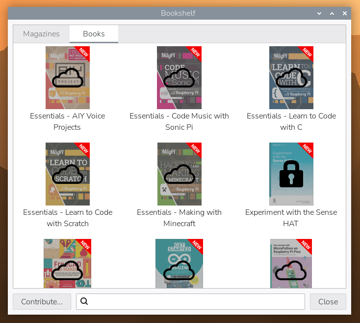

# 书架（Bookshelf）

## 简介

树莓派系统中的书架（Bookshelf）应用可让你访问 Raspberry Pi Press 出版的图书和杂志。从树莓派系统 *Trixie* 起，还包括仅贡献者可见的图书。

* 免费图书带有云图标，任何人都可以下载。
* 仅贡献者可见的图书带有挂锁图标，除非你使用与捐助或印刷版杂志订阅关联的 [Raspberry Pi ID](shu-mei-pai-zhang-hao-raspberry-pi-id.md) 登录书架。部分仅贡献者可见的图书之后会向所有人开放。

书架（Bookshelf）包含在树莓派系统桌面版和完整版镜像中。

## 成为贡献者（树莓派系统 *Trixie* 及更高版本）

使用与以下任一项目关联的 [Raspberry Pi ID](shu-mei-pai-zhang-hao-raspberry-pi-id.md) 登录书架的用户，可以访问仅贡献者可见的图书：

* 一个[订阅了我们印刷版杂志](https://magazine.raspberrypi.com/subscribe/new)的电子邮件地址
* [每月捐助](https://magazine.raspberrypi.com/bookshelf/link)

要设置每月捐助：

1. 在书架中，选择左下角的**捐助…**，打开 Raspberry Pi 网站上的贡献者页面。
2. 如果你还没有 Raspberry Pi ID，可以现在创建一个。如果你已有 Raspberry Pi ID，请使用用户名和密码登录。
3. 注册每月捐助。
4. 选择**登录书架**，打开书架并保存你的 ID，以标识你的贡献者身份。

**捐助…**按钮不再显示，现在可以下载所有图书。

你可以在任意数量的设备上使用 Raspberry Pi ID 登录并访问可用的图书。如果你换用新的树莓派，或将不同版本的树莓派系统刷入存储卡，请重新登录并下载你喜欢的图书。

## 下载图书

双击任意可用图书，将其下载为 PDF 并在默认 PDF 阅读器中打开。

如果你停止每月捐助，已下载的图书仍会保留。这些 PDF 文件存储在你主目录的 **Bookshelf** 文件夹中，仍可通过书架访问。
