# 树莓派 Connect

## 简介

树莓派 Connect（Raspberry Pi Connect）可让你从世界上任何地方安全地访问你的树莓派。它的工作原理是把你的设备关联到你的 Connect 账号。

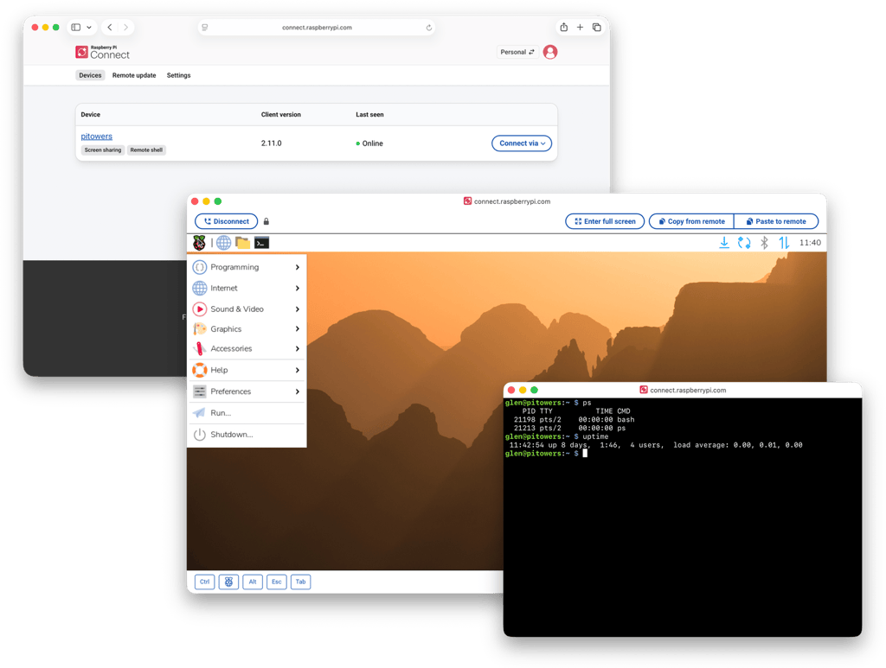

Connect 默认安装在树莓派系统桌面版（Raspberry Pi OS Desktop）和完整版（Raspberry Pi OS Full，即含推荐软件的桌面版）中。

Connect 还有一个备选的**精简（Lite）**变体，仅支持远程 shell 访问、无法进行屏幕共享，默认安装在精简版树莓派系统中。

>**注意**
>
>要使用 Connect，你的树莓派必须运行树莓派系统 *Bookworm* 或更高版本。

### Connect 服务功能

把你的树莓派设备关联到 Connect 账号后，你可以通过以下方式与设备交互：

* [屏幕共享](#屏幕共享界面)
* [远程 shell](#远程-shell)
* [远程更新](#远程更新你的设备)

### Connect 菜单

Connect 菜单可让你打开或关闭 Connect、登录和登出，以及启用或禁用两种远程访问方法（shell 和屏幕共享）。

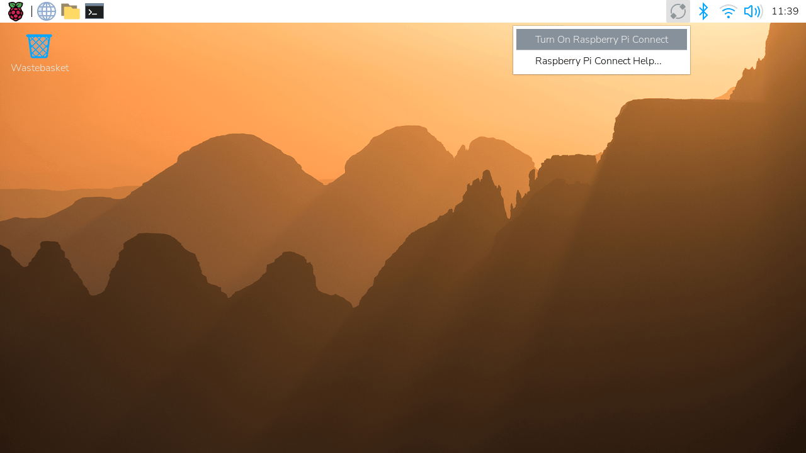

### 安全与数据存储

Connect 使用安全的加密连接。

在默认情况下，Connect 直接在你的树莓派和浏览器之间通信。但是，当 Connect 无法在你的树莓派和浏览器之间建立直接连接时，我们会使用中继服务器。在这种情况下，树莓派仅保留运行 Connect 所需的元数据。

### Connect 账号类型

Connect 账号分为两种类型：个人账号和组织账号。

个人账号为单个用户提供其 Connect 账号中所有已关联设备的视图。该账号类型免费。

组织账号允许多个用户查看共享 Connect 账号下关联的设备。该账号类型按月计费。更多信息请参见[树莓派 Connect 企业版](shu-mei-pai-connect-qi-ye-ban.md)。

## 开始使用

开始使用 Connect 有三个步骤：

1. 使用你的树莓派 ID 登录 [connect.raspberrypi.com](https://connect.raspberrypi.com/)。更多信息请参见[创建树莓派账号](shu-mei-pai-zhang-hao-raspberry-pi-id.md)。
2. 在你的树莓派设备上[打开](#打开-connect-服务并关联你的设备) Connect 服务，然后将其[关联](#打开-connect-服务并关联你的设备)到你的 Connect 账号。
3. 在你的 PC、Mac 或其他设备上访问 [connect.raspberrypi.com](https://connect.raspberrypi.com/)，即可在网页浏览器中远程访问已关联的设备。

### 打开 Connect 服务并关联你的设备

完整版树莓派系统包含 Connect，但该服务在默认情况下处于禁用状态。因此，首次使用前必须先将其打开。

你可以通过桌面、命令行或认证密钥打开 Connect，并将其关联到你的树莓派设备。

>**注意**
>
>Connect 会使用你设备的序列号对通信进行签名。在设备之间移动存储卡会导致你从 Connect 中注销。

**桌面**

要打开 Connect 并关联你的设备：

1. 接通你的树莓派设备的电源。
2. 点击系统托盘中的 Connect 图标，选择 **打开树莓派 Connect**。

    

3. 如果这是你第一次打开 Connect 服务，或者你尚未使用树莓派 ID 登录，浏览器会自动打开。

    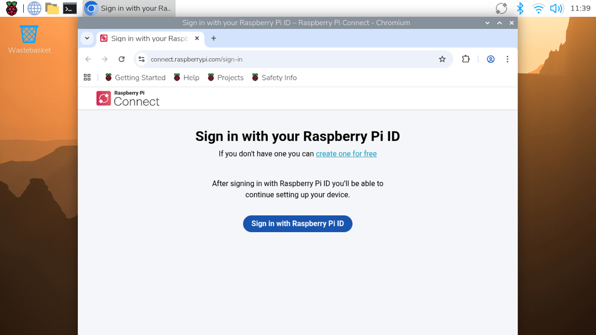

4. 输入你的树莓派 ID 电子邮件和密码，然后选择 **登录**（Sign In）。
5. 按照屏幕提示为你的树莓派设备命名，并选择将其关联到哪个 Connect 账号。

    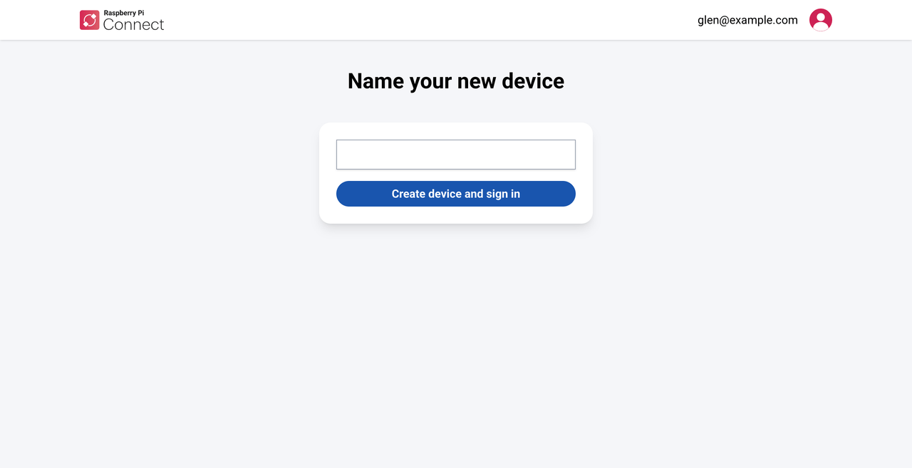

    如果你是某个[组织](shu-mei-pai-connect-qi-ye-ban.md)的管理员，选择将此设备添加到你的个人账号还是特定组织。

    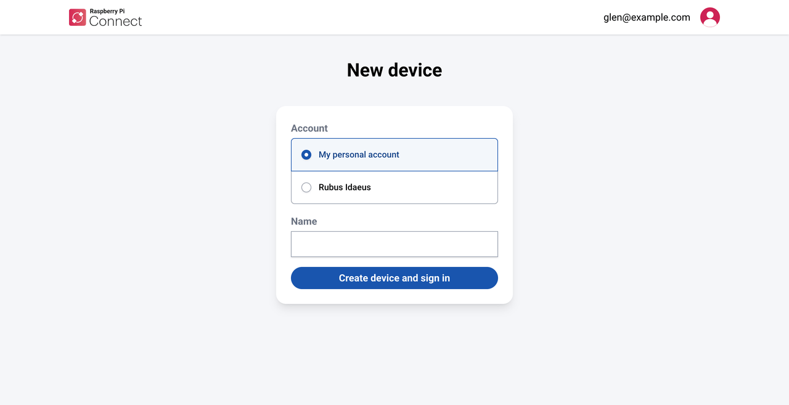

6. 选择 **创建设备并登录**（Create device and sign in）。

完成这些步骤后，树莓派设备系统托盘中的 Connect 图标会变成蓝色，表示已登录 Connect 服务。

你的注册邮箱也会收到一封通知邮件，告知有一台新设备关联到了你的 Connect 账号。

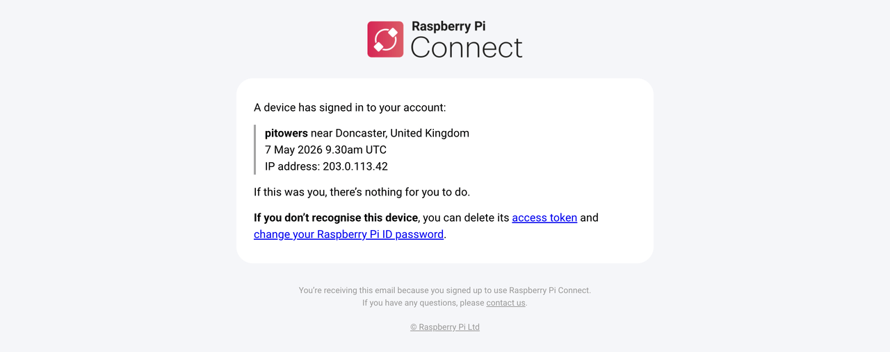

**命令行**

1. 运行以下命令打开 Connect：

    ```
    $ rpi-connect on
    ```

    该命令会打开 Connect 服务，但不会让你登录。

2. 运行以下命令登录：

    ```
    $ rpi-connect signin
    ```

    该命令会输出类似以下内容：

    ```
    Complete sign in by visiting https://connect.raspberrypi.com/verify/XXXX-XXXX
    ```

3. 在任意设备上访问该验证网址，并使用你的树莓派 ID 登录，完成关联过程。

完成这些步骤后，树莓派设备系统托盘中的 Connect 图标会变成蓝色，表示已登录 Connect 服务。你的注册邮箱也会收到一封通知邮件，告知有一台新设备关联到了你的 Connect 账号。

你还可以在命令行输入 `rpi-connect status` 来查看连接状态。


**认证密钥**

认证密钥（auth key）是一次性的临时令牌，可让你自动（无需使用网页界面）将设备关联到 Connect 账号。个人认证密钥在创建六小时后过期；组织认证密钥在创建后 1 到 90 天内过期（默认为 1 天）。

创建和使用认证密钥最简单的方法是使用[树莓派启动盘制作工具中的自定义选项](../shu-mei-pai/ru-men.md)。你也可以从个人或组织 Connect 账号的 **设置**（Settings）页面手动创建认证密钥；组织管理员还可以使用[管理 API](shu-mei-pai-connect-qi-ye-ban.md#管理-api) 创建认证密钥。

>**注意**
>
>个人账号同时只能有一个处于活动状态的认证密钥；组织可以同时有多个处于活动状态的认证密钥。每台设备都需要一个唯一的认证密钥。

>**技巧**
>
>要使用认证密钥，请确保在树莓派 Connect 网站上显示的过期时间之前启动树莓派并连接到互联网。

创建认证密钥后，使用 `rpi-connect signin` 命令将其提供给设备，或将认证密钥写入主目录中的文件。

也可以将其保存到主目录的 `.config/com.raspberrypi.connect/auth.key`，这样 Connect 会自动检测到它。

要以字符串形式提供认证密钥，请运行以下命令：

```
$ rpi-connect signin --auth-key=rpuak_123456
```

如果你已将认证密钥保存到文件，可以在其完整路径前加 `@` 前缀传给命令：

```
$ rpi-connect signin --auth-key=@/home/alice/auth.key
```

完成这些步骤后，树莓派设备系统托盘中的 Connect 图标会变成蓝色，表示已登录 Connect 服务。

你的注册邮箱也会收到一封通知邮件，告知有一台新设备关联到了你的 Connect 账号。


### 安全最佳实践

如果你收到一封关于你无法识别的设备的通知邮件：

1. 立即修改你的树莓派 ID 密码。
2. 按照[从 Connect 中移除设备](#管理设备)中的说明操作，将该设备与你的账号永久解除关联。
3. 考虑[启用双因素身份验证](shu-mei-pai-zhang-hao-raspberry-pi-id.md#启用双因素身份验证)以保护你的账号安全。

### 查看已关联的设备

Connect 会在**设备**标签页中列出你所有已关联的设备。

要查看你的设备：

1. 在任意设备上登录 [connect.raspberrypi.com](https://connect.raspberrypi.com/)。
2. 选择 **设备** 标签页。Connect 会显示已关联设备的列表。

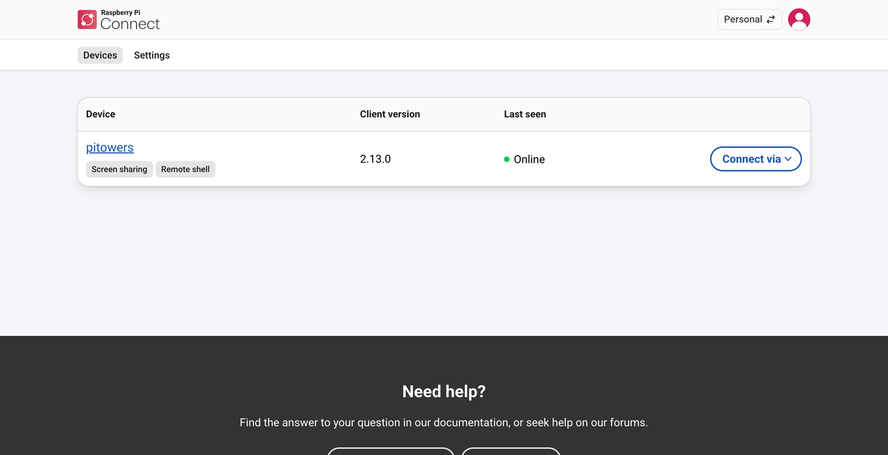

如果你使用组织账号，可以对该列表进行[搜索和筛选](shu-mei-pai-connect-qi-ye-ban.md#搜索和筛选设备)，并为设备添加[标签](shu-mei-pai-connect-qi-ye-ban.md#为设备添加标签)。

## 在 Connect 中访问你的设备

把树莓派设备关联到 Connect 账号后，你可以仅通过网页浏览器从任何地方访问它。

你可以通过以下两种方法之一来实现：

* 屏幕共享
* 远程 shell

屏幕共享需要 **Wayland** 窗口服务器。树莓派系统 *Bookworm* 及更高版本在默认情况下使用 Wayland。屏幕共享与精简版树莓派系统以及使用 X 窗口服务器的系统不兼容。

>**注意**
>
>无论你的树莓派与浏览器位于同一网络还是不同网络，屏幕共享和远程 shell 都能工作。但是，直接的本地连接比经由互联网或[中继服务器](#中继服务器)的连接更快、响应更灵敏。

### 屏幕共享界面

Connect 的屏幕共享界面同时针对桌面设备和移动设备设计。

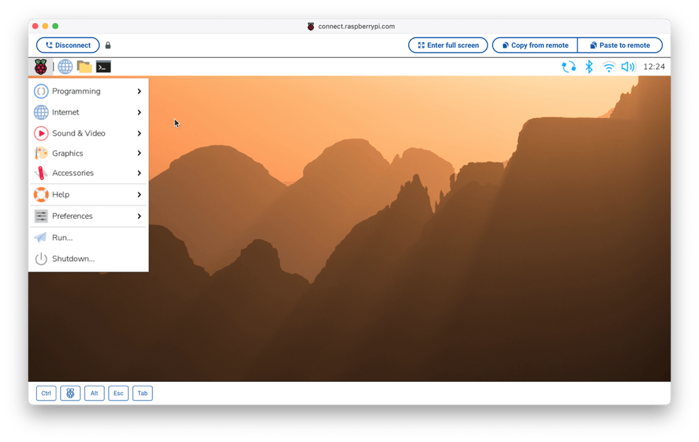

你可以使用界面左下角的按钮模拟常见的键盘功能：

* **Keyboard**（键盘）。切换屏幕键盘。仅在移动设备上显示。
* **Ctrl**。模拟在物理键盘上按住该键。
* **Super key**。模拟在物理键盘上按住该键。
* **Alt**。模拟在物理键盘上按住该键。
* **Esc**。模拟单次按下并松开该键。
* **Tab**。模拟单次按下并松开该键。

你还可以使用浏览器窗口顶部的按钮完成其他实用操作：

* **Copy from remote**（从远程复制）。把设备远程剪贴板中的文本传输到本地剪贴板。
* **Paste to remote**（粘贴到远程）。把本地剪贴板中的文本传输到设备的远程剪贴板。
* **Enter full screen**（进入全屏）。把浏览器窗口扩展到全屏大小。
* **Disconnect**（断开连接）。终止共享会话。


#### 开始屏幕共享

要开始屏幕共享会话：

1. 确保你的树莓派设备已关联到你的 Connect 账号、已接通电源，并且树莓派系统已启动。
2. 在你的 PC、Mac 或其他设备上登录 [connect.raspberrypi.com](https://connect.raspberrypi.com/)。

    如果你的浏览器或操作系统请求在本地网络上查找或连接设备的权限，请允许。如果拒绝，Connect 仍可工作，但与本地网络中设备的会话无法使用本地路由。

3. 选择 **设备** 标签页。

    支持屏幕共享的设备会在设备名称下方显示灰色的 **Screen sharing**（屏幕共享）徽章。

    

4. 点击你想访问的设备右侧的 **通过 Connect** 按钮。
5. 从菜单中选择 **Screen sharing**（屏幕共享）选项。

    浏览器窗口会打开并显示你设备的桌面，现在你可以像使用本地设备一样使用它。

    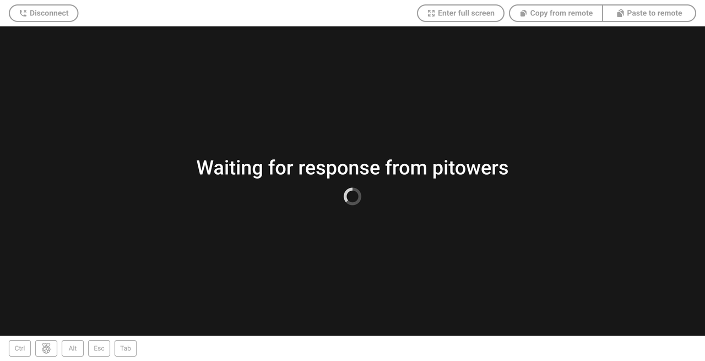

    屏幕共享开始后，Connect 仪表板中 **Screen sharing**（屏幕共享）徽章旁会出现绿色圆点，表示有活动的屏幕共享会话。悬停即可查看当前的屏幕共享会话数。

    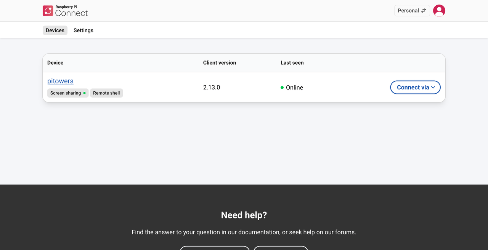

    屏幕共享会话进行时，系统托盘中的 Connect 图标会旋转。每当屏幕共享会话开始时，桌面上都会出现一条通知。

    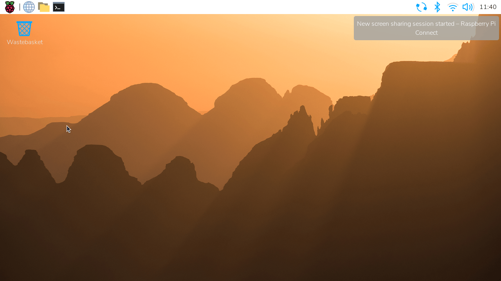

#### 停止屏幕共享

要停止屏幕共享：

1. 选择显示屏幕共享的浏览器窗口。
2. 点击左上角的 **断开连接**（Disconnect）按钮。

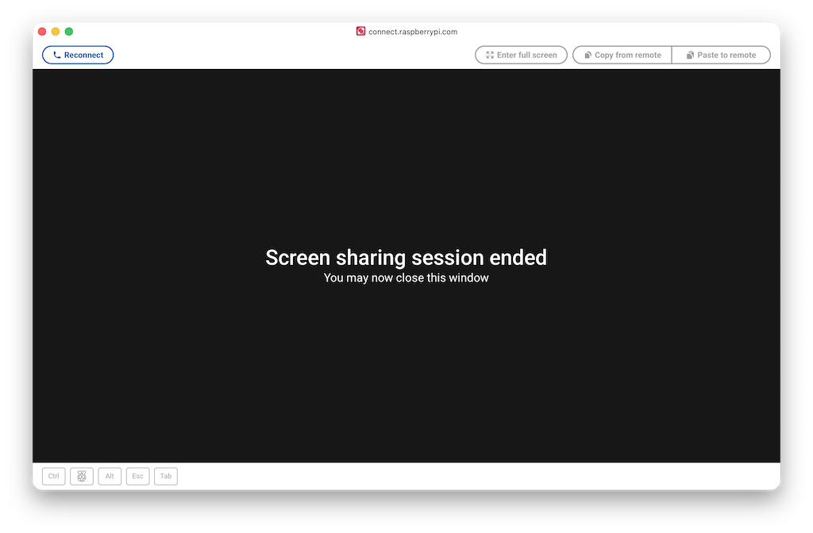

#### 禁止与重新允许屏幕共享

你可以通过界面或命令行，从树莓派设备上禁止屏幕共享。

>**警告**
>
>如果你在 shell 或屏幕共享会话中同时禁止了 shell 访问*和*屏幕共享，则必须借助 SSH 等其他常见远程访问方案，才能在不实际接触设备的情况下访问它。

**界面**

要禁止屏幕共享：

1. 在树莓派设备上，点击系统托盘中的 Connect 图标，然后取消选择 **Allow Screen Sharing**（允许屏幕共享）。

    你的设备保持登录 Connect，但屏幕共享已被禁止。

2. （可选）验证屏幕共享已被禁止：

    1. 在你的 PC、Mac 或其他设备上登录 [connect.raspberrypi.com](https://connect.raspberrypi.com/)。
    2. 选择 **设备** 标签页并在列表中找到该树莓派设备：**Screen sharing** 徽章和 **通过 Connect** 菜单中的 **Screen sharing** 选项现已显示删除线。

**命令行**

要禁止屏幕共享：

1. 在树莓派设备上打开终端。
2. 输入以下命令：

    ```
    $ rpi-connect vnc off
    ```

    你的设备保持登录 Connect，但屏幕共享已被禁止。

3. （可选）验证屏幕共享已被禁止：

    1. 在你的 PC、Mac 或其他设备上登录 [connect.raspberrypi.com](https://connect.raspberrypi.com/)。
    2. 选择 **设备** 标签页并在列表中找到该树莓派设备：**Screen sharing** 徽章和 **通过 Connect** 菜单中的 **Screen sharing** 选项现已显示删除线。

要重新允许屏幕共享：

1. 在树莓派设备上打开终端。
2. 输入以下命令：

    ```
    $ rpi-connect vnc on
    ```

### 远程 shell

要访问远程 shell：

1. 在你的 PC、Mac 或其他设备上登录 [connect.raspberrypi.com](https://connect.raspberrypi.com/)。

    如果你的浏览器或操作系统请求在本地网络上查找或连接设备的权限，请允许。如果拒绝，Connect 仍可工作，但与本地网络中设备的会话无法使用本地路由。

2. 选择 **设备** 标签页，在列表中找到该树莓派设备。

    支持远程 shell 访问的设备会在设备名称下方显示灰色的 **Remote shell**（远程 shell）徽章。

    

3. 点击你想访问的设备右侧的 **通过 Connect** 按钮。
4. 从菜单中选择 **Remote shell**（远程 shell）选项。这会在你的设备上打开一个 shell 会话。

    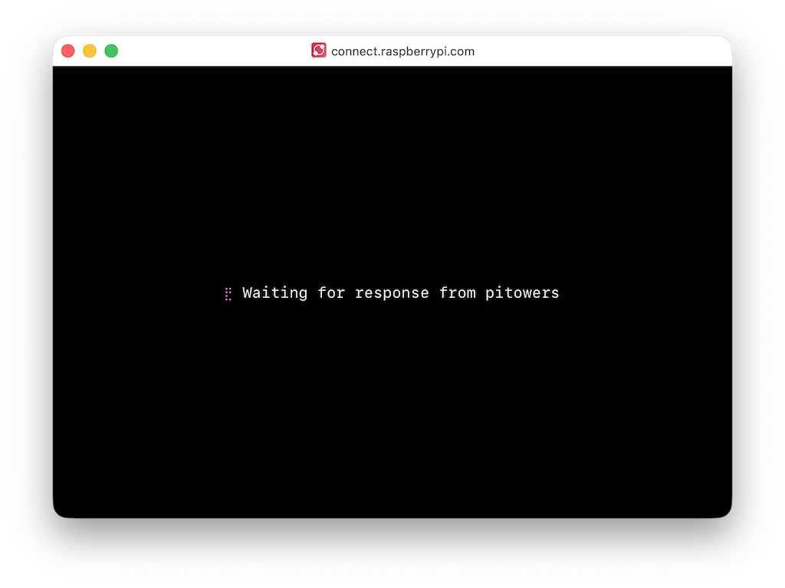

    现在你可以像使用本地设备一样使用它。

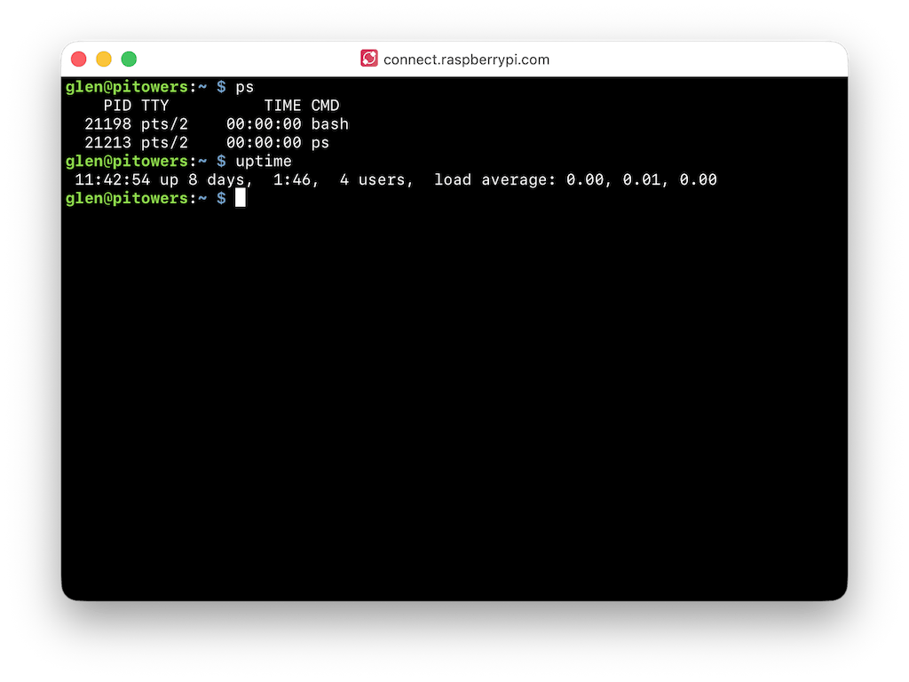

>**技巧**
>
>在某些操作系统上，浏览器会拦截 **Ctrl**+**Shift**+**C** 和 **Ctrl**+**C** 等组合键。此时你可以使用右键菜单或 **Ctrl**+**Insert** 进行复制、**Shift**+**Insert** 进行粘贴。

每当远程 shell 会话开始时，桌面上都会出现通知。连接期间，Connect 仪表板中 **Remote shell** 徽章旁会出现绿色圆点，表示有活动的远程 shell 会话。悬停即可查看当前的远程 shell 会话数。


>**技巧**
>
>每个远程 shell 连接都会创建一个全新的连接，就像 SSH 一样。要跨多个会话保留后台命令和配置，请使用 `screen` 或 `tmux`。

>**技巧**
>
>`CONNECT_TTY` 环境变量表示该会话使用由 Connect 提供的远程 shell。

#### 结束远程 shell 会话

要关闭远程 shell 会话，请在命令行运行 `exit` 命令，或关闭浏览器窗口。

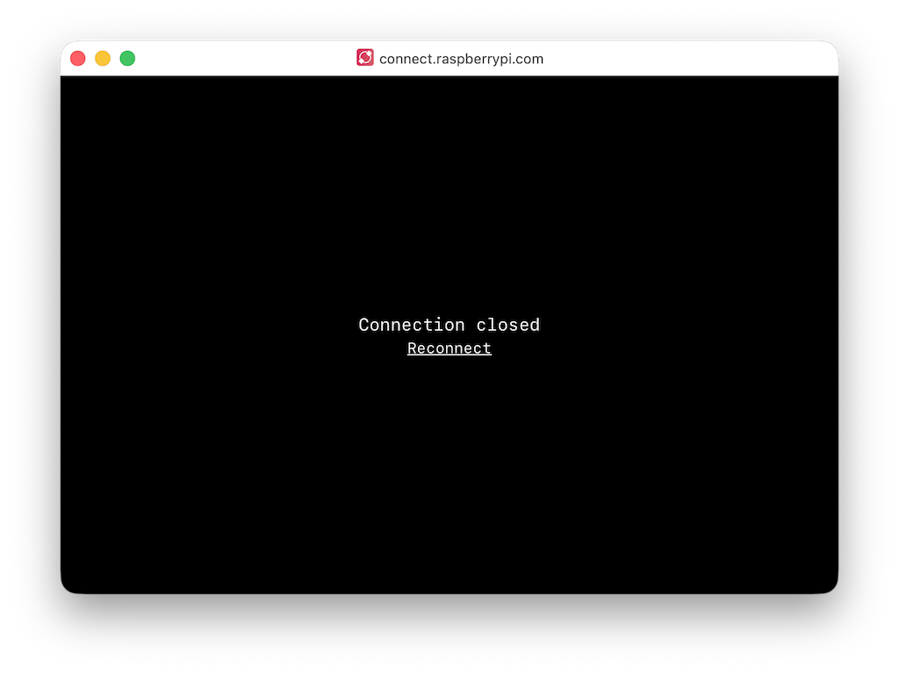

#### 禁止与重新允许远程 shell 访问

你可以通过界面或命令行禁止 shell 访问。

>**警告**
>
>如果你在 shell 或屏幕共享会话中同时禁止了 shell 访问*和*屏幕共享，则必须借助 SSH 等其他常见远程访问方案，才能在不实际接触设备的情况下访问它。

**界面**

1. 在树莓派设备上，点击系统托盘中的 Connect 图标。
2. 取消选择 **Allow Remote Shell Access**（允许远程 shell 访问）。

    你的设备保持登录 Connect，但你将无法从 Connect 仪表板创建远程 shell 会话。

    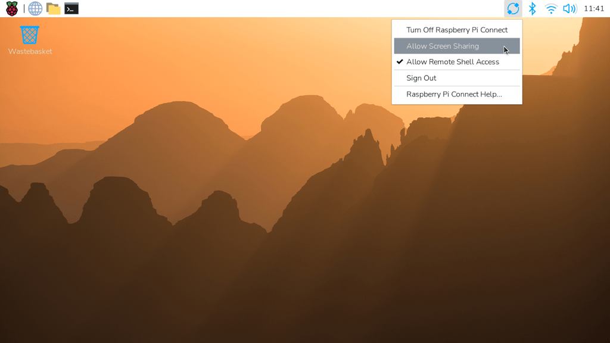

**命令行**

1. 在树莓派设备上打开终端。
2. 输入以下命令：

    ```
    $ rpi-connect shell off
    ```

    在 Connect 仪表板中，**Remote shell** 徽章和 **通过 Connect** 菜单中的 **Remote shell** 选项将显示删除线。

    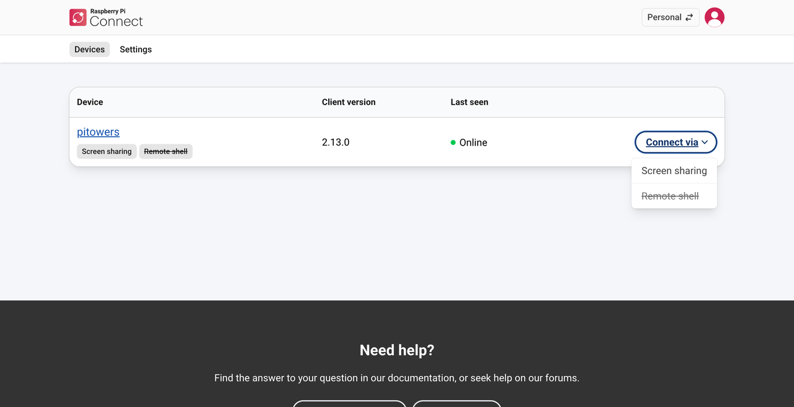

要重新允许远程 shell 访问：

**界面**

1. 在树莓派设备上，点击系统托盘中的 Connect 图标。
2. 选择 **Allow Remote Shell Access**（允许远程 shell 访问）。

**命令行**

1. 在树莓派设备上打开终端。
2. 输入以下命令：

    ```
    $ rpi-connect shell on
    ```

## 远程更新你的设备

Connect 支持通过远程推送更新的方式更新你的树莓派设备。

远程更新适合更新位于防火墙之后、物理位置偏远或难以接触的设备。

Connect 支持两种更新构件：

* [脚本构件](#脚本构件)，使用 `otamaker` 创建，在设备上以 root 身份运行 shell 脚本。它们适用于树莓派系统的标准安装，适合升级软件包等维护任务。
* [A/B 启动更新](#ab-启动更新)，使用 `rpi-image-gen` 创建，会替换整个操作系统，并在更新失败时自动回退到上一个版本。它们要求先为设备写入 A/B 启动布局。

无论构建哪种构件，都按照[部署更新构件](#部署更新构件)所述，从树莓派 Connect 网站进行部署。部署时上传构件，Connect 会将其传递给接收设备。

如果你的设备属于[树莓派 Connect 企业版](shu-mei-pai-connect-qi-ye-ban.md)账号，你还有更多选择：组织会维护一个可多次部署的构件库，你也可以自行托管构件而不是上传，这样在等待设备上线期间构件不会过期。更多信息请参见[在组织中部署远程更新](shu-mei-pai-connect-qi-ye-ban.md#部署远程更新)。

### 部署更新构件

使用 `otamaker` 或 `rpi-image-gen` 构建构件后，使用树莓派 Connect 网站将其部署到设备。

>**注意**
>
>如果接收设备属于某个组织，请按照[在组织中部署远程更新](shu-mei-pai-connect-qi-ye-ban.md#部署远程更新)所述进行部署。

部署始终从你要更新的设备开始，因此请先确保接收设备已注册到你的个人账号：

1. 登录树莓派 Connect。
2. 使用右上角的账号切换器选择 **Personal**（个人）账号。
3. 转到 **设备** 标签页，然后在接收设备旁边选择 **部署**（Deploy）。只有启用了远程更新的设备才会显示 **部署**。

这会打开 **新部署**（New deployment）表单，该表单分两步创建用于部署的新构件。

在 **第 1 步：上传构件**（Step 1: Upload an artefact）中，上传你构建的构件：

1. 为构件输入 **Name**（名称）。名称不必唯一，请使用便于日后辨认部署的名称，例如版本号。
2. 将构件拖放到 **File**（文件）区域，或选择 **browse**（浏览）来选择文件。文件必须是 Zstandard 压缩的 tar 归档（`.tar.zst` 文件），大小不超过 2 GB。
3. 等待 **Checksum**（校验和）和 **Upload**（上传）均显示 **Complete**（完成）。

    要选择其他文件，选择 **Remove**（移除）。要放弃仍在上传的文件，选择 **Cancel**（取消）。

4. 选择 **Next**（下一步）。

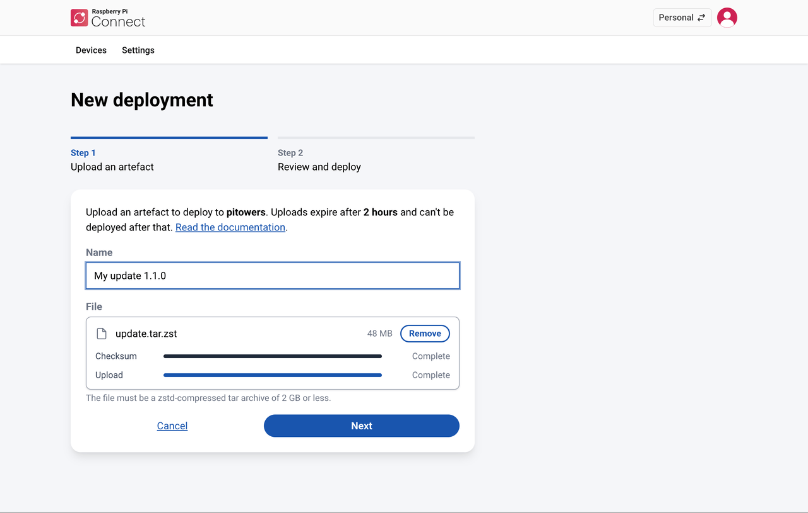

在 **第 2 步：检查并部署**（Step 2: Review and deploy）中，检查名称、文件和 SHA-256 校验和，然后选择 **Deploy**（部署）。如果发现错误，选择 **Back**（上一步）进行更正。此步骤还会显示上传文件的过期时间。


部署时接收设备不必在线，但 Connect 只把你上传的构件保留两小时，之后会将其删除。

>**重要**
>
>只有当接收设备在上传后两小时内上线并开始部署，部署才会成功。在构件被删除时尚未开始的部署会被标记为 **Invalidated**（已失效）。要再次部署该构件，请重新上传。

#### 监控部署

在树莓派 Connect 界面的 **设备** 标签页中，你可以选择一台设备，然后查看最近部署到它的部署列表。

部署状态包括：

* **Pending**（待处理）：等待接收设备接收更新。
* **In Progress**（进行中）：更新正在应用到设备。
* **Succeeded**（成功）：更新已成功应用。
* **Failed**（失败）：更新失败。更多信息请参见[远程更新失败](#远程更新失败)。
* **Cancelled**（已取消）：更新在应用之前被取消。当同一设备排队了另一个部署时，待处理的部署会自动取消。
* **Invalidated**（已失效）：无法再应用的更新。

当部署处于 **Pending** 或 **In Progress** 状态时，**设备** 页面会自动更新显示当前状态。部署进入 **Succeeded**、**Failed**、**Cancelled** 或 **Invalidated** 状态后即停止更新。

要查看部署详情：

1. 登录树莓派 Connect。
2. 使用右上角的账号切换器选择 **Personal**（个人）账号。
3. 转到 **设备** 标签页，然后选择你部署到的设备。**Deployments**（部署）部分列出了该设备最近的部署。
4. 从列表中选择一个部署，查看其状态的更多信息，或读取失败部署的错误信息。

要取消部署：

>**注意**
>
>你只能取消处于 **Pending**（待处理）状态的部署。

1. 登录树莓派 Connect。
2. 使用右上角的账号切换器选择 **Personal**（个人）账号。
3. 转到 **设备** 标签页，然后选择你部署到的设备。**Deployments**（部署）部分列出了该设备最近的部署。
4. 从部署列表中选择要取消的部署，然后选择 **Cancel**（取消）。

#### 验证部署

要验证部署：脚本构件请参见[脚本构件](#脚本构件)，A/B 启动更新请参见 [A/B 启动更新](#ab-启动更新)。

## 脚本构件

脚本构件打包了一个 shell 脚本，树莓派 Connect 会在接收设备上以 root 身份运行它。使用脚本构件执行维护任务，例如升级软件包、更改配置或安装软件。

与 [A/B 启动更新](#ab-启动更新)不同，脚本构件不需要特殊的分区布局，因此可以部署到运行树莓派系统标准安装的任何设备。但是，脚本失败时没有自动恢复机制，因此在部署到远程设备之前请仔细测试脚本。

使用 [otamaker](https://github.com/raspberrypi/utils/tree/master/otamaker) 创建脚本构件。

### 先决条件

创建和部署脚本构件需要满足以下条件：

#### 接收更新构件的接收设备

一台满足以下条件的树莓派设备：

* 已连接到互联网。
* 已注册并登录你的树莓派 Connect 账号。
* 运行最新版本的树莓派 Connect 或 Connect Lite，并安装了 `rpi-connect-ota` 软件包：

    ```
    $ sudo apt update
    $ sudo apt install rpi-connect rpi-connect-ota
    ```

    如果你使用 Connect Lite，请将 `rpi-connect` 替换为 `rpi-connect-lite`。

* 已选择加入远程更新，`rpi-connect` 通过其 `ota`（over-the-air，空中下载）子命令管理远程更新：

    ```
    $ rpi-connect ota on
    ```

#### 使用 otamaker 创建更新构件

* `otamaker` 工具，包含在 `rpi-connect-ota` 软件包中。

>**技巧**
>
>要在树莓派以外的计算机上构建构件，请从 GitHub 的 [utils 存储库](https://github.com/raspberrypi/utils)下载 `otamaker`。

### 第 1 步：创建脚本

编写你想在接收设备上运行的 shell 脚本。脚本以 root 身份运行，因此对设备的文件系统拥有完全访问权限。

使用脚本的退出代码向树莓派 Connect 报告更新结果：

* `0`：更新成功。
* `1`：更新失败。
* `2`：更新成功，且设备必须重启才能完成应用。

例如，以下脚本保存为 `aptupgradescript`，会升级接收设备上安装的所有软件包，如果任何被升级的软件包需要重启，则重启设备：

```sh
#!/bin/sh
export DEBIAN_FRONTEND=noninteractive
if ! apt update; then
    echo Package index update failed
    exit 1 # EXIT_FAILURE
fi
if apt -y -o DPKG::Options::="--force-confnew" upgrade > output.txt 2>&1; then
    if [ -r /var/run/reboot-required ]; then
        echo Rebooting to finish the upgrade
        exit 2 # EXIT_REBOOT
    fi
else
    echo Upgrade failed:
    echo
    cat output.txt
    exit 1 # EXIT_FAILURE
fi
echo Upgrade complete
exit 0 # EXIT_SUCCESS
```

脚本打印到标准输出或标准错误的所有内容都会记录在接收设备的 `systemd` 日志中，你可以在部署后查看日志以验证更新或诊断故障。示例脚本把 `apt` 的输出捕获到文件中，仅在升级失败时打印，因此成功运行只会记录 `Upgrade complete`。

### 第 2 步：创建清单

接下来，创建一个描述构件及其包含载荷的 YAML 清单。

以下清单保存为 `aptupgrade.yaml`，用于打包第 1 步中的脚本：

```yaml
# 在远程设备上运行 apt 升级
artefact:
  name: aptupgrade
  version: 1.0
  device_type: rpi

payloads:
- name: aptupgradescript
  type: script
```

`artefact` 部分为构件命名并指定版本。`payloads` 部分列出要打包的文件：每个载荷的 `name` 是你运行 `otamaker` 的目录中某个文件的名称，`type` 为 `script` 告诉接收设备执行该文件。要打包其他目录中的文件，请在载荷名称后以注释形式添加其路径，例如 `- name: aptupgradescript # scripts/aptupgradescript`。

### 第 3 步：构建构件

把清单传给 `otamaker` 来构建构件：

```
$ otamaker aptupgrade.yaml
```

这会创建一个 Zstandard 压缩的更新构件（`.tar.zst` 文件），其中包含清单和脚本，并输出构件的 SHA-256 校验和。

### 第 4 步：部署构件

脚本构件的部署方式与其他更新构件相同：选择接收设备并把 `.tar.zst` 文件上传给它，如[部署更新构件](#部署更新构件)所述。

如果接收设备属于某个组织，请先托管构件，然后使用其 URI 和校验和进行部署，如[在组织中部署远程更新](shu-mei-pai-connect-qi-ye-ban.md#部署远程更新)所述。你可以跳过计算校验和的步骤；`otamaker` 在构建构件时已经输出了它。

### 第 5 步：验证更新

当部署显示为 **Succeeded**（成功）时，使用树莓派 Connect 连接到接收设备，并在 `systemd` 日志中查看脚本的输出：

```
$ journalctl -t rpi-ota-connector
```

## A/B 启动更新

A/B 启动更新可以防止失败或有缺陷的更新导致设备无法工作。

该配置有两个独立的槽位（slot），每个槽位由一个启动分区和一个系统分区组成。槽位 A 用于现有操作系统（OS），槽位 B 用于更新。设备从槽位 B 启动，但如果失败，则回退到从已知可正常工作的分区（槽位 A）启动。每次后续更新都会重复此过程。

配置 A/B 启动需要能够物理接触设备，因为必须为设备写入相应的 A/B 启动布局。不过，配置完成后，你就可以使用树莓派 Connect 交付远程更新了。

使用 EEPROM 启动的 Raspberry Pi 5 及更新设备也可以配置为使用 A/B 启动更新。参见 [A/B bootloader updates](https://www.raspberrypi.com/documentation/computers/raspberry-pi.html#ab-bootloader-updates)。

使用 [rpi-image-gen](https://github.com/raspberrypi/rpi-image-gen) 创建 A/B 启动配置（`.img` 文件）和更新构件（`update.tar.zst` 文件）。使用[树莓派启动盘制作工具](https://www.raspberrypi.com/software/)配置 `.img` 文件并将其写入存储设备，以便传输给接收树莓派。

### 先决条件

使用远程更新和 A/B 启动配置需要满足以下条件：

#### 使用 rpi-image-gen 创建 A/B 启动配置和更新构件

一台安装了以下内容的树莓派设备：

* 最新 32 位或 64 位版本的树莓派系统（Trixie）。
* [rpi-image-gen](https://github.com/raspberrypi/rpi-image-gen)。
* 最新版本的树莓派 Connect 或 Connect Lite。
* 最新版本的[树莓派启动盘制作工具](https://www.raspberrypi.com/software/)。

#### 将接收设备配置为 A/B 启动

* 一个用于保存 A/B 启动布局的存储设备（通常为存储卡），以及把存储设备连接到树莓派的方法。

    你至少需要 16 GB 空间，但必须根据你对启动分区（固件、内核、设备树文件，可能还有 initramfs）和系统分区（内核模块和标准 Linux 命令行工具等系统级软件）的预期未来需求，自行确定具体需要多少磁盘空间。

#### 接收更新构件的接收设备

* 满足以下条件的 Raspberry Pi 4 或更新设备：

    * 已连接到互联网。
    * 已选择加入远程更新。
    * 已注册并登录你的树莓派 Connect 账号。

### 实现 A/B 启动并远程更新首个镜像

按照以下三个阶段实现 A/B 配置，并使用树莓派 Connect 发送更新：

1. 阶段 1：创建 A/B 启动文件，为接收更新的 Raspberry Pi 4 及更新设备做好远程更新准备，然后将其部署到设备。
2. 阶段 2：创建用于部署到接收设备的更新构件文件。
3. 阶段 3：使用树莓派 Connect 的远程更新功能把更新构件部署到接收设备，然后验证更新。

### 阶段 1：创建 A/B 启动配置

标准的树莓派系统安装不包含 A/B 启动配置。本阶段展示如何使用 [rpi-image-gen](https://github.com/raspberrypi/rpi-image-gen) 和[树莓派启动盘制作工具](https://www.raspberrypi.com/software/)创建一个。

rpi-image-gen 输出一个包含 A/B 启动镜像的 `.img` 文件。

然后，树莓派启动盘制作工具使用该 `.img` 文件把操作系统配置写入存储设备。这包括让设备选择加入远程更新，以便树莓派 Connect 可以更新它。

第一次更新设备时，你必须能物理接触接收设备，但配置完成后，你就可以远程发送更新了。

在第 3 步中，你会生成一个认证密钥，允许接收设备关联到树莓派 Connect 网站。该认证密钥绑定到单台接收设备，因此请为每台要更新的接收设备创建一个新密钥。

>**注意**
>
>你必须使用运行最新版本树莓派系统（Trixie）的树莓派设备来创建更新。接收设备必须是 Raspberry Pi 4 或更新设备。

要更新具有 A/B 启动配置的接收设备：

#### 第 1 步：安装 rpi-image-gen

1. 在树莓派上，从命令行运行以下命令，从 GitHub 克隆 rpi-image-gen 存储库：

    ```
    $ git clone https://github.com/raspberrypi/rpi-image-gen.git
    ```

2. 进入克隆的目录，然后运行以下命令安装依赖项：

    ```
    $ cd rpi-image-gen
    $ sudo ./install_deps.sh
    ```

#### 第 2 步：准备并配置镜像

>**技巧**
>
>rpi-image-gen 包含一个带有层和配置的示例应用，可构建与远程更新兼容的镜像。

`.yaml` 文件元数据的说明请参见 [X environment metadata](https://raspberrypi.github.io/rpi-image-gen/layer/index.html#_x_env_metadata) 和 [Layer](https://raspberrypi.github.io/rpi-image-gen/layer/index.html)。

要准备镜像：

1. 进入 rpi-image-gen 安装文件夹。
2. 打开 `examples/ota/layer/ota.yaml`。
3. 自定义以下元数据：
    - X-Env-Layer-Name。
    - X-Env-Layer-Category。
    - X-Env-Layer-Desc。
    - X-Env-Layer-Reqs。
4. 打开 `examples/ota/config/ota.yaml`。
5. 设置以下环境变量：
    - Version（版本）。用于确定启动镜像的版本。现在设置一个起始版本号，以后每创建一个更新构件就相应递增。如果不指定版本号，默认为 1.0.0。
    - Device hostname（设备主机名）。用于为此设备创建的所有镜像。必须唯一。如果不指定设备主机名，每次构建都会创建默认值 `ota-device-1`。
6. （可选）打开 `examples/ota/config/ota.yaml` 并：
    - 定义构建时要安装的额外软件包。更多信息请参见 [Packages](https://raspberrypi.github.io/rpi-image-gen/config/index.html#_packages)。
    - 添加无线网络凭据。更多信息请参见 [Wireless Networking](https://github.com/raspberrypi/rpi-image-gen/tree/master/examples/ota)。

#### 第 3 步：生成认证密钥

在此步骤中，你创建认证密钥并将其记录下来，供第 4 步使用。

在 A/B 启动更新后（第 6 步）启动接收设备时，它会用认证密钥交换一个保存在用户数据分区中的访问令牌。该密钥在以后的更新中持续有效，因此只需生成一次。

有关为组织创建认证密钥的更多信息，请参见[创建认证密钥](shu-mei-pai-connect-qi-ye-ban.md#创建认证密钥)。

要生成认证密钥：

1. 登录树莓派 Connect。
2. 在右上角的账号切换器中选择你的组织或 **Personal**（个人）账号。
3. 转到 **Provisioning**（预配）标签页（组织）或 **Settings**（设置）标签页（个人），然后在 Auth keys 部分选择 **New**（新建）（组织）或 **Create new auth key**（创建新认证密钥）（个人）。
4. 填写表单，然后选择 **Create auth key**（创建认证密钥）。
5. 记下该密钥。

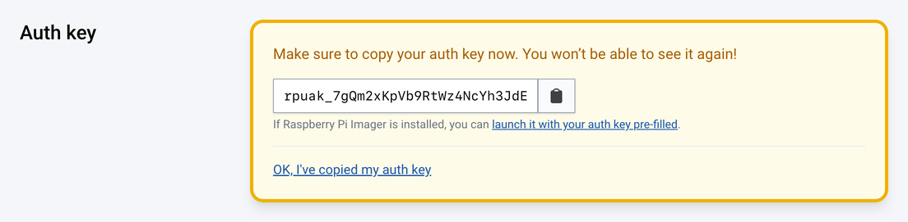

#### 第 4 步：构建 A/B 启动配置镜像

设置好应用并创建认证密钥后，使用 rpi-image-gen 创建启动配置镜像。

这会创建一个 `.img` 文件，将在第 5 步中使用树莓派启动盘制作工具写入存储设备。

要构建 A/B 启动配置镜像：

1. 从命令行切换到 rpi-image-gen 文件夹：

    ```
    $ cd rpi-image-gen
    ```

2. 运行以下命令，把 `rpuak_XXX` 替换为你在第 3 步中记下的认证密钥（组织认证密钥以 `rpoak_` 开头）。

    Raspberry Pi 5 及更新设备：

    ```
    $ ./rpi-image-gen build -S ./examples/ota/ -c ota.yaml -- IGconf_connect_authkey=rpuak_XXX
    ```

    Raspberry Pi 4：

    ```
    $ ./rpi-image-gen build -S ./examples/ota/ -c ota.yaml -- IGconf_device_layer=rpi4 IGconf_connect_authkey=rpuak_XXX
    ```

    该应用会生成文件并保存在 `/rpi-image-gen/work/image-x.x.x` 文件夹中（其中 x.x.x 对应你在第 2 步中设置的版本环境变量）。

#### 第 5 步：写入镜像

接下来，使用树莓派启动盘制作工具创建操作系统配置并将其保存到存储设备。

>**警告**
>
>在下面的示例目标（`/dev/mmcblk0`）中，只有当你从其他设备（如 NVMe SSD）启动时才使用它。小心不要覆盖操作系统。

要写入镜像：

1. 如果尚未安装树莓派启动盘制作工具，请从命令行运行以下命令：

    ```
    $ sudo apt install rpi-imager
    ```

2. 在图形界面中从 **Accessories**（附件）菜单打开 **Raspberry Pi Imager**。出现提示时输入你的密码。
3. 选择接收设备类型：**Raspberry Pi 4** 或 **Raspberry Pi 5**，然后选择 **Next**（下一步）。

    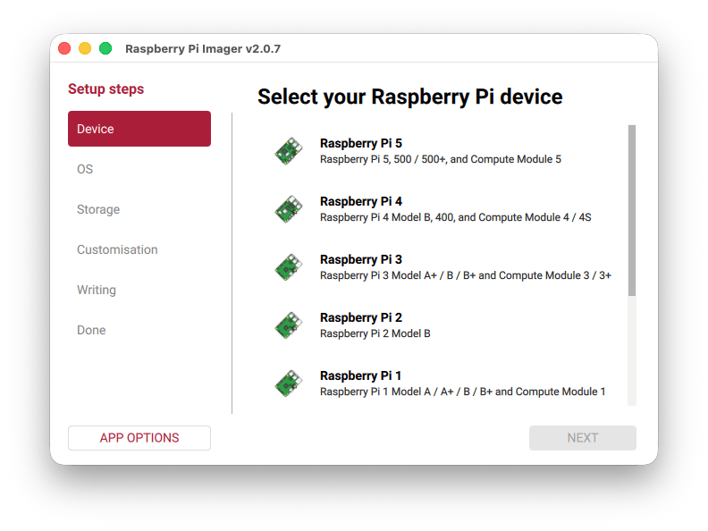

4. 在 OS 标签页中，一直滚动到底部并选择 **Use Custom**（使用自定义）。
5. 导航到你在第 4 步中创建的 `.img` 文件，选择它，然后选择 **Open**（打开）。
6. 选择 **Next**（下一步），然后选择要保存 A/B 启动配置的存储设备。
7. 选择 **Write**（写入），然后按照屏幕提示完成写入过程。
8. 树莓派启动盘制作工具完成操作系统写入后，选择 **Finish**（完成）。

现在可以安全移除存储设备，为第 6 步做准备。

#### 第 6 步：把 `.img` 文件部署到接收设备

1. 关闭接收设备的电源。
2. 连接第 5 步中的存储设备。
3. 接通接收设备的电源，然后等待它使用新镜像启动。
4. 登录树莓派 Connect，然后转到 **设备**（Devices）。

    设备会出现在树莓派 Connect 仪表板上，设备下方会显示 **Remote update**（远程更新）标签。

现在设备已准备就绪，可以使用树莓派 Connect 远程更新了。

#### 第 7 步：确认已部署的版本

确认设备上部署的镜像版本与你在第 2 步中配置的版本相同。

要确认已部署的镜像版本：

1. 在树莓派 Connect 中选择该设备。
2. 选择 **Connect**。
3. 在命令行输入：

    ```
    $ cat /etc/rpi-issue
    ```

    命令行会返回类似以下内容：

    ```
    Generated using rpi-image-gen e3828f885c860f15991468883d3b8484b0eaf9d8 on 2025-12-09
    Artefact version: 1.0.0
    ```

### 阶段 2：创建更新构件

现在设备已配置为 A/B 启动，你可以使用树莓派 Connect 向它部署更新构件了。

更新构件由 rpi-image-gen 创建为 `.tar.zst` 文件。它们比你在阶段 1 中创建的 `.img` 文件小得多，并在阶段 3 中由树莓派 Connect 部署到接收设备。

为了便于说明，这里继续使用阶段 1 的示例更新。请根据你自己的更新 .yaml 文件的路径和命名调整这些步骤。

要构建更新构件：

#### 第 1 步：更新 `ota.yaml` 配置

1. 递增配置文件 `ota.yaml` 中的 Version（版本）环境变量：

    ```
    ${EDITOR:-vi} ./examples/ota/config/ota.yaml
    ```

#### 第 2 步：构建更新

1. 在终端中运行以下命令构建更新：

    ```
    $ ./rpi-image-gen build -S ./examples/ota/ -c ota.yaml
    ```

### 阶段 3：远程更新

使用树莓派 Connect 把更新构件部署到接收树莓派设备。

#### 第 1 步：把构件部署到接收设备

从[树莓派 Connect 网站](https://connect.raspberrypi.com/)部署构件，上传你在阶段 2 中构建的 `.tar.zst` 文件，如[部署更新构件](#部署更新构件)所述。

如果接收设备属于某个组织，请先托管构件，然后使用其 URI 和校验和进行部署，如[在组织中部署远程更新](shu-mei-pai-connect-qi-ye-ban.md#部署远程更新)所述。

#### 第 2 步：验证更新

当部署显示为 **Succeeded**（成功）时，使用树莓派 Connect 连接到接收设备并确认已部署的版本，如阶段 1 的第 7 步：

```
$ cat /etc/rpi-issue
```

命令行会返回类似以下内容，表示 `Artefact version` 版本号已更改：

```
Generated using rpi-image-gen e3828f885c860f15991468883d3b8484b0eaf9d8 on 2025-12-09
Artefact version: 1.1.0
```

## 随时启用远程 shell

Connect 以用户级服务运行，而不是以 root 运行。因此，只有当你的用户账号当前登录在设备上时，Connect 才能正常工作。如果你在禁用自动登录的情况下重启，这可能导致你的设备无法访问。要让你未登录设备时 Connect 也能继续运行，请启用 **user-lingering**（用户持久化）。从你的用户账号运行以下命令以启用 user-lingering：

```
$ loginctl enable-linger
```

>**技巧**
>
>我们建议在所有无头精简版树莓派系统（Raspberry Pi OS Lite）设置上启用 user-lingering，以防止远程重启后设备变得无法访问。

## 禁用动画图标

要在屏幕共享或远程 shell 会话进行时禁用动画图标，请右键单击菜单栏中的 Connect 图标并选择 **Configure Plugin...**（配置插件）。

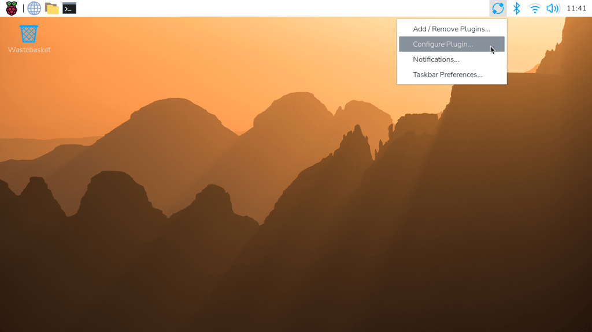

选择 **Animate Icon** 开关以切换到备用图标。

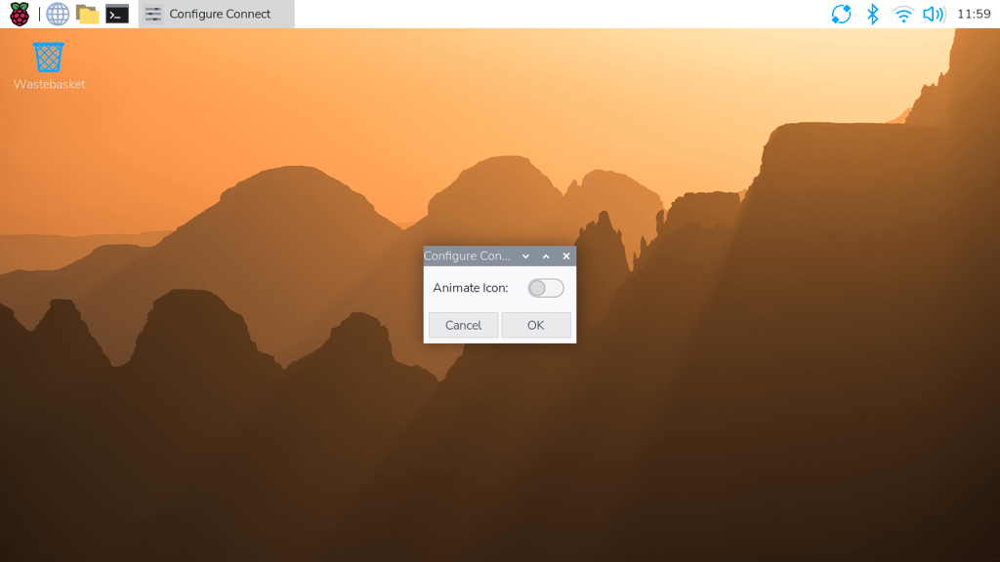

当屏幕共享或远程 shell 会话进行时，Connect 图标会变成蓝色。

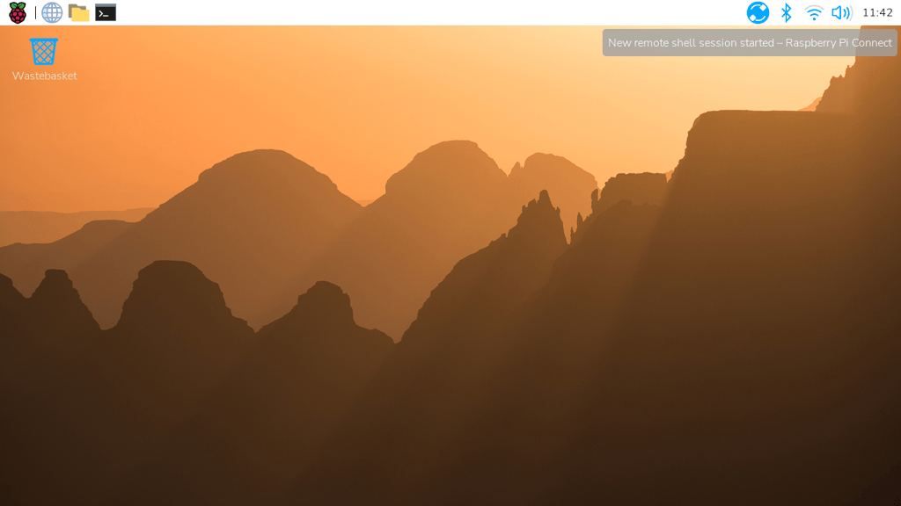

## 管理设备

Connect 仪表板列出了与你的 Connect 账号关联的所有设备，并显示访问它们的各种方式。


点击设备名称打开设备详情页面。此屏幕提供有关设备的底层信息。

要重命名或删除设备，请在设备页面选择 **Settings**（设置）。

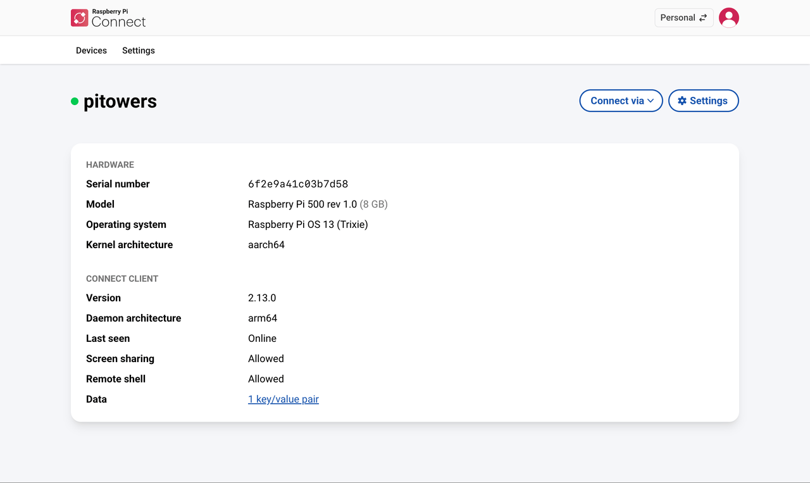

从 Connect 中删除设备会自动让你在设备上注销 Connect。菜单栏中的 Connect 图标变为灰色，菜单只提供 **登录…**（Sign In...）选项。

## 更新

>**警告**
>
>升级 Connect 会断开所有正在进行的屏幕共享或远程 shell 会话。不建议使用远程 shell 升级 Connect，除非你以断开连接后仍能继续运行的方式执行命令，例如使用 `screen` 或 `tmux`。

要更新到最新版本的 Connect，请运行以下命令：

```
$ sudo apt update
$ sudo apt install --only-upgrade rpi-connect
```

如果你安装的是 Connect Lite，请在上述命令中把 `rpi-connect` 替换为 `rpi-connect-lite`。

## 断开连接设备

在你的设备上运行以下命令，注销你的树莓派 ID，这将在 Connect 屏幕上禁用你的设备：

```
$ rpi-connect signout
```

也可以选择菜单栏中的 Connect 图标并选择 **Sign Out**（登出）。

>**技巧**
>
>要把设备从你的 Connect 账号中完全移除，请从 Connect 仪表板中[移除它](#管理设备)。

## 卸载

运行以下命令停止 Connect 并把它从设备中移除：

```
$ sudo apt remove --purge rpi-connect
```

>**技巧**
>
>如果你安装的是 Connect Lite，请在上述命令中把 `rpi-connect` 替换为 `rpi-connect-lite`。

卸载后，设备的序列号仍与你的 Connect 账号关联。设备仍显示在 Connect 仪表板中，但无法用于远程访问。如果你在同一台设备上重新安装 Connect，即使使用不同的存储卡，它也会重复使用 Connect 仪表板中现有的设备名称。

要解除设备与 Connect 账号之间的关联，请从 Connect 仪表板的设备列表中移除设备。

## 故障排除

### 已知问题

* 屏幕共享仅支持共享树莓派的单个主显示器。当树莓派连接多个 HDMI 屏幕时，Connect 有时会共享次要屏幕的内容。你可以通过右键单击桌面并在 **Desktop Preferences...**（桌面首选项）中更改任务栏位置来解决此问题。
* Connect 需要实现 [ECMAScript 2022](https://caniuse.com/?search=es2022)（ES13）的浏览器，因为它使用了旧版本浏览器中不可用的特性。
* 浏览器会截获某些按键和组合键。因此，你无法把这些按键输入到你的 Connect 窗口中。屏幕共享包含一个工具栏，可以模拟一些最常被截获的按键。
* 不支持使用 Connect 的远程 shell 升级 `rpi-connect` 和 `rpi-connect-lite`。升级过程会终止所有远程 shell 会话并断开所有连接。要在远程 shell 会话中升级 Connect，请使用 `screen` 或 `tmux` 等工具，确保你的连接关闭后进程仍能不间断地继续运行。
* 要从版本 1 升级到版本 2，必须先升级当前安装的软件包，然后在 `rpi-connect` 和 `rpi-connect-lite` 之间切换。这能确保 Connect 的服务正确迁移到版本 2 格式。如果你当前安装了 `rpi-connect`，请运行以下命令：

    ```
    $ sudo apt install --only-upgrade rpi-connect
    ```

    如果你当前安装了 `rpi-connect-lite`，请运行以下命令：

    ```
    $ sudo apt install --only-upgrade rpi-connect-lite
    ```

    升级期间你会看到类似以下的输出，表明 Connect 的服务已迁移到版本 2 格式：

    ```
    Replacing globally-enabled rpi-connect services with user-enabled ones...
    ```

### 常见问题

#### 屏幕共享不可用

如果 Connect 提示屏幕共享不可用，说明屏幕共享支持的一个或多个要求未得到满足。为帮助调试此问题，`rpi-connect` 和 `rpi-connect-lite` 提供了 `doctor` 命令。使用 `rpi-connect doctor` 找出屏幕共享的问题。

运行以下命令：

```
$ rpi-connect doctor
```

如果一切正常，你会看到类似以下的输出：

```
Screen sharing is supported by this version of rpi-connect
✓ Wayland compositor available
✓ Screen sharing services enabled and active
✓ Communication with Raspberry Pi Connect WebSocket server
✓ Communication with Raspberry Pi Connect API
✓ Authentication with Raspberry Pi Connect API
✓ Peer-to-peer connection candidate via STUN
✓ Peer-to-peer connection candidate via TURN
```

如果有问题，你会看到类似这样的输出：

```
Screen sharing is supported by this version of rpi-connect
✓ Wayland compositor available
✗ Screen sharing services enabled and active - Please run rpi-connect on to enable and start all required services
✓ Communication with Raspberry Pi Connect WebSocket server
✓ Communication with Raspberry Pi Connect API
✓ Authentication with Raspberry Pi Connect API
✓ Peer-to-peer connection candidate via STUN
✓ Peer-to-peer connection candidate via TURN

✗ Some checks failed
```

如果你反复尝试运行 Connect 所需的服务均失败，请运行以下命令更详细地检查它们的状态：

```
$ systemctl --user status rpi-connect-wayvnc.service
$ journalctl --follow --user-unit rpi-connect-wayvnc.service
```

如果服务无法启动或不存在，请确保你的环境满足以下条件：

1. 你使用的 `rpi-connect` 版本为 1.1.0 或更高。
2. 你没有使用不支持屏幕共享的 `rpi-connect-lite`。
3. 你使用 wayfire 或 labwc 等 Wayland 合成器，而不是 X。你可以通过 `raspi-config` 中的 **Advanced Options**（高级选项）控制此设置。
4. 你使用 WayVNC 支持的桌面环境，例如树莓派桌面。例如，使用 KDE 会把你的 Wayland 合成器切换为 kwin，这不受支持。
5. 有一个活动的图形桌面会话，并且其用户与你登录的用户相同。对大多数人来说，这意味着在 `raspi-config` 的 **System Options**（系统选项）中启用 **Desktop Autologin**（桌面自动登录）。

#### 重启或结束 SSH 会话后无法连接

Connect 以用户级服务运行，因此只有在已登录该服务的用户存在活动会话时才可用。如果你想在不运行另一个登录会话的情况下获得远程 shell 访问，请为你的用户[启用 user-lingering](#随时启用远程-shell)，这会让 Connect 始终保持运行。

对于屏幕共享，Connect 只能共享现有的图形桌面会话：它不会创建全新的会话。必须已经有桌面会话在进行中。要在启动时自动开始这样的会话，请在 `raspi-config` 的 **System Options**（系统选项）中启用 **Desktop Autologin**（桌面自动登录）。

#### 网络与防火墙问题

Connect 通常无需更改你的网络或防火墙即可在设备之间通信。但是，限制特别严格的网络有时会阻止 Connect 通信。为帮助调试此类网络的问题，`rpi-connect` 和 `rpi-connect-lite` 提供了 `rpi-connect doctor` 命令。`rpi-connect doctor` 会运行一系列测试，检查 Connect 通信在你的网络上是否正常。

要在你的设备上运行这些测试，请运行以下命令：

```
$ rpi-connect doctor
```

如果 Connect 能在你的网络上正常通信，你会看到类似以下的输出：

```
Screen sharing is supported by this version of rpi-connect
✓ Wayland compositor available
✓ Screen sharing services enabled and active
✓ Communication with Raspberry Pi Connect WebSocket server
✓ Communication with Raspberry Pi Connect API
✓ Authentication with Raspberry Pi Connect API
✓ Peer-to-peer connection candidate via STUN
✓ Peer-to-peer connection candidate via TURN
```

如果 Connect 无法在你的网络上正常通信，失败的测试项旁边会显示"x"而不是勾号。请让你的网络管理员在你的网络上启用以下连接：

* 在 443 端口上向 `api.connect.raspberrypi.com` 和 `ws.connect.raspberrypi.com` 的树莓派 Connect API 和 WebSocket 服务器发出的 HTTPS 请求
* 向以下所有主机的 UDP 3478 端口上的树莓派 Connect STUN 或 TURN 服务器发出的请求：
    * `stun.raspberrypi.com`
    * `turn1.raspberrypi.com`
    * `turn2.raspberrypi.com`
    * `turn3.raspberrypi.com`
* 向以下所有主机的 TCP 3478 或 443 端口上的树莓派 Connect TURN 服务器发出的请求：
    * `turn1.raspberrypi.com`
    * `turn2.raspberrypi.com`
    * `turn3.raspberrypi.com`
* 向以下所有主机的 UDP 3478、443 或 49152 → 65535 端口上的树莓派 Connect TURN 服务器发出的请求：
    * `turn1.raspberrypi.com`
    * `turn2.raspberrypi.com`
    * `turn3.raspberrypi.com`

#### 远程更新失败

如果 A/B 启动配置或远程更新过程失败，请参阅以下常见故障及修复方法列表。

你还可以参阅 [rpi-image-gen 文档](https://github.com/raspberrypi/rpi-image-gen/blob/master/docs/execution/index.adoc)，并访问[树莓派故障排除论坛](https://forums.raspberrypi.com/viewforum.php?f=28&sid=376757fde13953b7bfdcc0b1061edeca)。

>**技巧**
>
>如果看到错误，使用树莓派 Connect 的远程 shell 访问查看 `systemd` 日志以获取更多信息：

```
$ journalctl
```

| 错误 | 建议的修复方法 |
| ---- | ---- |
| `Download could not connect to server (retry).` | 接收设备必须能够找到更新文件。检查设备是否仍有互联网访问。对于组织中的设备，打开到接收设备的远程 shell 连接，然后使用 `curl` 检查设备能否访问你在创建部署时提供的 URI 中包含的 IP 地址，例如运行 `$ curl -I http://192.168.0.1:8080`。 |
| `update file rejected.` | 确保你部署的是 `.tar.zst` 更新文件，而不是 `.img` 完整镜像文件。对于组织中的设备，检查你在创建部署时提供的 URI 是否指向 `.tar.zst` 文件。 |
| 部署显示为 **Invalidated**（已失效），原因为 `File expired`。 | Connect 会把你上传的构件保留两小时，然后将其删除。接收设备在此之前未上线并开始部署。检查设备是否在线，然后重新部署该构件。 |
| 树莓派 Connect 中设备旁未显示 **部署**（Deploy）选项。 | 使用 `$ rpi-connect ota on` 命令启用 OTA 选择加入，然后刷新浏览器。 |

### 查看 Connect 状态

要查看 Connect 服务的当前状态，请运行以下命令：

```
$ rpi-connect status
```

该命令显示类似以下的输出：

```
Signed in: yes
Subscribed to events: yes
Screen sharing: allowed (0 sessions active)
Remote shell: allowed (0 sessions active)
```

此命令的输出表明你当前是否已登录 Connect，以及在树莓派上启用的远程服务。

如果你看到包含"Raspberry Pi Connect is not running, run rpi-connect on"的输出，请运行 `rpi-connect on` 启动 Connect。

### 启用增强日志记录

你可以为 `rpi-connect` 及其专用的 WayVNC 服务器启用调试日志，详细记录树莓派上的本地操作。

#### 在 `rpi-connect` 中启用增强日志记录

把环境变量 `RPI_CONNECT_VERBOSE=1` 添加到 `/etc/default/rpi-connect`，然后使用以下命令重启 Connect：

```
$ rpi-connect restart
```

对于 2.7 之前的版本，也可以使用以下命令覆盖 `rpi-connect` 服务定义：

```
$ systemctl --user edit rpi-connect
```

在注释之间输入以下配置行：

```
[Service]
ExecStart=
ExecStart=/usr/bin/rpi-connectd -socket %t/rpi-connect-wayvnc.sock -v
```

>**注意**
>
>你需要 **同时** 使用以 `ExecStart=` 开头的两行。

最后，使用以下命令重启 Connect：

```
$ rpi-connect restart
```

#### 在专用的 `wayvnc` 服务器中启用增强日志记录

使用以下命令覆盖 `rpi-connect-wayvnc` 服务定义：

```
$ systemctl --user edit rpi-connect-wayvnc
```

在注释之间输入以下配置行（包括 `-Ldebug` 标志）：

```
[Service]
ExecStart=
ExecStart=/usr/bin/rpi-connect-env /usr/bin/wayvnc --config /etc/rpi-connect/wayvnc.config --render-cursor --unix-socket --socket=%t/rpi-connect-wayvnc-ctl.sock -Ldebug %t/rpi-connect-wayvnc.sock
```

>**注意**
>
>你需要 **同时** 使用以 `ExecStart=` 开头的两行。

最后，使用以下命令重启 Connect：

```
$ rpi-connect restart
```

### 查看 Connect 日志

要查看 Connect 服务及其专用 WayVNC 服务器的日志，请运行以下命令：

```
$ journalctl --follow --user-unit rpi-connect.service --user-unit rpi-connect-wayvnc.service
```

## 安全

树莓派设备与用户浏览器之间的所有连接都使用 [WebRTC](https://webrtc.org/)：与 Zoom、Microsoft Teams 和 Google Meet 相同的实时通信技术。

### 端到端加密

所有屏幕共享和远程 shell 访问流量都使用 [DTLS](https://en.wikipedia.org/wiki/Datagram_Transport_Layer_Security) 在树莓派设备和用户浏览器之间加密。我们不会（也无法）解密这些流量，确保你的数据保持私密。

每个屏幕共享和远程 shell 会话都使用一个新的 WebRTC 对等连接。对于每个连接，树莓派设备上的 Connect 客户端会在内存中生成一对全新的公钥和私钥，你的浏览器也会生成自己的密钥对。设备绝不会把私钥写入磁盘或发送到任何地方，并在会话结束时将其丢弃。设备和浏览器交换公钥，并在两者之间直接握手派生出加密会话的密钥，因此我们的服务器无法派生这些密钥。经由我们 API 传递的唯一与密钥相关的信息是每个公开证书的指纹，它不允许解密。

会话中的所有内容都经由这条单一加密通道传输：屏幕帧、键盘和鼠标输入、剪贴板数据、远程 shell 的输入和输出，以及你在会话期间输入的任何凭据。这些都不会经过我们的 API。API 只交换建立连接所需的信息，并接收设备状态，例如设备是否在线、屏幕共享是否启用以及活动会话数。连接信息、屏幕共享状态和会话数在我们的数据库中静态加密存储。

此外，流量大部分是对等（peer-to-peer）的，这意味着加密流量不会经过我们的基础设施。相反，加密流量直接在你的树莓派设备和你的浏览器之间发送。这使我们无法观察到它。

### 中继服务器

在无法建立直接对等连接的情况下（例如由于网络问题），只有加密数据会经由我们的某台 [TURN](https://en.wikipedia.org/wiki/Traversal_Using_Relays_around_NAT) 服务器中继。这些服务器位于伦敦和加州。只有你的设备和你的浏览器持有解密这些数据的密钥，数据既不会被记录也不会被存储。

Connect 根据设备和浏览器各自 IP 地址所在的大洲，分别为你的设备和你的浏览器选择中继。欧洲和非洲的设备和浏览器使用伦敦的中继；美洲、亚洲和大洋洲的设备和浏览器使用加州的中继。如果无法确定位置，则使用伦敦。如果你的设备和浏览器被分配了不同的中继，会话可以经由其中之一或两者中继。

Connect 没有限制使用哪些中继或禁用中继的设置。如果你要求只能进行直接对等连接，可以阻止发往[网络与防火墙问题](#网络与防火墙问题)中列出的 TURN 服务器的流量。这样 Connect 就只能在能直接互相访问的设备和浏览器之间工作。

### 连接建立

树莓派 Connect API 会临时存储协商连接所需的 WebRTC offer 和 answer，包括你的设备和浏览器的 IP 地址和端口。前往该 API 的所有流量都使用 [HTTP over TLS](https://en.wikipedia.org/wiki/HTTPS)（HTTPS）加密，出于安全考虑仅支持 TLS 1.2 及更新版本。这确保连接信息绝不会以明文发送。此元数据会被加密并安全存储，最多保留一分钟。

来自你浏览器的 offer 会被加密存储，绝不会被解析或重写。只有代表已登录用户的 Connect Web 应用才能创建 offer；设备不能。

会话只能由满足以下条件的用户启动：使用拥有该设备的树莓派 ID（或属于拥有该设备的组织）登录，并且在过去一小时内通过树莓派 ID 完成过身份验证。

### 数据保留

Connect 只保留运营该服务所需的元数据。

| 数据 | 保留期限 |
| ---- | ---- |
| IP 地址 | 不存储。IP 地址在内存中用于选择最近的中继和速率限制，并在新设备关联时发送的通知邮件中出现一次。审计日志事件只存储从 IP 地址推导出的两位国家代码。 |
| 连接建立信息（WebRTC offer 和 answer） | 最多一分钟，静态加密 |
| 设备心跳和状态 | 仅当前状态；不保留历史 |
| 设备数据（序列号、型号、操作系统名称和版本、架构、Connect 版本、主机名和最后在线时间） | 在设备关联到账号期间保留；随设备或账号一起删除 |
| 账号数据（姓名和电子邮件地址） | 静态加密并在账号存续期间保留；随账号一起删除 |
| 组织审计日志，包括每次屏幕共享和远程 shell 会话的开始及其时间戳、用户、设备和国家代码 | 90 天 |

对于[**树莓派 Connect 企业版**](shu-mei-pai-connect-qi-ye-ban.md)客户，我们提供[审计日志](shu-mei-pai-connect-qi-ye-ban.md#查看审计日志)来审查过去 90 天的活动。个人账号没有连接日志。

### 安全评估

2025 年 1 月，[Cure53](https://cure53.de/) 的渗透测试和安全分析人员评估了树莓派 Connect Web 应用和基础设施、树莓派 ID，以及 2.2 至 2.3 版本的 Connect 客户端软件。你可以在 Cure53 网站阅读[完整报告](https://cure53.de/pentest-report_raspberry-web.pdf)。

有关 WebRTC 安全的更多详情，请参见 [A Study of WebRTC Security](https://webrtc-security.github.io/)。

### 安全通知

要通过电子邮件获知树莓派产品（包括 Connect）的重大安全漏洞，请在我们安全页面使用 [Be notified of security vulnerabilities](https://www.raspberrypi.com/security/#subscribe)（接收安全漏洞通知）表单订阅。

要报告漏洞，请参见 [Reporting a vulnerability](https://www.raspberrypi.com/security/#reporting-a-vulnerability)（报告漏洞）。

### 子处理者

树莓派有限公司（Raspberry Pi Ltd）使用以下第三方处理个人数据以提供 Connect。它们都无法访问屏幕共享或远程 shell 会话的内容，这些内容在你的树莓派设备和你的浏览器之间是[端到端加密](#端到端加密)的。

| 子处理者 | 用途 | 个人数据 | 位置 |
| ---- | ---- | ---- | ---- |
| [Mythic Beasts Ltd](https://www.mythic-beasts.com/) | 托管 Connect 服务，包括其数据库、电子邮件发送和 TURN 中继服务器 | Connect 持有的所有账号和设备数据、IP 地址，以及使用中继时的加密会话流量 | 英国。加州的 TURN 中继位于美国，但它只转发加密的会话流量，不存储任何内容。 |
| [Cloudflare, Inc.](https://www.cloudflare.com/) | 为 Connect 网站缓存和交付静态资源（图片、样式表和脚本） | 请求静态资源的 IP 地址和浏览器详情 | 全球边缘网络 |
| [Google LLC](https://cloud.google.com/) | 分析仓库（Google Cloud）和产品分析（Google Analytics） | 账号和设备记录（姓名和电子邮件地址保持加密），以及包含设备和会话标识符的假名化使用事件 | 欧盟（仓库）和美国（分析） |
| [Functional Software, Inc.（Sentry）](https://sentry.io/) | 错误监控 | 技术错误报告，可能包含设备和组织标识符 | 美国 |
| [MaxMind, Inc.](https://www.maxmind.com/) | 新设备登录时通知邮件中所示 IP 地址的地理位置查询 | IP 地址 | 美国 |
| [Stripe](https://stripe.com/) | 处理 Connect for Organisations 订阅的付款 | 账单联系详情和支付信息 | 美国和爱尔兰 |
| [Freshworks, Inc.（Freshdesk）](https://www.freshworks.com/) | 客户支持 | 姓名、电子邮件地址和支持请求的内容 | 美国 |

此列表最后更新于 2026 年 9 月 15 日。
