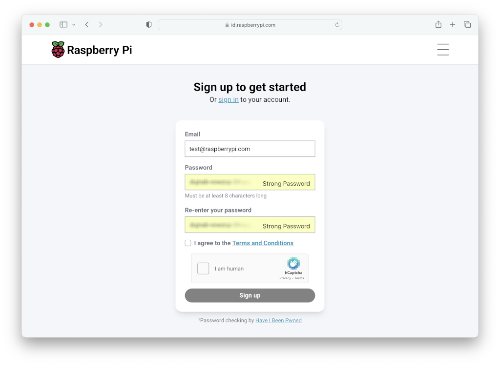
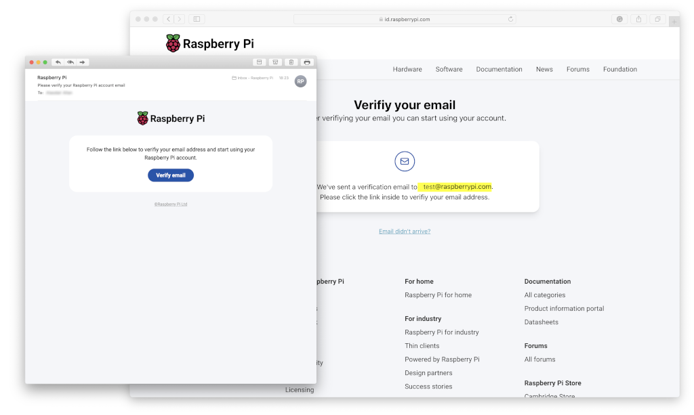
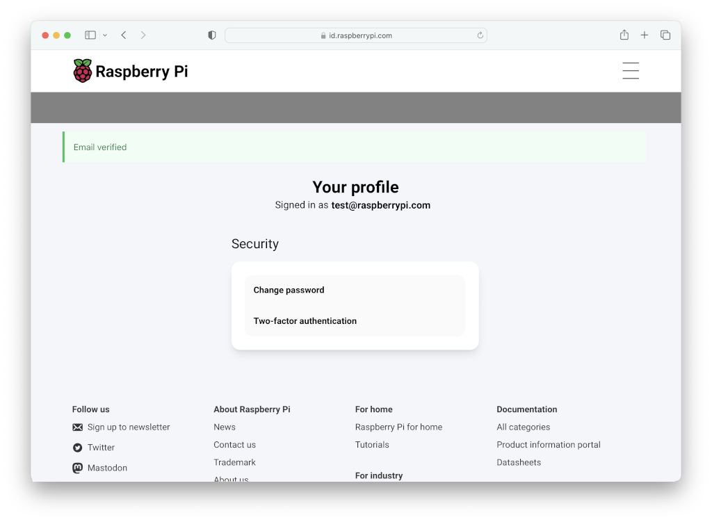
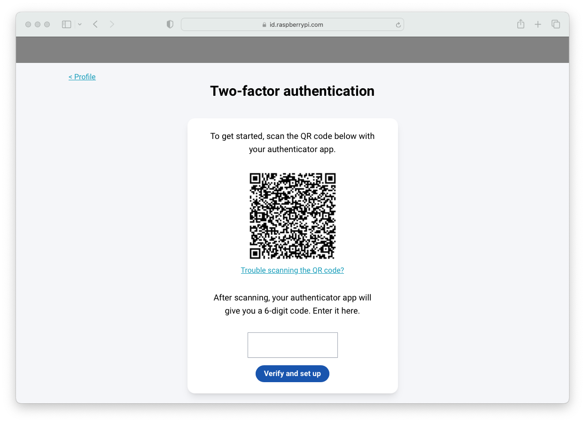
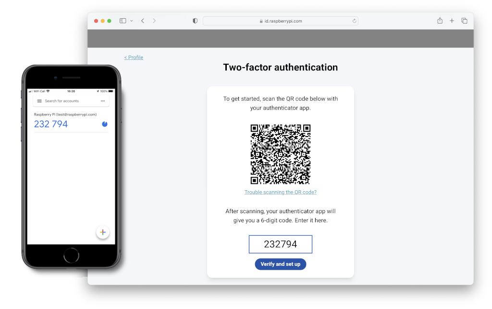
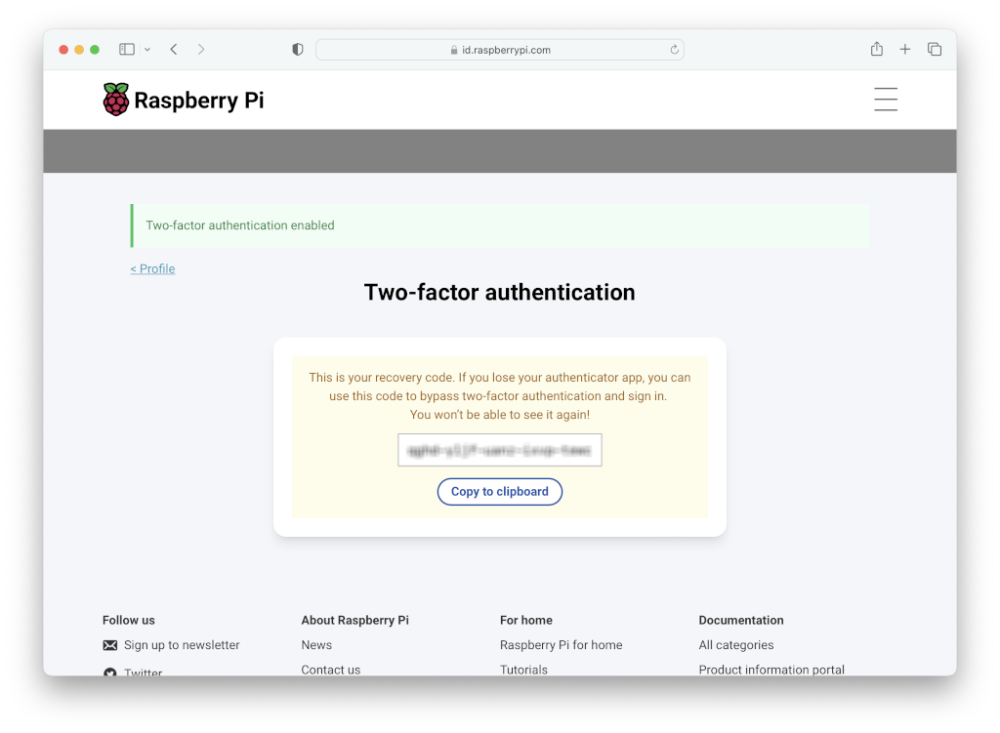

# 树莓派账号（Raspberry Pi ID）

## 创建树莓派账号

要使用树莓派服务，你首先需要创建一个[树莓派 ID](https://id.raspberrypi.com/)。

在浏览器中访问 [id.raspberrypi.com](https://id.raspberrypi.com/)。

输入电子邮件和密码。点击 **注册** 按钮来创建你的账户。

创建账户后，你会收到一封验证电子邮件。

在邮件中点击 **验证电子邮件** 按钮，来验证你的电子邮件地址以完成账户创建。

创建树莓派账号后，你就可以使用 **使用树莓派账号登录** 按钮登录树莓派服务。

## 启用双因素身份验证

与大多数现代网络服务类似，树莓派账号支持使用基于时间的一次性密码（TOTP）的双因素身份验证（2FA）。

双因素身份验证增加了额外的一层保护。除密码外，2FA 还需要另一项信息才能登录。第二因素应基于 *你拥有的东西*（如智能手机）或 *你固有的东西*（如生物特征信息）。

本指南使用你的智能手机作为认证的第二因素。

>**技巧**
>
>树莓派账号支持 macOS 和 iOS iCloud 钥匙串集成。在你的 Mac 或 iPhone 上右键单击 QR 码，选择“设置验证代码”选项。

### 安装双因素身份验证应用

首先，在你的手机上下载一个生成 TOTP 的应用程序。安装一款 2FA 应用程序，如 [Authy](https://authy.com/) 或 Google Authenticator。

### 启用 2FA

要启用双因素身份验证，请在登录到你的 [树莓派 ID](https://id.raspberrypi.com/) 后点击 **双因素身份验证** 选项。

在你的手机上打开 2FA 应用程序，用该应用程序扫描你的树莓派账号提供的 QR 码，开始生成令牌。

>**注意**
>
>请查看你的 2FA 应用程序的文档，了解如何扫描 QR 码生成令牌。

输入你的 2FA 软件生成的六位数字 TOTP，以注册 2FA 应用程序与你的树莓派 ID。

将出现确认屏幕，其中包含恢复代码。请将恢复代码存储到安全的地方。**这是在你丢失手机及 2FA 软件后，唯一能绕过 2FA 的方法**。

现在，你的树莓派账号会要求使用双因素身份验证。从今往后，登录时都需要输入手机上 2FA 应用程序生成的 TOTP。

>**注意**
>
>你可以随时在 [id.raspberrypi.com](https://id.raspberrypi.com/) 上禁用双因素身份验证。
