# 目录

|||||
|:---:|:---:|:---:|:---:|
|[词汇表](qian-yan/ci-hui-biao.md)|[编辑日志](CHANGELOG.md)|[关于我们](qian-yan/guan-yu-wo-men.md)|[版权说明](qian-yan/ban-quan-shuo-ming.md)|

## 树莓派

| | | |
|:---:|:---:|:---:|
| <a href="shu-mei-pai/ru-men.md">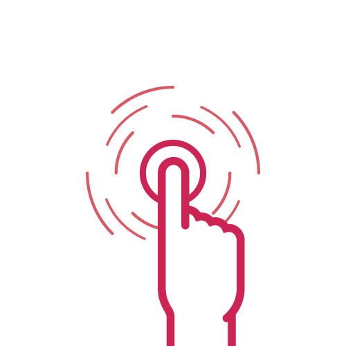</a>  **入门**    树莓派使用入门 | <a href="shu-mei-pai/raspberry-pi-os.md">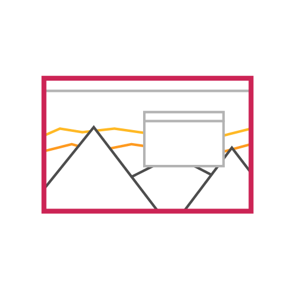</a> **树莓派系统（Raspberry Pi OS）**    树莓派官方操作系统 |   **系统配置**    配置你的树莓派之参数 |
| <a href="shu-mei-pai/config.txt.md">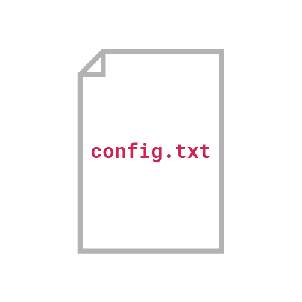</a>  **`config.txt`**    调整底层参数 | <a href="shu-mei-pai/linux-nei-he.md">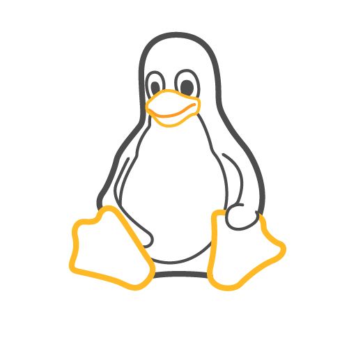</a>  **Linux 内核**    如何为树莓派定制配置及构建内核 | <a href="shu-mei-pai/yuan-cheng-fang-wen.md">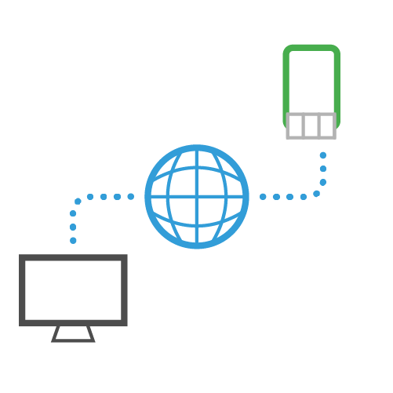</a>  **远程访问**    远程访问你的树莓派 |
| <a href="shu-mei-pai/she-xiang-tou-ruan-jian.md">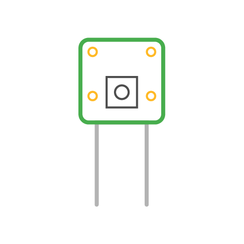</a>  **摄像头软件**    树莓派硬件摄像头的软件和库 |   **人工智能软件**    树莓派 AI Kit 与 AI HAT 的人工智能软件和库 | <a href="shu-mei-pai/shu-mei-pai-ying-jian.md">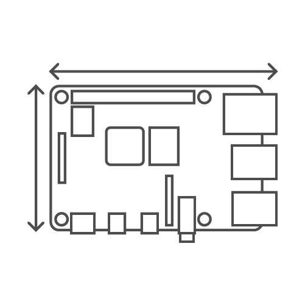</a>  **树莓派硬件**    树莓派硬件技术信息 |
| <a href="shu-mei-pai/jing-dian-dan-ban-ji-suan-ji.md">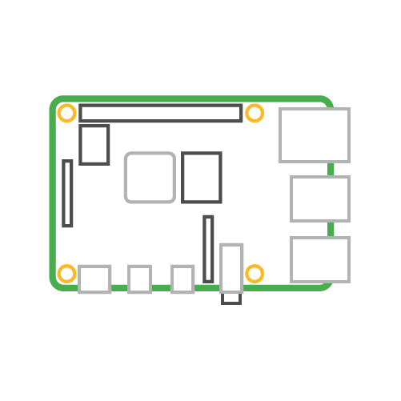</a>  **经典型单板计算机**    经典树莓派型号技术信息 | <a href="shu-mei-pai/ling-dian-xing-hao.md">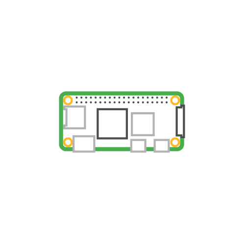</a>  **Zero 型号**    树莓派 Zero 型号技术信息 | <a href="shu-mei-pai/jian-pan-ji-suan-ji.md">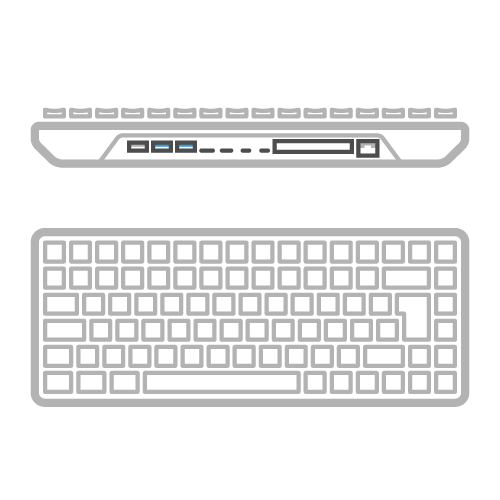</a>  **键盘计算机**    树莓派键盘计算机技术信息 |
| <a href="shu-mei-pai/ji-suan-mo-kuai-ying-jian.md">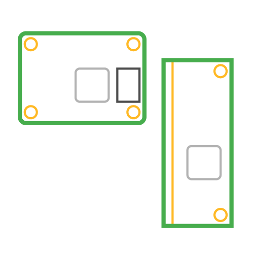</a>  **计算模块硬件**    树莓派计算模块硬件技术信息 | <a href="shu-mei-pai/chu-li-qi.md">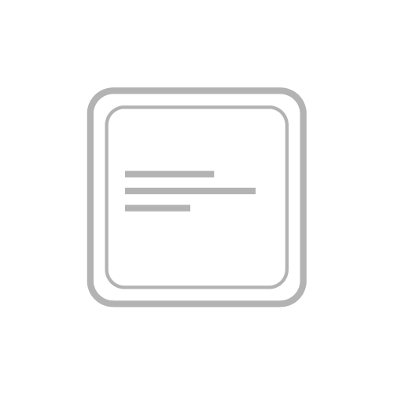</a>  **处理器**    树莓派处理器技术信息 | <a href="shu-mei-pai/io-kong-zhi-qi.md">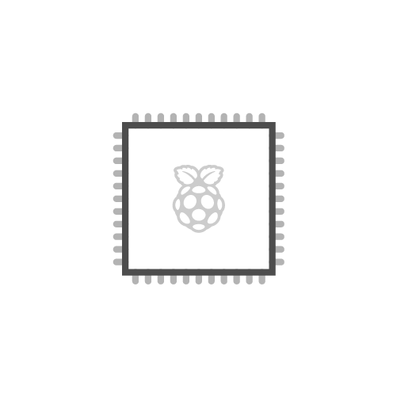</a>  **I/O 控制器**    树莓派 I/O 控制器技术信息 |
|   **软件来源**    树莓派的开源软件 | <a href="shu-mei-pai/jiu-ban-config.txt-can-shu.md">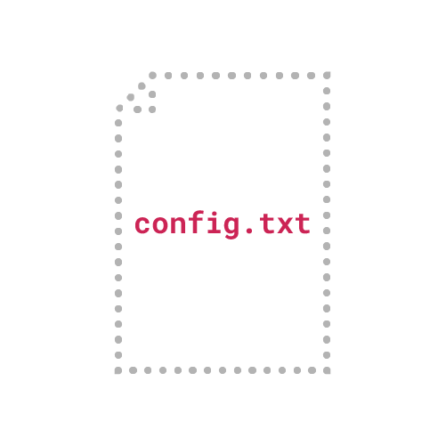</a>  **旧版 `config.txt` 参数**    对非树莓派操作系统可能有用的参数 |   |

## 配件

| | | |
|:---:|:---:|:---:|
|   **SD 卡**    树莓派官方 SD 卡| <a href="pei-jian/ssd.md">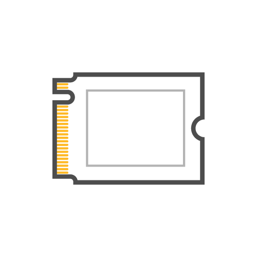</a>  **SSD**    树莓派官方固态硬盘| <a href="pei-jian/ssd-tao-jian.md">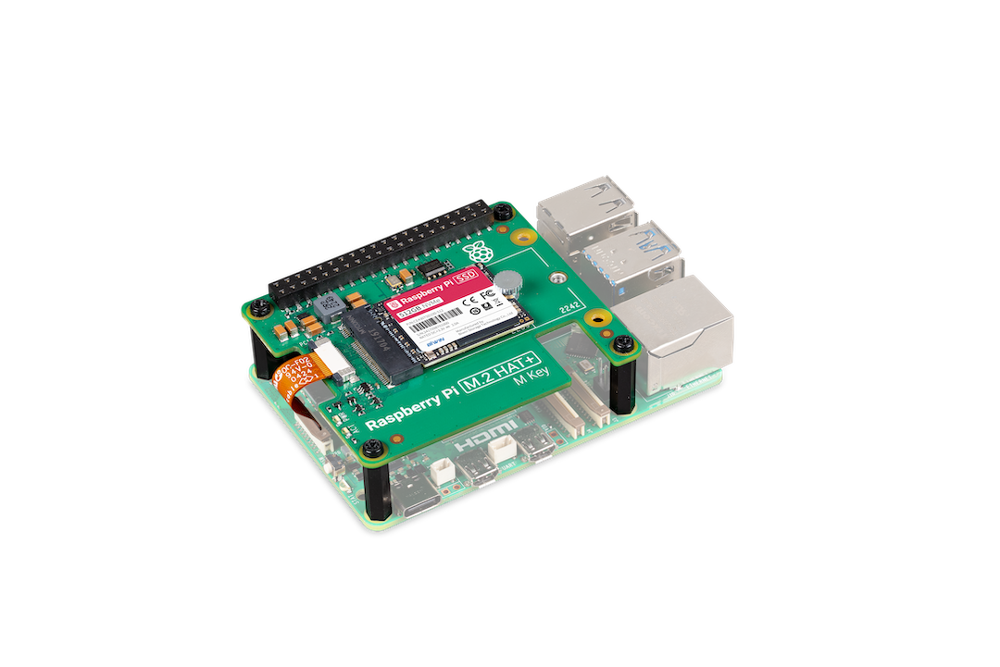</a>  **SSD 套件**    为你的树莓派提供存储|
| <a href="pei-jian/m.2-hat+.md">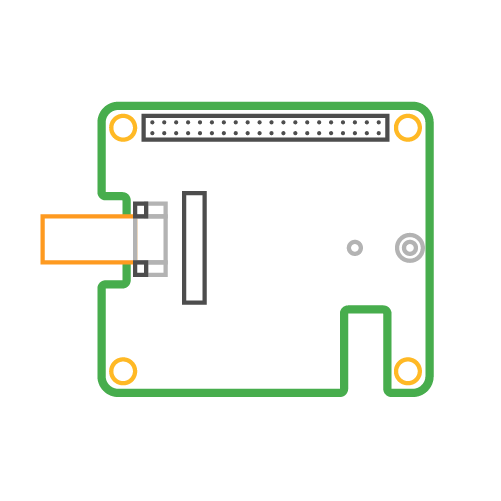</a>  **M.2 HAT+**    通过 PCIe 将存储器接入树莓派|   **显示屏**    树莓派显示屏| <a href="pei-jian/chu-mo-xian-shi-ping-2.md">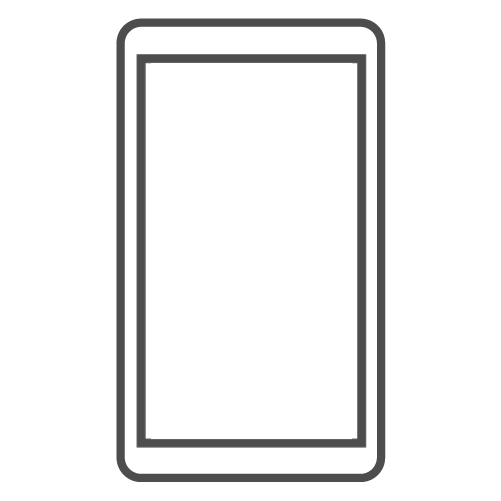</a>  **触摸显示屏 2**    树莓派触摸显示屏 2|
| <a href="pei-jian/raspberry-pi-monitor.md">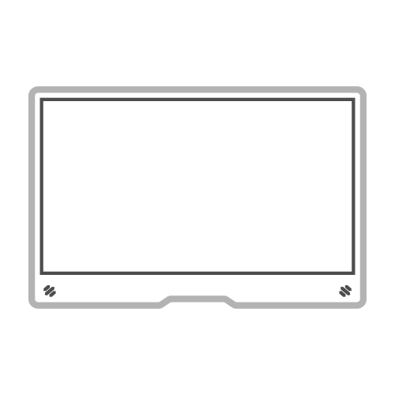</a>  **显示器**    树莓派显示器|   **摄像头**    树莓派摄像头主板| <a href="pei-jian/ai-she-xiang-tou.md">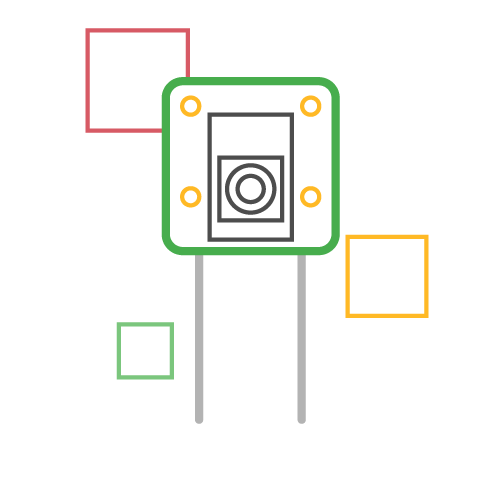</a>  **AI 摄像头**    为你的树莓派提供 AI 摄像头|
| <a href="pei-jian/jian-pan-he-shu-biao.md">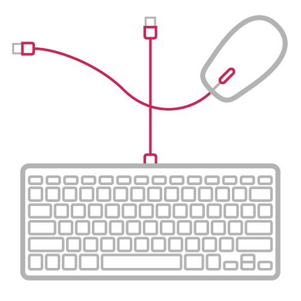</a>  **键盘和鼠标**    树莓派官方键盘和鼠标| <a href="pei-jian/usb-pei-jian.md">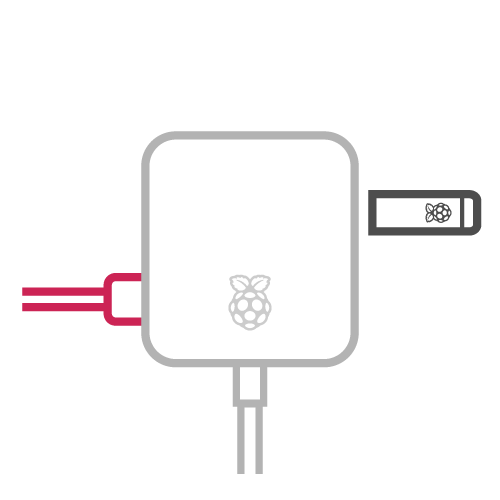</a>  **USB 配件**    官方 Raspberry Pi USB 3 Hub 与 Raspberry Pi Flash Drive| <a href="pei-jian/build-hat.md">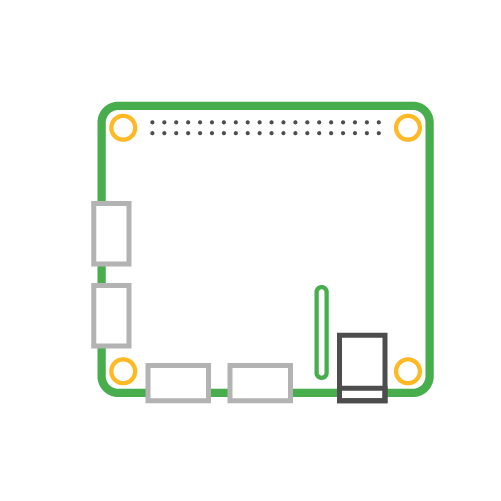</a>  **Build 扩展板（Build HAT）**    如何使用 Build 扩展板（Build HAT）|
| <a href="pei-jian/chuan-gan-qi-kuo-zhan-ban-sense-hat.md">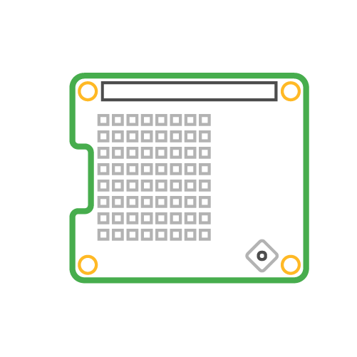</a>  **传感器扩展板（Sense HAT）**    监控并可视化传感器数据| <a href="pei-jian/ren-gong-zhi-neng-tao-jian-ai-kit.md">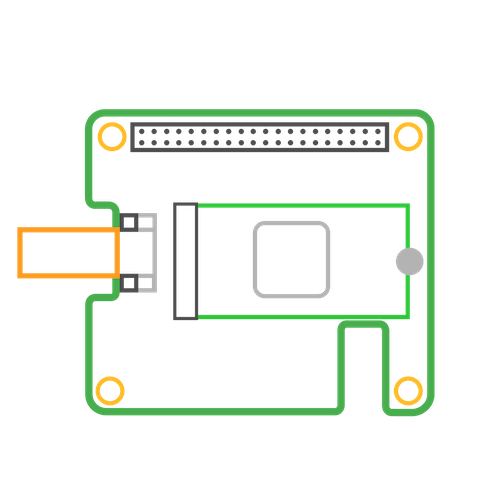</a>  **人工智能套件（AI Kit）**    树莓派 NPU| <a href="pei-jian/ai-hat.md">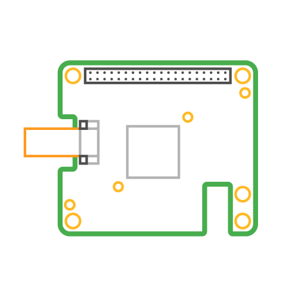</a>  **AI HAT+（AI HATs）**    为你的树莓派提供 NPU AI 扩展板|
| <a href="pei-jian/shu-mei-pai-yin-pin-kuo-zhan-ban-raspberry-pi-audio-board.md">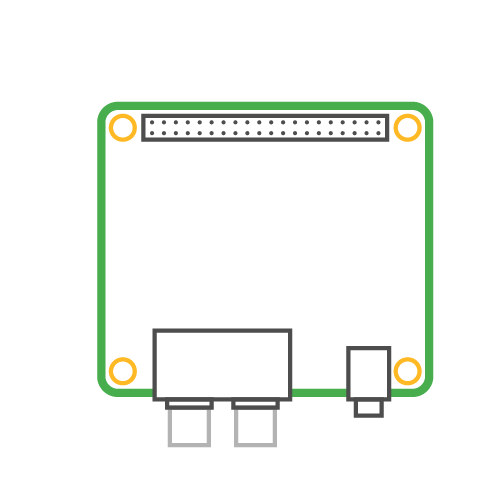</a>  **树莓派音频扩展板（Raspberry Pi Audio Board）**    用树莓派实现高清晰音频| <a href="pei-jian/dian-shi-kuo-zhan-ban-tv-hat.md">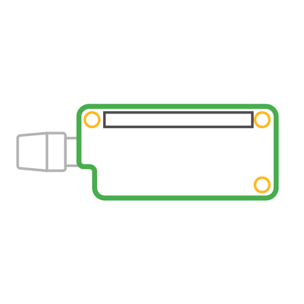</a>  **电视扩展板（TV HAT）**    用树莓派看电视| <a href="pei-jian/cm5-bian-cheng-zhi-ju.md">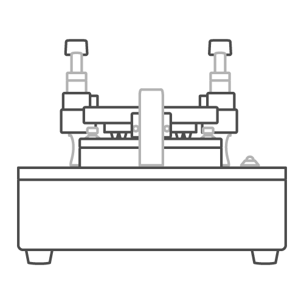</a>  **CM5 编程治具**    用于编程计算模块 5 设备的单头配置系统|
| <a href="pei-jian/zhi-neng-xian-shi-mo-kuai.md">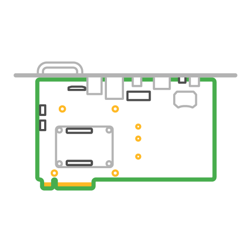</a>  **智能显示模块**    将计算模块 5 集成到兼容的数字标牌中|   **Bumper 保护壳**    为树莓派 5 提供保护的外壳| |

## 微控制器

| | | |
|:---:|:---:|:---:|
|  <a href="wei-kong-zhi-qi/wu-xian-dian-mo-kuai.md">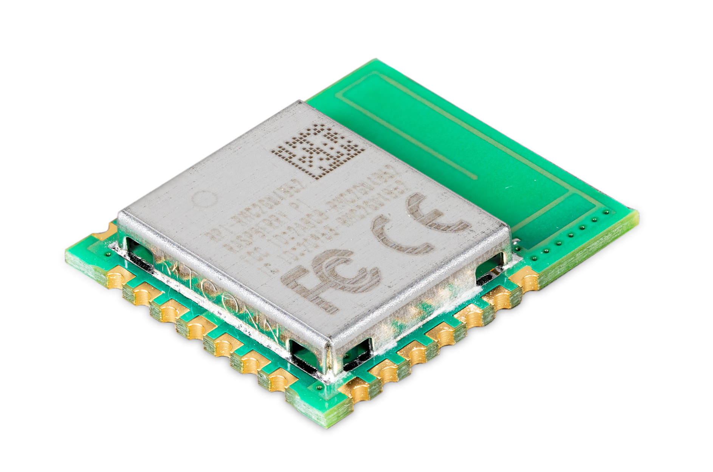</a>  **无线电模块**    树莓派自研无线电模块|<a href="wei-kong-zhi-qi/rp2040.md">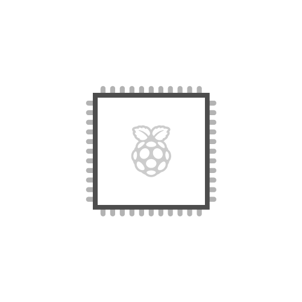</a>  **微控制器芯片**    树莓派自研微控制器芯片| <a href="wei-kong-zhi-qi/shu-mei-pai-pico-he-pico-w.md">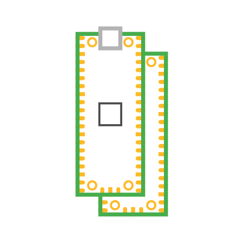</a> **Pico 系列微控制器**    树莓派 Pico 系列设备技术信息|
| <a href="wei-kong-zhi-qi/shu-mei-pai-tiao-shi-tao-jian-raspberry-pi-debug-probe.md">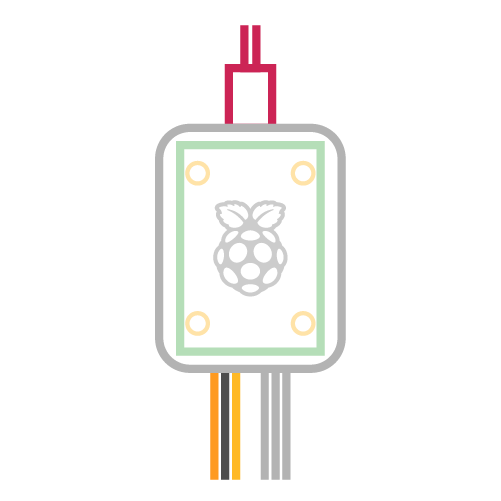</a>  **树莓派调试套件（Raspberry Pi Debug Probe）**    支持 Arm 串行线调试 (SWD)，并充当串口桥接器| <a href="wei-kong-zhi-qi/micropython.md">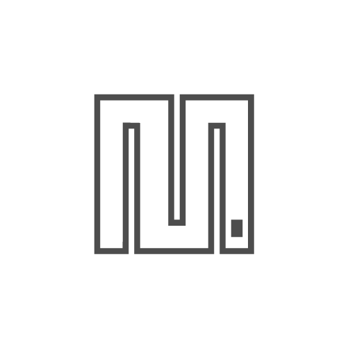</a>  **MicroPython**    MicroPython 入门|   **C/C++ SDK**    C/C++ SDK 入门|

## 服务

| | | |
|:---:|:---:|:---:|
|   **树莓派账号（Raspberry Pi ID）**    我们的身份验证服务| <a href="fu-wu/shu-mei-pai-yuan-cheng-fang-wen-raspberry-pi-connect.md">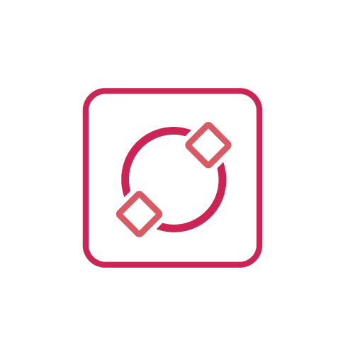</a>  **树莓派 Connect**    用浏览器连接树莓派|   **树莓派 Connect 企业版**    在团队中管理和共享你的树莓派设备|
|   **书架（Bookshelf）**    阅读树莓派出版社的出版物| | |

## 安全

| | | |
|:---:|:---:|:---:|
|   **安全概述**    树莓派硬件与软件生态中的安全选项概览|   **安全架构**    树莓派硬件与软件生态中的安全架构| <a href="an-quan/an-quan-qi-dong-pei-zhi-qi.md">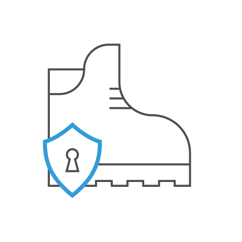</a>  **安全启动配置器**    用于验证启动与磁盘加密的树莓派安全启动配置器|
|   **运营安全**    树莓派的运营安全选项| <a href="an-quan/ufw-fang-huo-qiang.md">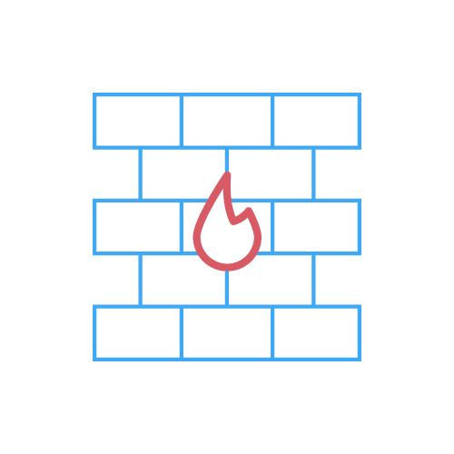</a>  **使用 UFW 的防火墙**    使用 UFW 保护你的树莓派| |

