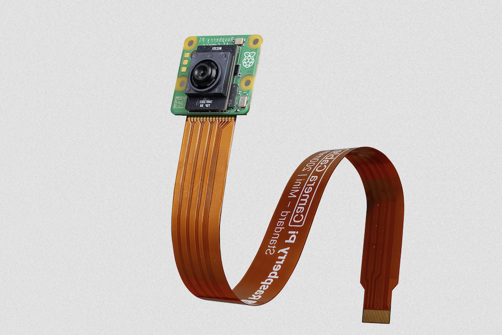
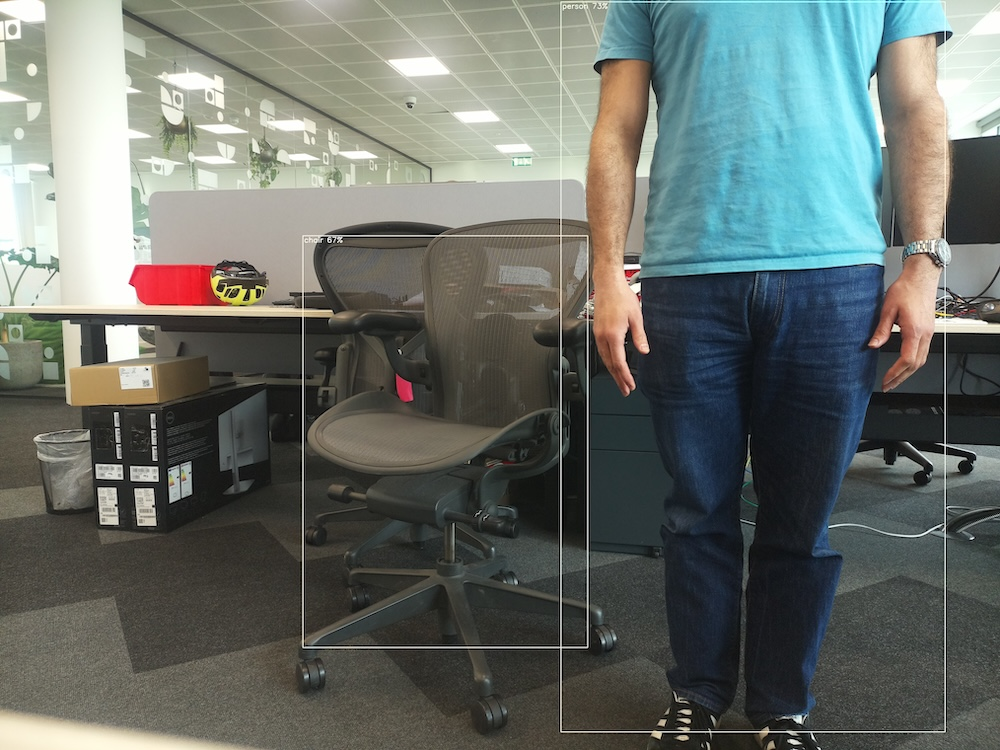
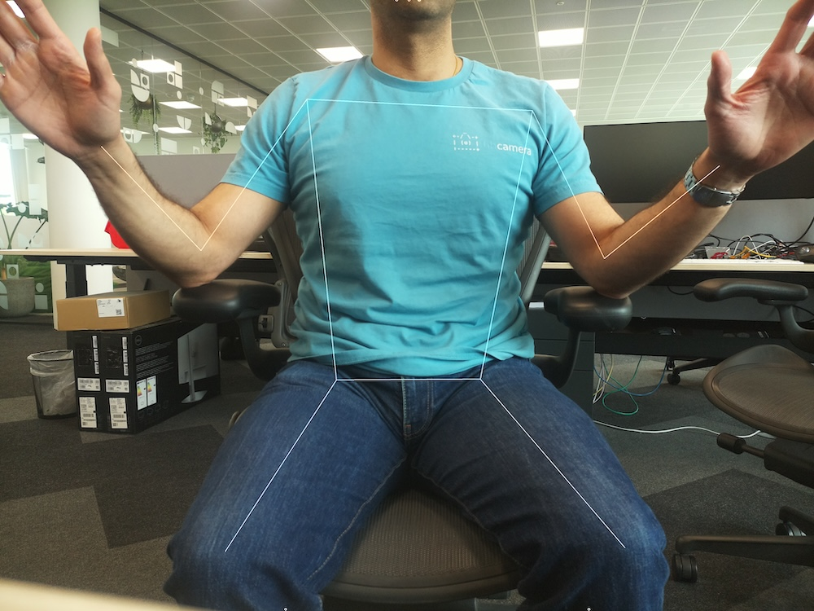

# AI 摄像头

## 关于

树莓派 AI 摄像头采用索尼 IMX500 图像传感器，可为任何摄像头应用提供低延迟、高性能的 AI 能力。它与[树莓派摄像头软件栈](https://www.raspberrypi.com/documentation/computers/camera_software.html)紧密集成，用户只需极少的投入即可部署自己的神经网络模型。



本节演示如何在摄像头上运行预打包的或自定义的神经网络模型。此外，本节还介绍了在 [`rpicam-apps`](https://github.com/raspberrypi/rpicam-apps) 和 [Picamera2](https://github.com/raspberrypi/picamera2) 中解析由 IMX500 上运行的神经网络生成的推理数据所需的步骤。

## 入门指南

以下说明介绍如何在树莓派 AI 摄像头上运行预打包的 MobileNet SSD 和 PoseNet 神经网络模型。

### 硬件设置

按照[安装树莓派摄像头](she-xiang-tou.md#安装树莓派摄像头)中的说明，将摄像头连接到你的树莓派 5 主板。

### 准备工作

这些说明假定你将 AI 摄像头连接到树莓派 4B 或树莓派 5 主板。稍作调整后，你也可以在带有摄像头接口的其他树莓派型号上遵循这些说明，包括树莓派 Zero 2 W 和树莓派 3B+。

首先，确保你的树莓派运行的是最新软件。运行以下命令进行更新：

```bash
$ sudo apt update && sudo apt full-upgrade
```

### 安装 IMX500 固件

AI 摄像头必须在启动期间将运行时固件下载到 IMX500 传感器。要在你的树莓派上安装这些固件文件，请运行以下命令：

```bash
$ sudo apt install imx500-all
```

此命令会：

* 安装运行 IMX500 传感器所需的 `/lib/firmware/imx500_loader.fpk` 和 `/lib/firmware/imx500_firmware.fpk` 固件文件
* 将若干神经网络模型固件文件放入 `/usr/share/imx500-models/`
* 在 `rpicam-apps` 中安装 IMX500 后处理软件阶段
* 安装索尼的网络模型打包工具

>**注意**
>
>IMX500 内核设备驱动会在摄像头启动时加载所有固件文件。如果神经网络模型固件之前未被缓存，这可能需要几分钟。下面的演示会在控制台上显示进度条，以指示固件加载进度。

### 重启

现在你已经安装了准备工作所需的软件，请重启树莓派：

```bash
$ sudo reboot
```

## 运行示例应用

在更新所有系统软件包并安装固件文件后，我们就可以开始运行一些示例应用了。如前所述，树莓派 AI 摄像头与 `libcamera`、`rpicam-apps` 和 `Picamera2` 完全集成。

### `rpicam-apps`

[`rpicam-apps` 摄像头应用](https://www.raspberrypi.com/documentation/computers/camera_software.html#rpicam-apps)包含可在后处理管线中运行的 IMX500 目标检测和姿势估计阶段。有关后处理管线的更多信息，请参阅[后处理文档](https://www.raspberrypi.com/documentation/computers/camera_software.html#post-process-file)。

本页的示例使用位于 `/usr/share/rpi-camera-assets/` 中的后处理 JSON 文件。

#### 目标检测

MobileNet SSD 神经网络执行基本的目标检测，为检测到的每个对象提供边界框和置信度。`imx500_mobilenet_ssd.json` 包含使用 MobileNet SSD 神经网络的 IMX500 目标检测后处理阶段的配置参数。

`imx500_mobilenet_ssd.json` 声明了一个包含两个阶段的后处理管线：

1. `imx500_object_detection`，从输出张量中挑选出神经网络生成的边界框和置信度
2. `object_detect_draw_cv`，在图像上绘制边界框和标签

MobileNet SSD 张量不需要在你的树莓派上进行大量后处理即可生成最终的边界框输出。所有目标检测都直接在 AI 摄像头上运行。

以下命令运行带有目标检测后处理的 `rpicam-hello`：

```bash
$ rpicam-hello -t 0s --post-process-file /usr/share/rpi-camera-assets/imx500_mobilenet_ssd.json --viewfinder-width 1920 --viewfinder-height 1080 --framerate 30
```

运行该命令后，你会看到一个取景器，它在神经网络识别出的对象上叠加边界框：



要录制带有目标检测叠加层的视频，请改用 `rpicam-vid`：

```bash
$ rpicam-vid -t 10s -o output.264 --post-process-file /usr/share/rpi-camera-assets/imx500_mobilenet_ssd.json --width 1920 --height 1080 --framerate 30
```

你可以通过多种方式配置 `imx500_object_detection` 阶段。

例如，`max_detections` 定义管线在任意时刻检测到的最大对象数量。`threshold` 定义管线将任何输入视为对象所需的最低置信度。

该网络的原始推理输出数据可能相当嘈杂，因此此阶段还会执行一些时间滤波并应用迟滞。要禁用此滤波，请移除 `temporal_filter` 配置块。

#### 姿势估计

PoseNet 神经网络执行姿势估计，标记身体上与关节和肢体相关的关键点。`imx500_posenet.json` 包含使用 PoseNet 神经网络的 IMX500 姿势估计后处理阶段的配置参数。

`imx500_posenet.json` 声明了一个包含两个阶段的后处理管线：

* `imx500_posenet`，从 PoseNet 神经网络获取原始输出张量
* `plot_pose_cv`，在图像上绘制线条叠加层

AI 摄像头执行基本检测，但输出张量需要在你作为主机的树莓派上进行额外的后处理才能生成最终输出。

以下命令运行带有姿势估计后处理的 `rpicam-hello`：

```bash
$ rpicam-hello -t 0s --post-process-file /usr/share/rpi-camera-assets/imx500_posenet.json --viewfinder-width 1920 --viewfinder-height 1080 --framerate 30
```



你可以通过多种方式配置 `imx500_posenet` 阶段。

例如，`max_detections` 定义管线在任意时刻检测到的最大人体数量。`threshold` 定义管线将输入视为人体所需的最低置信度。

### Picamera2

有关使用 Picamera2 进行图像分类、目标检测、图像分割和姿势估计的示例，请参阅 [`picamera2-examples` GitHub 存储库](https://github.com/raspberrypi/picamera2-examples/blob/main/examples/imx500/)。

大多数示例使用 OpenCV 进行一些额外处理。要安装运行 OpenCV 所需的依赖项，请运行以下命令：

```bash
$ sudo apt install python3-opencv python3-munkres
```

现在将 [`picamera2` 存储库](https://github.com/raspberrypi/picamera2)下载到你的树莓派以运行示例。你会在根目录中找到示例文件，更多信息见 `README.md` 文件。

从存储库中运行以下脚本以运行 YOLOv8 目标检测：

```bash
$ python imx500_object_detection_demo.py --model /usr/share/imx500-models/imx500_network_ssd_mobilenetv2_fpnlite_320x320_pp.rpk
```

要在 Picamera2 中尝试姿势估计，请从存储库中运行以下脚本：

```bash
$ python imx500_pose_estimation_higherhrnet_demo.py
```

## 深入解析

### 概述

树莓派 AI 摄像头的工作方式与传统基于 AI 的摄像头图像处理系统不同，如下图所示：


左侧展示了传统 AI 摄像头系统的架构。在这类系统中，摄像头将图像传送给树莓派。树莓派处理图像，然后执行 AI 推理。传统系统可以使用外部 AI 加速器（如图所示），也可以完全依赖 CPU。

右侧展示了使用 IMX500 的系统的架构。摄像头模块包含一个小型图像信号处理器（ISP），它将原始摄像头图像数据转换为 **输入张量**。摄像头模块将此张量直接发送到摄像头内部的 AI 加速器，后者生成包含推理结果的 **输出张量**。AI 加速器将这些张量发送到树莓派。既不需要外部加速器，也不需要树莓派在 CPU 上运行神经网络软件。

要完全理解此系统，请熟悉以下概念：

**输入张量**：传递给 AI 引擎进行推理的那部分传感器图像。由板载的小型 ISP 生成，该 ISP 还会裁剪并缩放摄像头图像，使其符合已加载神经网络所期望的尺寸。输入张量通常不提供给应用程序，但可以出于调试目的访问它。

**感兴趣区域（ROI）**：精确指定传感器图像的哪一部分在重新缩放到神经网络所需尺寸之前被裁剪出来。可由应用程序查询和设置。所用单位始终是全分辨率传感器输出中的像素。默认的 ROI 设置使用从传感器接收到的完整图像，不裁剪任何数据。

**输出张量**：神经网络执行推理的结果。输出的确切数量和形状取决于神经网络。应用程序代码必须了解如何处理这些张量。

### 系统架构

下图展示了在树莓派 AI 摄像头模块硬件（红色）的成像/推理用例中使用的各种摄像头软件组件（绿色）：


启动时，IMX500 传感器模块加载固件以运行特定的神经网络模型。在流传输期间，IMX500 会*同时*生成图像流和推理流。此推理流包含神经网络模型的输入和输出，也称为输入/输出 **张量**。

### 设备驱动

在最底层，IMX500 传感器内核驱动通过 I2C 总线配置摄像头模块。CSI2 驱动（树莓派 5 上为 `CFE`，其他所有树莓派平台上为 `Unicam`）设置接收器，将图像数据流写入帧缓冲区，并将嵌入数据流和推理数据流一起写入内存中的另一个缓冲区。

固件文件也通过 I2C 总线传输。在大多数设备上，这使用标准 I2C 协议，但树莓派 5 使用自定义的高速协议。内核中的 RP2040 SPI 驱动负责固件文件传输，因为传输使用 RP2040 微控制器。该微控制器通过 SPI 总线将来自内核的 I2C 传输桥接到 IMX500。此外，RP2040 会将固件文件缓存到板载存储中。这避免了通过 I2C 总线传输整个固件数据块的需要，从而显著加快已使用过的固件的加载速度。

### `libcamera`

在 `libcamera` 从内核中取出图像和推理数据缓冲区后，IMX500 专用的 `cam-helper` 库（`libcamera` 中树莓派 IPA 的一部分）会解析推理缓冲区以访问输入/输出张量。这些张量以树莓派厂商专用的 [`libcamera` 控件](https://docs.libcamera.org/master/public-api/classlibcamera_1_1ControlList.html)形式打包。`libcamera` 返回以下控件：

| 控件 | 说明 |
| ---- | ---- |
| `CnnOutputTensor` | 存储输出张量的浮点数组。 |
| `CnnInputTensor` | 存储输入张量的浮点数组。 |
| `CnnOutputTensorInfo` | 描述输出张量结构的网络特定参数，其结构体定义见下方代码块。 |
| `CnnInputTensorInfo` | 描述输入张量结构的网络特定参数，其结构体定义见下方代码块。 |

`CnnOutputTensorInfo` 的结构：

```c
struct OutputTensorInfo {
	uint32_t tensorDataNum;
	uint32_t numDimensions;
	uint16_t size[MaxNumDimensions];
};

struct CnnOutputTensorInfo {
	char networkName[NetworkNameLen];
	uint32_t numTensors;
	OutputTensorInfo info[MaxNumTensors];
};
```

`CnnInputTensorInfo` 的结构：

```c
struct CnnInputTensorInfo {
	char networkName[NetworkNameLen];
	uint32_t width;
	uint32_t height;
	uint32_t numChannels;
};
```

### `rpicam-apps`

`rpicam-apps` 提供了一个 IMX500 后处理阶段基类，它实现了用于 IMX500 后处理阶段的辅助函数：[`IMX500PostProcessingStage`](https://github.com/raspberrypi/rpicam-apps/blob/main/post_processing_stages/imx500/imx500_post_processing_stage.hpp)。使用此基类可为在 IMX500 上运行的任何神经网络模型派生新的后处理阶段。示例见 [`imx500_object_detection.cpp`](https://github.com/raspberrypi/rpicam-apps/blob/main/post_processing_stages/imx500/imx500_object_detection.cpp)：

```cpp
class ObjectDetection : public IMX500PostProcessingStage
{
public:
	ObjectDetection(RPiCamApp *app) : IMX500PostProcessingStage(app) {}

	char const *Name() const override;

	void Read(boost::property_tree::ptree const &params) override;

	void Configure() override;

	bool Process(CompletedRequestPtr &completed_request) override;
};
```

对于应用程序接收的每一帧，都会调用 `Process()` 函数（在上面的例子中是 `ObjectDetection::Process()`）。在此函数中，你可以提取输出张量以进行进一步处理或分析：

```cpp
auto output = completed_request->metadata.get(controls::rpi::CnnOutputTensor);
if (!output)
{
  LOG_ERROR("No output tensor found in metadata!");
  return false;
}

std::vector<float> output_tensor(output->data(), output->data() + output->size());
```

完成后，最终结果可以被可视化，也可以保存在元数据中，供另一个下游阶段或顶层应用程序本身使用。在对象推理的情况下：

```cpp
if (objects.size())
  completed_request->post_process_metadata.Set("object_detect.results", objects);
```

在下游运行的 `object_detect_draw_cv` 后处理阶段会从元数据中获取这些结果，并在 `ObjectDetectDrawCvStage::Process()` 函数中将边界框绘制到图像上：

```cpp
std::vector<Detection> detections;
completed_request->post_process_metadata.Get("object_detect.results", detections);
```

下表列出了 `IMX500PostProcessingStage` 提供的全部辅助函数：

| 函数 | 说明 |
| ---- | ---- |
| `Read()` | 通常从 `<Derived Class>::Read()` 调用，此函数读取用于输入张量解析和保存的配置参数。此函数还会读取神经网络模型文件字符串（`"network_file"`），并设置摄像头打开时要加载的固件。 |
| `Process()` | 通常从 `<Derived Class>::Process()` 调用，此函数处理输入张量，并在 JSON 配置文件要求时将其保存到文件。 |
| `SetInferenceRoiAbs()` | 在传感器图像上设置绝对感兴趣区域（ROI）裁剪矩形，用于在 IMX500 上进行推理。 |
| `SetInferenceRoiAuto()` | 自动计算传感器图像上的感兴趣区域（ROI）裁剪矩形，以便为给定神经网络保留输入张量的宽高比。 |
| `ShowFwProgressBar()` | 在控制台上显示进度条，展示神经网络固件上传到 IMX500 的进度。 |
| `ConvertInferenceCoordinates()` | 从输入张量坐标空间转换到最终 ISP 输出图像空间。从原始传感器图像到完全处理后的 ISP 输出图像会发生许多缩放/裁剪/平移操作。此函数将输出张量提供的坐标转换为执行这些操作后的等效坐标。 |

### Picamera2

Picamera2 中的 IMX500 集成与 `rpicam-apps` 中提供的非常相似。Picamera2 有一个 IMX500 辅助类，提供与 `rpicam-apps` 的 `IMX500PostProcessingStage` 基类相同的功能。可通过以下方式将其导入任何 Python 脚本：

```python
from picamera2.devices.imx500 import IMX500

# 必须在实例化 Picamera2 之前调用
imx500 = IMX500(model_file)
```

要获取输出张量，请从控件中获取它们。然后你可以在 Python 脚本中应用额外的处理。

例如，在诸如 [`imx500_object_detection_demo.py`](https://github.com/raspberrypi/picamera2-examples/tree/main/examples/imx500/imx500_object_detection_demo.py) 这样的对象推理用例中，对象边界框和置信度在 `parse_detections()` 中提取，并在 `draw_detections()` 中绘制到图像上：

```python
class Detection:
    def __init__(self, coords, category, conf, metadata):
        """创建 Detection 对象，记录边界框、类别和置信度。"""
        self.category = category
        self.conf = conf
        obj_scaled = imx500.convert_inference_coords(coords, metadata, picam2)
        self.box = (obj_scaled.x, obj_scaled.y, obj_scaled.width, obj_scaled.height)

def draw_detections(request, detections, stream="main"):
    """将此请求的检测结果绘制到 ISP 输出上。"""
    labels = get_labels()
    with MappedArray(request, stream) as m:
        for detection in detections:
            x, y, w, h = detection.box
            label = f"{labels[int(detection.category)]} ({detection.conf:.2f})"
            cv2.putText(m.array, label, (x + 5, y + 15), cv2.FONT_HERSHEY_SIMPLEX, 0.5, (0, 0, 255), 1)
            cv2.rectangle(m.array, (x, y), (x + w, y + h), (0, 0, 255, 0))
        if args.preserve_aspect_ratio:
            b = imx500.get_roi_scaled(request)
            cv2.putText(m.array, "ROI", (b.x + 5, b.y + 15), cv2.FONT_HERSHEY_SIMPLEX, 0.5, (255, 0, 0), 1)
            cv2.rectangle(m.array, (b.x, b.y), (b.x + b.width, b.y + b.height), (255, 0, 0, 0))

def parse_detections(request, stream='main'):
    """将输出张量解析为若干检测到的对象，并缩放到 ISP 输出。"""
    outputs = imx500.get_outputs(request.get_metadata())
    boxes, scores, classes = outputs[0][0], outputs[1][0], outputs[2][0]
    detections = [ Detection(box, category, score, metadata)
                   for box, score, category in zip(boxes, scores, classes) if score > threshold]
    draw_detections(request, detections, stream)
```

与 `rpicam-apps` 示例不同，此示例不应用额外的迟滞或时间滤波。

Picamera2 中的 IMX500 类提供以下辅助函数：

| 函数 | 说明 |
| ---- | ---- |
| `IMX500.get_full_sensor_resolution()` | 返回 IMX500 的完整传感器分辨率。 |
| `IMX500.config` | 返回神经网络配置的字典。 |
| `IMX500.convert_inference_coords(coords, metadata, picamera2)` | 将坐标 *coords* 从输入张量坐标空间转换为最终 ISP 输出图像空间。必须传入该图像的 Picamera2 图像元数据以及 Picamera2 对象。从原始传感器图像到完全处理后的 ISP 输出图像会发生许多缩放/裁剪/平移操作。此函数将输出张量提供的坐标转换为执行这些操作后的等效坐标。 |
| `IMX500.show_network_fw_progress_bar()` | 在控制台上显示进度条，展示神经网络固件上传到 IMX500 的进度。 |
| `IMX500.get_roi_scaled(request)` | 返回 ISP 输出图像坐标空间中的感兴趣区域（ROI）。 |
| `IMX500.get_isp_output_size(picamera2)` | 返回 ISP 输出图像尺寸。 |
| `IMX500.get_input_size()` | 根据所使用的神经网络模型返回输入张量尺寸。 |
| `IMX500.get_outputs(metadata)` | 从 Picamera2 图像元数据中返回输出张量。 |
| `IMX500.get_output_shapes(metadata)` | 从 Picamera2 图像元数据中返回所用神经网络模型的输出张量形状。 |
| `IMX500.set_inference_roi_abs(rectangle)` | 设置感兴趣区域（ROI）裁剪矩形，它决定传感器图像的哪一部分被转换为用于在 IMX500 上进行推理的输入张量。以全传感器分辨率下的像素为单位，使用 `(x_offset, y_offset, width, height)` 元组指定感兴趣区域。 |
| `IMX500.set_inference_aspect_ratio(aspect_ratio)` | 自动计算传感器图像上的感兴趣区域（ROI）裁剪矩形，以保留给定的宽高比。要使 ROI 宽高比与该网络的输入张量完全匹配，请使用 `imx500.set_inference_aspect_ratio(imx500.get_input_size())`。 |
| `IMX500.get_kpi_info(metadata)` | 返回 IMX500 针对给定图像元数据记录的帧级性能指标。 |

## 模型部署

要将新的神经网络模型部署到树莓派 AI 摄像头，请完成以下步骤：

1. 提供一个浮点神经网络模型（PyTorch 或 TensorFlow）。
2. 通过 Edge-MDT（边缘 AI 模型开发工具包）运行模型。
   * *量化*并压缩模型，使其能够使用 IMX500 摄像头模块上可用的资源运行。
   * *转换*压缩后的模型为 IMX500 格式。
3. 将模型打包成可在运行时加载到摄像头上的固件文件。

前两个步骤通常在更强大的计算机（如台式机或服务器）上执行。最后一步打包必须在树莓派上运行。

### 模型创建

神经网络模型的创建超出了本指南的范围。可以复用现有模型，也可以使用 TensorFlow 或 PyTorch 等流行的 AI 框架创建新模型。

更多信息，请参阅官方 [AITRIOS 开发者网站](https://developer.aitrios.sony-semicon.com/en/raspberrypi-ai-camera)。

### 模型压缩与转换

#### 安装 Edge-MDT

Edge-MDT（模型开发工具包）软件包会安装量化、压缩和转换模型以便在你的 IMX500 设备上运行所需的全部工具。

Edge-MDT 软件包接受一个参数，用于选择安装 PyTorch 版还是 TensorFlow 版工具。

**PyTorch**

```bash
$ pip install edge-mdt[pt]
```

**TensorFlow**

```bash
$ pip install edge-mdt[tf]
```

>**技巧**
>
>始终使用与压缩模型时相同的 TensorFlow 版本。

如果你需要同时安装两个软件包，请使用两个独立的 Python 虚拟环境。这可以防止 TensorFlow 和 PyTorch 相互冲突。

#### 模型优化

模型使用索尼的模型压缩工具包（MCT）进行量化和压缩。此工具会在安装 Edge-MDT 的步骤中自动安装。更多信息，请参阅 [Sony 模型优化 GitHub 存储库](https://github.com/sony/model_optimization)。

模型压缩工具包会生成以下格式的量化模型：

* Keras（TensorFlow）
* ONNX（PyTorch）

### 转换

转换器是一个命令行应用程序，它将量化模型（`.onnx` 或 `.keras` 格式）编译为可打包并加载到 AI 摄像头上的二进制文件。此工具会在安装 Edge-MDT 的步骤中自动安装。

要转换模型：

**PyTorch**

```bash
$ imxconv-pt -i <compressed ONNX model> -o <output folder>
```

**TensorFlow**

```bash
$ imxconv-tf -i <compressed Keras model> -o <output folder>
```

>**重要**
>
>为最佳利用 IMX500 传感器上加速器可用的内存，请在上述命令中添加 `--no-input-persistency`。但这会禁用可用于调试目的的输入张量生成。

两个命令都会创建一个输出文件夹，其中包含内存使用报告和 `packerOut.zip` 文件。

有关模型转换过程的更多信息，请参阅官方 [Sony IMX500 转换器文档](https://developer.aitrios.sony-semicon.com/en/raspberrypi-ai-camera/documentation/imx500-converter)。

### 打包

>**重要**
>
>必须在树莓派上运行此步骤。

最后一步将模型打包为 RPK 文件。运行神经网络模型时，我们会将此文件上传到 AI 摄像头。在继续之前，请运行以下命令安装必要的工具：

```bash
$ sudo apt install imx500-tools
```

要将模型打包为 RPK 文件，请运行以下命令：

```bash
$ imx500-package -i <path to packerOut.zip> -o <output folder>
```

此命令会在输出文件夹中创建一个名为 `network.rpk` 的文件。将此文件的名称传递给你的 IMX500 摄像头应用程序。

如需更全面的说明和有关所用工具的更多细节，请参阅 [Sony IMX500 打包器文档](https://developer.aitrios.sony-semicon.com/en/raspberrypi-ai-camera/documentation/imx500-packager)。
