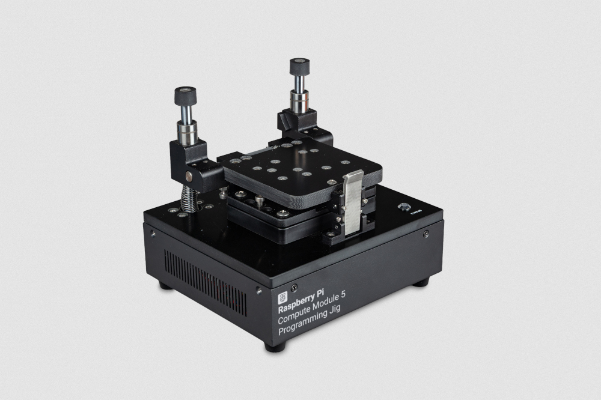
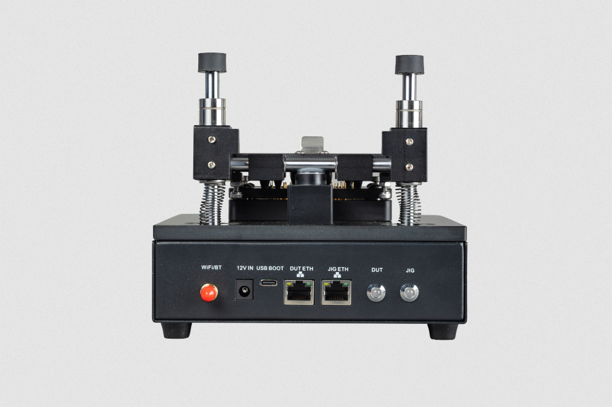
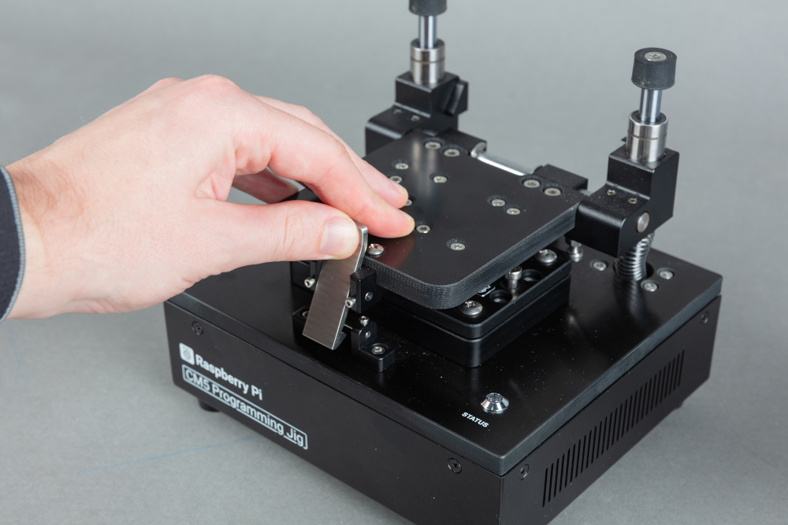
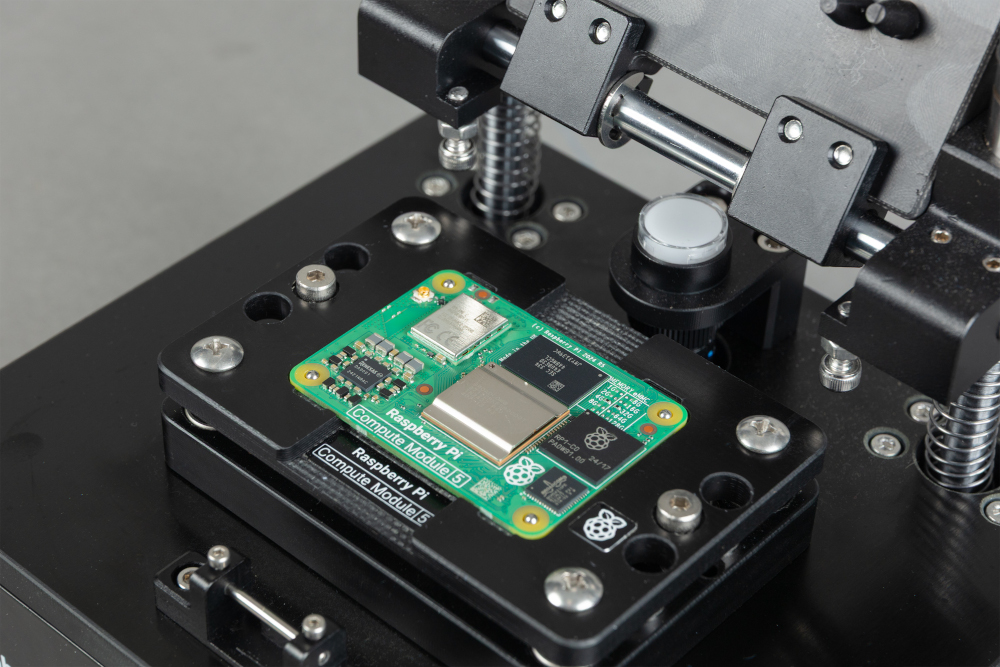

# CM5 编程治具

[计算模块 5 编程治具](https://www.raspberrypi.com/products/cm5-programming-jig)是一种配置系统，每次为一块计算模块 5（CM5）写入操作系统（OS）和安全配置。治具直接与每块 CM5 连接，配置过程中无需单独的 IO 板。

治具运行[安全启动配置器（`rpi-sb-provisioner`）](https://www.raspberrypi.com/documentation/security/secure-boot-provisioner.html)以自动化配置流程。当你将 CM5 插入治具并固定后，治具会自动执行所有配置步骤，包括安全启动实施、全盘加密和操作系统安装。



计算模块 5 编程治具

## 规格

本节介绍计算模块 5 编程治具的物理特性和能力，包括规格、功能和硬件。

一般规格

| 规格 | 说明 |
| ---- | ---- |
| 兼容设备 | 树莓派计算模块 5（CM5） |
| 配置能力 | 单设备配置；治具每次配置一块 CM5 |
| 治具网络接口（**JIG ETH**） | 以太网（10/100/1000）或 Wi-Fi（2.4 GHz 和 5.0 GHz IEEE 802.11 b/g/n/ac） |
| CM5 网络接口（**DUT ETH**） | 以太网（10/100/1000） |
| 尺寸（包括天线） | 170 × 181.5 × 153 mm |
| 重量 | 1800 g |

### 功能

* **机械夹紧。** 治具在编程期间将 CM5 固定在位。
* **无需载板的配置。** 治具使用弹簧探针直接与 CM5 连接，无需载板（IO 板），并减少高密度引脚连接器的磨损。
* **LED 状态指示。** 治具通过专用 LED 显示当前状态和配置进度。有关这些 LED 的更多信息，请参阅 [LED 行为](#led-行为)。
* **双网络连接。** 治具通过以太网（**JIG ETH**）或 Wi-Fi® 连接到配置网络，第二个以太网端口（**DUT ETH**）为正在编程的 CM5 提供加速的软件传输。
* **自动化配置。** 治具会自动完成配置流程，包括操作系统安装、全盘加密和安全启动配置（取决于你选择的安全级别）。
* **三级安全。** 你可以将治具配置为按三种安全级别之一来编程 CM5：完全安全（`secure-boot`）、加密存储和设备唯一密钥（`fde-only`），以及仅操作系统（`naked`）。更多信息请参阅[安全级别](https://www.raspberrypi.com/documentation/security/secure-boot-provisioner.html#security-levels)。
* **用户可维护。** 治具附带镊子和备用弹簧探针，使你能够拆卸和更换任何损坏的弹簧探针。更多信息请参阅[更换弹簧探针](#更换弹簧探针)。

>**警告**
>
>不要触摸弹簧探针，因为它们很尖锐且可能带电；你可能会损坏探针、治具或你自己。

### 硬件

计算模块 5 编程治具包装箱包含以下部件：

* 一个计算模块 5 编程治具。
* 一个全球通用电源，输入 110 V 至 240 V AC，输出 12 V、2 A（24 W）DC。
* 一根 Wi-Fi 天线。
* 两根 RJ45 线缆。
* 五根备用弹簧探针。
* 一把镊子。

使用过程中，你会接触到计算模块 5 编程治具的连接器和模块槽。还有一个安全按钮，你不需要直接操作它。

#### 连接器



CM5 编程治具背面的连接器

计算模块 5 编程治具的背面提供以下外部连接器：

计算模块 5 编程治具背面的外部连接器

| 标签 | 说明 |
| ---- | ---- |
| **WiFI/BT** | 随附天线的连接点。 |
| **12 V IN** | 一个桶形电源插孔，接受随附电源提供的 12 V、2 A（24 W）DC 输入。 |
| **USB BOOT** | 一个 USB-C 端口，在使用树莓派启动盘制作工具写入治具的操作系统时，用于将治具连接到计算机（见[第 2 步：将操作系统写入治具](#第-2-步将操作系统写入治具)）。 |
| **JIG ETH** | 一个 RJ45 以太网端口，用于将治具连接到配置网络，以便进行配置、管理和软件更新。 |
| **DUT ETH** | 一个 RJ45 以太网端口，用于将插入的 CM5 连接到配置网络，以便在配置期间加速数据传输。 |

除了 **JIG ETH** 端口，你也可以使用 Wi-Fi 将治具无线连接到配置网络。

#### 模块槽

计算模块 5 编程治具顶部的模块槽用于放置正在编程的 CM5。

CM5 紧密地嵌入模块槽中，CM5 上的树莓派标志朝上，并且与治具上的树莓派标志方向一致。模块槽前部的金属锁扣将其保持闭合。

#### 安全按钮

治具顶部、模块槽后部有一个未标记的安全按钮。配置软件使用此按钮检测治具何时闭合。

>**警告**
>
>不要手动按下此按钮，因为这样做可能会中断配置操作。

## 设置治具

首次设置治具时，你需要以下物品：

* 一个树莓派计算模块 5 编程治具。
* 随附的 12 V、2 A（24 W）电源。
* 一根 USB-C 线缆。
* 一台安装了[树莓派启动盘制作工具](https://www.raspberrypi.com/software/) 2.0.11 或更高版本的计算机。
* 能够访问[树莓派计算模块 5 编程治具清单](https://downloads.raspberrypi.com/cm5-jig/cm5-jig.rpi-imager-manifest)。
* 能够访问配置网络（以太网或 Wi-Fi）。

### 第 1 步：配置树莓派启动盘制作工具

你必须首先配置树莓派启动盘制作工具，使其使用计算模块 5 编程治具清单并启用 RPIBOOT 支持。

#### 配置清单

你可以自动或手动配置计算模块 5 编程治具清单。

**自动配置**

要打开已配置自定义存储库的树莓派启动盘制作工具，请在网络浏览器中输入以下 URL：`rpi-imager://open?repo=https://downloads.raspberrypi.com/cm5-jig/cm5-jig.rpi-imager-manifest`。

**手动配置**

要手动配置存储库，请打开树莓派启动盘制作工具并完成以下步骤：

1. 从底部左侧选择 **App Options**。
2. 在 **Content Repository** 旁边，选择 **Edit**。将打开 **Content Repository** 窗口。
3. 选择 **Use custom URL**。
4. 在显示的字段中，输入清单 URL（`https://downloads.raspberrypi.com/cm5-jig/cm5-jig.rpi-imager-manifest`）。
5. 选择 **Apply & Restart**。

#### 启用 RPIBOOT 支持

要配置树莓派启动盘制作工具以支持 RPIBOOT，请完成以下步骤：

1. 打开 **Debug Options**：
   * 在 Windows 或 Linux 上，按 **Ctrl + Alt + S**。
   * 在 macOS 上，按 **Cmd + Option + S**。
2. 滚动到 **Advanced Features**。
3. 使用切换开关选择 **Enable Rpiboot/Fastboot Support**。
4. 选择 **Apply** 保存更改并退出 **Debug Options** 对话框。

如果你使用树莓派启动盘制作工具设置多个治具，只需启用一次 RPIBOOT 支持；该工具会保存此设置以供后续写入使用。

### 第 2 步：将操作系统写入治具

在将启动盘制作工具配置为使用自定义内容存储库后，你现在可以将操作系统写入治具。

1. 将计算机的 USB-C 线缆连接到治具的 **USB BOOT** 端口。

2. 为治具接通电源。

   治具会启动进入 USB 大容量存储模式。你的计算机会将治具的内部存储识别为可移动驱动器。

3. 在计算机上打开树莓派启动盘制作工具。

4. 在 **Device** 选项卡上，选择 **Raspberry Pi Compute Module 5 Programming Jig**。选择 **Next**。

5. 在 **OS** 选项卡上，选择 **Compute Module 5 Programming Jig** 作为操作系统镜像。选择 **Next**。

6. 在 **Storage** 选项卡上，选择治具的内部存储作为目标。它显示为 **Raspberry Pi Compute Module 5 Lite**。选择 **Next**。

7. 在随后的 **Customisation** 选项卡中，配置操作系统：
   * 为治具设置主机名。
   * 选择你所在的首都城市以设置本地化设置。
   * 创建用户名时，必须指定用户名 **jig**。你可以为此账户设置任意密码。
   * 可选：如果你计划通过 Wi-Fi 连接治具，请配置无线网络凭据。
   * 可选：启用 SSH 以进行远程访问。
   * 将治具关联到你的 Raspberry Pi Connect 账户以进行远程管理。

8. 在 **Writing** 选项卡上，检查你的设置，如果这些设置正确，请选择 **Write**。

9. 树莓派启动盘制作工具完成写入后，断开 USB-C 线缆，并通过拔下再重新插入电源线来重启治具。

### 第 3 步：连接到配置网络

使用以下方法之一将治具连接到你的配置网络：

* （推荐）[以太网](#使用以太网连接推荐)
* [Wi-Fi](#使用-wi-fi-连接)

治具通过配置网络连接来：

* 提供 Raspberry Pi Connect 屏幕共享和 SSH 访问。
* 下载软件更新。
* 将操作系统镜像传输到治具。

>**警告**
>
>配置网络始终可以直接访问治具。如果你还将 **DUT ETH** 端口连接到配置网络（见[第 4 步：连接 DUT ETH 端口（可选）](#第-4-步连接-dut-eth-端口可选)），该网络在编程期间可以直接访问设备。请将此网络的设计纳入你的威胁模型。确保只有授权的系统和人员才能访问配置网络。

#### 使用以太网连接（推荐）

要通过以太网将治具连接到配置网络：

1. 拔下电源线，确保治具已断电。
2. 将配置网络的以太网线缆连接到治具的 **JIG ETH** 端口。
3. 插上电源线，开启治具。

治具使用 DHCP 自动获取网络地址。

#### 使用 Wi-Fi 连接

如果你在树莓派启动盘制作工具中配置了 Wi-Fi 凭据，治具会在启动时自动连接到你的无线网络。

1. 拔下电源线，确保治具已断电。
2. 确保 Wi-Fi 天线已连接到治具背面。
3. 如果治具的 **JIG ETH** 端口连接了以太网线缆，请从治具上断开该线缆。
4. 插上电源线，开启治具。

治具会连接到已配置的无线网络。

### 第 4 步：连接 DUT ETH 端口（可选）

为了在配置期间加速数据传输，请将配置网络的以太网线缆连接到治具的 **DUT ETH** 端口。这为正在编程的 CM5 提供直接的以太网接口。

### 第 5 步：访问安全启动配置器 Web 界面

安全启动配置器（`rpi-sb-provisioner`）的 Web 界面仅在 [localhost](http://localhost:3142) 上可用。这是一项强制对治具进行身份验证的安全措施。要访问 Web 界面，请使用 Raspberry Pi Connect 屏幕共享远程访问治具的桌面。

1. 登录 [Raspberry Pi Connect](https://connect.raspberrypi.com)。
2. 从设备列表中选择你的治具。
3. 选择 **Connect** 按钮并选择 **Screen Sharing**，启动屏幕共享会话。

如果治具桌面上尚未打开安全启动配置器 Web 界面，请在治具桌面上打开 Chromium 并访问 http://localhost:3142。

### 第 6 步：将客户端操作系统镜像传输到治具

在开始配置之前，你必须将要安装到 CM5 设备上的操作系统镜像传输到治具。

该镜像必须是由 [`rpi-image-gen`](https://github.com/raspberrypi/rpi-image-gen) 创建的非压缩 `.img` 文件。

我们建议使用 Magic-Wormhole 将镜像从你的计算机传输到治具。`magic-wormhole` 在两台计算机之间提供安全的、一次性的文件传输。要使用此方法，两台计算机都必须能够访问互联网。

1. 在你的计算机上安装 `magic-wormhole`。更多信息请参阅 [Magic-Wormhole](https://magic-wormhole.readthedocs.io/en/latest/)。

2. 在你的计算机上，使用以下命令发送镜像文件：

   ```bash
   wormhole send <path-to-image-file>
   ```

   `magic-wormhole` 会显示一个接收代码。记下此代码以便在治具上使用。

3. 通过 SSH 连接到治具，或使用 Raspberry Pi Connect 屏幕共享会话中的终端。

4. 在治具上，使用以下命令安装 `magic-wormhole`：

   ```bash
   sudo apt install -y magic-wormhole
   ```

5. 在治具上，使用以下命令接收镜像文件，将 `<code>` 替换为你从计算机发送镜像文件时获得的接收代码：

   ```bash
   wormhole receive <code>
   ```

### 第 7 步：配置安全启动配置器

1. 按照[第 5 步](#第-5-步访问安全启动配置器-web-界面)所述打开安全启动配置器 Web 界面。
2. 在 **Options** 选项卡上，配置以下选项：
   * 在 **OS Image** 部分，选择 **Upload New Image**，然后选择或浏览到你传输到治具的操作系统镜像。
   * 在 **Device & Firmware** 部分，对于 **Device family**，选择 **Raspberry Pi 5**。
   * 在 **Device & Firmware** 部分，对于 **Storage Type**，选择 **eMMC**。
   * 在 **Security Configuration** 部分，对于 **Provisioning Style**，选择安全级别。更多信息请参阅[安全级别](https://www.raspberrypi.com/documentation/security/secure-boot-provisioner.html#security-levels)。
   * 签名密钥：对于 `secure-boot` 模式，提供签名密钥。Web 界面会引导你创建一个。

有关配置选项的更多信息，请参阅[安全启动配置器配置参考](https://github.com/raspberrypi/rpi-sb-provisioner/blob/main/docs/config_vars.md)。

## 编程计算模块 5

使用计算模块 5 编程治具为计算模块 5（CM5）配置操作系统镜像。

开始之前，请确保治具：

* 已通电，且 **JIG** 和 **STATUS** LED 显示绿色。
* 已连接到配置网络。更多信息请参阅*设置治具*说明中的[第 3 步：连接到配置网络](#第-3-步连接到配置网络)。
* 已配置操作系统镜像和配置选项。更多信息请参阅*设置治具*说明中的[第 7 步：配置安全启动配置器](#第-7-步配置安全启动配置器)。

### 第 1 步：将 CM5 插入治具

1. 向后按压锁扣顶部以释放夹紧机构，让盖子向上滑动，然后将盖子向后转动直到停止。

   

2. 将计算模块 5 放入模块槽，CM5 上的树莓派标志朝上，并与治具上的树莓派标志方向一致。将计算模块 5 角上的孔与模块凹槽角上的通孔螺柱对齐。螺柱会穿过 CM5 上的孔。

   

3. 将盖子向前转动直到与 CM5 平行，并按压盖子使其向下滑动，以闭合夹紧机构。当盖子到达底部时，锁扣会啮合，将 CM5 固定到位。

>**警告**
>
>在闭合盖子之前，确保通孔螺柱穿过 CM5 上所有四个角孔。对齐不正确可能导致配置失败或损坏弹簧探针。

### 第 2 步：监控配置进度

CM5 夹紧到位后，治具会自动开始配置。如果配置没有自动开始，请参阅[未检测到设备](#未检测到设备)。

对于使用 `naked` 配置方式安装 2.6 GB 操作系统镜像的每块 CM5，典型配置时间约为 1.5 分钟。实际时间取决于操作系统镜像大小、存储类型、安全级别和网络速度。

>**警告**
>
>配置进行期间不要从治具中取出 CM5。不要按下治具上未标记的按钮。这两种操作都可能导致 CM5 无法使用。

通过治具上的 **STATUS** LED 跟踪各配置阶段的进度：

配置期间的状态指示

| 状态 LED | 阶段 | 说明 |
| ---- | ---- | ---- |
| 蓝色闪烁 | 配置中 | 治具检测到 CM5 并加载临时 Linux 环境。在 `secure-boot` 模式下，签名密钥哈希会被写入设备 OTP 存储器（这是一项永久性操作）。治具根据你在[第 7 步](#第-7-步配置安全启动配置器)中选择的安全级别，选择相应的配置服务。治具创建加密密钥（如适用）、格式化存储并安装操作系统。 |
| 绿色 | 成功 | 配置完成。可以取出 CM5。 |
| 红色闪烁 | 配置失败 | 配置过程失败。更多信息请参阅[故障排除](#故障排除)。 |

如需更详细的进度信息，你也可以使用安全启动配置器 Web 界面。按照[第 5 步](#第-5-步访问安全启动配置器-web-界面)所述访问 http://localhost:3142，然后：

1. 选择 **Devices** 选项卡查看配置进度。
2. 选择设备以查看其详细日志。

### 第 3 步：取出 CM5

当 **STATUS** LED 变为绿色时，配置完成。你可以取出 CM5。

1. 打开夹紧机构。向后按压锁扣顶部以释放它，让盖子向上滑动，然后将盖子向后转动直到停止。
2. 从模块槽中取出 CM5。

CM5 现在可以部署了。

## 更新治具

为获得最新的安全功能，我们建议保持治具软件为最新版本。

要更新治具的操作系统及所有已安装软件（包括安全启动配置器），请通过 SSH 连接到治具，或使用 Raspberry Pi Connect 屏幕共享会话中的终端，然后运行：

```bash
sudo apt update && sudo apt full-upgrade -y
```

## 更换弹簧探针

计算模块 5 编程治具的结构设计使你能够更换任何损坏的弹簧探针。

要完成此过程，你需要以下物品：

* 替换用的弹簧探针
* 镊子
* 3 mm 内六角扳手

在此过程中，避免用裸手触摸弹簧探针；这样做可能会将油脂和污垢转移到探针上。

要更换一根或多根弹簧探针，请完成以下步骤：

1. 确保治具已断开电源。
2. 向后按压锁扣顶部以释放夹紧机构，让盖子向上滑动，然后将盖子向后转动直到停止。
3. 使用内六角扳手松开模块槽两个短边中部的螺栓。保留这些螺栓以便重新组装时使用。
4. 将模块槽笔直向上抬起，使其远离治具中的弹簧探针。四个角的导柱可确保你在操作时不会碰到弹簧探针。保留模块槽以便重新组装时使用。
5. 用镊子夹住要更换的弹簧探针，将其笔直向上拔出套环。
6. 用镊子将替换弹簧探针插入套环。确保直径较大且带孔的一端先进入套环，直径较小的一端朝上。
7. 用镊子的平面轻轻向下按压弹簧探针，确保其压缩时与套环齐平。
8. 更换完所有需要更换的弹簧探针后，重新安装模块槽。
   * 将其放置为使树莓派标志和文字朝上，并使文字位于最靠近治具前部的边缘。
   * 将模块槽四个角的导柱与治具上相应的孔对齐。
   * 将模块槽向下滑入到位。导柱可确保此操作不会碰到弹簧探针。
9. 重新插入之前拆下的两个螺栓，并用内六角扳手拧紧，以固定模块槽。不要过度拧紧这些螺栓。

## LED 行为

治具使用 LED 指示灯传达其当前状态。下表描述了每个 LED 及其含义。

治具背面有两个 LED 指示灯，**JIG** 和 **DUT**，顶部有一个 LED，**STATUS**。

计算模块 5 编程治具上的 LED 指示灯

| LED | 状态 | 含义 |
| ---- | ---- | ---- |
| JIG | 熄灭 | 治具未通电。插上电源线使治具上线。 |
| JIG | 常亮绿色 | 治具已通电。 |
| JIG | 绿色闪烁 | 治具处于活动状态；数据传输进行中。 |
| JIG | 常亮红色 | 治具已通电，但 CPU 未运行。 |
| DUT | 熄灭 | 治具未通电或未插入 CM5。 |
| DUT | 常亮绿色 | 检测到 CM5 并已供电。 |
| DUT | 绿色闪烁 | CM5 处于活动状态；数据传输进行中。 |
| DUT | 常亮红色 | 这可能表示 CM5 已损坏。如果该灯在多块不同的模块上均保持红色，则可能表示治具存在问题。更多信息请参阅[故障排除](#故障排除)。 |
| STATUS | 熄灭 | 治具已断电。插上电源线使治具上线。 |
| STATUS | 常亮红色 | 治具已通电，但尚未准备好配置 CM5。 |
| STATUS | 蓝色闪烁 | 配置进行中。此阶段不要取出 CM5。 |
| STATUS | 常亮绿色 | 如果治具中没有 CM5，表示治具已准备好开始配置。如果治具中有 CM5，表示配置已成功完成，可以取出 CM5。 |
| STATUS | 红色闪烁 | 配置失败。 |

## 故障排除

如果你在使用计算模块 5 编程治具时遇到问题，请使用以下信息诊断问题。

* 如果 CM5 夹紧在治具中后配置没有开始，请尝试[未检测到设备](#未检测到设备)中的步骤来解决问题。
* 对于其他问题，请参阅[安全启动配置器故障排除信息](https://www.raspberrypi.com/documentation/security/secure-boot-provisioner.html#troubleshooting)。

### 未检测到设备

如果 CM5 已夹紧在治具中，但配置没有开始，请尝试以下操作：

1. 确保治具已通电并连接到网络。
   * 如果 **JIG** LED 指示灯未亮，请确保电源线已插好。
   * 通过从另一台计算机连接治具来验证网络。

2. 确保 CM5 正确就位并与弹簧探针对齐。
   * 打开夹具。
   * 重新放置 CM5，确保树莓派标志朝上且与治具上的标志方向一致，并确保治具上的通孔螺柱穿过 CM5 上所有四个角孔。
   * 确保计算模块良好地嵌入模块槽凹槽，且在水平方向没有任何松动。
   * 再次闭合夹具。

3. 检查弹簧探针是否脏污或损坏。
   * 检查弹簧探针是否有碎屑或损坏。
   * 如果弹簧探针脏污，请用蘸有异丙醇或专用清洁液的棉签轻轻清洁。

## 安全警告

* 进行任何维护之前，请断开治具与电源的连接。
* 不要触摸模块槽中的金属弹簧探针。它们很尖锐且可能带电；你可能会损坏探针、治具或你自己。
* 确保 CM5 按照[第 1 步](#第-1-步将-cm5-插入治具)所述正确就位于模块槽中。就位不当可能损坏弹簧探针。
* 配置过程进行期间（**STATUS** LED 蓝色闪烁）不要从治具中取出 CM5；这可能导致 CM5 无法使用。
* 不要按下治具上未标记的按钮；这可能会中断配置并导致 CM5 无法使用。
* 不要将计算模块 4 插入计算模块 5 编程治具。
