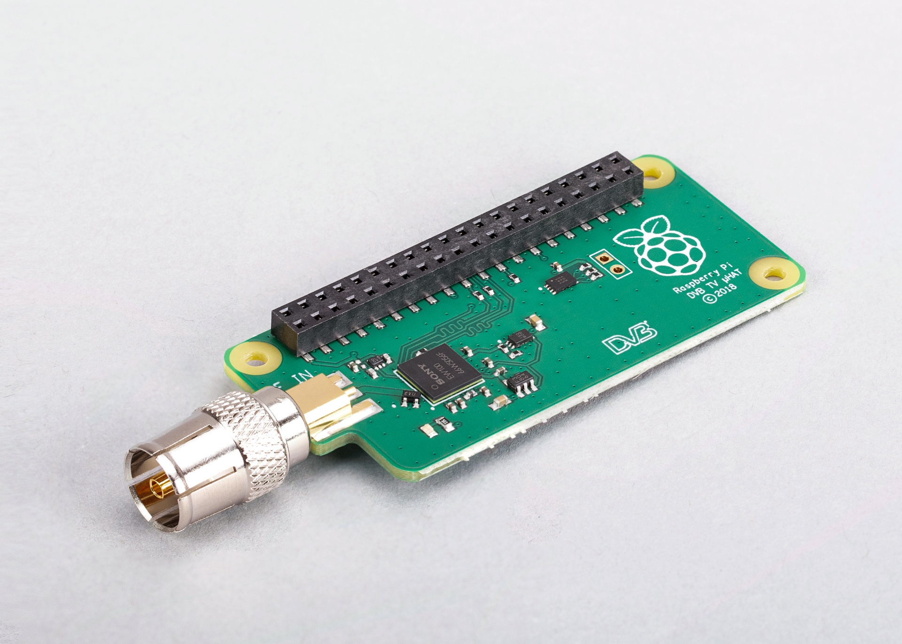
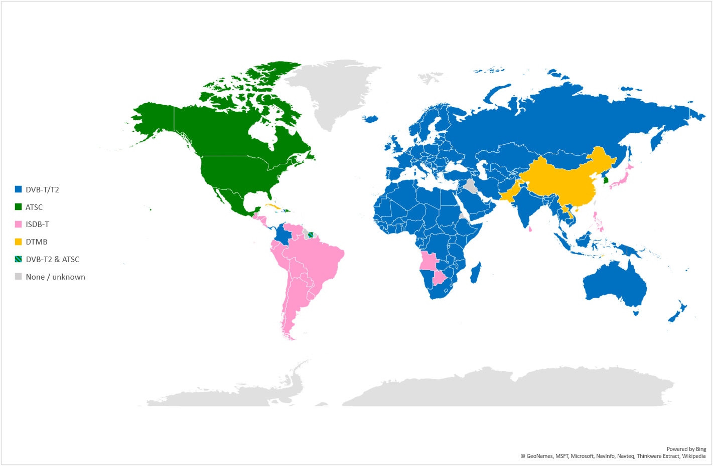
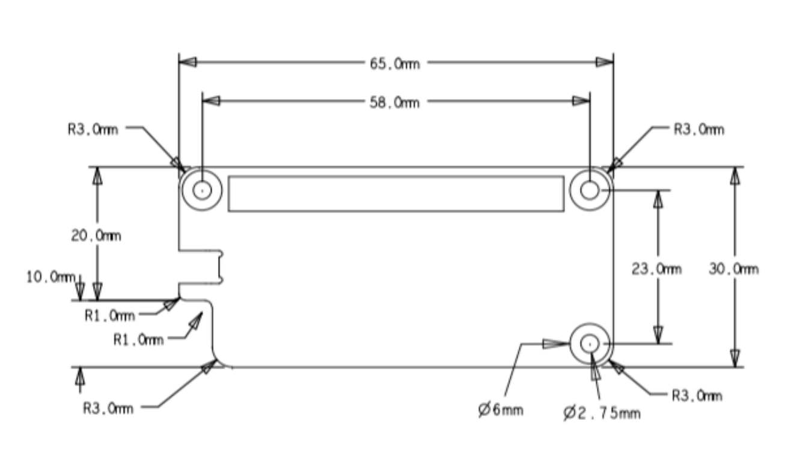

# 电视扩展板（TV HAT）

## 关于电视扩展板（TV HAT）



树莓派电视扩展板（TV HAT）

树莓派电视扩展板（TV HAT）让你能够在树莓派上使用板载的 DVB-T 和 DVB-T2 调谐器接收数字地面电视广播系统。借助这块扩展板，你可以在树莓派上接收和观看电视，或者创建一个电视服务器，通过网络将接收到的电视串流传输到其他设备。电视扩展板可以配合任何 40 针树莓派板使用，充当网络上其他设备的服务器。在树莓派设备本身上接收和观看电视时，性能可能因设备而异，我们建议为此使用树莓派 2B 或更新版本。

主要特点：

* 索尼 CXD2880 电视调谐器
* 支持的电视标准：DVB-T2、DVB-T
* 接收频率：VHF III、UHF IV、UHF V
* 频道带宽：
  * DVB-T2：1.7 MHz、5 MHz、6 MHz、7 MHz、8 MHz
  * DVB-T：5 MHz、6 MHz、7 MHz、8 MHz

## 关于 DVB-T

>**警告**
>
>电视扩展板不支持北美所使用的数字电视标准 ATSC。

数字视频广播－地面（DVB-T）是以欧洲为基础的 DVB 联盟为数字地面电视广播传输制定的标准。世界其他地区则使用不同的数字电视标准，例如北美使用的 ATSC。不过，电视扩展板仅支持 DVB-T 和 DVB-T2 标准。



已实施或采用的 DTT 系统（来源：DVB/EBU/BNE DTT 部署数据库，2023 年 3 月）

## 安装

按照我们的[入门文档](../shu-mei-pai/ru-men.md)，用最新版本的树莓派系统设置好树莓派。

将天线转接器连接到电视扩展板。让转接器朝向远离 USB 端口的一侧，把扩展板轻轻按压到树莓派设备的 GPIO 引脚上，再将间隔柱放在扩展板的两到三个角上，从安装孔拧入螺丝将其固定。然后将电视扩展板的天线转接器接到来自电视天线的线缆上。

我们推荐用 TVHeadend 来解码这些流（称为复用，英文为 multiplexes，简称 muxes）并观看内容。电视扩展板一次只能解码一个复用，每个复用可以包含多个可供选择的频道。内容既可以在连接了电视扩展板的树莓派上观看，也可以发送到同一网络上的其他设备。

启动你的树莓派，然后打开一个终端窗口，运行以下两个命令来安装 `tvheadend` 软件：

```bash
$ sudo apt update
$ sudo apt install tvheadend
```

在安装 `tvheadend` 的过程中，系统会要求你设置管理员账户名称和密码。稍后你会用到这些信息，所以务必选择容易记住的名称和密码。

在你网络中的另一台计算机上，打开一个网络浏览器，然后在地址栏中输入以下内容：`http://raspberrypi.local:9981/extjs.html`

这样就会连接到树莓派上运行的 `tvheadend`。通过浏览器连接到 `tvheadend` 后，系统会提示你用在树莓派上安装 `tvheadend` 时所选的账户名称和密码登录。

随后会出现设置向导。

首先，系统会要求你设置希望 `tvheadend` 使用的语言，然后设置网络、用户和管理员访问权限。如果你没有特定的偏好，请将 **允许网络** 留空，并在 **用户名** 和 **密码** 字段中输入星号（`*`）。这将让连接到你本地网络的任何人都能访问 `tvheadend`。

你会看到一个标题为 **网络设置** 的窗口。在 **网络 2** 下，你会看到 `Tuner: Sony CXD2880 #0 : DVB-T #0`。对于 **网络类型**，选择 `DVB-T Network`。下一个窗口是 **为网络分配预定义的复用器**；在这里，你选择要接收和解码的电视流。在 **网络 1** 下，从预定义的复用器中选择你当地的电视发射台。

>**注意**
>
>你可以使用 [Freeview 网站](https://www.freeview.co.uk/help)找到你的本地发射台。输入你的邮政编码，查看哪个发射台能为你提供良好的信号。

当你单击 **保存并下一步** 时，软件将开始扫描所选的复用器，并显示进度条。大约两分钟后，你会看到类似以下内容：

```
Found muxes: 8
Found services: 172
```

在下一个标题为 **服务映射** 的窗口中，勾选全部三个复选框：**映射所有服务**、**创建提供者标签** 和 **创建网络标签**。你会看到一个可观看的电视频道列表，以及它们当前正在播放的节目。

要在浏览器中观看电视频道，请单击频道列表左侧的小电视图标，就在 `i` 图标的右侧。这会调出一个浏览器内的媒体播放器。根据你浏览器内置的解码能力和正在播放的流类型，播放可能会有些卡顿。在这些情况下，我们建议使用本地媒体播放器作为播放应用程序。

要在本地媒体播放器（例如 [VLC](https://www.videolan.org/vlc)）中观看电视频道，你需要将其下载为流。单击频道列表左侧的 `i` 图标，以打开该频道的信息面板。这里会显示一个可供下载的流文件。

>**注意**
>
>许多应用程序都支持 `tvheadend`，例如 iOS 上的 TvhClient，可播放来自树莓派的电视。

## 机械图纸



树莓派电视扩展板
