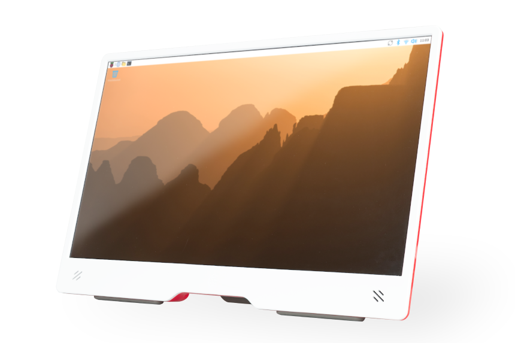
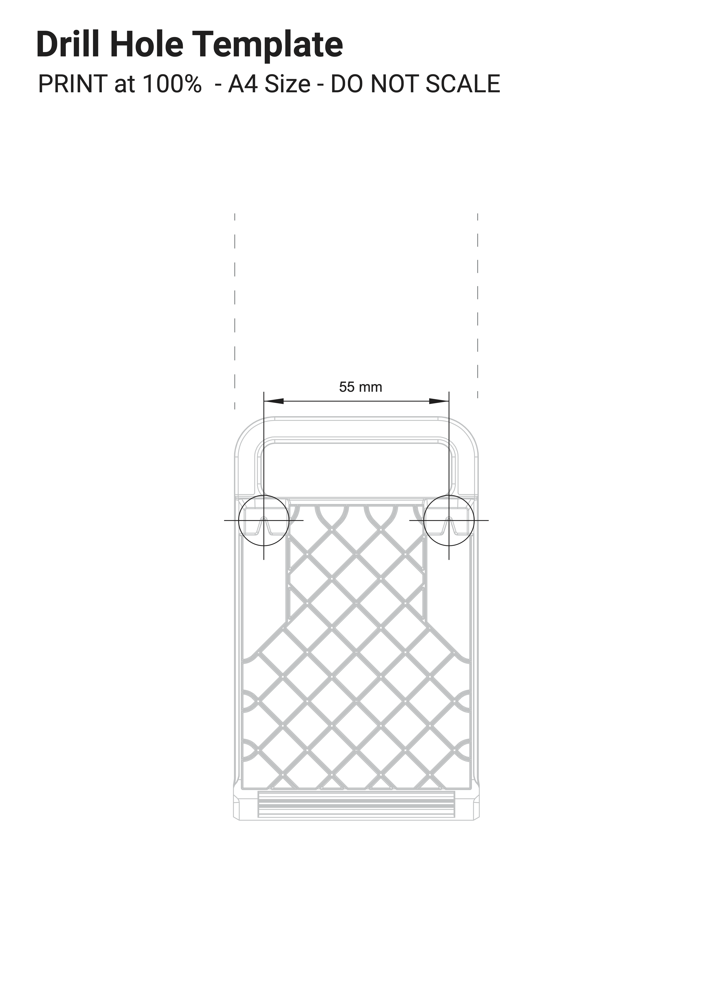
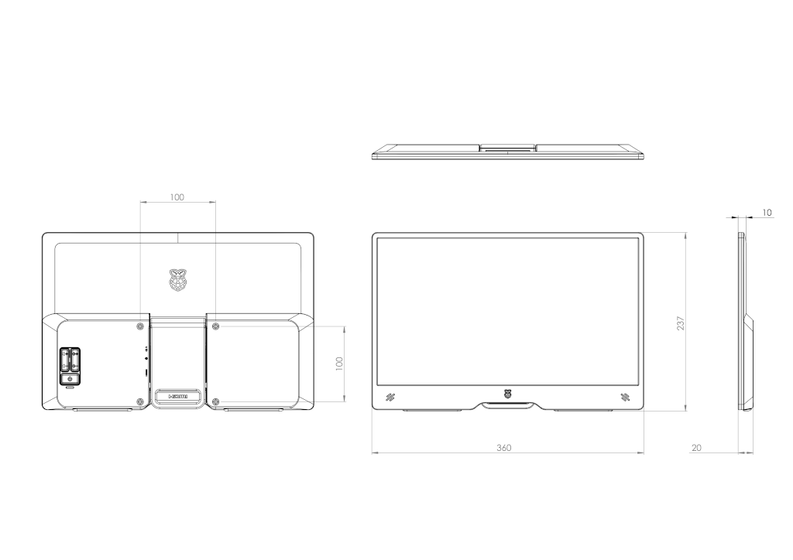

# 显示器

## 树莓派显示器

[树莓派显示器](https://www.raspberrypi.com/products/raspberry-pi-monitor/)是一款 15.6 英寸 1920 × 1080p IPS LCD 显示屏，可通过 HDMI 电缆连接到计算机。显示器还需要一个 USB-C 电源。要获得完整的亮度和音量范围，该电源必须是能够提供至少 1.5A 电流的 USB-PD 电源。

树莓派显示器

该显示器兼容所有支持 HDMI 输出的树莓派型号。

### 控制

显示器背面包括以下控制项：

* 用于进入和退出待机模式的按钮（以 ⏻ 电源符号标示）
* 用于增加和降低显示屏亮度的按钮（以 🔆 太阳符号标示）
* 用于增加和降低扬声器音量的按钮（以 🔈 扬声器符号标示）

### 屏幕显示消息

屏幕显示（OSD）可以显示以下消息：

| 消息 | 描述 |
| :---: | :--- |
|  | 未检测到 HDMI 信号。 |
|  | 显示器即将进入待机模式以节省功耗。 |
|  | 不支持所连接设备的输出显示分辨率。 |
|  | 显示器正以省电模式运行，亮度和音量降低，因为它未连接到能够提供至少 1.5A 电流的电源。 |

此外，OSD 会用 🔆（太阳）符号提示显示屏亮度的变化，用 🔈（扬声器）符号提示扬声器音量的变化。亮度和音量均采用 0 到 100 的范围。

>**技巧**
>
>如果你在显示器无法检测到 HDMI 信号时尝试退出待机模式，待机按钮下方的红色 LED 会短暂亮起，但显示器会保持待机模式。

### 放置显示器

使用以下方法放置显示器：

* 使用一体式支架调整显示器的角度。
* 使用红色后部塑料外壳背面的四个 VESA 安装孔，将显示器安装到支臂或支架上。

  >**重要**
  >
  >使用间隔柱，确保显示屏电缆和电源电缆有足够的出线空间。

* 将一体式支架完全向上翻起，朝向显示器顶部。使用钻孔模板创建两个相距 55 mm 的安装点。利用一体式支架背面的槽口悬挂显示器。

  

  钻孔模板

### 为显示器供电

树莓派显示器通过 5V [USB Power Delivery](https://en.wikipedia.org/wiki/USB_hardware#USB_Power_Delivery)（USB-PD）电源供电。许多 USB-C 电源，包括树莓派 4 和树莓派 5 的官方电源，都支持此标准。

当使用通过 USB-PD 提供至少 1.5A 电流的电源时，显示器以 **全功率模式** 运行。在全功率模式下，你可以使用显示屏亮度和扬声器音量的完整范围（0%-100%）。

当使用的电源*不*通过 USB-PD 提供至少 1.5A 电流（包括所有 USB-A 电源）时，显示器以 **省电模式** 运行。省电模式会限制最大显示屏亮度和最大扬声器音量，以确保可靠运行。在省电模式下，你可以使用显示屏亮度的有限范围（0-50%）和扬声器音量的有限范围（0-60%）。当由树莓派供电时，显示器以省电模式运行，因为树莓派设备无法通过 USB-A 连接提供 1.5A 电流。

要从省电模式切换到全功率模式，请按住 **提高亮度** 按钮 3 秒。

>**技巧**
>
>如果显示器反复闪烁，说明你的 USB 电源无法提供足够的电流为显示器供电。如果你通过树莓派 5、500 或 500+ 为显示器供电，而这些设备本身由 5V/3A 电源供电，就可能出现这种情况。请尝试以下修复方法，让显示器不再反复闪烁：
>
>* 降低显示屏亮度和音量（你可能需要将显示器连接到另一个电源，才能访问这些设置）
>* 改用其他电源或电缆

### 规格

* 对角线：15.6 英寸
* 分辨率：1920 × 1080
* 类型：IPS LCD
* 色域：45%
* 对比度：800:1
* 亮度：250 cd/m²
* 屏幕涂层：防眩光，3H 硬度
* 显示区域：344 × 193 mm
* 尺寸：237 × 360 × 20 mm
* 重量：850 g
* 支持的分辨率：
  * 1920 × 1080p @ 50/60Hz
  * 1280 × 720p @ 50/60Hz
  * 720 × 576p @ 50/60Hz
  * 720 × 480p @ 50/60Hz
  * 640 × 480p @ 50/60Hz
* 输入：HDMI 1.4；支持 DDC-CI
* 电源输入：USB-C；需在 5V 下通过 USB-PD 提供 1.5A 电流，方可获得完整的亮度和音量范围
* 功耗：使用中 4.5-6.5 W；空闲时 < 0.1 W
* 扬声器：2 × 1.2 W（立体声）
* 端口：3.5 mm 音频插孔

### 机械图纸

机械图纸
