# 树莓派音频扩展板（Raspberry Pi Audio Board）

## 概述

树莓派音频扩展板为你现有的高保真音响设备或基于树莓派的设备和项目带来高质量音频。我们提供四种不同的 HAT（Hardware Attached on Top，顶部附加硬件）选项，适用于所有配备 40 针 GPIO 排针的树莓派。

每块板都有特定的用途和一组功能。DAC Pro、DAC+ 和 DigiAMP+ 扩展板可提供最高音质的播放，最高支持全高清音频（192 kHz）；而 Codec Zero 支持高达高清音频（96 kHz），并内置麦克风，非常适合紧凑型项目。

### 参数对比

|          | **线路输出（Line out）** | **平衡输出（Balanced out）** | **立体声扬声器** | **单声道扬声器** | **耳机** | **辅助输入（Aux in）** | **辅助输出（Aux out）** | **外接麦克风（Ext mic）** | **内置麦克风（Built-in mic）** |
| --- | --- | --- | --- | --- | --- | --- | --- | --- | --- |
| DAC Pro    | ✓ | ✓ |   |   | ✓ |   |   |   |   |
| DAC+       | ✓ |   |   |   | ✓ |   |   |   |   |
| DigiAMP+   |   |   | ✓ |   |   |   |   |   |   |
| Codec Zero |   |   |   | ✓ | ✓ | ✓ | ✓ | ✓ | ✓ |

- **线路输出（Line out）**：双 Phono/RCA 连接器，通常为红色和白色。此输出为可变模拟信号（0-2V RMS），可连接到你现有的高保真音响（前置放大器或功放），也可用于驱动内置功放的有源扬声器。
- **平衡输出（Balanced out）**：XLR 连接器，通常为三针公头连接器。用于工作室环境及部分高端高保真系统，也可用于驱动有源监听扬声器，例如俱乐部或舞台上朝向 DJ 或表演者的监听音箱。
- **立体声扬声器**：两组螺钉端子，用于 2 × 25 W 扬声器。适用于不带内置放大的传统高保真扬声器，这类扬声器称为无源扬声器。
- **单声道扬声器**：单个 1.2 W 扬声器的螺钉端子，类似晶体管收音机中的扬声器。
- **耳机**：3.5 mm 耳机插孔，为一副耳机提供立体声音频。树莓派 DAC 扩展板上的耳机放大器可驱动阻抗高达 80/90 Ω 的耳机。
- **辅助输入（Aux in）**：双 Phono/RCA 连接器或 3.5 mm 插孔。接受最高 1V RMS 的模拟音频输入，可用于录制来自可变模拟信号源（如手机、MP3 播放器或类似设备）的音频。
- **辅助输出（Aux out）**：双 Phono/RCA 连接器或 3.5 mm 插孔。提供最高 1V RMS 的模拟音频输出，可用于以低于线路输出（Line out）的音量把音频送入功放。
- **外接麦克风（Ext mic）**：3.5 mm 插孔，用于外接驻极体麦克风。使用外接麦克风输入插孔时，Codec Zero 的内置 MEMS 麦克风会自动禁用。

### 树莓派 DAC Pro

树莓派 DAC Pro 扩展板是我们保真度最高的数模转换器（DAC）。

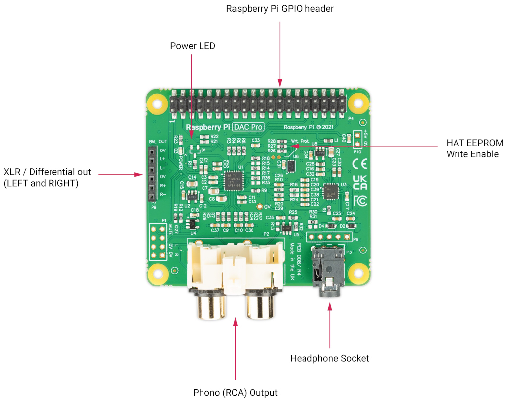

DAC Pro 采用 Texas Instruments PCM5242，信噪比（SNR）表现出色，并在 Phono/RCA 线路电平输出之外支持平衡/差分输出。它还带有专用耳机放大器。DAC Pro 由树莓派通过 GPIO 排针供电。

作为 DAC Pro 的一部分，树莓派设备的 USB 和以太网接口上方引出了两个三针排针（P7/P9），供可选的 XLR 扩展板使用，以实现差分/平衡输出。

#### 引脚分配

| **P1** | 模拟输出（0-2V RMS），携带 GPIO27、静音信号（耳机检测）、左右音频通道和左右地线。 |
| -- | -- |
| **P6** | 耳机插孔信号（1：左，2：地，3：右，4：地，5：检测）。 |
| **P7/9** | 差分（0-4V RMS）输出（P7：左，P9：右）。 |
| **P10** | 备用 5V 输入，可同时为树莓派供电。 |

#### 可选的 XLR 扩展板

Pi-DAC PRO 引出了一个 6 针排针，供可选的 XLR 扩展板使用，通过位于树莓派设备 USB/以太网接口上方的 XLR 插座提供差分/平衡输出。

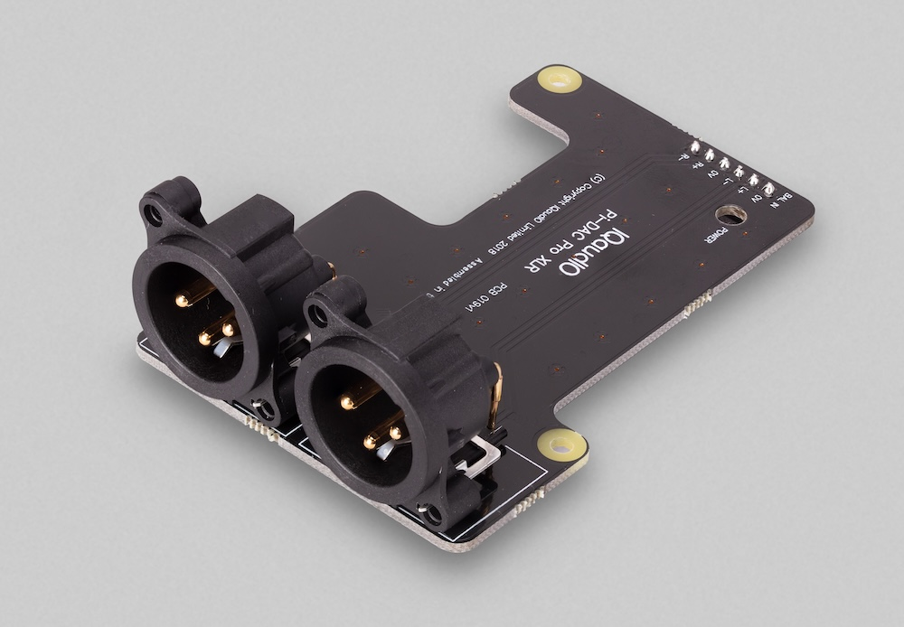

XLR 连接器用于工作室及部分高端高保真系统，也可用于驱动迪斯科舞厅或舞台上使用的有源“监听”扬声器。

### 树莓派 DAC+

树莓派 DAC+ 是一款高分辨率音频输出扩展板，可提供 24 位 192 kHz 数字音频输出。

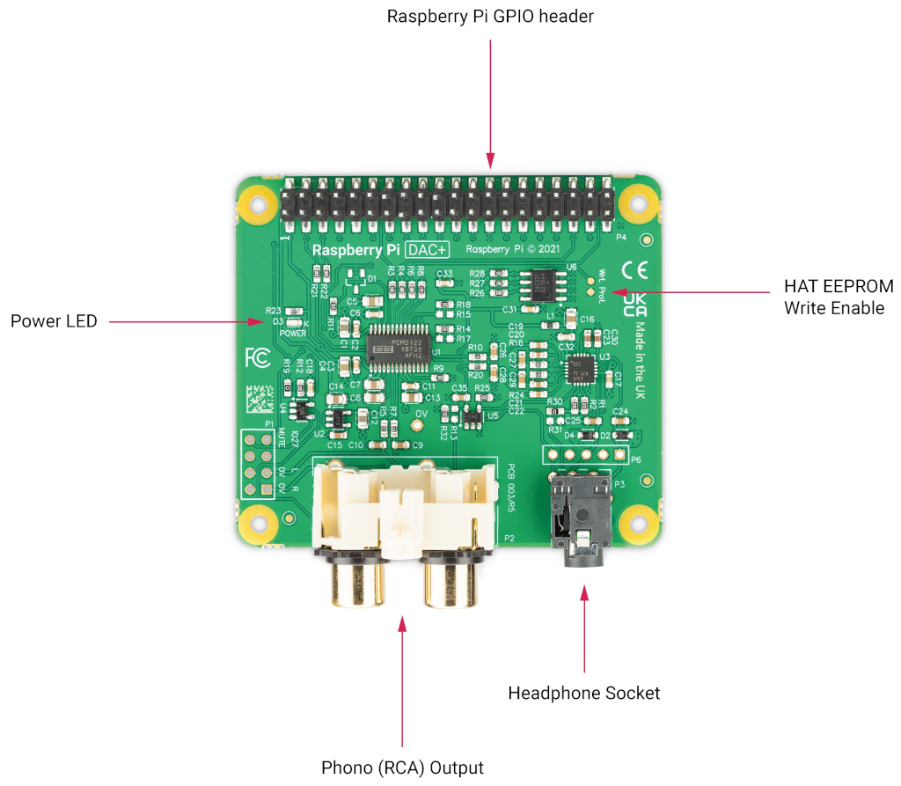

DAC+ 采用 Texas Instruments PCM5122，将模拟音频输出到设备的 Phono 连接器。它还带有专用耳机放大器，并由树莓派通过 GPIO 排针供电。

#### 引脚分配

| **P1** | 模拟输出（0-2V RMS），携带 GPIO27、静音信号（耳机检测）、左右音频通道和左右地线。 |
| -- | -- |
| **P6** | 耳机插孔信号（引脚 1：左，2：地，3：右，4：地，5：检测）。 |

### 树莓派 DigiAMP+

使用树莓派 DigiAMP+，你可以连接 2 个功率最高 35 W 的无源立体声扬声器，输出功率可调，非常适合用于基于树莓派的高保真系统。

DigiAMP+ 采用 Texas Instruments TAS5756M PowerDAC，必须由外部电源供电。

它需要 12-24V 直流电源（推荐使用 XP Power VEC65US19 电源）。

>**注意**
>
>DigiAMP+ 设计用于树莓派 3 及更早的设备。如果将其与树莓派 4 或更新的设备搭配使用，请使用带外部供电的 USB 集线器，避免 USB 接口给设备带来额外负载；否则很可能触发低电压警告。

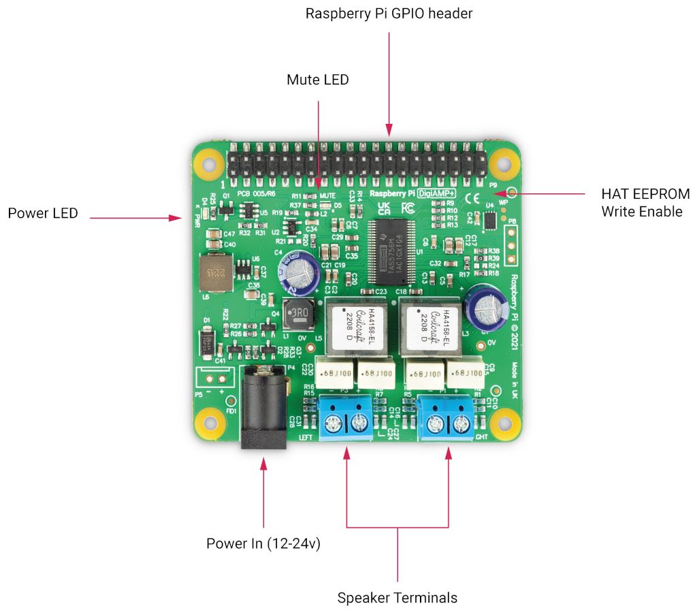

DigiAMP+ 的电源输入桶形连接器尺寸为 5.5 mm × 2.5 mm。

上电时，放大器默认处于静音状态（静音 LED 点亮）。静音状态和 LED 控制由软件负责（树莓派 GPIO22）。

DigiAMP+ 可同时为树莓派和自身并联供电，并通过 GPIO 排针向树莓派提供 5.1V 2.5A 电源。

>**警告**
>
>使用 DigiAMP+ 时，请勿再向树莓派设备自身的电源输入接口供电。

#### 引脚分配

| **P5** | 备用电源输入，用于硬接线安装（必须注意极性）。 |
| -- | -- |
| **P8** | TAS5756M 内部 GPIO1/2/3 |

#### 扬声器端子极性

极性印在扬声器端子上方的丝印上。

从板子上方俯视，且电源连接器位于左侧时，两个端子的极性相同：左侧为“-”，右侧为“+”。

### 树莓派 Codec Zero

树莓派 Codec Zero 是一款树莓派 Zero 尺寸的音频扩展板。它在树莓派与 Codec Zero 板载的 Dialog Semiconductor DA7212 编解码器之间传输双向数字音频信号（I2S）。Codec Zero 支持多种输入和输出设备。

* 高性能 24 位音频编解码器
* 支持 8-96 kHz 之间的常见音频采样率
* 内置微机电（MEMS）麦克风（Mic2）
* 单声道驻极体麦克风（Mic2 左）
* 在检测到 Mic2 插入时自动禁用 MEMS
* 支持额外的（未安装）单声道驻极体麦克风（Mic1 右）
* 立体声辅助输入通道（AUX IN）——Phono/RCA 连接器
* 立体声辅助输出通道（耳机/AUX OUT）
* 灵活的模拟和数字混音路径
* 用于自动电平控制（ALC）的数字信号处理器（DSP）
* 五段均衡器
* 单声道线路输出/迷你扬声器驱动器：1.2 W @ 5V，THD < 10%，R = 8 Ω

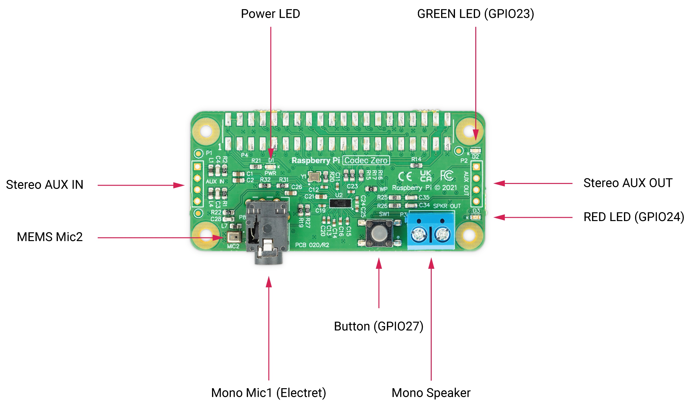

Codec Zero 内置 EEPROM，必要时可用于自动配置 Linux 环境。它带有集成 MEMS 麦克风，可通过 3.5 mm 插孔使用立体声麦克风输入，并可连接单声道扬声器（1.2W/8Ω）。

除绿色（GPIO23）和红色（GPIO24）LED 外，还提供了一个可编程轻触按钮（GPIO27）。

#### 引脚分配

| **P1/2** | 如有需要，支持外接 Phono/RCA 插座。P1：AUX IN，P2：AUX OUT。 |
| -- | -- |
| **P1** | 第 1 针为方形。 |

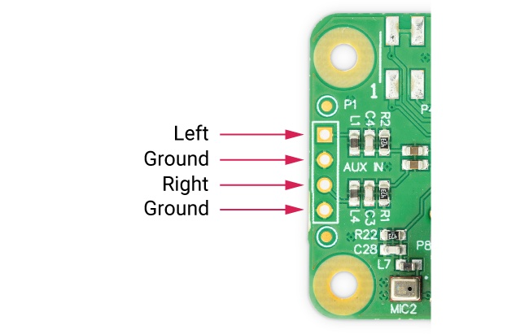

对于对讲机、智能门铃、复古收音机改造或智能音箱等小型项目，Codec Zero 都是理想的设计起点。

## 安装、连接与配置

树莓派音频扩展板预编程有 EEPROM，在运行树莓派系统的树莓派设备上即插即用。它们属于 HAT（Hardware Attached on Top）设备家族。

它们也可以在无头（远程）设置中使用。

### 安装并连接音频扩展板

树莓派音频扩展板连接到 40 针 GPIO 排针上，并设计为使用随附的电路板间隔柱和螺丝固定。所有必要的安装硬件（包括间隔柱、螺丝和连接器）均已提供。

正常使用无需焊接，但如果你想硬接线特定连接器（例如 DAC Pro 上的 XLR 连接），则可能需要焊接。

安装音频扩展板的步骤：

1. 用手将 PCB 间隔柱拧到树莓派设备上（拧到手感紧即可）。
2. 将音频扩展板装到 40 针 GPIO 排针上。
3. 从板子上方拧入剩余的螺丝。

### 检查硬件版本

树莓派音频扩展板有多个版本。版本决定了配置所需的操作。

较旧的 IQaudIO 品牌扩展板为黑色 PCB，较新的树莓派品牌扩展板为绿色 PCB。两种板在电气上等效，但 EEPROM 内容不同。

检查音频扩展板版本的方法：

1. 将音频扩展板接到树莓派上并通电。
2. 如果扩展板上有电源 LED，请确认其已点亮。例如，Codec Zero 上有一个标有 `PWR` 的 LED。
3. 在树莓派设备上，打开终端并输入以下命令：

```bash
$ grep -a . /proc/device-tree/hat/*
```

终端将返回以下字符串之一：

- `Raspberry Pi Ltd.`：无需进一步操作（参见下文的额外 Codec Zero 配置）。
- `IQaudIO Limited`：无需进一步操作（参见下文的额外 Codec Zero 配置）。
- `No such file or directory`：HAT 未被检测到。请执行以下操作：
  1. 关闭设备电源。
  2. 检查 HAT 与树莓派设备之间的物理连接。
  3. 重新上电，然后重复上一节中的第 3 步。
  4. 如果返回相同的字符串，请在树莓派设备上打开 `config.txt`。
  5. 添加以下几行，取消加载默认 HAT overlay，并应用正确的设备树 overlay：

```ini
# 阻止加载默认 HAT overlay：
dtoverlay=
# 添加以下其中一行：
dtoverlay=rpi-codeczero
dtoverlay=rpi-dacplus
dtoverlay=rpi-dacpro
dtoverlay=rpi-digiampplus
```

  6. 保存并关闭文件。
  7. 重启你的树莓派使更改生效。

### 配置音频扩展板

将音频扩展板安装并连接到树莓派设备后，你可以在它和板载音频设备之间切换音频播放：

1. 右键单击屏幕右上角的音频设置。
2. 在板载音频设置和 HAT 音频设置之间切换。

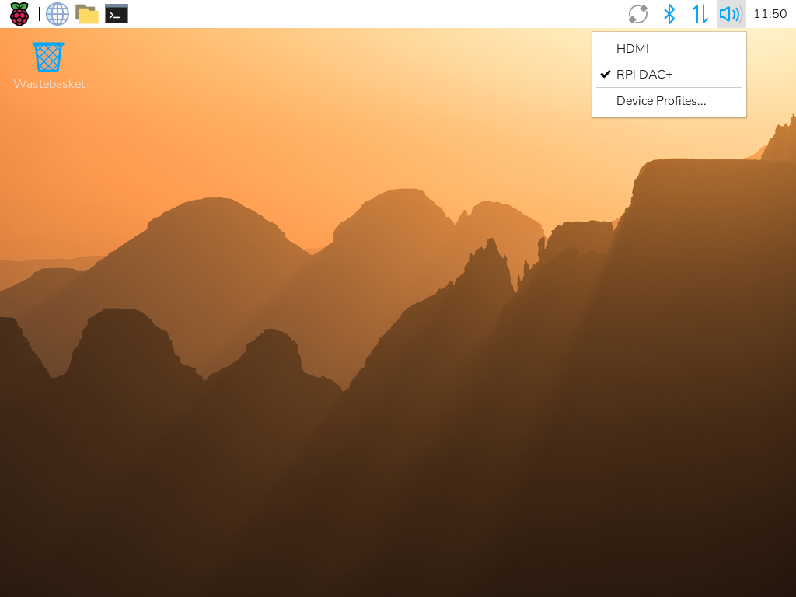

你还可以禁用板载音频设备，使树莓派音频扩展板成为树莓派系统中的主要音频设备。

下文介绍的命令行方法适用于无头设置（或树莓派系统精简版）环境，此时你无法通过图形化的树莓派系统桌面界面控制音频扩展板。

通过 SSH 禁用板载音频设备的步骤：

1. 使用 SSH 连接到你的树莓派设备。
2. 运行以下命令编辑文件：

```bash
$ sudo nano /boot/firmware/config.txt
```

3. 在文件中找到 `dtparam=audio=on` 行，并在行首添加 `#` 符号将其注释掉。

程序会忽略任何一行中 `#` 符号之后的内容。你的 `/boot/firmware/config.txt` 文件现在应包含以下条目：

```ini
#dtparam=audio=on
```

4. 按 *Ctrl+X*，再按 *Y*，然后按 *Enter* 保存。
5. 重启你的树莓派使设置生效：

```bash
$ sudo reboot
```

### 额外的 Codec Zero 配置

树莓派 Codec Zero 采用 Dialog Semiconductor DA7212 编解码器。

它支持从内置 MEMS 麦克风、立体声排针（AUX IN）或两个单声道外部驻极体麦克风录制音频。

播放通过立体声排针（AUX OUT）或单声道扬声器连接器进行。

每个输入和输出设备都有自己的混音器，可以独立调整音频电平和音量。编解码器内部还有其他混音器和开关，可将输出混合到单一单声道通道，以供单扬声器输出。信号还可以反转；另有五段均衡器用于调整特定频段。你可以使用 AlsaMixer 交互式地控制这些设置，也可以通过编程方式控制。

AUX IN 和 AUX OUT 均为 1V RMS。你可能需要调整 AUX IN 的混音器，以确保输入信号不会使 ADC 饱和；同样，也请调整输出混音器以获得最佳输出。

GitHub 上提供了预配置脚本（可加载的 ALSA 设置）：https://github.com/raspberrypi/Pi-Codec ，提供以下功能：

* 单声道 MEMS 麦克风录制，单声道扬声器播放
* 单声道 MEMS 麦克风录制，单声道 AUX OUT 播放
* 立体声 AUX IN 录制，立体声 AUX OUT 播放
* 立体声 MIC1/MIC2 录制，立体声 AUX OUT 播放

Codec Zero 需要在树莓派每次上电时知道正在使用哪些输入和输出设置。

为编解码器提供输入和输出设置的步骤：

1. 如果尚未安装 `git`，请打开终端并运行以下命令：

```bash
$ sudo apt install git
```

2. 在终端会话中，运行以下命令克隆脚本：

```bash
$ git clone https://github.com/raspberrypi/Pi-Codec.git
```

3. 运行以下命令，将设备设置为使用板载 MEMS 麦克风进行输入、扬声器进行播放，并将 `<username>` 替换为你的用户名：

```bash
$ sudo alsactl restore -f /home/<username>/Pi-Codec/Codec_Zero_OnboardMIC_record_and_SPK_playback.state
```

此命令可能产生无害的警告，包括：

* “failed to import hw” 或 “snd_use_case_mgr_open”
* “No state is present for card”

在大多数情况下，你可以放心忽略这些警告。

不过，以下警告可能表示硬件故障：

* “Remote I/O error”

4. 为确保你的设置在树莓派设备下次启动时仍然生效，请编辑 `/etc/rc.local` 文件：

```bash
$ sudo nano /etc/rc.local
```

5. 在 `exit 0` 行上方添加所选的脚本命令。

该文件类似于以下内容：

```bash
#!/bin/sh
#
# rc.local
#
# This script is executed at the end of each multiuser runlevel.
# Make sure that the script will "exit 0" on success or any other
# value on error.
#
# In order to enable or disable this script just change the execution
# bits.
#
# By default this script does nothing.

sudo alsactl restore -f /home/<username>/Pi-Codec/Codec_Zero_OnboardMIC_record_and_SPK_playback.state

exit 0
```

6. 按 *Ctrl+X*，再按 *Y*，然后按 *Enter* 保存。重启以使设置生效：

```bash
$ sudo reboot
```

如果你在无头或命令行环境中使用树莓派：

1. 在你的主文件夹中创建以下文件：

```bash
$ nano ~/.asoundrc
```

2. 在文件中添加以下几行，使默认播放和录制通过 ALSA `plug` 插件进行自动格式和通道转换：

```ini
pcm.!default {
        type plug
        slave.pcm {
                type hw
                card Zero
        }
}

ctl.!default {
        type hw
        card Zero
}
```

3. 按 *Ctrl+X*，再按 *Y*，然后按 *Enter* 保存。
4. 再次重启以完成配置：

```bash
$ sudo reboot
```

### 音频框架

与其他现代 Linux 发行版一样，树莓派系统默认使用 PulseAudio 或 PipeWire 进行音频控制。

这些框架可以混音和切换来自多个音源的音频，并为音频应用提供高层 API。许多音频应用默认使用这些框架。

只有当音频应用需要以下功能时才创建 `~/.asoundrc`：

* 直接与 ALSA 通信
* 在没有 PulseAudio 或 PipeWire 的环境中运行

此文件可能干扰底层音频资源的界面视图。我们不建议在运行树莓派系统桌面时创建 `~/.asoundrc`。如果该文件存在，界面可能会自动将其删除。

### 静音和取消静音 DigiAMP+

DigiAMP+ 的静音状态通过 GPIO22 切换。设备树 overlay 支持通过附加参数取消 DigiAMP+ 的静音。

在内核模块加载时应用一次性取消静音：

对于树莓派板：

```ini
dtoverlay=rpi-digiampplus,unmute_amp
```

对于 IQaudIO 板：

```ini
dtoverlay=iqaudio-digiampplus,unmute_amp
```

在 ALSA 设备被客户端打开时取消静音，关闭时延迟五秒再静音（在五秒窗口内重新打开会取消静音）：

对于树莓派板：

```ini
dtoverlay=rpi-digiampplus,auto_mute_amp
```

对于 IQaudIO 板：

```ini
dtoverlay=iqaudio-digiampplus,auto_mute_amp
```

如果你不想通过设备树控制静音状态，也可以编写自己的脚本方案。

放大器启动时处于静音状态。

取消放大器静音：

```bash
$ pinctrl 22 op dh
```

再次将放大器静音：

```bash
$ pinctrl 22 dl
```

### 控制数字音量

如果你使用树莓派系统桌面环境，可以使用系统托盘中的音量滑块。

在无头设置中调整音频扩展板的音频输出音量，请使用 AlsaMixer：

```bash
$ alsamixer
```

使用左右方向键选择要调整的音量通道，然后使用上下方向键调整音量。按 *Esc* 退出 AlsaMixer。

## 入门指南

### 制作玩具聊天盒

作为树莓派音频扩展板功能的一个示例，让我们一起来制作一个玩具聊天盒。其板载麦克风、可编程按钮和扬声器驱动器使 Codec Zero 成为这一应用的理想选择。

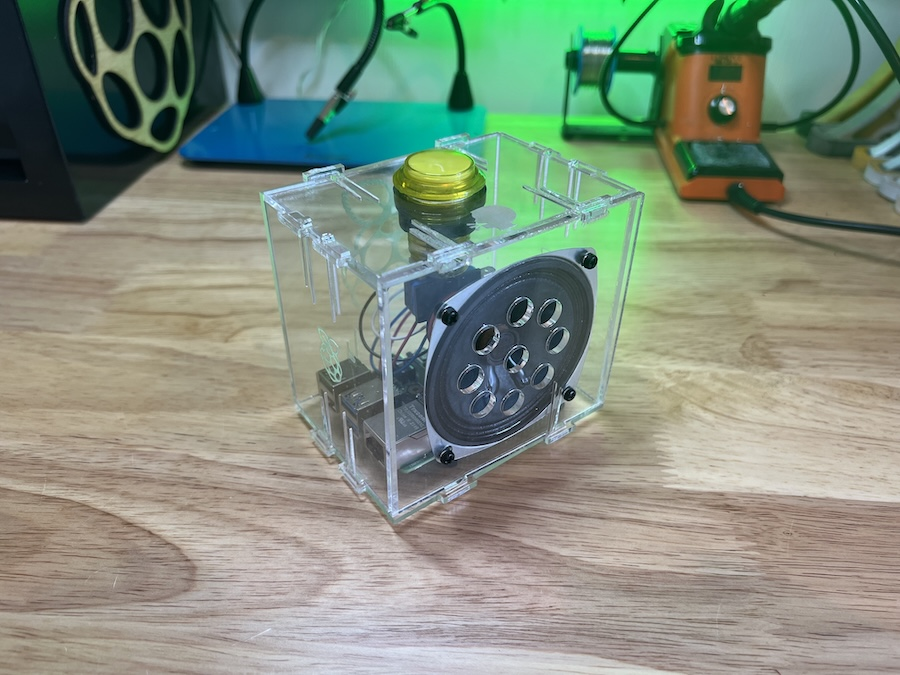

按下按钮时，将随机播放一段预录的 5 秒音频片段。按住 10 秒后，会发出一声提示用的打嗝声，随后录制一段新的 5 秒片段。按住按钮超过 20 秒将播放第二声打嗝，然后删除之前所有的录音。

### 硬件和接线

对于这个项目，任何小型无源扬声器基本都够用。我们使用的是[这款扬声器](https://shop.pimoroni.com/products/3-speaker-4-3w?variant=380549926)，它在 4 Ω 下可承受 5 W 功率。我们还使用了一个带照明的瞬时按钮和一个激光切割的盒子来容纳所有组件；但两者都完全可选。仅使用 Codec Zero 的板载按钮（已预先连接到 GPIO 27）也可以运行本示例。（或者，你也可以使用任何瞬时按钮，例如[这款](https://shop.pimoroni.com/products/mini-arcade-buttons?variant=40377171274)。）

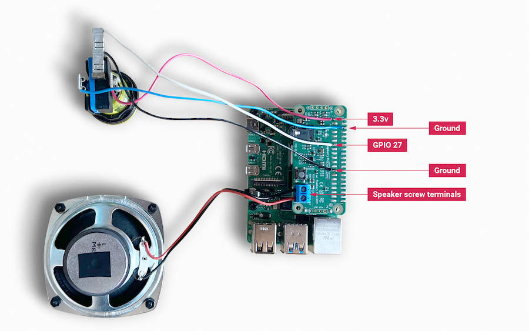

使用小号一字螺丝刀将扬声器连接到螺钉端子。对于额外的按钮，如有需要，请将按钮导线按图示直接焊接到 Codec Zero 的焊盘上：开关使用 GPIO 27 针脚和地线，LED 使用 +3.3V 和地线。

### 设置你的树莓派

在本示例中，我们使用树莓派系统精简版。详情请参阅我们的安装树莓派系统指南。

在继续之前，请确保更新你的操作系统，并按照 Codec Zero 配置说明进行操作，包括启用板载麦克风和扬声器输出的命令。

### 编程你的树莓派

在你的树莓派上打开一个 shell——例如通过 SSH 连接——并运行以下命令来创建 Python 脚本：

```bash
$ sudo nano chatter_box.py
```

将以下内容添加到文件中，并将 `<username>` 替换为你的用户名：

```python
#!/usr/bin/env python3
from gpiozero import Button
from signal import pause
import time
import random
import os
from datetime import datetime

# Print current date

date = datetime.now().strftime("%d_%m_%Y-%H:%M:%S")
print(f"{date}")

# Make sure that the 'sounds' folder exists, and if it does not, create it

path = '/home/<username>/sounds'

isExist = os.path.exists(path)

if not isExist:
  os.makedirs(path)
  print("The new directory is created!")
  os.system('chmod 777 -R /home/<username>/sounds')

# Download a 'burp' sound if it does not already exist

burp = '/home/<username>/burp.wav'

isExist = os.path.exists(burp)
if not isExist:
  os.system('wget http://rpf.io/burp -O burp.wav')
  print("Burp sound downloaded!")

# Setup button functions - Pin 27 = Button hold time 10 seconds.

button = Button(27, hold_time=10)

def pressed():
    global press_time
    press_time = time.time()
    print("Pressed at %s" % (press_time));

def released():
    release_time = time.time()
    pressed_for = release_time - press_time
    print("Released at %s after %.2f seconds" % (release_time, pressed_for))
    if pressed_for < button.hold_time:
        print("This is a short press")
        randomfile = random.choice(os.listdir("/home/<username>/sounds/"))
        file = '/home/<username>/sounds/' + randomfile
        os.system('aplay ' + file)
    elif pressed_for > 20:
        os.system('aplay ' + burp)
        print("Erasing all recorded sounds")
        os.system('rm /home/<username>/sounds/*');

def held():
    print("This is a long press")
    os.system('aplay ' + burp)
    os.system('arecord --format S16_LE --duration=5 --rate 48000 -c2 /home/<username>/sounds/$(date +"%d_%m_%Y-%H_%M_%S")_voice.m4a');

button.when_pressed = pressed
button.when_released = released
button.when_held = held

pause()
```

按 `Ctrl+X`，再按 `Y`，然后按 *Enter* 保存。要使脚本可执行，请输入以下内容：

```bash
$ sudo chmod +x chatter_box.py
```

接下来，我们需要创建一个 crontab 守护进程，让脚本在设备每次上电时自动启动。运行以下命令打开你的 crontab 进行编辑：

```bash
$ crontab -e
```

系统会要求你选择一个编辑器；我们推荐使用 `nano`。输入对应的数字并按 Enter 键继续。将以下行添加到文件底部，并将 `<username>` 替换为你的用户名：

```sh
@reboot python /home/<username>/chatter_box.py
```

按 *Ctrl X*，再按 *Y*，然后按 *Enter* 保存，然后用 `sudo reboot` 重启你的设备。

### 使用玩具聊天盒

最后一步是确认一切按预期运行。按下按钮，听到打嗝声时松开。录音随即开始，持续 5 秒。松开按钮后，再短暂按下按钮即可听到录音。你可以随心重复这一过程，你的声音将被随机播放。要删除所有录音，请按住按钮，在第一声打嗝和录音过程中保持按住，并在至少 20 秒后松开，此时你会听到另一声打嗝，确认录音已删除。

[观看演示视频](https://youtu.be/BjXERzu8nS0)

### 下一步

升级！升级项目总是充满乐趣，为什么不添加一些额外功能，例如录音时点亮的 LED？本项目所需的零件足以让你打造自己的 [Google 智能扬声器系统](https://aiyprojects.withgoogle.com/)，你也可以考虑制作第二台设备，组成一对可通过 SSH 在网络上传输音频文件的对讲机。

## 硬件信息

硬件信息：

* PCB 螺丝均为 M2.5。
* PCB 间隔柱（用于外壳）为 5 mm 公/母。
* PCB 间隔柱（用于树莓派与音频扩展板之间）为 9 mm 母/母。
* PCB 间隔柱（用于 XLR 与 DAC PRO 之间）为 8 mm 母/公。
* PCB 间隔柱（用于官方树莓派 7 英寸显示屏）为 5 mm 公/母。
* 我们使用并测试过的旋转编码器包括 Alpha 三针旋转编码器 RE160F-40E3-20A-24P、ALPS EC12E2430804（RS: 729-5848）和 Bourns ECW0JB24-AC0006L（RS: 263-2839）。
* 用于为 DigiAMP+ 供电的桶形连接器为 2.5 mm 内径、5.5 mm 外径、11 mm 长。
* DigiAMP+ 设计为配合 12V 至 24V、3A 电源工作，例如 XPPower VEC65US19 或类似产品。
* DigiAMP+ 使用 CamdenBoss 两件式连接器，装在 PCB 上的是 CTBP9350/2AO。
* Codec Zero 上使用的扬声器端子可接受 14~26 AWG（最大直径 1.6 mm）的导线。

### GPIO 使用

树莓派音频扩展板要正常工作，需要使用 GPIO 排针上的若干引脚。其中一些引脚专供扩展板使用，另一些则可与其他外设、传感器等共享。

音频扩展板将使用以下树莓派 GPIO 引脚：

* 所有电源引脚
* 所有接地引脚
* GPIO 2/3（I2C）
* GPIO 18/19/20/21（I2S）

如果适用，还将使用以下引脚：

* GPIO 22（DigiAMP+ 静音/取消静音支持）
* GPIO 23/24，用于旋转编码器（物理音量控制）或状态 LED（Codec Zero）
* GPIO 25，用于红外传感器
* GPIO 27，用于旋转编码器按压开关/Codec Zero 按钮

### DAC PRO、DAC+、DigiAMP+、Codec Zero

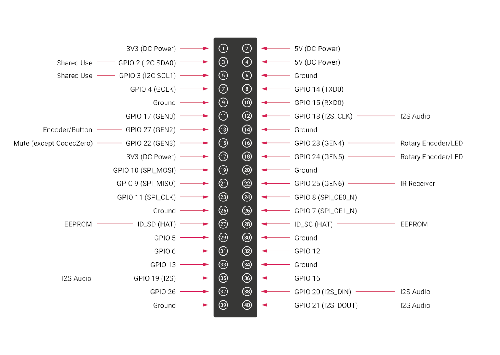

DAC PRO、DAC+ 和 DigiAMP+ 重新引出了树莓派信号，便于添加额外的传感器和外设。部分信号为某些扩展板专用（I2S 和 EEPROM）；其他信号（如 I2C）可在多块扩展板之间共享。

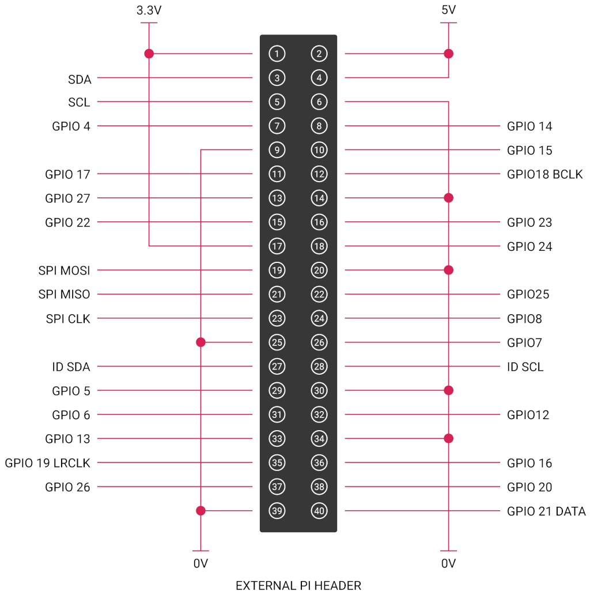

### 保存 AlsaMixer 设置

要存储 AlsaMixer 设置，请在命令行中输入以下命令：

```bash
$ sudo alsactl store
```

你可以将当前状态保存到文件，然后在启动时重新加载该状态。

要保存，请运行以下命令，并将 `<username>` 替换为你的用户名：

```bash
$ sudo alsactl store -f /home/<username>/usecase.state
```

要恢复已保存的文件，请运行以下命令，并将 `<username>` 替换为你的用户名：

```bash
$ sudo alsactl restore -f /home/<username>/usecase.state
```

### 基于 MPD 的音频与音量控制

要让基于音乐播放器守护进程（MPD）的音频软件控制音频扩展板的内置音量，你可能需要修改 `/etc/mpd.conf` 文件，以支持正确的 AlsaMixer 名称。

具体做法是确保 `/etc/mpd.conf` 的“Audio output”（音频输出）部分包含 `mixer_control` 行。以下是基于 Texas Instruments 的扩展板（DAC PRO/DAC+/DigiAMP+）的示例：

```ini
audio_output {
    type "alsa"
    name "ALSA Device"
    mixer_control "Digital"
}
```

## 更新固件

树莓派音频扩展板使用 EEPROM，其中包含主机树莓派设备在启动时选择相应驱动程序所需的信息。该信息在制造时写入 EEPROM。某些情况下，最终用户可能需要更新 EEPROM 内容：这可以通过命令行完成。

>**重要**
>
>在继续之前，请将树莓派上运行的树莓派系统更新到最新版本。

### EEPROM 写保护跳线

在编程过程中，你需要用导线连接红框中所示的两个焊盘，以拉低 EEPROM 写保护跳线。

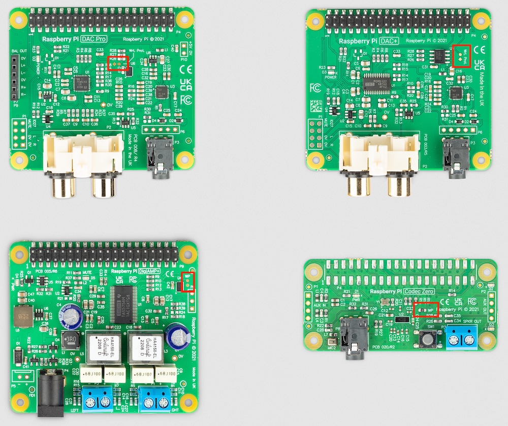

>**注意**
>
>在某些情况下，两个焊盘上可能已经焊有 0 Ω 电阻来桥接写保护跳线，如 Codec Zero 扩展板的图片所示。

### 对 EEPROM 编程

写保护线被拉低后，即可对 EEPROM 编程。

先安装实用工具，然后运行烧录程序。打开终端窗口并输入以下内容：

```bash
$ sudo apt update
$ sudo apt install rpi-audio-utils
$ sudo rpi-audio-flash
```

启动后，你将看到一个警告界面。

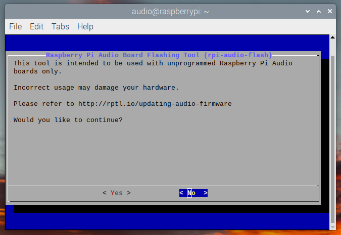

选择 *Yes* 继续。你将看到一个菜单，可在其中选择你的硬件。

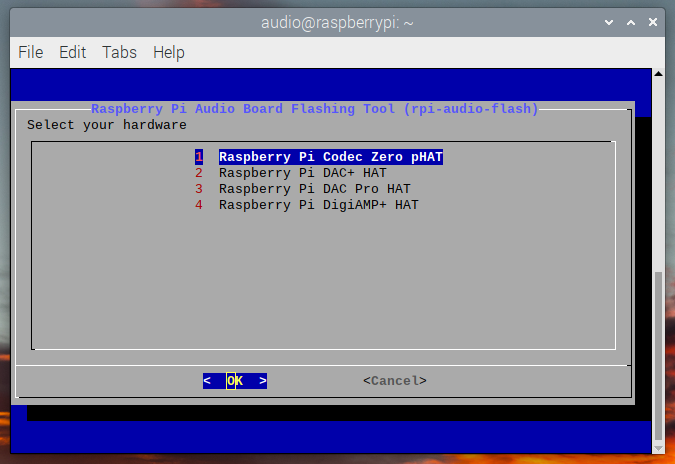

>**注意**
>
>如果没有检测到 HAT，或连接的 HAT 不是树莓派音频扩展板，你将看到错误界面。如果扩展板上的固件已经更新过，则会显示一条消息，告知你无需继续。

选择硬件后，屏幕会显示新固件正在刷入 HAT 的界面。

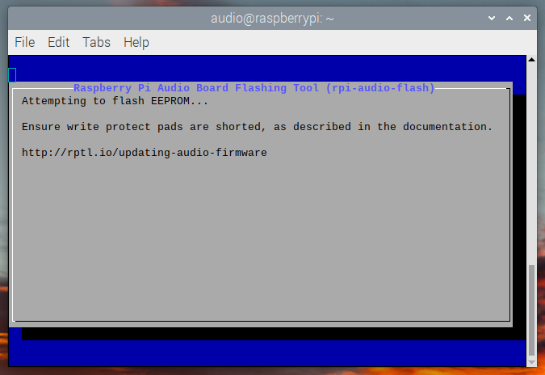

随后会显示一个界面，告知你新固件已安装。

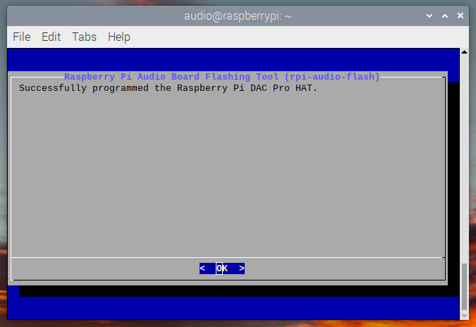

>**注意**
>
>如果固件未能正确安装，你将看到错误界面。请尝试拔下并重新插好 HAT，然后重新刷写固件。
