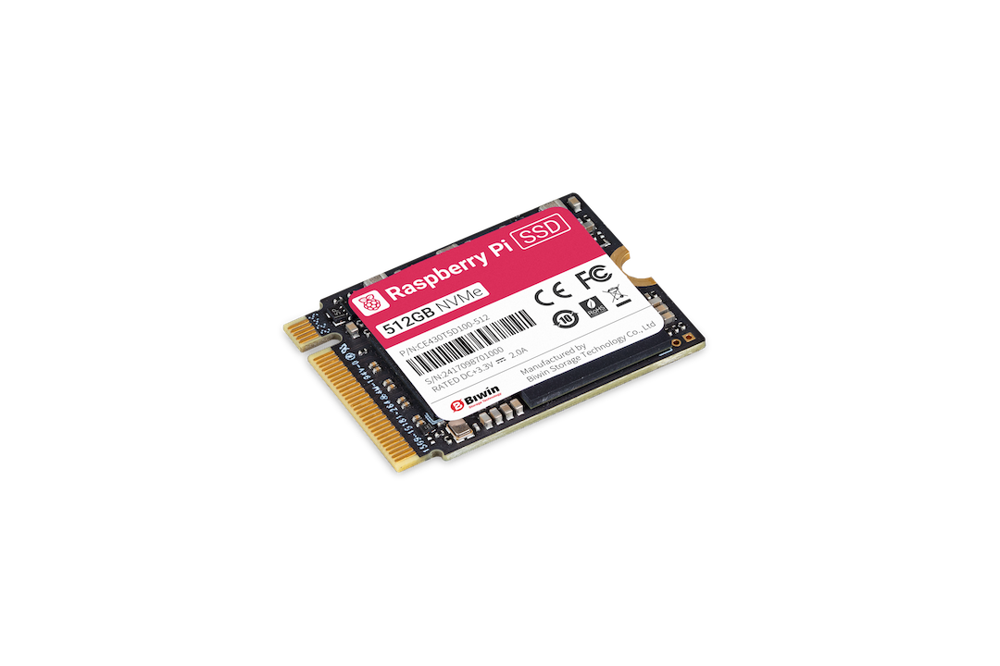

# SSD

## 关于

512 GB 树莓派 SSD

SSD 质量是决定树莓派整体用户体验的关键因素。树莓派提供经过测试的官方 SSD，以确保与树莓派型号和外设兼容。

树莓派 SSD 提供以下容量：

* 256 GB
* 512 GB
* 1 TB

要在树莓派上使用 SSD，你需要一个兼容树莓派 5 的 M.2 适配器，例如[树莓派 M.2 HAT+ 或 M.2 HAT+ Compact](m.2-hat+.md)。

## 规格

树莓派 SSD 符合 PCIe Gen 3 规范。

树莓派 SSD 使用 NVMe 1.4 寄存器接口和命令集。

树莓派 SSD 采用 M.2 2230 外形尺寸。

下表描述了使用 4 kB 随机数据时树莓派 SSD 的读取和写入速度：

| 容量 | 读取速度 | 写入速度 |
| :---: | :---: | :---: |
| 256 GB | 40,000 IOPS | 70,000 IOPS |
| 512 GB | 50,000 IOPS | 90,000 IOPS |
| 1 TB | 90,000 IOPS | 90,000 IOPS |
