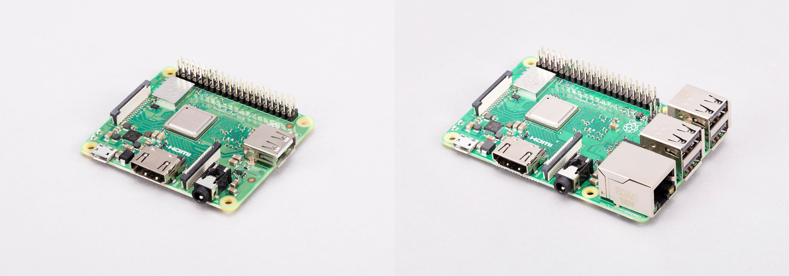
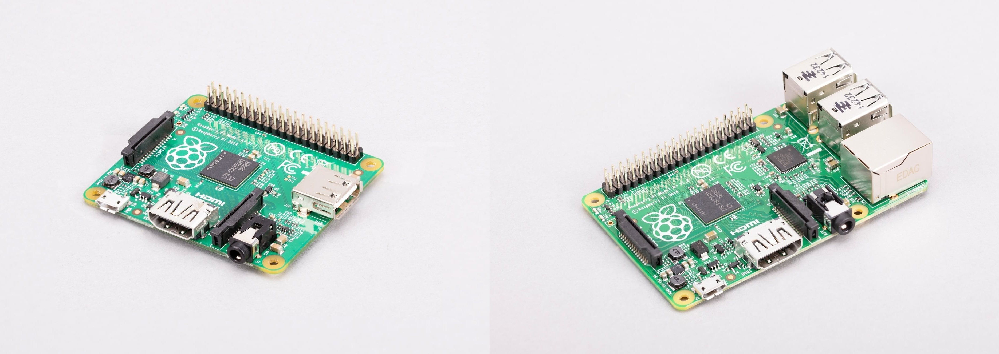
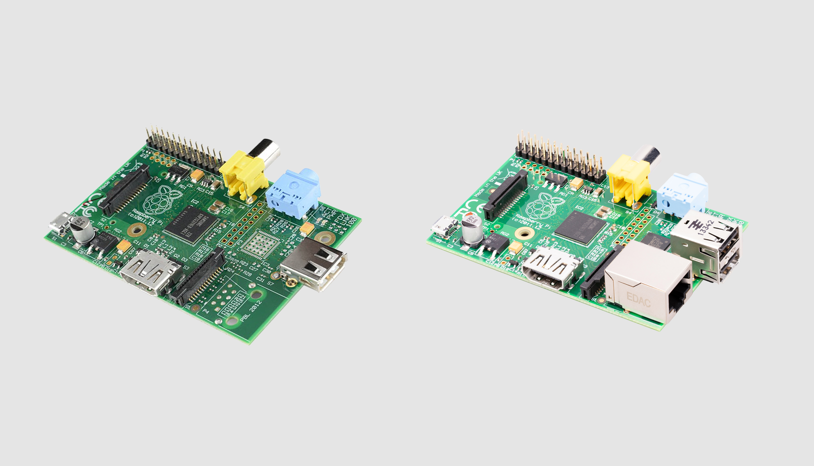

# 经典型单板计算机

单板计算机（SBC）是构建在印刷电路板（PCB）上的完整、可正常工作的计算机。经典型 Raspberry Pi SBC 将以下内容集成在一块板子上：

* 片上系统（SoC）。
* 内存。
* GPIO 排针。
* 多种连接选项。

所有组件和端口均裸露在外，但你可以购买保护壳或机箱来保护它们。只要不将 Raspberry Pi SBC 放在金属表面上，即使没有保护壳或机箱，也可以安全使用。如果将未安装机箱的 Raspberry Pi SBC 放在金属表面上，可能会发生短路。

你还可以连接各种外设，例如屏幕、键盘和鼠标。有关操作说明，请参阅[设置你的 Raspberry Pi](ru-men.md#设置你的树莓派)。

## 型号

Raspberry Pi 设备经历了多个型号的演进，在性能、连接性和功能方面不断提升，以满足不同的使用场景。

### 型号变体

同一代经典型 SBC 型号中的变体有时会用一个字母 *A* 或 *B* 来标示，表示该代产品中不同型号在外形尺寸和功能集上的差异。

* **型号 B** 表示功能齐全的变体，包含以太网端口和多个 USB 端口，适合通用场景。
* **型号 A** 表示成本更低、尺寸更小的变体，没有以太网端口，USB 端口也更少，适合空间更受限的应用。

>**注意**
>
>如果你使用的是 Raspberry Pi 400、500 或 500+，其 Raspberry Pi 电路板内置于键盘机箱中。有关这些设备的更多信息，请参阅[键盘计算机](jian-pan-ji-suan-ji.md)。

### 型号列表

下表按时间倒序汇总经典型 Raspberry Pi SBC 型号，列出各型号的主要区别特征，便于快速查阅。有关各型号的更多详细信息（包括连接选项的详细说明），请参阅本页后面的专门章节。

**按时间倒序排列的旗舰 SBC 列表**

| 型号 | 微处理器 | 内存（RAM） | GPIO 排针 | GPU | CPU |
| ---- | -------- | ----------- | --------- | --- | --- |
| Raspberry Pi 5（2023） | Broadcom [BCM2712](chu-li-qi.md#bcm2712) | 1、2、4、8 或 16 GB 内存 | 40 针 GPIO 排针 | VideoCore VII | 2.4 GHz 四核 64 位 Cortex-A76 |
| Raspberry Pi 4B（2019） | Broadcom [BCM2711](chu-li-qi.md#bcm2711) | 1、2、3、4 或 8 GB 内存 | 40 针 GPIO 排针 | VideoCore VI | 1.8 GHz 四核 64 位 Cortex-A72 |
| Raspberry Pi 3A+（2018） | Broadcom [BCM2837B0](chu-li-qi.md#bcm2837b0) | 512 MB 内存 | 40 针 GPIO 排针 | VideoCore IV | 1.4 GHz 四核 64 位 Cortex-A53 |
| Raspberry Pi 3B+（2018） | Broadcom [BCM2837B0](chu-li-qi.md#bcm2837b0) | 1 GB 内存 | 40 针 GPIO 排针 | VideoCore IV | 1.4 GHz 四核 64 位 Cortex-A53 |
| Raspberry Pi 3B（2017） | Broadcom [BCM2837B0](chu-li-qi.md#bcm2837b0)（早期版本使用 [BCM2837](chu-li-qi.md#bcm2837)） | 1 GB 内存 | 40 针 GPIO 排针 | VideoCore IV | 1.2 GHz 四核 64 位 Cortex-A53 |
| Raspberry Pi 2B（2015） | Broadcom [BCM2837B0](chu-li-qi.md#bcm2837b0)（早期版本使用 [BCM2837](chu-li-qi.md#bcm2837) 或 [BCM2836](chu-li-qi.md#bcm2836)） | 1 GB 内存 | 40 针 GPIO 排针 | VideoCore IV | 900 MHz 四核 64 位 Cortex-A53（早期版本使用 900 MHz 四核 32 位 Cortex-A7） |
| Raspberry Pi A+（2014） | Broadcom [BCM2835](chu-li-qi.md#bcm2835) | 256 或 512 MB 内存 | 40 针 GPIO 排针 | VideoCore IV | 700 MHz 单核 32 位 ARM11 |
| Raspberry Pi B+（2014） | Broadcom [BCM2835](chu-li-qi.md#bcm2835) | 512 MB 内存 | 40 针 GPIO 排针 | VideoCore IV | 700 MHz 单核 32 位 ARM11 |
| Raspberry Pi A（2013） | Broadcom [BCM2835](chu-li-qi.md#bcm2835) | 256 MB 内存 | 26 针 GPIO 排针 | VideoCore IV | 700 MHz 单核 32 位 ARM11 |
| Raspberry Pi B（2012） | Broadcom [BCM2835](chu-li-qi.md#bcm2835) | 256 或 512 MB 内存 | 26 针 GPIO 排针 | VideoCore IV | 700 MHz 单核 32 位 ARM11 |

## Raspberry Pi 5

[Raspberry Pi 5](https://www.raspberrypi.com/products/raspberry-pi-5/) 是 Raspberry Pi 的第五代经典型 SBC。与之前的型号相比，它在 CPU 性能、图形能力、内存带宽、I/O 吞吐量和电源管理方面均有提升。该板引入了将 I/O 管理与主处理器分离的新架构，从而实现更快的外设连接和更好的整体系统性能，具体如下。

Raspberry Pi 5 的尺寸约为 85 mm × 56 mm。更详细的尺寸，请参阅 [Raspberry Pi 5 的机械图](https://pip.raspberrypi.com/documents/RP-008347-DS)。

### 相比 Raspberry Pi 4 的功能变化

相比 Raspberry Pi 4，Raspberry Pi 5 在架构和用户体验上发生了根本性变化：

* **更快的 SoC。** Raspberry Pi 5 的 SoC 为 Broadcom *BCM2712*，包含：
  * 四个 64 位 Arm Cortex-A76 CPU 核心，每个 CPU 核心的运行频率为 2.4 GHz。
  * 一个 800 MHz 的 Broadcom VideoCore VII GPU，用于视频和 3D 渲染任务。
* **更快的内存。** 升级为运行频率 4267 MHz 的 LPDDR4X。
* **可选更大内存。** 有五种内存选项，最高可达 16 GB。
* **RP1 I/O 控制器。** RP1 组件充当 SoC 与板载外设接口之间的中介，使 SoC 无需直接管理底层 I/O 任务。RP1 管理板上的大部分端口连接，让 SoC 能够专注于处理任务。有关该组件的更多信息，请参阅 [I/O 控制器](io-kong-zhi-qi.md)。
* **USB 3.0 带宽可同时使用。** 得益于 RP1 组件，Raspberry Pi 5 可以同时以全速运行两个 USB 3.0 端口。
* **PCIe 2.0 支持。** 通过专用的 [FFC 连接器](https://pip.raspberrypi.com/documents/RP-008298-DS)提供高带宽通信，可直接连接 NVMe 硬盘或 AI 加速器等外部外设，与存储卡相比可提高数据读写速度。
* **可互换、更高带宽的 MIPI 端口。** Raspberry Pi 5 有两个可互换的 CSI/DSI 端口，而非一个 CSI 端口和一个 DSI 端口，因此你可以连接两个摄像头、两个显示器，或各连接一个。每个连接器支持 4 条 MIPI 数据通道，适用于高性能摄像头和显示器。
* **增强的双 4K 显示支持。** 你可以同时连接两台 60 Hz 的 4K 显示器。
* **专用电源按钮。** 你不再需要插拔 Raspberry Pi 的电源来开机和关机，电源按钮提供更接近 PC 的电源管理体验。
* **更高的供电规格。** PMIC 支持 5 V 5 A（25 W）的供电规格，以满足耗电更多的 USB 设备。
* **散热管理。** 专用风扇排针让你可以连接以下设备之一，通过脉宽调制（PWM）管理温度：
  * [Raspberry Pi Active Cooler](https://www.raspberrypi.com/products/active-cooler/)，将铝制散热器与温控鼓风机风扇结合在一起。
  * [Raspberry Pi 5 Case](https://www.raspberrypi.com/products/raspberry-pi-5-case/)，附带集成的温控散热风扇。
* **实时时钟（RTC）。** 你可以连接电池，即使 Raspberry Pi 5 断电，也能保持系统时间。
* **专用 UART 调试端口。** 该排针（[3 针调试连接器](https://pip.raspberrypi.com/documents/RP-008189-DS)）无需占用 GPIO 引脚即可提供对 CPU 的调试访问。
* **PoE 排针位置调整。** 四针 PoE 排针从板子上方 GPIO 排针旁边移至板子下方以太网端口与 CSI/DSI 端口之间。

以下各节在介绍这些变化的同时，还介绍：

* 焊接在 Raspberry Pi 5 上的其他内部组件。
* 允许你将外部硬件连接到这些组件的物理插座和排针。

### Raspberry Pi 5 组件

Raspberry Pi 5 包含以下板载组件：

**Raspberry Pi 5 组件列表**

| 组件 | 说明 |
| ---- | ---- |
| **SoC** | **Broadcom BCM2712**，包含 2.4 GHz 四核 64 位 Arm Cortex-A76（CPU）和 800 MHz VideoCore VII（GPU）。 |
| **RP1（I/O 管理）** | 该 I/O 控制器管理外设，为主 CPU 分担 I/O 任务，包括 GPIO、USB、以太网和 MIPI。有关更多信息，请参阅 [I/O 控制器](io-kong-zhi-qi.md)。 |
| **内存** | *LPDDR4X*（增强型低功耗双倍数据速率 4）内存，运行频率为 4267 MHz；可在 1、2、4、8 或 16 GB 中固定选择一种容量。 |
| **无线模块** | 一个承担两种功能的无线电模块：用于连接计算机网络的 *Wi-Fi* 无线电，提供双频（2.4 GHz 或 5 GHz）802.11ac Wi-Fi；以及用于连接外设的*蓝牙*无线电，提供蓝牙 5.0 和低功耗蓝牙（BLE）。 |
| **以太网 PHY** | 专用的物理层收发器（PHY），在 RP1 I/O 控制器和 RJ45（千兆以太网）端口之间传输数据。 |
| **实时时钟（RTC）** | 一个 RTC 模块，即使 Raspberry Pi 5 断电，也能记录当前日期和时间。 |
| **电源按钮** | 位于板子边缘的物理按钮，无需拔下 USB-C 线缆即可执行软关机、唤醒和硬断电。 |

### Raspberry Pi 5 端口

Raspberry Pi 5 包含以下端口：

**表 4. Raspberry Pi 5 端口列表**

| 端口类型 | 说明 |
| -------- | ---- |
| **USB 3.0 端口** | 两个 USB 3.0 端口（蓝色），在 RP1 的支持下可同时以 5 Gb/s 运行。这些 USB 端口让你可以将高速存储设备和外设连接到 Raspberry Pi 5。 |
| **USB 2.0 端口** | 两个 USB 2.0 端口（黑色），支持键盘、鼠标和其他不需要高带宽的较慢外设。 |
| **千兆以太网端口** | 用于连接有线计算机网络的高速 RJ45 端口。该端口底部有两个 LED，用于指示连接状态和活动状态。当与 PoE+ 扩展板配合使用时，该端口还支持 PoE；如果另一端连接到支持 PoE 的网络交换机、路由器或注入器，它可以从以太网线缆中获取电力。 |
| **PoE 排针** | 位于 CSI/DSI 端口和以太网端口之间的四针排针。连接 PoE+ 扩展板后，这些引脚让 Raspberry Pi 5 可以通过以太网线缆而非 USB-C 线缆获取电力。 |
| **Micro-HDMI 端口** | 两个 micro-HDMI 端口，标记为 `HDMI0` 和 `HDMI1`，最多支持同时连接两台 60 Hz 的 4K 显示器。 |
| **双 CSI/DSI 端口** | 两个可互换的 4 通道 MIPI 连接器，标记为 `CAM/DISP 0` 和 `CAM/DISP 1`，采用两个 mini 22 针、0.5 mm 间距、11.5 mm 宽的 CSI/DSI 组合端口，支持两个摄像头、两个显示器，或各连接一个。 |
| **PCIe 2.0 接口** | 单通道 PCIe 2.0 接口，通过 16 针、0.5 mm 间距的 FFC 连接器引出，可连接 NVMe SSD（通过 M.2 扩展板）和 AI 加速器（通过 AI 扩展板）等高速外设。 |
| **USB Type-C 电源端口** | 用于将 Raspberry Pi 连接到电源的 USB-C 端口，支持为板子和所连接外设供电所需的 5 V 5 A（25 W），或 5 V 3 A（15 W）；在后一种情况下，USB 外设电流限制为 600 mA。 |
| **GPIO 排针** | 由 40 个金属引脚组成的标准化接口，排列为两行各 20 针。这些引脚让 Raspberry Pi 可以与其他硬件（如 LED、按钮、传感器等）通信。 |
| **风扇排针** | 用于风扇的专用四针 JST 连接器（JST-SH 1.25 mm），使用 PWM 根据 CPU 温度调节风扇转速，在高负载时保持低温。 |
| **RTC 电池排针** | 一个两针 JST 连接器，标记为 `BAT`，位于 USB-C 电源端口右侧。用于连接[锂电池](https://www.raspberrypi.com/products/rtc-battery/)，在主电源断开时为板载实时时钟（RTC）供电。 |
| **存储卡插槽** | 位于板子底面，用于插入高速存储卡以加载操作系统。 |
| **UART 调试端口** | 位于两个 micro-HDMI 端口之间的专用 3 针 JST 排针，为 CPU 提供调试访问，以便进行故障排查。 |

## Raspberry Pi 4 型号 B

[Raspberry Pi 4B](https://www.raspberrypi.com/products/raspberry-pi-4-model-b/) 是 Raspberry Pi 的第四代经典型 SBC。与之前的型号相比，它在处理器性能、内存容量、网络和多媒体能力方面均有提升。该板配备更强大的四核处理器，支持最高 4K 分辨率的双显示输出，并通过千兆以太网、USB 3.0 和双频无线网络提供更快的连接，具体如下。

Raspberry Pi 4B 的尺寸约为 85 mm × 56 mm。更详细的尺寸，请参阅以下机械图：

* [Raspberry Pi 4B 机械图（PDF）](https://pip.raspberrypi.com/documents/RP-008343-DS)
* [Raspberry Pi 4B 机械图（DXF）](https://pip.raspberrypi.com/documents/RP-008342-DS)

有关电源电路和端口连接的工程图，请参阅 [Raspberry Pi 4B 的原理图](https://pip.raspberrypi.com/documents/RP-008345-DS)。

### 相比 Raspberry Pi 3A+ 和 3B+ 的功能变化

相比 Raspberry Pi 3A+ 和 3B+，Raspberry Pi 4B 在架构上发生了变化：

* **更快的 SoC。** Raspberry Pi 4B 的 SoC 为 Broadcom *BCM2711*，包含：
  * 四个 64 位 Arm Cortex-A72 CPU 核心，每个 CPU 核心的运行频率为 1.8 GHz。
  * 一个 500 MHz 的 Broadcom VideoCore VI GPU，用于视频和 3D 渲染任务。
* **更快的内存。** 升级为运行频率 3200 MHz 的 LPDDR4。
* **内存选项。** 有五种内存选项，最高可达 8 GB。
* **USB 3.0 端口。** 除两个 USB 2.0 端口（黑色）外，Raspberry Pi 4B 还包含两个 USB 3.0 端口（蓝色），速度更快，供电能力也强于 USB 2.0 端口。
* **真正的千兆以太网。** Raspberry Pi 4B 不像 Raspberry Pi 3B+ 那样通过 USB 控制器传输以太网流量，而是提供完整、不受限制的千兆以太网，线速可达 1 Gb/s。
* **支持双 4K 显示器。** 两个 micro-HDMI 端口取代了单个全尺寸 HDMI 端口，支持两台 30 Hz 的 4K 显示器或一台 60 Hz 的 4K 显示器。
* **升级的蓝牙。** 无线连接升级至蓝牙 5.0，速度是蓝牙 4.2 的两倍，范围是四倍。
* **USB-C 电源输入。** USB-C 电源输入取代了 micro USB 电源输入。
* **专用 USB 控制器。** Raspberry Pi 4B 不再使用单一的以太网和 USB 控制器，而是用独立组件控制 USB；以太网控制器则集成在 SoC 中。

以下各节在介绍这些变化的同时，还介绍：

* 焊接在 Raspberry Pi 5 上的其他内部组件。
* 允许你将外部硬件连接到这些组件的物理插座和排针。

### Raspberry Pi 4B 组件

Raspberry Pi 4B 包含以下板载组件：

**Raspberry Pi 4B 组件列表**

| 组件 | 说明 |
| ---- | ---- |
| **SoC** | **Broadcom BCM2711**，包含 1.8 GHz 四核 64 位 Arm Cortex-A72（CPU）和 500 MHz VideoCore VI（GPU）。 |
| **内存** | *LPDDR4*（低功耗双倍数据速率 4）内存，运行频率为 3200 MHz；可选 1、2、3、4 或 8 GB 内存。 |
| **无线模块** | 一个承担两种功能的无线电模块：用于连接计算机网络的 *Wi-Fi* 无线电，提供双频（2.4 GHz 或 5 GHz）802.11ac Wi-Fi；以及用于连接外设的*蓝牙*无线电，提供蓝牙 5.0 和低功耗蓝牙（BLE）。 |
| **USB 控制器** | USB 端口后面的一个小型黑色组件（VL805），用于控制这些端口。 |
| **以太网 PHY** | 专用的物理层收发器（PHY），将 SoC 中的千兆以太网接口连接到 RJ45（千兆以太网）端口。 |

### Raspberry Pi 4B 端口

Raspberry Pi 4B 包含以下端口：

**Raspberry Pi 4B 端口列表**

| 端口类型 | 说明 |
| -------- | ---- |
| **USB 3.0 端口** | 两个 USB 3.0 端口（蓝色），支持高速运行。这些 USB 端口让你可以将高速存储设备和外设连接到 Raspberry Pi 4B。 |
| **USB 2.0 端口** | 两个 USB 2.0 端口（黑色），支持键盘、鼠标和其他不需要高带宽的较慢外设。 |
| **千兆以太网端口** | 用于连接有线计算机网络的高速 RJ45 端口。该端口底部有两个 LED，用于指示连接状态和活动状态。当与 PoE+ 扩展板配合使用时，该端口还支持 PoE；如果另一端连接到支持 PoE 的网络交换机、路由器或注入器，它可以从以太网线缆中获取电力。 |
| **PoE 排针** | 位于 GPIO 排针附近的四针排针。连接 PoE+ 扩展板后，这些引脚让 Raspberry Pi 4B 可以通过以太网线缆而非 USB-C 线缆获取电力。 |
| **AV 插孔** | 3.5 mm、4 极立体声音频和复合视频端口（AV 插孔），可使用 TRRS 线缆连接支持复合视频信号的电视、投影仪和其他显示器。 |
| **Micro-HDMI 端口** | 两个 micro-HDMI 端口，标记为 `HDMI0` 和 `HDMI1`，最多支持两台 30 Hz 的 4K 显示器或一台 60 Hz 的 4K 显示器。 |
| **CSI（摄像头）端口** | 2 通道 MIPI 摄像头串行接口（CSI）端口，标记为 `CAMERA`，可连接摄像头。采用标准的 15 针、1 mm 间距、16 mm 宽的 CSI 端口。 |
| **DSI（显示器）端口** | 2 通道 MIPI 显示器串行接口（DSI）端口，标记为 `DISPLAY`，可连接显示器。采用标准的 15 针、1 mm 间距、16 mm 宽的 DSI 端口。 |
| **USB Type-C 电源端口** | 用于将 Raspberry Pi 连接到电源的 USB-C 电源端口，支持为板子和所连接外设供电所需的 5 V 3 A（15 W）。 |
| **GPIO 排针** | 由 40 个金属引脚组成的标准化接口，排列为两行各 20 针。这些引脚让 Raspberry Pi 可以与其他硬件（如 LED、按钮、传感器等）通信。 |
| **存储卡插槽** | 位于板子底面，用于插入高速存储卡以加载操作系统。 |

## Raspberry Pi 3 型号 A+ 和 B+

Raspberry Pi 3A+ 和 3B+ 相比初代 Raspberry Pi 3B 均提供了硬件升级，包括更快的 SoC、用于改善散热性能的集成金属散热片，以及升级的无线连接。

[Raspberry Pi 3B+](https://www.raspberrypi.com/products/raspberry-pi-3-model-b-plus/) 是第三代（Raspberry Pi 3B）经典型 SBC 的增强版本。与 Raspberry Pi 3A+ 相比，它提供更多硬件功能，包括以太网端口和额外的 USB 端口。其尺寸约为 85 mm × 56 mm。如需更详细的尺寸数据，请参阅以下机械图：

* [Raspberry Pi 3B+ 机械图（PDF）](https://pip.raspberrypi.com/documents/RP-008337-DS)
* [Raspberry Pi 3B+ 机械图（DXF）](https://pip.raspberrypi.com/documents/RP-008336-DS)

有关电源电路和端口连接的工程图，请参阅 [Raspberry Pi 3B+ 的原理图](https://pip.raspberrypi.com/documents/RP-008339-DS)。

[Raspberry Pi 3A+](https://www.raspberrypi.com/products/raspberry-pi-3-model-a-plus/) 与 Raspberry Pi 3B+ 共享相同的核心处理器和无线能力，但外形尺寸更小，内存更少，端口也更少。其尺寸约为 65 mm × 56 mm。如需更详细的尺寸数据，请参阅 [Raspberry Pi 3A+ 的机械图](https://pip.raspberrypi.com/documents/RP-008330-DS)。有关电源电路和端口连接的工程图，请参阅 [Raspberry Pi 3A+ 的原理图](https://pip.raspberrypi.com/documents/RP-008332-DS)。

此外还有 Raspberry Pi 3A+ 机箱和 3B+ 机箱的机械图：

* [Raspberry Pi 3A+ 机箱机械图（PDF）](https://pip.raspberrypi.com/documents/RP-008329-DS)
* [Raspberry Pi 3B+ 机箱机械图（PDF）](https://pip.raspberrypi.com/documents/RP-008160-DS)

### 相比 Raspberry Pi 3B 的功能变化

Raspberry Pi 3A+ 和 3B+ 具备升级的无线网络：

* 双频（2.4 GHz 和 5 GHz）Wi-Fi，具有模块化合规认证。
* 蓝牙 4.2（从 4.1 升级）和低功耗蓝牙（BLE）。

Raspberry Pi 3B+ 相比 Raspberry Pi 3B 还包含以下变化：

* **更快的以太网。** Raspberry Pi 3B+ 通过 USB 2.0 实现千兆以太网，吞吐量从约 100 Mb/s 提升至约 300 Mb/s。
* **支持 PoE。** 借助 PoE+ 扩展板，Raspberry Pi 3B+ 上的四针 PoE 排针让 SBC 可以通过以太网线缆获取电力。

以下各节在介绍这些变化的同时，还介绍：

* 焊接在 Raspberry Pi 3A+ 或 3B+ 上的其他内部组件。
* 允许你将外部硬件连接到这些组件的物理插座和排针。

### Raspberry Pi 3A+ 和 3B+ 组件

Raspberry Pi 3A+ 和 3B+ 包含以下板载组件：

**Raspberry Pi 3A+ 和 3B+ 组件列表**

| 组件 | Raspberry Pi 3A+ | Raspberry Pi 3B+ |
| ---- | ---------------- | ---------------- |
| **SoC** | **Broadcom BCM2837B0**，包含 1.4 GHz 四核 64 位 Arm Cortex-A53（CPU）和 400 MHz VideoCore IV（GPU）。 | **Broadcom BCM2837B0**，包含 1.4 GHz 四核 64 位 Arm Cortex-A53（CPU）和 400 MHz VideoCore IV（GPU）。 |
| **内存** | 512 MB *LPDDR2*（低功耗双倍数据速率 2）内存，运行频率为 900 MHz。 | 1 GB *LPDDR2*（低功耗双倍数据速率 2）内存，运行频率为 900 MHz。 |
| **无线模块** | 一个承担两种功能的无线电模块：用于连接计算机网络的 *Wi-Fi* 无线电，提供双频（2.4 GHz 或 5 GHz）802.11b/g/n Wi-Fi；以及用于连接外设的*蓝牙*无线电，提供蓝牙 4.2 和低功耗蓝牙（BLE）。 | 一个承担两种功能的无线电模块：用于连接计算机网络的 *Wi-Fi* 无线电，提供双频（2.4 GHz 或 5 GHz）802.11b/g/n Wi-Fi；以及用于连接外设的*蓝牙*无线电，提供蓝牙 4.2 和低功耗蓝牙（BLE）。 |
| **I/O 管理** | 单个 USB 2.0 端口直接连接到 Broadcom SoC。 | 网络和 USB 控制器（LAN7515），USB 端口后面的一个小型黑色组件，用于控制 USB 端口和以太网。 |

### Raspberry Pi 3A+ 和 3B+ 端口

Raspberry Pi 3A+ 和 3B+ 包含以下端口：

**Raspberry Pi 3A+ 和 3B+ 端口列表**

| 端口类型 | Raspberry Pi 3A+ | Raspberry Pi 3B+ |
| -------- | ---------------- | ---------------- |
| **USB 2.0 端口** | 单个 USB 2.0 端口，支持键盘、鼠标和其他不需要高带宽的较慢外设。 | 四个 USB 2.0 端口，支持键盘、鼠标和其他不需要高带宽的较慢外设。 |
| **千兆以太网端口（通过 USB 2.0）** | 无。如需有线连接，需要使用 USB 转以太网适配器。 | 通过 USB 2.0 总线在内部连接的 RJ45 网络端口。虽然这是千兆以太网端口，但在 USB 2.0 上实际网络吞吐量限制为 300 Mb/s。该端口底部有两个 LED，用于指示连接状态和活动状态。当与 PoE+ 扩展板配合使用时，该端口还支持 PoE；如果另一端连接到支持 PoE 的网络交换机、路由器或注入器，它可以从以太网线缆中获取电力。 |
| **PoE 排针** | 无。 | 位于 GPIO 排针附近的四针排针。连接 PoE+ 扩展板后，这些引脚让 Raspberry Pi 可以通过以太网线缆获取电力，从而无需 micro USB 线缆即可运行 Raspberry Pi。 |
| **AV 插孔** | 3.5 mm、4 极立体声音频和复合视频端口（AV 插孔），可使用 TRRS 线缆连接支持复合视频信号的电视、投影仪和其他显示器。 | 3.5 mm、4 极立体声音频和复合视频端口（AV 插孔），可使用 TRRS 线缆连接支持复合视频信号的电视、投影仪和其他显示器。 |
| **HDMI 端口** | 全尺寸 HDMI（Type-A）端口，支持向显示器或电视输出视频和音频，分辨率最高 1080p、60 Hz。 | 全尺寸 HDMI（Type-A）端口，支持向显示器或电视输出视频和音频，分辨率最高 1080p、60 Hz。 |
| **CSI（摄像头）端口** | 2 通道 MIPI 摄像头串行接口（CSI）端口，标记为 `CAMERA`，可连接摄像头。采用标准的 15 针、1 mm 间距、16 mm 宽的 CSI 端口。 | 2 通道 MIPI 摄像头串行接口（CSI）端口，标记为 `CAMERA`，可连接摄像头。采用标准的 15 针、1 mm 间距、16 mm 宽的 CSI 端口。 |
| **DSI（显示器）端口** | 2 通道 MIPI 显示器串行接口（DSI）端口，标记为 `DISPLAY`，可连接显示器。采用标准的 15 针、1 mm 间距、16 mm 宽的 DSI 端口。 | 2 通道 MIPI 显示器串行接口（DSI）端口，标记为 `DISPLAY`，可连接显示器。采用标准的 15 针、1 mm 间距、16 mm 宽的 DSI 端口。 |
| **Micro USB 电源端口** | 用于将 Raspberry Pi 连接到电源的 micro USB 电源端口，支持为板子和所连接外设供电所需的 5 V 2.5 A（12.5 W）。 | 用于将 Raspberry Pi 连接到电源的 micro USB 电源端口，支持为板子和所连接外设供电所需的 5 V 2.5 A（12.5 W）。 |
| **GPIO 排针** | 由 40 个金属引脚组成的标准化接口，排列为两行各 20 针。这些引脚让 Raspberry Pi 可以与其他硬件（如 LED、按钮、传感器等）通信。 | 由 40 个金属引脚组成的标准化接口，排列为两行各 20 针。这些引脚让 Raspberry Pi 可以与其他硬件（如 LED、按钮、传感器等）通信。 |
| **存储卡插槽** | 位于板子底面，用于插入高速存储卡以加载操作系统。 | 位于板子底面，用于插入高速存储卡以加载操作系统。 |

## Raspberry Pi 3 型号 B

[Raspberry Pi 3B](https://www.raspberrypi.com/products/raspberry-pi-3-model-b/) 是 Raspberry Pi 的第三代经典型 SBC。它带来了性能升级、内存增加和内置无线连接。它也是首款搭载 64 位 CPU 的 Raspberry Pi 型号，该 CPU 基于四核 Arm Cortex-A53 处理器。其尺寸约为 85 mm × 56 mm。更详细的尺寸，请参阅以下机械图：

* [Raspberry Pi 3B 机械图（PDF）](https://pip.raspberrypi.com/documents/RP-008335-DS)
* [Raspberry Pi 3B 机械图（DXF）](https://pip.raspberrypi.com/documents/RP-008334-DS)

有关电路、组件和引脚连接的工程图，请参阅 [Raspberry Pi 3B 的原理图](https://pip.raspberrypi.com/documents/RP-008340-DS)。

>**注意**
>
>Raspberry Pi 3B 的修订版 1.1 使用 *BCM2837*，已停止生产，不再销售。

### 相比 Raspberry Pi 2B 的功能变化

相比 Raspberry Pi 2B，Raspberry Pi 3B 在性能和连接性上发生了变化：

* **更快的 SoC。** Raspberry Pi 3B 最新修订版的 SoC 为 Broadcom *BCM2837B0*，包含四个 64 位 Arm Cortex-A53 CPU 核心，每个 CPU 核心的运行频率为 1.2 GHz。
* **改进的散热管理。** Raspberry Pi 3B 最新修订版的 SoC 包含金属散热片（封装），用于改善散热。
* **无线网络。** 新增无线连接，包括：
  * 单频（2.4 GHz）802.11b/g/n Wi-Fi。
  * 蓝牙 4.1 和低功耗蓝牙（BLE）。

以下各节在介绍这些变化的同时，还介绍：

* 焊接在 Raspberry Pi 3B 上的其他内部组件。
* 允许你将外部硬件连接到这些组件的物理插座和排针。

### Raspberry Pi 3B 组件

Raspberry Pi 3B 包含以下板载组件：

**Raspberry Pi 3B 组件列表**

| 组件 | 说明 |
| ---- | ---- |
| **SoC** | Raspberry Pi 3B 的最新修订版使用 **Broadcom BCM2837B0**，包含 1.2 GHz 四核 64 位 Cortex-A53（CPU）和 400 MHz VideoCore IV（GPU）。 |
| **内存** | 1 GB *LPDDR2*（低功耗双倍数据速率 2）内存，运行频率为 900 MHz。 |
| **无线模块** | 一个承担两种功能的无线电模块：用于连接计算机网络的 *Wi-Fi* 无线电，提供单频（2.4 GHz）802.11b/g/n Wi-Fi；以及用于连接外设的*蓝牙*无线电，提供蓝牙 4.1 和低功耗蓝牙（BLE）。 |
| **I/O 管理** | *网络和 USB 控制器*（LAN9514），USB 端口后面的一个小型黑色组件，用于控制 USB 端口和以太网。 |

### Raspberry Pi 3B 端口

Raspberry Pi 3B 包含以下端口：

**Raspberry Pi 3B 端口列表**

| 端口类型 | 说明 |
| -------- | ---- |
| **USB 2.0 端口** | 四个 USB 2.0 端口，支持键盘、鼠标和其他不需要高带宽的较慢外设。 |
| **100BASE-T 以太网端口** | 用于以 100 Mb/s 连接有线计算机网络的 RJ45 网络端口。以太网端口底部有两个 LED，用于指示连接状态和活动状态。 |
| **AV 插孔** | 3.5 mm、4 极立体声音频和复合视频端口（AV 插孔），可使用 TRRS 线缆连接支持复合视频信号的电视、投影仪和其他显示器。 |
| **HDMI 端口** | 全尺寸 HDMI（Type-A）端口，支持向显示器或电视输出视频和音频，分辨率最高 1080p、60 Hz。 |
| **CSI（摄像头）端口** | 2 通道 MIPI 摄像头串行接口（CSI）端口，标记为 `CAMERA`，可连接摄像头。采用标准的 15 针、1 mm 间距、16 mm 宽的 CSI 端口。 |
| **DSI（显示器）端口** | 2 通道 MIPI 显示器串行接口（DSI）端口，标记为 `DISPLAY`，可连接显示器。采用标准的 15 针、1 mm 间距、16 mm 宽的 DSI 端口。 |
| **Micro USB 电源端口** | 用于将 Raspberry Pi 连接到电源的 micro USB 电源端口，支持为板子和所连接外设供电所需的 5 V 2.5 A（12.5 W）。 |
| **GPIO 排针** | 由 40 个金属引脚组成的标准化接口，排列为两行各 20 针。这些引脚让 Raspberry Pi 可以与其他硬件（如 LED、按钮、传感器等）通信。 |
| **存储卡插槽** | 位于板子底面，用于插入高速存储卡以加载操作系统。 |

## Raspberry Pi 2 型号 B

[Raspberry Pi 2B](https://www.raspberrypi.com/products/raspberry-pi-2-model-b/) 是 Raspberry Pi 的第二代经典型 SBC。它带来了性能升级和内存增加，从单核处理器转变为四核处理器和 1 GB 内存，同时保留与 Raspberry Pi B+ 相同的外形尺寸和连接选项。其尺寸为 85 mm × 56 mm。有关电路、组件和引脚连接的工程图，请参阅 [Raspberry Pi 2B 的原理图](https://pip.raspberrypi.com/documents/RP-008327-DS)。

>**重要**
>
>Raspberry Pi 2B 的修订版 1.1 和修订版 1.2 分别使用 *BCM2836* 和 *BCM2837*，均已停止生产，不再销售。由于这些产品使用的核心 SoC 停止供应，官方停产日期为 2025 年 10 月 16 日。Raspberry Pi 2 型号 B 的修订版 1.3 具有相同的机械尺寸，并使用 *BCM2837B0* 处理器，因此推荐用于现有设计。有关更多信息，请参阅官方的[停产通知](https://pip.raspberrypi.com/documents/RP-009284-PC)。

### 相比 Raspberry Pi A+ 和 B+ 的功能变化

相比 Raspberry Pi 1A+ 和 1B+，Raspberry Pi 2B 在性能和架构上发生了变化：

* **多核架构。** Raspberry Pi 2B 的 SoC 从第一代 Raspberry Pi 系列的单核 32 位架构转向基于 Arm 的四核处理器。Raspberry Pi 2B 最新修订版的 SoC 为 Broadcom *BCM2837B0*，包含：
  * 四个 64 位 Arm Cortex-A53 CPU 核心，每个 CPU 核心的运行频率为 900 MHz。
  * 一个 250 MHz 的 Broadcom VideoCore IV GPU，用于视频和 3D 渲染任务。
* **更大的内存。** 提供 1 GB 内存。

以下各节在介绍这些变化的同时，还介绍：

* 焊接在 Raspberry Pi 2B 上的其他内部组件。
* 允许你将外部硬件连接到这些组件的物理插座和排针。

### Raspberry Pi 2B 组件

Raspberry Pi 2B 包含以下板载组件：

**Raspberry Pi 2B 组件列表**

| 组件 | 说明 |
| ---- | ---- |
| **SoC** | Raspberry Pi 2B 的最新修订版使用 **Broadcom BCM2837B0**，包含 900 MHz 四核 64 位 Cortex-A53（CPU）和 250 MHz VideoCore IV（GPU）。 |
| **内存** | 1 GB *LPDDR2*（低功耗双倍数据速率 2）内存，运行频率为 450 MHz。 |
| **I/O 管理** | *网络和 USB 控制器*（LAN9514），USB 端口后面的一个小型黑色组件，用于控制 USB 端口和以太网。 |

### Raspberry Pi 2B 端口

Raspberry Pi 2B 包含以下端口：

**Raspberry Pi 2B 端口列表**

| 端口类型 | 说明 |
| -------- | ---- |
| **USB 2.0 端口** | 四个 USB 2.0 端口，支持键盘、鼠标和其他不需要高带宽的较慢外设。 |
| **100BASE-T 以太网端口** | 用于以 100 Mb/s 连接有线计算机网络的 RJ45 端口。以太网端口底部有两个 LED，用于指示连接状态和活动状态。 |
| **AV 插孔** | 3.5 mm、4 极立体声音频和复合视频端口（AV 插孔），可使用 TRRS 线缆连接支持复合视频信号的电视、投影仪和其他显示器。 |
| **HDMI 端口** | 全尺寸 HDMI（Type-A）端口，支持向显示器或电视输出视频和音频，分辨率最高 1080p、60 Hz。 |
| **CSI（摄像头）端口** | 2 通道 MIPI 摄像头串行接口（CSI）端口，标记为 `CAMERA`，可连接摄像头。采用标准的 15 针、1 mm 间距、16 mm 宽的 CSI 端口。 |
| **DSI（显示器）端口** | 2 通道 MIPI 显示器串行接口（DSI）端口，标记为 `DISPLAY`，可连接显示器。采用标准的 15 针、1 mm 间距、16 mm 宽的 DSI 端口。 |
| **Micro USB 电源端口** | 用于将 Raspberry Pi 连接到电源的 micro USB 电源端口，支持为板子和所连接外设供电所需的 5 V 2.5 A（12.5 W）。 |
| **GPIO 排针** | 由 40 个金属引脚组成的标准化接口，排列为两行各 20 针。这些引脚让 Raspberry Pi 可以与其他硬件（如 LED、按钮、传感器等）通信。 |
| **存储卡插槽** | 位于板子底面，用于插入高速存储卡以加载操作系统。 |

## Raspberry Pi 型号 A+ 和 B+

>**注意**
>
>为与后来带编号的 Raspberry Pi SBC 区分，Raspberry Pi A+ 和 B+ 有时也被称为 Raspberry Pi 1 A+ 和 1 B+。

[Raspberry Pi A+](https://www.raspberrypi.com/products/raspberry-pi-1-model-a-plus/) 和 B+ 相比初代 Raspberry Pi A 和 B 均提供了硬件升级，包括更低的功耗、更好的音频、更多 GPIO 引脚和存储卡插槽。Raspberry Pi A+ 和 B+ 还采用了更整洁的外形尺寸，下文将详细介绍。

[Raspberry Pi B+](https://www.raspberrypi.com/products/raspberry-pi-1-model-b-plus/) 还比 Raspberry Pi B 多提供两个 USB 2.0 端口（比 Raspberry Pi A+ 多三个）。其尺寸为 85 mm × 56 mm。更详细的尺寸，请参阅以下机械图：

* [Raspberry Pi B+ 机械图（PDF）](https://pip.raspberrypi.com/documents/RP-008351-DS)
* [Raspberry Pi B+ 机械图（DXF）](https://pip.raspberrypi.com/documents/RP-008352-DS)

Raspberry Pi A+ 的尺寸为 65 mm × 56 mm。Raspberry Pi 3A+ 的机械图也适用于 Raspberry Pi A+。

有关电路、组件和引脚连接的工程图，请参阅 Raspberry Pi A+ 和 B+ 的原理图：

* [Raspberry Pi A+ 的原理图](https://pip.raspberrypi.com/documents/RP-008350-DS)
* [Raspberry Pi B+ 的原理图](https://pip.raspberrypi.com/documents/RP-008353-DS)

### 相比 Raspberry Pi A 和 B 的功能变化

Raspberry Pi A+ 和 B+ 是对 Raspberry Pi A 和 B 的渐进式硬件升级，带来了一些增强功能：

* **更多 GPIO 引脚。** GPIO 引脚数量从 26 针增加到 40 针；前 26 针的 GPIO 引脚定义与 A 和 B 型号相同。
* **更紧凑的存储。** 用存储卡插槽取代全尺寸 SD 卡插槽。
* **更低的功耗。** 用开关稳压器取代线性稳压器，将功耗降低 0.5 W 至 1 W。
* **单个端口同时提供音频和视频输出。** 用组合式 3.5 mm AV 插孔取代 RCA 视频连接器和音频插孔，可同时传输立体声音频和复合视频。
* **更整洁的外形尺寸。**
  * USB 端口与板子边缘对齐，形成更平直的信用卡形状。
  * 存储卡取代了从板子边缘突出的全尺寸 SD 卡。
  * 复合视频集成到 3.5 mm AV 插孔中，节省了空间。
  * 圆角设计改善了握持感，并降低了勾挂风险。
* **安装孔。** 四个安装孔便于将板子牢固地安装在机箱中，也便于使用支撑柱安装扩展板。

Raspberry Pi B+ 相比 Raspberry Pi B 还包含以下变化：

* **更多 USB 2.0 端口。** 四个 USB 2.0 端口。
* **更高的 USB 可靠性。** 增强了对 USB 设备的热插拔支持和过流保护。

以下各节在介绍这些变化的同时，还介绍：

* 焊接在 Raspberry Pi A+ 和 B+ 上的其他内部组件。
* 允许你将外部硬件连接到这些组件的物理插座和排针。

### Raspberry Pi A+ 和 B+ 组件

Raspberry Pi A+ 和 B+ 包含以下板载组件：

**Raspberry Pi A+ 和 B+ 组件列表**

| 组件 | Raspberry Pi A+ | Raspberry Pi B+ |
| ---- | --------------- | --------------- |
| **SoC** | **Broadcom BCM2835**，包含 700 MHz 单核 32 位 ARM11（CPU）和 250 MHz VideoCore IV（GPU）。 | **Broadcom BCM2835**，包含 700 MHz 单核 32 位 ARM11（CPU）和 250 MHz VideoCore IV（GPU）。 |
| **内存** | 512 MB（此前为 256 MB）*LPDDR2*（低功耗双倍数据速率 2）内存，运行频率为 400 MHz。 | 512 MB *LPDDR2*（低功耗双倍数据速率 2）内存，运行频率为 400 MHz。 |
| **I/O 管理** | 单个 USB 2.0 端口直接连接到 Broadcom SoC。 | *网络和 USB 控制器*（LAN9514），USB 端口后面的一个小型黑色组件，用于控制 USB 端口和以太网。 |

### Raspberry Pi 型号 A+ 和 B+ 端口

Raspberry Pi A+ 和 B+ 包含以下端口：

**Raspberry Pi A+ 和 B+ 端口列表**

| 端口类型 | Raspberry Pi A+ | Raspberry Pi B+ |
| -------- | --------------- | --------------- |
| **USB 2.0 端口** | 单个 USB 2.0 端口，支持键盘、鼠标和其他不需要高带宽的较慢外设。 | 四个 USB 2.0 端口，支持键盘、鼠标和其他不需要高带宽的较慢外设。 |
| **100BASE-T 以太网端口** | 无。如需有线连接，需要使用 USB 转以太网适配器。 | 用于以 100 Mb/s 连接有线计算机网络的 RJ45 端口。以太网端口底部有两个 LED，用于指示连接状态和活动状态。 |
| **AV 插孔** | 3.5 mm、4 极立体声音频和复合视频端口（AV 插孔），可使用 TRRS 线缆连接支持复合视频信号的电视、投影仪和其他显示器。 | 3.5 mm、4 极立体声音频和复合视频端口（AV 插孔），可使用 TRRS 线缆连接支持复合视频信号的电视、投影仪和其他显示器。 |
| **HDMI 端口** | 全尺寸 HDMI（Type-A）端口，支持向显示器或电视输出视频和音频，分辨率最高 1080p、60 Hz。 | 全尺寸 HDMI（Type-A）端口，支持向显示器或电视输出视频和音频，分辨率最高 1080p、60 Hz。 |
| **CSI（摄像头）端口** | 2 通道 MIPI 摄像头串行接口（CSI）端口，标记为 `CAMERA`，可连接摄像头。采用标准的 15 针、1 mm 间距、16 mm 宽的 CSI 端口。 | 2 通道 MIPI 摄像头串行接口（CSI）端口，标记为 `CAMERA`，可连接摄像头。采用标准的 15 针、1 mm 间距、16 mm 宽的 CSI 端口。 |
| **DSI（显示器）端口** | 2 通道 MIPI 显示器串行接口（DSI）端口，标记为 `DISPLAY`，可连接显示器。采用标准的 15 针、1 mm 间距、16 mm 宽的 DSI 端口。 | 2 通道 MIPI 显示器串行接口（DSI）端口，标记为 `DISPLAY`，可连接显示器。采用标准的 15 针、1 mm 间距、16 mm 宽的 DSI 端口。 |
| **Micro USB 电源端口** | 用于将 Raspberry Pi 连接到电源的 micro USB 电源端口，支持为板子和所连接外设供电所需的 5 V 700 mA。 | 用于将 Raspberry Pi 连接到电源的 micro USB 电源端口，支持为板子和所连接外设供电所需的 5 V 700 mA。 |
| **GPIO 排针** | 由 40 个金属引脚组成的标准化接口，排列为两行各 20 针。这些引脚让 Raspberry Pi 可以与其他硬件（如 LED、按钮、传感器等）通信。 | 由 40 个金属引脚组成的标准化接口，排列为两行各 20 针。这些引脚让 Raspberry Pi 可以与其他硬件（如 LED、按钮、传感器等）通信。 |
| **存储卡插槽** | 位于板子底面，用于插入高速存储卡以加载操作系统。 | 位于板子底面，用于插入高速存储卡以加载操作系统。 |

## Raspberry Pi 型号 A 和 B

>**注意**
>
>为与后来带编号的 Raspberry Pi SBC 区分，Raspberry Pi A 和 B 有时也被称为 Raspberry Pi 1A 和 1B。

Raspberry Pi B 是第一代经典型 Raspberry Pi SBC，现已由 [Raspberry Pi B+](https://www.raspberrypi.com/products/raspberry-pi-1-model-b-plus/) 取代。

Raspberry Pi A 是首款 A 系列 Raspberry Pi 型号，现已由 [Raspberry Pi A+](https://www.raspberrypi.com/products/raspberry-pi-1-model-a-plus/) 取代。它与 Raspberry Pi B 具有相同的核心处理器能力，但内存更少，端口也更少。

两块板子的尺寸均为 85 mm × 56 mm，端口突出于板子边缘。后来的 Raspberry Pi SBC 优化了这一外形尺寸。

### Raspberry Pi A 和 B 组件

Raspberry Pi A 和 B 包含以下板载组件：

**Raspberry Pi A 和 B 组件列表**

| 组件 | Raspberry Pi A | Raspberry Pi B |
| ---- | -------------- | -------------- |
| **SoC** | **Broadcom BCM2835**，包含 700 MHz 单核 32 位 ARM11（CPU）和 250 MHz VideoCore IV（GPU）。 | **Broadcom BCM2835**，包含 700 MHz 单核 32 位 ARM11（CPU）和 250 MHz VideoCore IV（GPU）。 |
| **内存** | 256 MB *LPDDR2*（低功耗双倍数据速率 2）内存，运行频率为 400 MHz。 | 512 MB（此前为 256 MB）*LPDDR2*（低功耗双倍数据速率 2）内存，运行频率为 400 MHz。 |
| **I/O 管理** | 单个 USB 2.0 端口直接连接到 Broadcom SoC。 | *网络和 USB 控制器*（LAN9512），USB 端口后面的一个小型黑色组件，用于控制 USB 端口和以太网。 |

### Raspberry Pi A 和 B 端口

Raspberry Pi A 和 B 包含以下端口：

**Raspberry Pi A 和 B 端口列表**

| 端口类型 | Raspberry Pi A | Raspberry Pi B |
| -------- | -------------- | -------------- |
| **USB 2.0 端口** | 单个 USB 2.0 端口，支持键盘、鼠标和其他不需要高带宽的较慢外设。 | 两个 USB 2.0 端口，支持键盘、鼠标和其他不需要高带宽的较慢外设。 |
| **100BASE-T 以太网端口** | 无。如需有线连接，需要使用 USB 转以太网适配器。 | 用于以 100 Mb/s 连接有线计算机网络的 RJ45 端口。 |
| **音频插孔** | 3.5 mm、3 极立体声音频端口。 | 3.5 mm、3 极立体声音频端口。 |
| **RCA 复合视频端口** | 用于向显示器传输标准清晰度视频信号的模拟连接器。 | 用于向显示器传输标准清晰度视频信号的模拟连接器。 |
| **HDMI 端口** | 全尺寸 HDMI（Type-A）端口，支持向显示器或电视输出视频和音频，分辨率最高 1080p、60 Hz。 | 全尺寸 HDMI（Type-A）端口，支持向显示器或电视输出视频和音频，分辨率最高 1080p、60 Hz。 |
| **CSI（摄像头）端口** | 2 通道 MIPI 摄像头串行接口（CSI）端口，标记为 `CAMERA`，可连接摄像头。采用标准的 15 针、1 mm 间距、16 mm 宽的 CSI 端口。 | 2 通道 MIPI 摄像头串行接口（CSI）端口，标记为 `CAMERA`，可连接摄像头。采用标准的 15 针、1 mm 间距、16 mm 宽的 CSI 端口。 |
| **DSI（显示器）端口** | 2 通道 MIPI 显示器串行接口（DSI）端口，标记为 `DISPLAY`，可连接显示器。采用标准的 15 针、1 mm 间距、16 mm 宽的 DSI 端口。 | 2 通道 MIPI 显示器串行接口（DSI）端口，标记为 `DISPLAY`，可连接显示器。采用标准的 15 针、1 mm 间距、16 mm 宽的 DSI 端口。 |
| **Micro USB 电源端口** | 用于将 Raspberry Pi 连接到电源的 micro USB 电源端口，支持为板子和所连接外设供电所需的 5 V 700 mA。 | 用于将 Raspberry Pi 连接到电源的 micro USB 电源端口，支持为板子和所连接外设供电所需的 5 V 1.2 A。 |
| **GPIO 排针** | 由 26 个金属引脚组成的接口，排列为两行各 13 针。这些引脚让 Raspberry Pi 可以与其他硬件（如 LED、按钮、传感器等）通信。 | 由 26 个金属引脚组成的接口，排列为两行各 13 针。这些引脚让 Raspberry Pi 可以与其他硬件（如 LED、按钮、传感器等）通信。 |
| **SD 卡插槽** | 位于板子底面，用于插入 SD 卡以加载操作系统。 | 位于板子底面，用于插入 SD 卡以加载操作系统。 |
