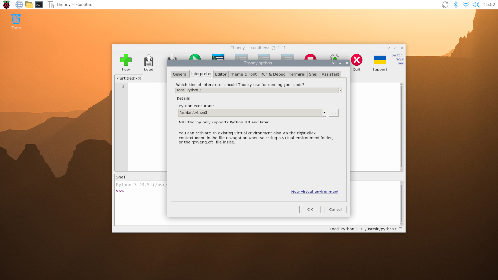

# 树莓派系统（Raspberry Pi OS）

## 简介

树莓派系统（Raspberry Pi OS）是树莓派计算机的官方操作系统（OS），可免费使用。对于大多数树莓派使用场景，我们推荐使用树莓派系统。

树莓派系统基于 *Debian* Linux 发行版，支持 69,000 多个 Debian 软件包。树莓派在 [Debian 发布周期](https://wiki.debian.org/DebianReleases)的基础上错峰发布，大约每两年发布一次。最新版的树莓派系统基于 [Debian Trixie](https://www.raspberrypi.com/news/trixie-the-new-version-of-raspberry-pi-os/)。上一版本基于 [Debian Bookworm](https://www.raspberrypi.com/news/bookworm-the-new-version-of-raspberry-pi-os/)。

## 安装操作系统

树莓派系统通过树莓派启动盘制作工具安装，该工具支持 Windows、Mac 和 Linux。有关说明，参阅[使用树莓派启动盘制作工具安装](ru-men.md#使用树莓派启动盘制作工具安装)。你也可以直接从[我们的网站](https://raspberrypi.com/software/operating-systems)下载树莓派系统的磁盘镜像（即开即用的文件），然后把它写入存储卡，开始使用你的树莓派。

如果你正在运行旧版本的树莓派系统，想改用最新的大版本，请不要原地更新（不重装、直接更新当前系统），而是重新安装一份新的树莓派系统镜像，从头开始。有关说明，参阅[使用树莓派启动盘制作工具安装](ru-men.md#使用树莓派启动盘制作工具安装)。

>**警告**
>
>请备份旧系统中所有你不希望丢失的重要文件。安装新系统会覆盖存储卡上的全部内容。

### 版本

树莓派系统有三个版本：

* *树莓派系统*（含基础软件的桌面版）：树莓派启动盘制作工具中推荐的版本。它提供图形桌面环境，附带 Chromium 和 Firefox 网页浏览器、VLC 媒体播放器、Thonny Python 环境等应用。
* *完整版树莓派系统*（Raspberry Pi OS Full，含基础软件和推荐应用的桌面版）：提供与默认的*树莓派系统*相同的图形桌面环境和应用，另外还包含 LibreOffice 套件、KiCad、Scratch 编程环境等许多其他应用。
* *精简版树莓派系统*（Raspberry Pi OS Lite，无图形桌面的纯命令行版本）：适合用作无头服务器、嵌入式系统，或较老的树莓派型号，如初代树莓派、树莓派 2 和树莓派 Zero。

### 架构

树莓派系统提供 64 位和 32 位两种版本。请选择与你的树莓派设备硬件最匹配的版本：

* *64 位*版本面向配备 64 位处理器的新款树莓派型号，如树莓派 3、4 和 5。它既能运行 64 位软件，也能运行 32 位软件，还能支持更大的内存（RAM），在需要较强算力的任务上速度更快。
* *32 位*版本面向配备 32 位处理器的老款树莓派型号，如初代树莓派、树莓派 2 和树莓派 Zero。它占用的内存更少，与旧软件、旧硬件的兼容性可能更好。

## 管理软件和固件更新

更新当前操作系统有两种方式：

* *基于 APT*。我们向大多数用户推荐这种方式。用它来更新当前树莓派系统安装中的软件、内核和稳定版固件。有关说明，参阅[更新当前的树莓派软件](#更新当前的树莓派软件)。
* *`rpi-update`*。用于试验性或预发布版内核与固件的测试、开发，或修复特定 bug。有关说明，参阅[更新预发布固件](#更新预发布固件)。

常规固件更新包含在 APT 更新中（`raspi-firmware` 软件包）；`rpi-update` 只适合开发者和测试者，或者树莓派工程师明确指示你使用时。

如果你不是想更新当前操作系统，而是想从旧版本的树莓派系统升级到新版本（例如从 Bookworm 升级到 Trixie），请用新镜像重装操作系统。有关说明，参阅[升级到新的大版本](#升级到新的大版本)。

### 更新当前的树莓派软件

保持树莓派上的软件处于最新状态。这有助于保护你的树莓派免受[漏洞](https://cve.mitre.org/index.html)侵害，确保你能获得最新的 bug 修复，同时还会更新你的 Linux 内核和固件。

以下说明介绍如何在同一操作系统大版本内（例如 Trixie），保持*当前*安装的树莓派系统为最新。这些步骤不会把树莓派系统升级到新的大版本（例如从 Bookworm 升级到 Trixie）。有关升级操作系统的说明，参阅[升级到新的大版本](#升级到新的大版本)。

我们推荐使用 APT 保持树莓派软件为最新。你也可以用 APT 查找特定的软件包或工具、查看软件包的元数据、安装和卸载特定的软件包。有关说明，参阅[管理软件包](#管理软件包)。

要定期运行以下命令，用 APT 把当前的树莓派软件连同最新的修复、Linux 内核和固件一起更新：

1. *更新软件包列表。* APT 在 `/etc/apt/sources.list` 和 `/etc/apt/sources.list.d/` 中维护可用软件源的列表；运行以下命令，刷新可用软件包列表：

```bash
$ sudo apt update
```

2. *把已安装的软件包更新到最新版本。* 拿到新版本列表后，运行以下命令，下载并安装更新。由于树莓派系统比 Debian 更频繁地变更软件包依赖关系，我们推荐使用 `full-upgrade`，而不是标准的 `upgrade`：

```bash
$ sudo apt full-upgrade
```

继续更新之前，请确认你有足够的剩余磁盘空间。如果 `sudo apt full-upgrade` 提示需要额外空间才能完成更新，你可以用 `df -h` 检查系统是否有这么多可用空间，然后按照[清理文件](#清理文件)中的说明删除已下载的文件，腾出空间。

### 更新预发布固件

`rpi-update` 是一个命令行工具，用于在树莓派上安装试验性或预发布版固件。在树莓派 4 和 5 上，它还会更新 EEPROM 引导加载程序。

`rpi-update` 会下载最新预发布版的 Linux 内核、与之匹配的内核模块、设备树文件，以及最新版的 VideoCore 固件，然后把这些文件安装到现有的树莓派系统中。

>**警告**
>
>预发布版固件不保证能正常工作，可能引入不稳定因素，导致你的系统不可靠，甚至无法启动。

`rpi-update` 使用的所有源数据都来自 [rpi-firmware 存储库](https://github.com/raspberrypi/rpi-firmware)，该存储库包含[官方固件存储库](https://github.com/raspberrypi/firmware)数据的一个子集。

`rpi-update` 面向开发者和工程师，用于测试、开发和修复特定 bug。在大多数情况下，你不需要使用 `rpi-update`；只有树莓派工程师建议时才应使用它。日常更新请改用 APT，具体做法参阅[更新当前的树莓派软件](#更新当前的树莓派软件)。

1. 备份你的系统。
2. 运行以下命令，开始更新：

```bash
$ sudo rpi-update
```

3. 重启树莓派，让变更生效：

```bash
$ sudo reboot
```

更多信息，参阅[更新树莓派固件](https://pip.raspberrypi.com/documents/RP-003476-WP)。

### 把固件降级回最近一次稳定版本

如果更新到最新的预发布固件后出现问题，你可以回退到最近一次的稳定版固件，然后重启，让降级生效：

```bash
$ sudo apt update
$ sudo apt install --reinstall raspi-firmware
$ sudo reboot
```

这会重装树莓派系统官方支持的固件，恢复系统的稳定性。

### 管理软件包

在终端中，*APT* 是默认的软件包管理器，用于在当前运行的树莓派系统中安装、更新和卸载软件。你用 `apt-cache`、`apt install` 之类的终端命令来操作它。

在桌面环境中，你可以用*首选项 > 添加/删除软件*（Preferences > Add / Remove Software）工具，通过图形界面管理软件。

#### 搜索软件

要查找特定的软件包或工具，使用 `apt-cache search` 加关键字。它会返回名称或描述中包含该关键字的软件包列表。例如，显示所有与 `raspi` 相关的软件包：

```bash
$ apt-cache search raspi
```

#### 查看软件包详情

要查看某个软件包的详细信息，使用 `apt-cache show` 加软件包名。它会显示软件包版本、大小、依赖关系等信息。例如，查看 `raspi-config` 软件包的更多详细信息：

```bash
$ apt-cache show raspi-config
```

#### 安装软件包

要在树莓派上安装特定的软件包，使用 `sudo apt install` 加软件包名：

```bash
$ sudo apt install <package-name>
```

命令会返回软件包所需的磁盘空间，并要求你确认安装。要确认安装，输入 `Y` 后按键盘上的 *回车键*。要在安装时跳过确认提示、自动回答“是”，在命令中加上 `-y`：

```bash
$ sudo apt install -y <package-name>
```

#### 卸载软件包

要在树莓派上卸载特定的软件包，使用 `sudo apt remove` 加软件包名：

```bash
$ sudo apt remove <package-name>
```

命令会返回卸载该软件包可释放的磁盘空间，并要求你确认卸载。要确认卸载，输入 `Y` 后按键盘上的 *回车键*。要在卸载时跳过确认提示、自动回答“是”，在命令中加上 `-y`：

```bash
$ sudo apt remove -y <package-name>
```

要彻底移除软件包的所有痕迹（包括配置文件），用 `purge` 代替 `remove`：

```bash
$ sudo apt purge <package-name>
```

#### 检查磁盘空间

在树莓派上安装或更新软件之前，用以下命令检查可用存储空间：

```bash
$ df -h
```

#### 清理文件

APT 把下载的软件包（`.deb` 文件）存放在 `/var/cache/apt/archives`。安装过程中，APT 先下载这些软件包，再把其中的文件复制到正确的安装位置。视你安装的软件而定，软件包文件可能占用大量磁盘空间。用以下命令删除旧的已下载软件包文件：

```bash
$ sudo apt clean
```

### 升级到新的大版本

与其在现有启动介质上原地升级，我们强烈建议你用全新安装的方式升级树莓派上的操作系统版本，例如从 Bookworm 升级到 Trixie。具体做法是：用*树莓派启动盘制作工具*把新的操作系统镜像写入新的启动介质。

以下步骤需要：

* 一块新的存储设备作为启动介质（通常是存储卡），以及把它连接到电脑的方式（例如 USB 读卡器）。
* 一台电脑，用于把新的操作系统镜像写入新的启动介质，并在启动介质之间存储和转移数据。

以下步骤假设你使用存储卡作为新的启动介质，并使用树莓派启动盘制作工具把新的操作系统镜像写入该启动介质。如果你的启动介质是其他类型的存储，请酌情调整以下步骤。

1. *备份当前启动介质。*

>**警告**
>
>这一步会永久删除你选用的存储设备上的所有文件。继续之前请先备份。

2. *准备写入新系统的存储设备。* 在新的存储设备上安装最新版树莓派系统的新镜像。有关说明，参阅[使用树莓派启动盘制作工具安装](ru-men.md#使用树莓派启动盘制作工具安装)。
3. *复制现有的文件和配置。* 用存储设备从你的树莓派复制重要文件。
4. *把新的启动介质插入树莓派。* 把装有新系统的存储设备插入树莓派。
5. *启动树莓派。* 接通电源并开机。

### 将精简版树莓派系统转换为桌面版树莓派系统

你可以用 APT 安装一些软件包，把精简版（Lite）变成桌面版（Desktop）。

1. 安装你偏好的桌面窗口系统。

* 要安装 Wayland（推荐），运行：

```bash
$ sudo apt install rpd-wayland-core
```

* 要安装 X，运行：

```bash
$ sudo apt install rpd-x-core
```

2. 安装树莓派主题和控制中心：

```bash
$ sudo apt install rpd-theme
$ sudo apt install rpd-preferences
```

3. 添加应用：

```bash
$ sudo apt install rpd-applications
$ sudo apt install rpd-utilities
$ sudo apt install rpd-developer
$ sudo apt install rpd-graphics
```

4. 为你选择的窗口系统添加附加功能，例如截图和远程桌面能力。

* 对于 Wayland，运行：

```bash
$ sudo apt install rpd-wayland-extras
```

* 对于 X，运行：

```bash
$ sudo apt install rpd-x-extras
```

5. 重启树莓派，进入桌面环境：

```bash
$ sudo reboot
```

现在，你已经装齐了构成桌面版树莓派系统的全部软件包。

如果你想回到精简版树莓派系统，可以卸载这些软件包。或者，如果你不想卸载已安装的桌面软件包、又想要精简版的体验，可以按照[启动到控制台或桌面](xi-tong-pei-zhi.md#启动到控制台或桌面)的说明，把树莓派设置为启动到命令行。

你还可以安装完整版树莓派系统附带的推荐应用：打开树莓派主菜单，选择 **首选项 > 推荐软件**（Preferences > Recommended Software）。

## 播放音视频

树莓派系统预装了 [VLC 媒体播放器](https://www.videolan.org/)。你可以用 VLC 播放音视频文件。在树莓派系统上，VLC 使用硬件加速，支持多种常见的音视频文件格式。

### VLC 媒体播放器

#### VLC 图形界面

要从树莓派桌面播放音视频文件，在文件管理器中双击文件即可，这会自动启动 VLC 播放该文件。也可以从“**声音和视频**”（Sound & Video）菜单启动 **VLC 媒体播放器**，然后从“**媒体**”（Media）菜单中选择“**打开文件...**”（Open File...），找到你想播放的文件。

默认情况下，树莓派系统通过 HDMI 把音频输出到显示器。要把音频输出到其他接口（如耳机插孔或 USB 扬声器），右键单击系统托盘中的扬声器图标，然后选择一个选项。

#### `vlc` 命令行

你也可以从命令行启动 VLC。下面的示例使用了《大雄兔》（Big Buck Bunny）的一个短片段。运行以下命令下载该片段：

```bash
$ wget --trust-server-names http://rpltd.co/big-buck-bunny
```

要从命令行用 VLC 播放该片段，运行以下命令：

```bash
$ vlc big-buck-bunny-1080p.mp4
```

要避免文件播放完毕后 VLC 的图形界面仍然停留，加参数 `--play-and-exit`：

```bash
$ vlc --play-and-exit big-buck-bunny-1080p.mp4
```

要全屏播放视频（某些情况下播放会更流畅），加参数 `--fullscreen`：

```bash
$ vlc --play-and-exit --fullscreen big-buck-bunny-1080p.mp4
```

#### 使用 `cvlc` 播放无图形界面的媒体

如果在上述任何命令中把 `vlc` 换成 `cvlc`，就不会显示 VLC 的图形界面：

```bash
$ cvlc --play-and-exit big-buck-bunny-1080p.mp4
```

### 在精简版树莓派系统上播放音视频

与完整版树莓派系统不同，精简版树莓派系统不预装 VLC。要在精简版树莓派系统上用 VLC 播放音视频，请安装无桌面播放所需的软件包：

```bash
$ sudo apt install --no-install-recommends vlc-bin vlc-plugin-base
```

下面的示例使用了一个短音频片段。运行以下命令下载该片段：

```bash
$ wget --trust-server-names http://rpltd.co/startup-music
```

要从命令行用 VLC 播放该片段，运行以下命令：

```bash
$ cvlc --play-and-exit computer-startup-music.mp3
```

### 指定音频输出设备

要把音频强制输出到特定设备，把 `alsa` 值传给参数 `-A`，以使用 [ALSA](https://www.alsa-project.org/wiki/Main_Page) 音频输出；再用参数 `--alsa-audio-device` 指定音频输出设备：

```bash
$ cvlc --play-and-exit -A alsa --alsa-audio-device <alsa-device> computer-startup-music.mp3
```

把 `<alsa-device>` 占位符替换为以下选项之一：

| ALSA 设备 | 说明 |
| :---: | :--- |
| `sysdefault:CARD=Headphones` | 树莓派 4 及更早型号上的耳机插孔 |
| `sysdefault:CARD=vc4hdmi` | 单 HDMI 接口设备上的 HDMI 输出（Zero 系列、CM4S、CM4 之前的计算模块，以及树莓派 4 之前的旗舰型号） |
| `sysdefault:CARD=vc4hdmi0` | 树莓派 4B 起的旗舰型号、CM4 起的计算模块，以及键盘系列上的 HDMI0 输出 |
| `sysdefault:CARD=vc4hdmi1` | 树莓派 4B 起的旗舰型号、CM4 起的计算模块，以及键盘系列上的 HDMI1 输出 |

>**技巧**
>
>使用以下命令，可获取树莓派上所有 ALSA 设备的列表：
>
>```bash
>$ aplay -L | grep sysdefault
>```

### 指定视频输出设备

你可以通过 VLC 图形界面指定视频输出，也可以在控制台用 `--drm-vout-display` 参数指定。

要从控制台指定视频输出：

1. 把树莓派设备启动到[控制台](xi-tong-pei-zhi.md#启动到控制台或桌面)。
2. 加上 `--drm-vout-display` 参数：

```bash
$ cvlc --play-and-exit --drm-vout-display <drm-device> big-buck-bunny-1080p.mp4
```

3. 把 `<drm-device>` 占位符替换为以下选项之一：

| DRM 设备 | 说明 |
| :---: | :--- |
| `HDMI-A-1` | 树莓派 Zero 或树莓派 1、2、3 上的 HDMI 输出；*或*树莓派 4B 及后续型号、所有键盘系列上的 HDMI0 输出 |
| `HDMI-A-2` | 树莓派 4B 及后续型号、CM4 及后续计算模块（不含 CM4S），以及所有键盘系列上的 HDMI1 输出 |
| `DSI-1` | 树莓派触摸显示屏、树莓派触摸显示屏 2，或第三方 DSI 屏幕 |
| `DSI-2` | 配备多个 DSI 接口的型号上的第二路 DSI 输出（树莓派 5 起的旗舰型号和所有计算模块型号） |

>**技巧**
>
>使用以下命令，可获取树莓派上所有 DRM 设备的列表。
>
>>**注意**
>>
>>不带参数运行 `kmsprint` 只会查询找到的第一块卡。因此在树莓派 5 及后续型号上，它可能不会列出所有已接入的显示器。参阅 [kmsprint](#kmsprint)。
>
>```bash
>$ kmsprint | grep Connector
>```

### 同时指定音频和视频输出设备

你可以组合音频和视频输出参数。例如，要把视频输出定向到触摸屏、把音频输出定向到耳机插孔，可组合使用上述参数：

```bash
$ cvlc --play-and-exit --fullscreen --drm-vout-display DSI-1 -A alsa --alsa-audio-device sysdefault:CARD=Headphones your_video.mp4
```

### 改善流媒体播放性能

如果你有原始的 H.264 码流（裸流），比如用树莓派摄像头模块录制的码流，可以把码流封装进 MP4 之类的容器格式，提升 VLC 的播放性能。你可以用 `ffmpeg` 把码流内容转换成容器文件。例如，以下命令把名为 `video.h264` 的码流转换成 30fps 的 MP4 容器 `video.mp4`：

```bash
$ ffmpeg -r 30 -i video.h264 -c:v copy video.mp4
```

## 实用工具

树莓派系统预装了几款实用的命令行工具。

### `kmsprint`

`kmsprint` 工具可以列出接入树莓派的显示器所支持的显示模式。

用 `kmsprint` 查看接入树莓派的所有显示器的状态，用 `kmsprint -m` 列出每台显示器支持的显示模式。

在树莓派 5 及后续型号上，显示接口（如 HDMI、DSI、DPI 和 VEC）分布在多个独立的 DRM 卡（`/dev/dri/cardX`）上，而不像树莓派 4 及更早型号那样合并为单一的一张卡。

要在树莓派 5 上查询特定的接口，可能需要用 `--device`（或 `-d`）参数指定设备节点：

```bash
$ kmsprint --device=/dev/dri/card1
```

卡号在启动时动态分配，随接入硬件的不同，重启后可能变化。

### `vclog`

`vclog` 用于在 Arm 上运行的 Linux 中查看 VideoCore GPU 的日志消息。它需要以 root 身份运行。

`sudo vclog --msg` 打印消息日志，而 `sudo vclog --assert` 打印断言日志。

### `vcgencmd`

`vcgencmd` 工具用于输出树莓派上 VideoCore GPU 的信息。你可以在 [GitHub 上](https://github.com/raspberrypi/utils/tree/master/vcgencmd)找到工具 `vcgencmd` 的源代码。

要获取 `vcgencmd` 支持的所有命令列表，请使用 `vcgencmd commands`。下面列出了一些实用命令及其所需参数。

#### `vcos`

`vcos` 命令有两个实用的子命令：

* `version` 可显示 VideoCore 上固件的构建日期和版本
* `log status` 可显示 VideoCore 固件各部分的错误日志状态

#### `version`

可显示 VideoCore 固件的构建日期和版本。

#### `get_throttled`

返回系统的限流状态，这是一个位模式。某个位被置位表示以下含义：

| 位 | 十六进制（Hex）值 | 含义 |
| :---: | :---: | :--- |
| 0 | `0x1` | 检测到欠压 |
| 1 | `0x2` | Arm 频率受限 |
| 2 | `0x4` | 当前被限流 |
| 3 | `0x8` | 温度软限制生效中 |
| 16 | `0x10000` | 曾发生欠压 |
| 17 | `0x20000` | 曾发生 Arm 频率限制 |
| 18 | `0x40000` | 曾被限流 |
| 19 | `0x80000` | 曾发生温度软限制 |

#### `measure_temp`

返回 SoC 内部温度传感器测得的温度。
在树莓派 4 上，`measure_temp pmic` 返回电源管理芯片（PMIC）的温度。

#### `measure_clock [时钟]`

返回指定时钟的当前频率。可接受以下时钟值：

| 时钟 | 说明 |
| :---: | :--- |
| `arm` | Arm 核心 |
| `core` | GPU 核心 |
| `h264` | H.264 模块 |
| `isp` | 图像传感器管道 |
| `v3d` | 3D 模块 |
| `uart` | 串口 |
| `pwm` | PWM 模块（模拟音频输出） |
| `emmc` | 存储卡接口 |
| `pixel` | 像素阀（Pixel valves） |
| `vec` | 模拟视频编码器 |
| `hdmi` | HDMI |
| `dpi` | 显示并行接口 |

例如 `vcgencmd measure_clock arm`。

#### `measure_volts [模块]`

显示特定模块使用的当前电压。可接受以下模块值：

| 模块 | 说明 |
| :---: | :--- |
| `core` | VC4 核心电压 |
| `sdram_c` | SDRAM 核心电压 |
| `sdram_i` | SDRAM I/O 电压 |
| `sdram_p` | SDRAM 物理层电压 |

#### `otp_dump`

显示 SoC 内部 OTP（一次性可编程，one-time programmable）存储器的内容。这些是 32 位值，索引范围是 8 到 64。更多细节请参阅 [OTP 位页面](https://www.raspberrypi.com/documentation/computers/raspberry-pi.html#otp-register-and-bit-definitions)。

#### `get_config [配置项目|int|str]`

显示指定配置项的值；也可以指定 `int`（整数）或 `str`（字符串），查看给定类型的所有配置项。例如，以下命令以 MB 为单位返回设备的总内存：

```bash
$ vcgencmd get_config total_mem
```

#### `get_mem 类型`

报告 Arm 和 GPU 可寻址的内存大小。要显示 Arm 可寻址内存的大小，请使用 `vcgencmd get_mem arm`；要显示 GPU 可寻址内存的大小，请使用 `vcgencmd get_mem gpu`。在内存大于 1GB 的设备上，`arm` 参数的返回值始终是 1GB 减去 `gpu` 内存值，因为 GPU 固件只能感知前 1GB 内存。要准确报告设备的总内存，请参阅 `total_mem` 配置项和上文的 [`get_config`](#get_config-配置项目intstr) 小节。

##### `codec_enabled [类型]`

报告指定的编解码器类型是否启用。类型可选项有 AGIF、FLAC、H263、H264、MJPA、MJPB、MJPG、MPG2、MPG4、MVC0、PCM、THRA、VORB、VP6、VP8、WMV9、WVC1。由于树莓派 4 及后续设备家族的 H.265 硬件模块不属于 VideoCore GPU，此命令无法查询其状态。

##### `mem_oom`

显示 VideoCore 内存空间中发生过的所有 OOM（Out of memory，内存不足）事件的统计信息。

##### `mem_reloc_stats`

显示 VideoCore 上可重定位内存分配器的统计信息。

##### `read_ring_osc`

返回环形振荡器当前的速度、电压和温度。

## 辅助功能选项

### 视觉辅助

有视觉障碍的树莓派系统用户，可以在菜单 **推荐软件**（Recommended Software）中找到实用的工具。

我们提供 [Orca 屏幕阅读器](https://help.gnome.org/users/orca/stable/introduction.html.en)来简化树莓派桌面的操作，还提供屏幕放大器来放大界面和屏幕元素，提高可读性。你还可以在 **控制中心**（Control Centre）里调整界面元素的大小。

#### Orca 屏幕阅读器

你可以从树莓派主菜单的 **推荐软件** 中安装 Orca 屏幕阅读器，也可以按 **Ctrl** + **Alt** + **空格键** 自动安装 Orca。

写入新镜像后首次启动树莓派系统时，30 秒后会播放一段自动语音提醒，告诉你如何安装 Orca。

#### 屏幕放大器

要放大屏幕，按 **Ctrl** + **Alt** + **M**。这会放大显示的桌面，因此屏幕上只能看到桌面的一部分。移动鼠标指针，即可查看放大后桌面的不同部分。要关闭屏幕放大，再按一次 **Ctrl** + **Alt** + **M**。

#### 放大界面元素

要放大界面元素以便于查看，选择 **首选项 > 控制中心**（Preferences > Control Centre），然后进入 **默认值**（Defaults）标签页。在这个标签页中，你可以为不同尺寸的屏幕*设置默认值*（Set Defaults）。你设置默认值的屏幕越大，界面文字、图标和其他元素显示得就越大。

## 在树莓派上使用 Python

树莓派系统预装了 Python 3。干扰系统 Python 安装可能给你的操作系统带来问题。安装第三方 Python 库时，请务必使用正确的软件包管理工具。

在 Linux 上，你可以用两种方式安装 `python` 依赖包：

* 使用 `apt` 安装预配置的系统软件包
* 在虚拟环境中使用 `pip`，也就是用 Python 的依赖管理器安装库

>**重要**
>
>自树莓派系统 *Bookworm* 起，你只能用 `pip` 把库安装到 Python 虚拟环境（`venv`）中。这一变更由 Python 社区引入，与树莓派无关：更多信息请参阅 [PEP 668](https://peps.python.org/pep-0668/)。

### 使用 `apt` 安装 Python 软件包

通过 `apt` 安装的软件包，是专为树莓派系统打包的。这些软件包通常预先编译，因此安装速度更快。由于 `apt` 管理所有软件包的依赖关系，用这种方式安装，会一并装上运行该软件包所需的全部子依赖包。而且 `apt` 能确保你在卸载时不会破坏其他软件包。

例如，要安装支持树莓派 [Build 扩展板](../pei-jian/build-hat.md)的 Python 3 库，请运行以下命令：

```bash
$ sudo apt install python3-build-hat
```

要查找 `apt` 分发的 Python 软件包，可[使用 `apt search`](#搜索软件)。在大多数情况下，Python 软件包使用 `python-` 或 `python3-` 前缀：例如，名为 `python3-numpy` 的包就是 `numpy`。

### 使用 `pip` 安装 Python 库

#### *Bookworm* 对 `pip` 安装的变更

自树莓派系统 *Bookworm* 起，你无法再把库直接安装到系统级 Python。

请改为[把库安装到虚拟环境（`venv`）](#将-pip-与虚拟环境配合使用)。要为所有用户在系统级安装库，请[用 `apt` 安装](#使用-apt-安装-python-软件包)。

尝试在系统级安装 Python 软件包会输出类似以下的报错：

```
$ pip install buildhat
error: externally-managed-environment

× This environment is externally managed
╰─> To install Python packages system-wide, try apt install
  python3-xyz, where xyz is the package you are trying to
  install.

  If you wish to install a non-Debian-packaged Python package,
  create a virtual environment using python3 -m venv path/to/venv.
  Then use path/to/venv/bin/python and path/to/venv/bin/pip. Make
  sure you have python3-full installed.

  For more information visit http://rptl.io/venv

note: If you believe this is a mistake, please contact your Python installation or OS distribution provider. You can override this, at the risk of breaking your Python installation or OS, by passing --break-system-packages.
hint: See PEP 668 for the detailed specification.
```

Python 用户长期面对 `apt` 这类操作系统软件包管理器与 `pip` 这类 Python 专用软件包管理工具之间的冲突。这些冲突既包括 Python 层面的 API 不兼容，也包括文件所有权之争。

自树莓派系统 *Bookworm* 起，通过 `pip` 安装的软件包*必须安装到 Python 虚拟环境*（`venv`）中。虚拟环境是一个容器，你可以在其中安全地安装第三方模块，不会干扰系统级 Python。

#### 将 `pip` 与虚拟环境配合使用

要使用虚拟环境，先创建一个容器来存放环境。根据你使用 Python 的方式，有以下几种做法：

##### 为每个项目使用独立的环境

许多用户会为每个 Python 项目创建独立的虚拟环境。虚拟环境放在每个项目的根文件夹中，通常共用一个名称，如 `env`。在每个项目的根文件夹中运行以下命令，创建虚拟环境配置文件夹：

```bash
$ python -m venv env
```

在开始项目工作之前，在项目根目录运行以下命令，开始使用该虚拟环境：

```bash
$ source env/bin/activate
```

然后你会看到类似以下的提示符：

```
(env) $
```

项目工作结束后，在任意目录运行以下命令，退出虚拟环境：

```
(env) $ deactivate
```

##### 为每个用户使用独立的环境

你也可以不为每个 Python 项目分别创建虚拟环境，而是为你的用户账户创建一个虚拟环境。**运行任何 Python 代码之前，先激活这个虚拟环境。** 对于在多个项目之间共享大量库的工作流，这种方式可能更方便。

为整个用户账户的多个项目创建虚拟环境时，可以考虑把虚拟环境配置文件放在你的主目录下。把配置存放在[名称以点开头的文件夹](https://en.wikipedia.org/wiki/Hidden_file_and_hidden_directory#Unix_and_Unix-like_environments)里，默认即可隐藏，避免弄乱你的主文件夹。

用以下命令，在当前用户主目录的隐藏文件夹中创建虚拟环境：

```bash
$ python -m venv ~/.env
```

在任意目录运行以下命令，即可开始使用该虚拟环境：

```bash
$ source ~/.env/bin/activate
```

然后你会看到类似以下的提示符：

```
(.env) $
```

要退出虚拟环境，在任意目录运行以下命令：

```
(.env) $ deactivate
```

##### 创建虚拟环境

运行以下命令创建虚拟环境配置文件夹，把 `<env-name>` 换成你想用的虚拟环境名称（例如 `env`）：

```bash
$ python -m venv <env-name>
```

>**技巧**
>
>在文件夹名之前加参数 `--system-site-packages`，可以把系统级 Python 中当前已安装的所有软件包预加载到虚拟环境中。

##### 进入虚拟环境

然后，在虚拟环境配置文件夹中执行 `bin/activate` 脚本，进入虚拟环境：

```bash
$ source <env-name>/bin/activate
```

然后你会看到类似以下的提示符：

```
(<env-name>) $
```

提示符前缀 `(<env-name>)` 表示当前终端会话位于名为 `<env-name>` 的虚拟环境中。

要确认自己是否在虚拟环境中，请用 `pip list` 查看已安装软件包的列表：

```
(<env-name>) $ pip list
Package    Version
---------- -------
pip        23.0.1
setuptools 66.1.1
```

这个列表应该比系统级 Python 的软件包列表短得多。现在你可以放心用 `pip` 安装软件包了。在虚拟环境中用 `pip` 安装的所有软件包，都只会装进该虚拟环境。在虚拟环境中，命令 `python` 和 `python3` 会自动使用虚拟环境中的 Python 版本和已安装的软件包，而不是系统级 Python。

##### 退出虚拟环境

要退出虚拟环境，请运行以下命令：

```
(<env-name>) $ deactivate
```

### 使用 Thonny 编辑器

我们推荐用 [Thonny](https://thonny.org/) 在树莓派上编辑 Python 代码。

默认情况下，Thonny 使用系统级 Python。不过，你可以单击 Thonny 窗口右下角的 **解释器菜单**（interpreter menu），切换到 Python 虚拟环境。你可以选择一个已配置的环境，或用 `Configure interpreter...` 配置一个新的虚拟环境。



## 用 Python 控制 GPIO

使用 [GPIO Zero](https://gpiozero.readthedocs.io/) 库，可以轻松地用 Python 控制 GPIO 设备。该库在 [gpiozero.readthedocs.io](https://gpiozero.readthedocs.io/) 上有全面的文档。

有关 GPIO 硬件的信息，请参阅 [GPIO 硬件](https://www.raspberrypi.com/documentation/computers/raspberry-pi.html#gpio)。

### 控制 LED

以下示例代码用于控制接入 GPIO17 的 LED：

```python
from gpiozero import LED
from time import sleep

led = LED(17)

while True:
    led.on()
    sleep(1)
    led.off()
    sleep(1)
```

在 Thonny 之类的 IDE 中运行这段代码，LED 会不停地闪烁。

LED 方法包括 `on()`、`off()`、`toggle()` 和 `blink()`。

### 读取按钮状态

以下示例代码用于读取接入 GPIO2 的按钮状态：

```python
from gpiozero import Button
from time import sleep

button = Button(2)

while True:
    if button.is_pressed:
        print("Pressed")
    else:
        print("Released")
    sleep(1)
```

按钮功能包括属性 `is_pressed` 和 `is_held`；回调 `when_pressed`、`when_released` 和 `when_held`；以及方法 `wait_for_press()` 和 `wait_for_release()`。

### 用按钮控制 LED

以下示例代码读取接入 GPIO2 的按钮状态，并在按钮按下时点亮接入 GPIO17 的 LED：

```python
from gpiozero import LED, Button

led = LED(17)
button = Button(2)

while True:
    if button.is_pressed:
        led.on()
    else:
        led.off()
```

或者：

```python
from gpiozero import LED, Button

led = LED(17)
button = Button(2)

while True:
    button.wait_for_press()
    led.on()
    button.wait_for_release()
    led.off()
```

也可以这样写：

```python
from gpiozero import LED, Button

led = LED(17)
button = Button(2)

button.when_pressed = led.on
button.when_released = led.off
```
