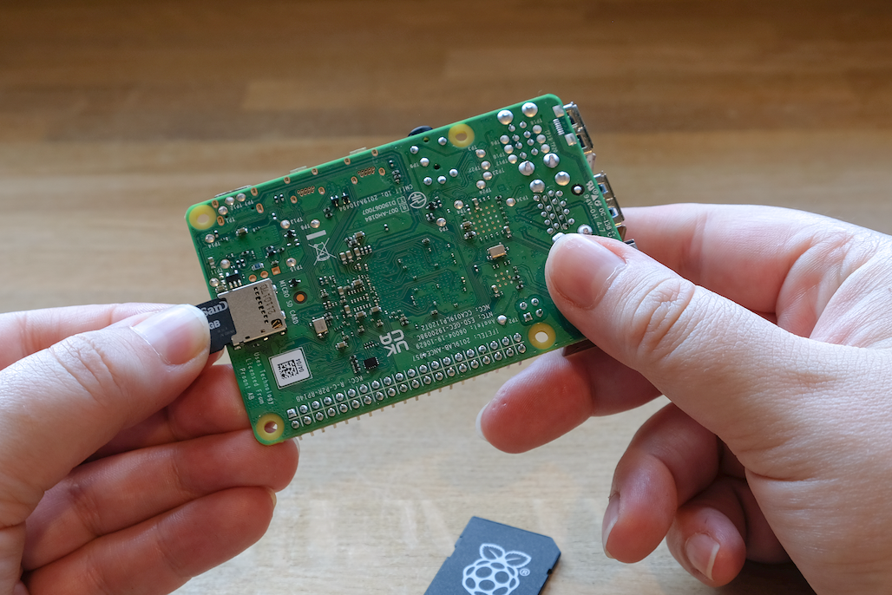
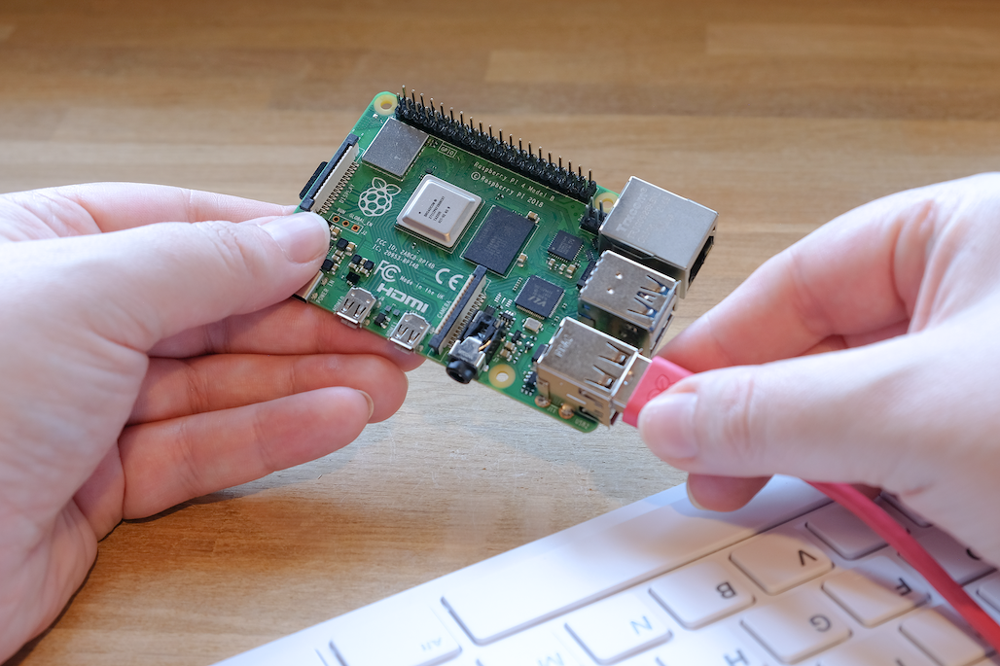
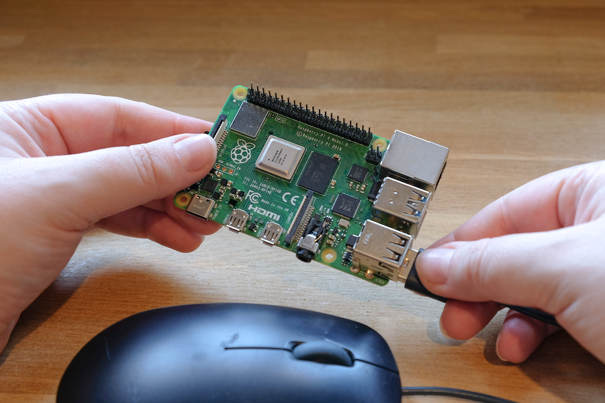
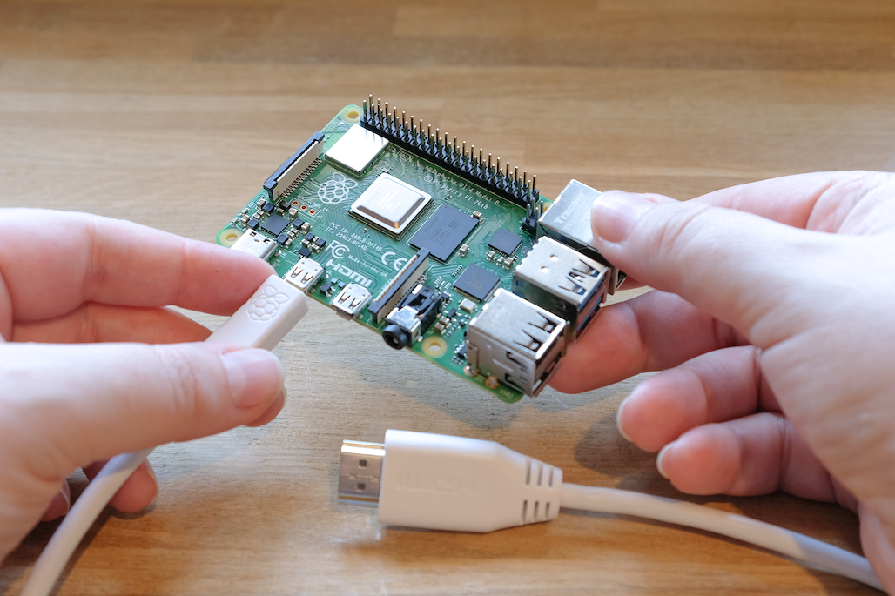
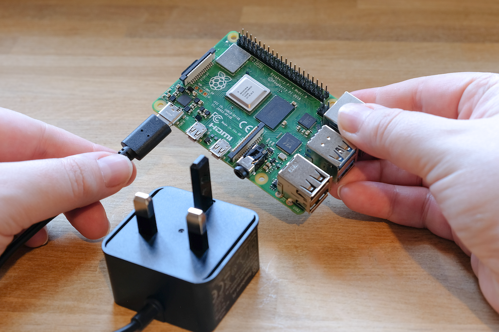
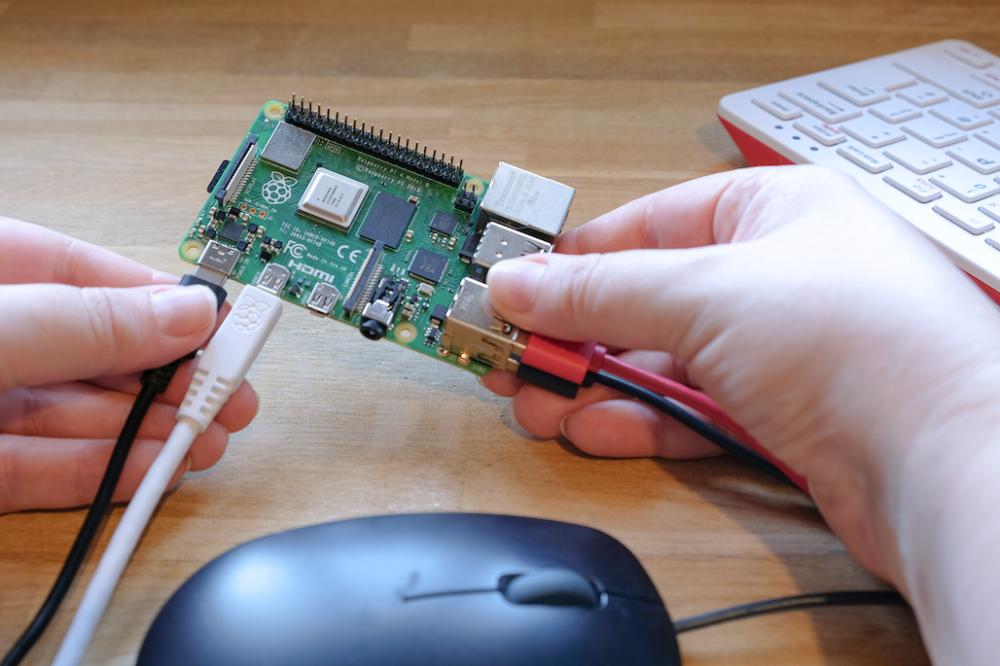
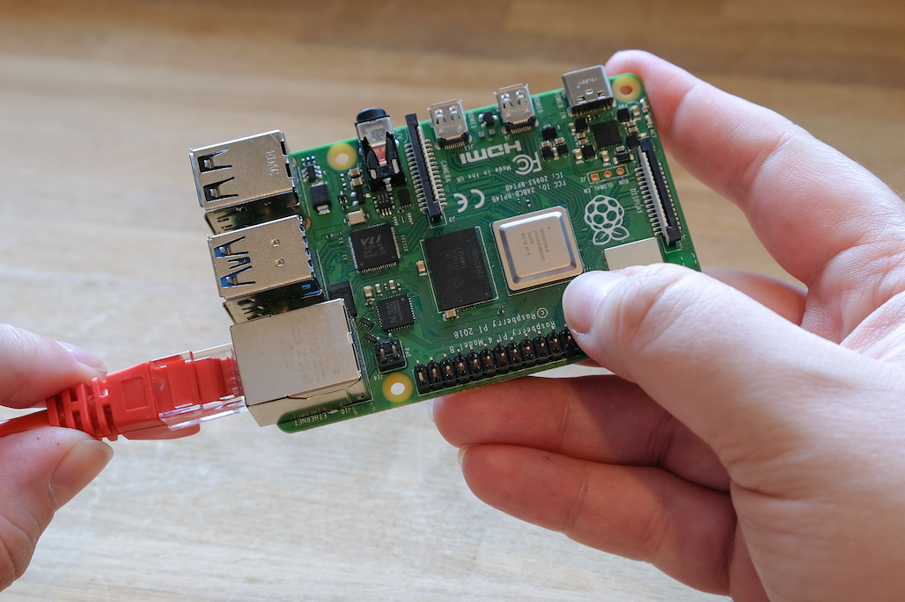
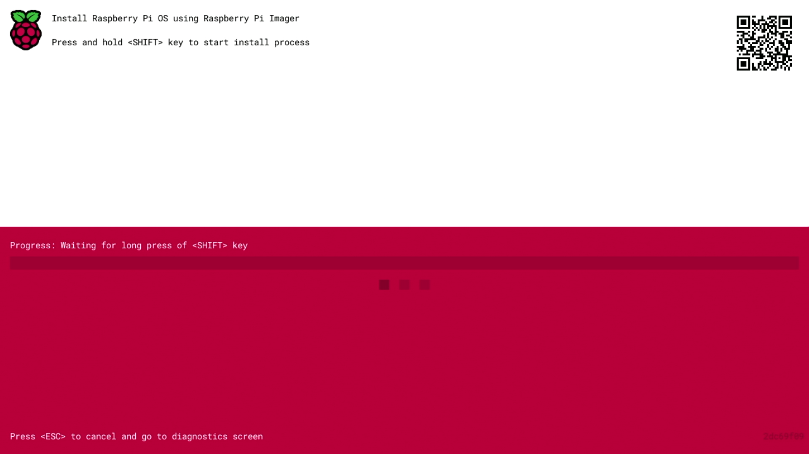
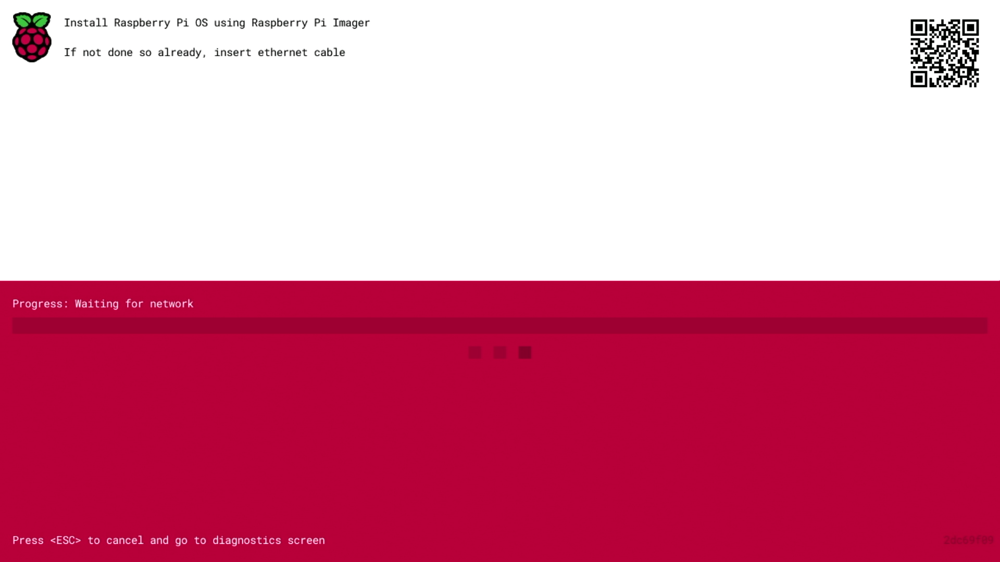
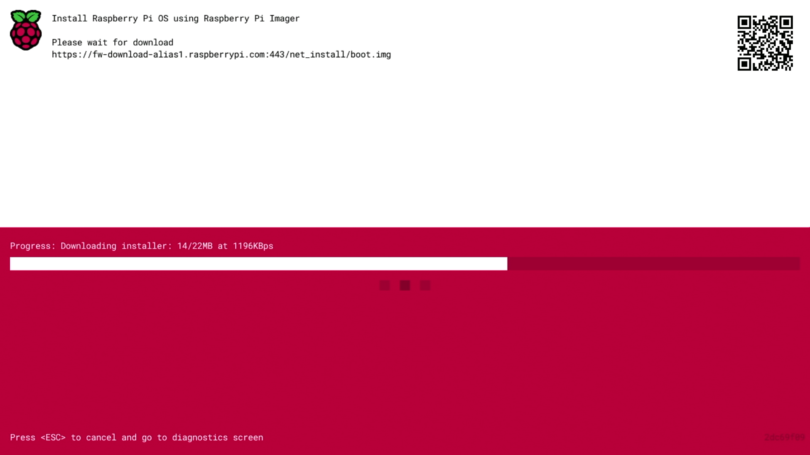

# 入门

## 开始你的树莓派之旅



树莓派设备是一款紧凑型计算机，通常有两种主要使用方式：作为**台式计算机**，或作为**无头（远程）计算机**。有关这些选项的更多信息，请参阅[设置你的树莓派](#设置你的树莓派)。

树莓派设备有多个系列：

* **经典单板计算机（SBC）。** 经典的树莓派设备（有时也称为“旗舰”型号），可以像台式计算机一样连接显示器、键盘和鼠标。有关经典单板计算机的详细信息，请参阅[经典型单板计算机](jing-dian-dan-ban-ji-suan-ji.md)。
* **树莓派 Zero。** 经典树莓派设备的缩小版，USB 接口更少，功耗更低。有关树莓派 Zero 型号的详细信息，请参阅[Zero 型号](ling-dian-xing-hao.md)。
* **树莓派键盘计算机。** 将计算机内置在键盘外壳中的设备，设计为连接显示器和鼠标使用。有关树莓派键盘计算机的详细信息，请参阅[键盘计算机](jian-pan-ji-suan-ji.md)。
* **树莓派计算模块。** 树莓派计算机的小型系统级模块（system-on-module）版本，专为工业和嵌入式应用设计。有关树莓派计算模块的详细信息，请参阅[计算模块硬件](ji-suan-mo-kuai-ying-jian.md)。
* **树莓派 Pico。** 使用树莓派微控制器（RP2040 或 RP2350）的微控制器开发板。有关树莓派 Pico 的详细信息，请参阅[Pico 系列微控制器](../wei-kong-zhi-qi/shu-mei-pai-pico-he-pico-w.md)。

本页聚焦于**经典单板计算机**，但其中的许多信息同样适用于树莓派 **Zero** 和**键盘计算机**。

## 硬件准备

要设置一台树莓派设备，你需要以下硬件。这些组件按下列顺序准备和组装：

* 安装了操作系统的[启动介质](#启动介质)。
* 桌面设置所需的输入和输出外设，见[外部设备](#外部设备)。
* 无头设置所需的另一台计算机和网络连接。
* 电源适配器。参见[电源](#电源)。

此外，你还可以使用：

* 树莓派外壳。它有助于保护你的树莓派设备免受损坏，或避免把它放在金属表面时发生短路。
* 用于把树莓派接入有线网络的以太网（RJ45）网线。连接无线网络时不需要它；你可以改用 SSID 和密码连接 Wi-Fi。

### 启动介质

要作为计算机运行，你的树莓派需要一块包含**操作系统（OS）镜像**的非易失性存储。这种存储被称为**启动介质**，最常见的是**存储卡**。一些较新的树莓派型号还可以从其他介质启动，例如 **USB 大容量存储**、**网络启动（PXE）**，以及**通过 PCIe 连接的 NVMe 存储**。

你必须先配置好启动介质，再组装树莓派；除非你在树莓派 4B、5、500 或 500+ 上使用网络安装——这种情况下，你可以用树莓派本身来配置启动介质。

无论你选择哪种存储设备作为启动介质，它都必须有足够的容量和速度来充当存放操作系统镜像的硬盘。操作系统镜像是一种预先打包的软件，安装到启动介质之后，就能把一块空白的电路板变成一台可以工作的计算机。

有关为树莓派配置启动介质的分步指南，请参阅[将操作系统安装到启动介质](#将操作系统安装到启动介质)。

读写速度更快的存储设备能提升树莓派的整体性能，使其运行更流畅。如果你不确定该买哪种存储卡，可以考虑[树莓派官方存储卡](https://www.raspberrypi.com/products/sd-cards/)。你可能还需要一个读卡器，以便把存储卡连接到计算机来安装操作系统。

自树莓派 Model B+ 起的所有型号都带有存储卡插槽；这些树莓派设备会自动从插入了有效操作系统镜像的存储卡启动。

如果你拥有的是树莓派键盘计算机（树莓派 400、500 或 500+），或者套件中附带的树莓派计算机，那么操作系统已经预先配置好。你可以在**控制中心**或终端里的 `raspi-config` 中更改配置。操作说明见[系统配置](xi-tong-pei-zhi.md)。

#### 推荐的最低存储要求

所需的启动介质存储容量取决于你安装的操作系统版本包含多少软件。

以下建议足以让你根据所选操作系统开始使用，但我们建议选择更大的存储空间，为日后扩展留出余地：

* 对于**树莓派系统**（带桌面的基础软件版），我们建议使用容量至少为 32 GB 的存储卡。
* 对于**树莓派系统 Full**（带桌面、基础软件和推荐应用程序），我们建议使用容量至少为 32 GB 的存储卡。
* 对于**树莓派系统精简版**（仅命令行，适用于无头设置），我们建议使用容量至少为 8 GB 的存储卡。

其他操作系统可能有不同的存储需求，因此请务必查阅你计划安装的操作系统的文档。

#### 支持的最大容量

你可以使用容量小于 2 TB 的任意存储卡。不支持容量超过 2 TB 的存储卡，因为它们超出了主引导记录（MBR）的限制。MBR 是存储卡上使用的一种分区系统，它告诉树莓派到哪里去找操作系统，以便启动。

一些较老的树莓派设备只能从不超过 256 GB 的启动分区启动，包括：

* 树莓派 Zero。
* 初代经典树莓派设备。
* 采用 BCM2836 SoC 的早期树莓派 2 型号。

#### 插入存储卡

在把存储卡插入树莓派之前，你必须先完成配置。有关为树莓派配置启动介质的分步指南，请参阅[将操作系统安装到启动介质](#将操作系统安装到启动介质)。

把存储卡配置好操作系统后，将其标签朝外插入存储卡插槽。

对于树莓派 3 及更新的型号以及所有树莓派 Zero 型号，存储卡插入后会到位停止，没有咔哒声，取出时轻轻拔出即可。较老的型号则需要先向内按压存储卡将其解锁。

### 外部设备

**无头设置**只需要另一台有网络连接的计算机。更多信息见[无头（远程）设置](#无头远程设置)。

根据你的设备和使用场景，大多数**桌面设置**需要输入和输出外设（如键盘、鼠标和显示器）。你还必须有把这些外设连接到树莓派的合适线缆。

要连接显示器，树莓派 4B、400、5、500 和 500+ 需要 micro-HDMI 转 HDMI 线缆；树莓派 Zero 和 Zero 2 需要 mini-HDMI 转 HDMI 线缆。你也可以使用转接器。

#### 输入设备（键盘和鼠标）

你可以使用树莓派上的任意 USB 接口来连接[有线键盘](https://www.raspberrypi.com/products/raspberry-pi-keyboard-and-hub/)和[有线鼠标](https://www.raspberrypi.com/products/raspberry-pi-mouse/)。如果你想把高速的 USB 3.0（蓝色）接口留给其他高速外设，就把外设接到树莓派的 USB 2.0（黑色）接口上。

如果你使用的是树莓派官方键盘或树莓派键盘计算机，可以把有线鼠标接到背面的一个 USB 接口上，为树莓派设备保留更多可用的 USB 接口。

##### 树莓派 Zero 的 USB 设备

树莓派 Zero 系列使用 micro USB 而非全尺寸 USB，因此需要 micro USB OTG 转接器。其中一个 micro USB 接口标有 PWR IN，仅用于供电；标有 USB 的接口均可使用。

树莓派 Zero 设备无法为键盘和鼠标同时提供足够的电力（键盘自带触摸板的情况除外）。因此，你需要把一个带独立供电的 USB 集线器接到连接树莓派 Zero 的 micro USB OTG 转接器上，然后再把鼠标插到这个 USB 集线器上。

>**注意**
>
>树莓派 Zero 启动后再插入 USB 设备，可能导致电压下降到足以让 CPU 重启。因此我们建议你使用带独立供电的 USB 集线器，或在开机前接好 USB 设备。

##### 无线输入设备

如果你想使用无线键盘或鼠标，我们建议你先用有线键盘和鼠标完成树莓派的首次配置和组装，之后再设置无线设备。你可以选择：

* 带 USB 蓝牙接收器的键盘或鼠标：把键盘或鼠标的 USB 接收器插到树莓派的 USB 接口上即可连接。
* 内置蓝牙的键盘或鼠标：直接与树莓派连接。如果你的树莓派型号支持蓝牙，就可以把键盘或鼠标与树莓派配对。

操作说明见系统配置页面的[连接蓝牙外设](https://www.raspberrypi.com/documentation/computers/configuration.html#bt)。有关自带蓝牙的树莓派型号列表，见[网络](#网络)。

#### 输出设备（显示器和音频）

如果你要把树莓派当作台式计算机使用，它需要一台显示器，让你能看到自己正在做什么。此外，你还可以连接扬声器或耳机来输出音频。如果你使用的是树莓派官方[显示器](https://www.raspberrypi.com/products/raspberry-pi-monitor/)，可以通过显示器背面的 3.5 mm 音频插孔连接扬声器或耳机。

##### 显示器

你可以利用树莓派上可用的显示输出接口来连接显示器。如果你的树莓派有多个 HDMI 接口，请把主显示器插入标有 **HDMI0** 的接口。

>**注意**
>
>显示器通常需要自己的电源。如果你使用的是树莓派官方显示器，可以用一根 USB 供电线把显示器接到树莓派上取电；树莓派开机后会为这台显示器供电。

在树莓派 4 及更新的型号上，两个 HDMI 输出都支持最高 4K 分辨率，但刷新率因型号而异。

较新的树莓派型号使用 micro HDMI，树莓派 Zero 系列使用 mini HDMI，而大多数显示器使用全尺寸 HDMI。你可以使用 [micro-HDMI 转 HDMI 线缆](https://www.raspberrypi.com/products/micro-hdmi-to-standard-hdmi-a-cable/)或 [mini-HDMI 转 HDMI 线缆](https://www.raspberrypi.com/products/standard-hdmi-a-male-to-mini-hdmi-c-male-cable/)（或 [mini-HDMI 转 HDMI 转接器](https://www.raspberrypi.com/products/mini-hdmi-c-male-to-standard-hdmi-a-female-adapter/)）把这些型号连接到 HDMI 显示器。如果你的显示器没有 HDMI 接口，请使用转接线把 HDMI 端转换为 DVI-D、DisplayPort 或 VGA 接口。

下表列出了各树莓派型号可用的显示输出和推荐的线缆转接方案。

| 型号 | 显示输出 | 适用于全尺寸 HDMI 显示器的线缆和转接器 |
| :--- | :--- | :--- |
| 树莓派 5、400、500 和 500+ | 两个 micro HDMI 接口，支持双显示器。 | 使用 micro-HDMI 转 HDMI 线缆；把线缆较粗（全尺寸 HDMI）的一端接到显示器。 |
| 树莓派 4 Model B | 两个 micro HDMI 接口，外加一个用于音频和复合视频的 3.5 mm [TRRS](https://en.wikipedia.org/wiki/Phone_connector_(audio)#TRRS_standards) 插孔。 | 使用 micro-HDMI 转 HDMI 线缆；把线缆较粗（全尺寸 HDMI）的一端接到显示器。 |
| 树莓派 3（所有型号） | 一个 HDMI 接口，外加一个用于音频和复合视频的 3.5 mm [TRRS](https://en.wikipedia.org/wiki/Phone_connector_(audio)#TRRS_standards) 插孔。 | 使用标准 HDMI 线缆。 |
| 树莓派 2 Model B | 一个 HDMI 接口，外加一个用于音频和复合视频的 3.5 mm [TRRS](https://en.wikipedia.org/wiki/Phone_connector_(audio)#TRRS_standards) 插孔。 | 使用标准 HDMI 线缆。 |
| 树莓派 1 Model A+ 和 B+ | 一个 HDMI 接口，外加一个用于音频和复合视频的 3.5 mm [TRRS](https://en.wikipedia.org/wiki/Phone_connector_(audio)#TRRS_standards) 插孔。 | 使用标准 HDMI 线缆。 |
| 树莓派 1 Model A 和 B | 一个 HDMI 接口，外加一个用于音频的 3.5 mm [TRRS](https://en.wikipedia.org/wiki/Phone_connector_(audio)#TRRS_standards) 插孔和一个用于复合视频的[莲花头](https://en.wikipedia.org/wiki/RCA_connector)插孔。 | 使用标准 HDMI 线缆。 |
| 树莓派 Zero（所有型号） | 一个 mini HDMI 接口。 | 使用 mini-HDMI 转 HDMI 线缆；把线缆较粗（全尺寸 HDMI）的一端接到显示器。 |

>**注意**
>
>所有树莓派型号都不支持通过 USB-C（DisplayPort Alt Mode）输出视频。树莓派上的任何 USB-C 接口都无法用来连接显示器。

如果你的显示器有多个 HDMI 接口，请留意你接入的接口编号。这个编号代表你需要切换到的输入源，才能看到树莓派的显示内容。

##### 音频

根据树莓派型号的不同，你可以通过 HDMI、USB、蓝牙或 3.5 mm 插孔输出音频。你也可以通过树莓派官方显示器背面的 3.5 mm 插孔连接音频。

* 所有带 HDMI、micro HDMI 或 mini HDMI 的树莓派型号都支持通过 HDMI 输出音频。
* 所有树莓派型号都支持通过 USB 输出音频。
* 所有配备蓝牙的树莓派型号都支持蓝牙音频。
* 树莓派 1、2、3 和 4 的所有变体都有一个 3.5 mm 辅助 [TRRS](https://en.wikipedia.org/wiki/Phone_connector_(audio)#TRRS_standards) 插孔，可能需要放大才能获得足够的输出音量。TRRS 插孔提供线路电平输出，而不是经过放大的扬声器电平输出。

### 电源

把树莓派接通电源是硬件设置的最后一步。我们建议使用与你的树莓派型号相匹配的树莓派官方电源适配器。

树莓派一旦接通电源就会开机。唯一的例外是你[编辑了 EEPROM 设置](shu-mei-pai-ying-jian.md#树莓派引导加载程序配置)，让树莓派 5 在按下电源键之前保持关机状态。

#### 推荐电源适配器

我们建议使用树莓派官方电源适配器。

不同的树莓派型号正常运行所需的功率不同。下表列出了每种型号所需的 USB Power Delivery 模式。

>**注意**
>
>这里列出的推荐电压是在插头端而非电源端测得的。请为线缆上的电压损耗预留余量，尤其是在电源适配器的线缆可以拆卸的情况下。

| 型号 | 推荐电压/电流 | 推荐的树莓派电源适配器 |
| :--- | :--- | :--- |
| 树莓派 500+ | 5V/5A | [27W USB Type-C 电源适配器](https://www.raspberrypi.com/products/27w-power-supply/) |
| 树莓派 5 和树莓派 500 | 5V/5A；5V/3A 时外设会被限制到 600 mA | [27W USB Type-C 电源适配器](https://www.raspberrypi.com/products/27w-power-supply/) |
| 树莓派 4 Model B 和树莓派 400 | 5V/3A | [15W USB Type-C 电源适配器](https://www.raspberrypi.com/products/type-c-power-supply/) |
| 树莓派 3（所有型号） | 5V/2.5A | [12.5W Micro USB 电源适配器](https://www.raspberrypi.com/products/micro-usb-power-supply/) |
| 树莓派 2 Model B | 5V/2.5A | [12.5W Micro USB 电源适配器](https://www.raspberrypi.com/products/micro-usb-power-supply/) |
| 树莓派 1（所有型号） | 5V/2.5A | [12.5W Micro USB 电源适配器](https://www.raspberrypi.com/products/micro-usb-power-supply/) |
| 树莓派 Zero（所有型号） | 5V/2.5A | [12.5W Micro USB 电源适配器](https://www.raspberrypi.com/products/micro-usb-power-supply/) |

#### 连接电源

在给树莓派通电之前，你必须先把操作系统（OS）镜像写入（烧录）到设备的存储介质上，否则树莓派无法启动。更多信息见[启动介质](#启动介质)。

配置好启动介质、把它插入树莓派并组装好所有必要的外设之后，把电源适配器插到树莓派上标有 **POWER IN**、**PWR IN** 或 **PWR** 的接口上。某些树莓派型号（如 Zero 系列）的 USB 输出接口与电源接口外形相同，请使用树莓派上正确的接口。然后把电源适配器的另一端插入电源插座并打开开关。

随后树莓派就会通电开机，电源或状态 LED 会亮起，接着屏幕上会显示带有树莓派标志的信息画面。之后，树莓派会从启动介质加载操作系统。

## 网络

下表列出了树莓派设备的连接规格。

如果你的树莓派设备没有以太网接口，你仍然可以用 USB 转以太网转接器连接有线网络。

同样，如果你的树莓派设备没有内置 Wi-Fi，你仍然可以用 USB 转 Wi-Fi 转接器连接无线网络。

| 型号名称 | 无线 | 以太网 |
| :--- | :--- | :--- |
| 树莓派 3B+ 及更新型号 | 有。双频 Wi-Fi（2.4/5 GHz） | 有。树莓派 3B+ 为 300 Mb/s，树莓派 4B 及更新型号为千兆以太网 |
| 树莓派 3B | 有，仅 2.4 GHz | 有 |
| 树莓派 3A+ | 有。双频 Wi-Fi（2.4/5 GHz） | 无 |
| 树莓派 1B、1B+ 和 2B | 无 | 有 |
| 所有键盘计算机（树莓派 400、500 和 500+） | 有。双频 Wi-Fi（2.4/5 GHz） | 有。千兆以太网 |
| 树莓派 Zero W 和 Zero 2 W | 有，仅 2.4 GHz | 无 |
| 计算模块 5（CM5）和计算模块 4（CM4） | 可选双频 Wi-Fi（2.4/5 GHz） | 有。千兆以太网。 |
| 计算模块 3+（CM3+）及更早型号 | 无 | 可选 |

## 设置你的树莓派

树莓派通常有两种使用方式：

* **作为台式计算机。** 带桌面环境的交互式系统。这种设置需要显示器、连接树莓派与显示器的线缆、键盘和鼠标。有关这些配件的信息，见[外部设备](#外部设备)。
* **作为无头计算机。** 不使用传统外设（显示器、键盘和鼠标）运行的系统。你可以通过树莓派 Connect 访问它，或者在同一网络中通过 Wi-Fi 或以太网用 SSH 从另一台计算机访问。你可以在安装操作系统时预先配置主机名、用户账户、网络连接和 SSH 访问。

### 标准（桌面）设置

大体而言，树莓派的桌面设置包括启动介质、外设和电源，按顺序进行。网络连接是可选的。

#### 步骤 1. 准备启动介质

使用**树莓派启动盘制作工具**把操作系统安装到启动介质上。

这是使用树莓派的前提，也是你首次配置大多数关键设置的地方，包括主机名、本地化、用户凭据、Wi-Fi 连接和远程访问。

其他设置可以之后再配置。操作说明见[将操作系统安装到启动介质](#将操作系统安装到启动介质)。

把操作系统安装到启动介质后，将其接入树莓派。在较新的型号上，这通常是一张插入设备底部插槽的存储卡。如果你把操作系统安装在了其他存储设备上，可以用其他兼容的连接方式把它接入树莓派。

#### 步骤 2. 连接外设

要把树莓派当作台式计算机使用，你可以连接以下外设：

* [输入设备](#输入设备键盘和鼠标)：
  * **键盘。** 使用经典树莓派或树莓派 Zero 的台式计算机需要键盘；如果你的树莓派是键盘计算机（树莓派 400、500 或 500+），则不需要。
  * **鼠标。** 台式计算机需要鼠标。
* [输出设备](#输出设备显示器和音频)：
  * **显示器。** 台式计算机需要显示器。
  * **音频。** 可选。

#### 步骤 3. 连接电源

连接好外设后，把电源适配器插到树莓派的 USB-C（老型号为 micro USB）供电接口上。

请确保你的电源适配器满足树莓派型号的电压和电流要求。更多信息见[电源](#电源)。

树莓派通电后状态 LED 会亮起；如果你的树莓派连接了显示器，就会出现启动画面。这可能需要几分钟。

#### 步骤 4. 连接网络（可选）

把操作系统安装到启动介质并插入树莓派之后，你就可以配置网络连接了。可以是有线（以太网）连接，也可以是无线（Wi-Fi）连接。

##### 连接无线网络

连接无线网络通常在配置启动介质时完成。配置启动介质的操作说明见[将操作系统安装到启动介质](#将操作系统安装到启动介质)。你也可以稍后在桌面或命令行中配置无线网络，操作说明见[系统配置](xi-tong-pei-zhi.md#连接到无线网络)中的“连接到无线网络”。

部分无线适配器和部分树莓派型号不支持 5 GHz 网络；请在你无线模块对应的[树莓派产品页面](https://www.raspberrypi.com/products/)确认其与你首选网络的兼容性。有关支持无线网络的树莓派型号，见[网络](#网络)。

##### 连接有线网络

要把树莓派接入有线网络，请把以太网网线插入树莓派设备的以太网接口，直到听到咔哒声。如果你的树莓派型号没有以太网接口，可以使用 USB 以太网转接器。

把网线的另一端接到网络集线器、交换机或路由器的端口上。树莓派系统会自动连接到网络。

要拔出以太网网线，请按下接头底部的卡扣，轻轻把网线从接口中滑出。

### 无头（远程）设置

无头树莓派在没有显示器、键盘和鼠标的情况下运行。你通过网络远程控制它。为此，你必须具备：

* 网络连接（Wi-Fi 或以太网）。部分无线适配器和部分树莓派型号不支持 5 GHz 网络；请查阅你无线模块的文档，确认其与你首选网络的兼容性。有关支持无线网络的树莓派型号，见[网络](#网络)。
* 首次启动时的远程访问方式：SSH 或[树莓派 Connect](../fu-wu/shu-mei-pai-yuan-cheng-fang-wen-raspberry-pi-connect.md)。首次启动之后，你还可以使用 [VNC](yuan-cheng-fang-wen.md#使用-vnc-进行屏幕共享) 进行远程桌面访问。

>**注意**
>
>VNC 与树莓派系统的精简版不兼容。

我们建议你使用**树莓派启动盘制作工具**来设置无头设备。它让你能够：

* 在**树莓派系统**和**树莓派系统精简版**之间做出选择。
* 配置网络。
* 配置远程访问。
* 设置用户凭据（用户名和密码）。

你之后还可以从桌面或通过交互式的 `raspi-config` 工具启用 VNC 和**树莓派 Connect**。操作说明见[系统配置](xi-tong-pei-zhi.md#远程访问)中的“远程访问”。

#### 步骤 1. 准备启动介质

使用**树莓派启动盘制作工具**把你的存储设备变成装有树莓派操作系统的可启动介质。在此过程中，你还要配置无头设置所需的网络、远程访问和用户凭据（用户名和密码）。

1. 按照说明，使用**树莓派启动盘制作工具**[把操作系统安装到启动介质](#将操作系统安装到启动介质)。
   * 由于无头设置不需要桌面环境，我们建议在树莓派启动盘制作工具中选择**树莓派系统精简版**作为操作系统。
   * 首次启动时，只有 SSH 和树莓派 Connect 可用于远程访问。请确保你在用制作工具自定义操作系统时配置了其中一项。如果你选择不用树莓派启动盘制作工具自定义镜像，也可以改为[手动设置 SSH](#手动设置-ssh)。
2. 安装操作系统后，把启动介质接入树莓派。
   * 对大多数型号而言，这通常是一张插入设备底部插槽的存储卡。
   * 如果你把操作系统安装在了其他存储设备上，可以用合适的转接器或兼容的连接方式把它接入树莓派。

#### 步骤 2. 连接电源

准备好启动介质并把它接入树莓派之后，把电源适配器插到树莓派的 USB-C（老型号为 micro USB）供电接口上。请确保你的电源适配器满足树莓派型号的电压和电流要求。更多信息见[电源](#电源)。

树莓派通电后状态 LED 会亮起。

#### 步骤 3. 连接网络

把操作系统安装到启动介质、插入树莓派并接通电源之后，你就可以配置网络连接，让树莓派能与你的计算机通信。可以是无线（Wi-Fi）连接（通常在步骤 1 中用制作工具设置好），也可以是有线（以太网）连接。

##### 连接无线网络

>**注意**
>
>部分无线适配器和树莓派型号不支持 5 GHz 网络，请查阅你无线模块的文档，确认其与你首选网络的兼容性。更多信息见[网络](#网络)。

如果你在步骤 1 中用制作工具设置好了 SSID 和无线网络信息，树莓派会在首次启动时尝试连接无线网络。

如果你在步骤 1 中没有设置无线网络连接，请改为把无头树莓派设备接入有线网络，具体方法见下文“连接有线网络”一节。

>**注意**
>
>树莓派系统的旧版本使用 `wpa_supplicant.conf` 文件，可以把它放进启动文件夹来配置无线网络设置。从树莓派系统 **Bookworm** 及之后的版本开始，这一功能不再可用。

##### 连接有线网络

如果你在步骤 1 中用制作工具设置好了 SSID 和无线网络信息，可以跳过这一步，直接前往步骤 4。

1. 把以太网网线插入树莓派设备的以太网接口，直到听到咔哒声。如果你的树莓派型号没有以太网接口，请使用 USB 以太网转接器。
2. 把网线的另一端接到路由器的端口上。树莓派系统会自动连接到网络。

#### 步骤 4. 访问你的树莓派

首次启动时，无头树莓派仅有的远程访问方式是 SSH 或树莓派 Connect。

* 有关从另一台计算机使用 SSH 的信息，见[连接到 SSH 服务器](yuan-cheng-fang-wen.md#连接到-ssh-服务器)。
* 有关使用树莓派 Connect 的信息，见[树莓派 Connect](../fu-wu/shu-mei-pai-yuan-cheng-fang-wen-raspberry-pi-connect.md) 文档。

如果你安装的是包含桌面的树莓派系统版本（**树莓派系统**或**树莓派系统 Full**），现在可以启用 VNC 以便后续连接。操作说明见[系统配置](xi-tong-pei-zhi.md#远程访问)中的“远程访问”。

#### 手动设置 SSH

如果你在步骤 1 中没有用树莓派启动盘制作工具为远程访问自定义镜像，可以改为手动设置 SSH。在启动介质的 `bootfs` 分区上：

1. 创建一个名为 `ssh` 的空文件。
2. 创建一个名为 `userconf.txt` 的文件，其中只有一行文本：`<username>:<encrypted-password>`。

把 `<username>` 替换为你的用户名，把 `<encrypted-password>` 替换为你密码的**加密**表示形式。

* **用户名。** 用户名必须以字母开头，只能包含小写字母、数字、下划线和连字符，最长 31 个字符。
* **加密密码。** 使用 [OpenSSL](https://www.openssl.org) 生成加密密码。在命令行中运行 `openssl passwd -6`，然后在提示时输入密码并再次确认。该命令会输出所提供密码的加密版本。

>**注意**
>
>在 macOS 上，请确保使用 OpenSSL 运行该命令。macOS 默认的 SSL 应用程序是 LibreSSL，它不支持 `-6` 参数。要确认你运行的是 OpenSSL 还是 LibreSSL，请运行 `openssl version`。你可以用 `brew install openssl` 安装 OpenSSL。更多信息见 [OpenSSL](https://openssl.org/)、[brew](https://brew.sh/) 和 macOS 的文档。

## 将操作系统安装到启动介质

要使用树莓派，你必须先把**操作系统（OS）**安装（烧录）到你的存储设备上，使其成为启动设备。在默认情况下，树莓派设备会在插入存储卡插槽的任何存储卡上查找操作系统。一些树莓派型号还允许你从其他存储设备启动操作系统，例如 USB 存储设备、通过扩展板连接的存储设备和网络存储。以下说明假设你使用的是存储卡。

我们建议你用另一台计算机上的**树莓派启动盘制作工具**把操作系统安装到存储设备上。操作说明见[使用树莓派启动盘制作工具安装](#使用树莓派启动盘制作工具安装)。如果你没有可以用来把操作系统镜像写入存储设备的计算机，你也可以直接在树莓派上通过互联网安装操作系统。操作说明见[通过网络安装](#通过网络安装)。

### 例外情况

树莓派 500 和部分树莓派台式机及个人计算机套件附带了预装树莓派系统的存储卡。树莓派 500+ 还内置了预装树莓派系统的 SSD。在这些情况下，你不必遵循本页的安装说明。不过，我们建议你把预装的操作系统更新到最新版本。操作说明见[更新软件](raspberry-pi-os.md#更新软件)。

如果你想重新配置树莓派，可以在树莓派所接显示器的顶部菜单中进行。例如，你可以通过右上角的 Wi-Fi 图标设置或更改无线网络。操作说明见[系统配置](xi-tong-pei-zhi.md#连接到无线网络)中的“连接到无线网络”。

### 前提条件

要把操作系统安装到存储设备上，你需要：

* 一块作为启动介质的空白存储设备，通常是存储卡。更多信息见[启动介质](#启动介质)。
* 一台可以用来把操作系统镜像写入存储设备的计算机，让树莓派能从它启动。
* 把存储设备接入那台计算机的方法。

### 使用树莓派启动盘制作工具安装

树莓派启动盘制作工具是一款在 Mac、Windows 和 Linux 上为树莓派下载和写入操作系统镜像的工具。

制作工具包含许多流行的树莓派操作系统镜像，也支持加载从[树莓派官网](https://www.raspberrypi.com/software/operating-systems/)或 [Ubuntu](https://ubuntu.com/download/raspberry-pi) 等第三方供应商手动下载的镜像。

在使用制作工具进行配置时，你还可以为树莓派设备预配置凭据和远程访问设置。

#### 步骤 1. 安装并启动树莓派启动盘制作工具

在你的计算机（Windows、Mac 或 Linux）上下载并安装树莓派启动盘制作工具。

1. 用以下方式之一安装制作工具：
   * 在 Windows 和 Mac 上，从[树莓派官网](https://www.raspberrypi.com/software/)下载最新版本并运行安装程序。
   * 在树莓派系统上，运行 `sudo apt install rpi-imager`。
   * 在其他 Linux 操作系统上，从[树莓派官网](https://www.raspberrypi.com/software/)下载最新版本的 AppImage，并让 AppImage 可执行。
2. 用以下方式之一启动树莓派启动盘制作工具应用程序：
   * 在**应用程序**菜单中找到制作工具。
   * 选择计算机桌面上的树莓派启动盘制作工具图标。
   * 在命令行中以 root 身份运行 AppImage 文件，例如命令：`sudo ./imager-<version>-amd64.AppImage`，其中 `<version>` 是代表最新制作工具版本的数字。

#### 步骤 2. 配置基本选项

告诉树莓派启动盘制作工具你想使用的硬件和操作系统组合：

1. 在 **Device** 选项卡中，从列表中选择你的树莓派型号，然后选择 **Next**。

   

2. 在 **OS** 选项卡中，选择一个操作系统，然后选择 **Next**。

   你既可以选择要安装的现有操作系统（适用于你树莓派型号的推荐操作系统位于列表顶部），也可以选择 **Use Custom** 从计算机上的镜像安装操作系统。

   

3. 把存储设备接入计算机。例如，用外置或内置读卡器把存储卡插入计算机。
4. 在 **Storage** 选项卡中，选择你的存储设备，然后选择 **Next**。

   如果你有多个存储设备接在计算机上，请小心选择正确的存储设备。通常可以按容量来识别正确的设备。如果不确定，请断开其他设备，直到你确认了要写入镜像的设备。

   如果你要写入的操作系统支持自定义，**Customisation** 选项卡会打开。

   

>**警告**
>
>我们强烈建议你保持勾选 **Exclude system drives**。这可以防止你永久擦除自己的数据，并导致你的主机计算机无法使用。

我们建议你现在就按照[步骤 3. 自定义操作系统（推荐）](#步骤-3-自定义操作系统推荐)中的说明操作。如果你现在不想这么做，首次启动时会再次要求你提供相同的信息。对于树莓派系统，这次首次启动配置会在[配置向导](#首次启动配置)中进行。

#### 步骤 3. 自定义操作系统（推荐）

树莓派系统和一些第三方操作系统支持自定义。

我们强烈建议你现在就设置好你的树莓派，但你也可以选择 **Skip customisation** 跳过。

如果你现在不配置树莓派，操作系统会在首次启动后要求你提供相同的信息。

如果你安装的操作系统支持自定义，你可以预配置：

1. 设备主机名
2. 时区
3. 用户名和密码
4. Wi-Fi 凭据
5. 远程连接
6. 树莓派 Connect

如果你已经用制作工具完成了自定义步骤，其中一些设置的值可能已经填好。

要自定义操作系统，请打开制作工具的 **Customisation** 选项卡，然后按照以下每个子选项卡的说明操作。

##### 主机名

在 **Hostname** 子选项卡中，为你的树莓派输入一个只包含字母、数字和连字符的名称，然后选择 **Next**。

你的树莓派会使用 [mDNS](https://en.wikipedia.org/wiki/Multicast_DNS) 向网络广播这个主机名。当你把树莓派接入网络后，网络上的其他设备就可以用 `<hostname>.local` 或 `<hostname>.lan` 与你的树莓派通信。

##### 本地化

在 **Localisation** 子选项卡中，选择你所在地的首都城市。制作工具会自动补全该城市对应的时区和键盘布局。你也可以分别单独更改这些设置。

你的选择还会设定 Wi-Fi 管制域；管制域始终与所选的首都城市对应。

完成后选择 **Next**。

##### 用户

在 **User** 子选项卡中，输入树莓派管理员用户的用户名和密码，然后选择 **Next**。

用户名必须为小写，且只能包含字母、数字、下划线和连字符。

* 对于无头设置，这些就是通过网络连接树莓派时使用的凭据。
* 在这一步创建用户名和密码，并不意味着每次启动树莓派时都要输入这些凭据。如果想在开机时要求输入密码，请关闭自动登录。操作说明见[从启动起要求密码](https://www.raspberrypi.com/documentation/computers/configuration.html#auto-login)。
* 你在这里设置的密码，在以超级用户身份运行命令（`sudo` 命令）时是必需的。如果你不想为这些命令输入密码，可以稍后关闭这项要求。操作说明见[系统配置](xi-tong-pei-zhi.md#让-sudo-命令要求密码)中的“让 `sudo` 命令要求密码”。

##### Wi-Fi

在 **Wi-Fi** 子选项卡中，选择连接**安全网络**还是**开放网络**。在此之前，如果你用的是 Mac 电脑，可能会被询问是否要从系统钥匙串预填 Wi-Fi 密码。确认是否要这样做，并输入你的 Mac 电脑凭据。

首次使用时，制作工具通常会预填你当前连接的 Wi-Fi 网络的 SSID（名称）和密码。如果没有预填信息，或者你想更改，请输入相应无线网络的 SSID。对于安全网络，请输入并确认该网络的密码。如果你的网络不公开广播 SSID，请启用 **Hidden SSID** 设置，以便你的操作系统能找到它。完成后选择 **Next**。

如果你要设置无头树莓派，现在就配置好 Wi-Fi 连接非常重要，因为树莓派需要知道开机的那一刻如何上网。

##### 远程访问

在 **Remote Access** 子选项卡中，配置你的 SSH 设置，然后选择 **Next**。

要通过网络远程使用树莓派，请用对应的开关打开 **Enable SSH**。

如果你打算以无头方式运行树莓派（而不是把它当台式计算机用），你可以打开 SSH，也可以为设备配置**树莓派 Connect**。

如果你启用了 SSH，请选择以下一种验证方式：

* **Use password authentication**：使用你在 **Customisation > User** 选项卡中提供的用户名和密码，通过网络登录树莓派。
* **Use public key authentication**：把树莓派配置为使用基于 SSH 密钥的验证。制作工具会显示一个用于提供公钥的字段。如果你的 SSH 配置中已有 RSA 公钥，制作工具会使用该公钥。如果没有，你可以把公钥复制进制作工具，或选择 **Browse** 在计算机上定位公钥文件。

##### 树莓派 Connect

一些操作系统还会显示 **Raspberry Pi Connect** 子选项卡。要把你的设备关联到树莓派 Connect 账户，请完成以下步骤：

1. 用开关打开 **Enable Raspberry Pi Connect**。

   

2. 选择 **Open Raspberry Pi Connect**。这会在你的默认浏览器中打开树莓派 Connect。

   

3. 登录你的树莓派 ID 账户；如果还没有账户，请先注册。
4. 在 **New auth key** 页面创建你的授权密钥。这是一次性的临时令牌。个人授权密钥在创建后 6 小时过期，组织授权密钥在创建后 1 到 90 天过期（默认为 1 天）。要使用该令牌，请在过期前启动你的树莓派并让它接入互联网。

   

   * 如果你是一个或多个组织的成员，请选择要与该密钥关联的组织或账户，然后选择 **Create auth key and launch Raspberry Pi Imager**。
5. 你的浏览器可能会询问是否允许该网站打开树莓派启动盘制作工具。确认你要打开树莓派启动盘制作工具。

   * 制作工具会打开 **Raspberry Pi Connect** 选项卡，其中显示一条消息，确认制作工具已从浏览器收到身份验证令牌，还有一个包含该令牌的字段。
   * 如果令牌没有被自动复制过去，你可以手动把它复制到制作工具中。打开树莓派 Connect 网页的 **Having trouble?** 部分，复制令牌，然后把它粘贴到制作工具的令牌字段中。
6. 选择 **Next** 继续。

#### 步骤 4. 设置制作工具选项

你可以选择在写入过程中配置制作工具的行为。选择制作工具左下角的 **App Options**，然后在 App Options 窗口中用每个选项旁边的开关打开或关闭它们：

* **Play sound when finished** 让制作工具在写入完成时播放提示音。
* **Eject media when finished** 让制作工具在写入完成时自动卸载存储设备。
* **Enable anonymous statistics telemetry** 让制作工具发送有关你的设备和操作系统的匿名使用统计。更多信息见[匿名统计（遥测）](https://github.com/raspberrypi/rpi-imager?tab=readme-ov-file#anonymous-metrics-telemetry)。
* **Disable warnings** 让制作工具在写入过程中不显示警告消息。

高级用户还可以设置自定义的 **Content Repository**，用于获取操作系统和设备列表。更多信息见 [Imager repo URL](shu-mei-pai-ying-jian.md#imager_repo_url)。

完成后，在 **App Options** 窗口的右下角选择 **Save**。

#### 步骤 5. 把镜像写入存储设备

在制作工具中完成各选项卡的设置后，你可以在 **Writing** 选项卡中查看自己所做选择的**摘要（Summary）**。

如果你对这些选择满意并想继续：

1. 选择制作工具右下角的 **Write**。
2. 制作工具会弹出提示，警告你即将覆盖存储介质上的所有数据。要继续，请选择 **I understand, erase and write**。如果看到要求读取和写入存储介质权限的管理员提示，请授予制作工具相应权限以继续。

   

3. 制作工具开始把镜像写入存储设备。这可能需要几分钟。
4. 写入镜像后，制作工具会校验镜像是否被正确写入。这也可能需要几分钟。我们建议你完成校验步骤。不过，如果你想取消校验，可以选择 **Skip verification**。
5. 镜像写入并校验完成后，制作工具会显示 **Done** 选项卡。选择 **Finish** 退出制作工具。

现在，你可以按照[标准（桌面）设置](#标准桌面设置)或[无头（远程）设置](#无头远程设置)中的说明，根据自己的需求启动树莓派。

### 通过网络安装

你可以使用通过网络下载的树莓派启动盘制作工具，把操作系统安装到存储设备上。使用**网络安装**，你不需要单独的读卡器，也不需要树莓派之外的计算机。你可以在任何兼容的存储设备上运行网络安装，包括存储卡和 USB 存储设备。

如果你的树莓派运行的是较旧的引导加载程序，你可能需要更新引导加载程序才能使用网络安装。操作说明见[系统配置](https://www.raspberrypi.com/documentation/computers/configuration.html#update-bootloader-version)中的“更新引导加载程序”。

#### 前提条件

网络安装需要满足以下条件：

* 一台运行支持**网络安装**固件的兼容树莓派型号。网络安装只能在树莓派 4B 起的旗舰型号和树莓派键盘计算机（400、500 和 500+）上运行。
* 实物连接到树莓派设备的显示器和键盘。
* 有线互联网连接。
* 一块接到树莓派设备上的空白兼容存储设备，例如存储卡或 U 盘。这是网络安装写入操作系统镜像的目标设备。如果这块存储设备上已经安装了操作系统（或任何可启动的系统），而你没有按住 **Shift** 键，你的树莓派会正常启动，而不是进入网络安装。

#### 启动网络安装

1. 把显示器和键盘连接到树莓派设备，然后任选其一执行：
   * 把一块空白（不可启动）的存储设备（如存储卡或 U 盘）接入树莓派设备，

     或

   * 在给树莓派通电的同时，按住已连接键盘上的 **Shift** 键。

   

2. 如果尚未联网，请用以太网网线把树莓派接入互联网。联网后，树莓派会下载树莓派安装程序。如果下载失败，请从上一步开始重复该过程，再试一次。

   

3. 等待安装程序下载完成。

   

4. 树莓派安装程序下载完成后，你的树莓派会自动加载树莓派启动盘制作工具。按照[使用树莓派启动盘制作工具安装](#使用树莓派启动盘制作工具安装)中的说明操作。

   

有关网络安装配置的更多信息，见 [HTTP 引导](shu-mei-pai-ying-jian.md#http-引导)。

## 配置

树莓派的大多数重要配置，通常在制作工具的操作系统安装过程中完成。

### 首次启动配置

本节介绍安装后的配置，无论你是：

* 在制作工具中跳过了自定义步骤。
* 没有使用制作工具安装操作系统。
* 正在使用预装了操作系统的树莓派，还是
* 想在安装后更改设置，让树莓派更符合你的需求。

如果你按照[将操作系统安装到启动介质](#将操作系统安装到启动介质)的*步骤 3*，在操作系统自定义过程中预配置了树莓派，那么除非你想更改某些设置，否则无需再次配置树莓派。

如果你使用**桌面设置**并在制作工具中跳过了操作系统自定义，或者你使用的树莓派预装了操作系统，首次启动时会出现配置向导。

**无头设置**会跳过配置向导；由于你已经在制作工具中预配置了各项设置，无头树莓派会直接启动进入网络。如果你选择了 SSH 作为远程访问方式，你可以在计算机的命令行中输入 `ssh username@hostname.local`，远程连接你的无头树莓派。更多信息见[无头（远程）设置](#无头远程设置)。

你需要显示器和键盘来操作配置向导。鼠标是可选的；你可以用 **Tab** 键在向导中前进。

如果你打算在这次配置过程中配对 USB 蓝牙鼠标或键盘，请在启动树莓派之前插入 USB 适配器。

配置向导会引导你完成以下设置选项。选择右下角的 **Next**，逐项进行。

#### 欢迎与蓝牙

下图显示了配置向导的欢迎窗口；此时你的树莓派也会尝试连接它发现的任何蓝牙外设。

>**注意**
>
>只有当你的树莓派通过以太网接入网络时，欢迎窗口上才会显示 IP 地址。

如果你使用蓝牙键盘或鼠标，你的树莓派会搜索可配对的设备，并为每类外设连接找到的第一台设备。此过程适用于内置或外置 USB 蓝牙适配器。如果你使用 USB 适配器，请在启动树莓派之前插入。

#### 国家/地区

使用下拉菜单设置你的国家/地区、语言和时区。此外，你还可以：

* 选择 **Use English language**，确保桌面界面以英文显示，覆盖本地语言的默认值。
* 选择 **Use US keyboard**，确保操作系统能正确识别美式布局键盘的输入。

#### 用户

配置默认用户账户的用户名和密码。你的用户名必须以字母开头，只能包含小写字母、数字、下划线和连字符。

#### 无线网络

从列表中选择你首选的 Wi-Fi 网络。如果你的网络需要密码，接下来会提示你输入密码，然后才能继续。你也可以跳过这一步。

#### 默认浏览器

选择你的默认浏览器：**Chromium** 或 **Firefox**。此外，为了节省启动介质的空间，你可以卸载没有设为默认的那个浏览器。

#### 软件更新

如果你为树莓派配置了互联网访问，或者你的树莓派已经用以太网网线接入互联网，你就可以把操作系统和软件更新到最新版本。

在软件更新过程中，如果你在“默认浏览器”步骤中选择了卸载非默认浏览器，配置向导会把它删除。

软件更新可能需要长达半小时，具体取决于可用更新的数量和你的网络速度。

#### 完成

完成配置向导的每个步骤后，会出现一个提示系统已设置完成的确认窗口。选择 **OK**，然后选择 **Launch**（如果你看到的是 **Restart**，则选择它来重启树莓派）。你的配置会应用到树莓派，随后它会启动并加载图形桌面环境，你就可以像在其他台式计算机上一样使用窗口、图标和菜单了。

### 更改配置

你可以通过命令行或桌面重新配置树莓派。

要从桌面重新配置，请打开左上角的树莓派图标，然后依次选择 **Preferences > Control Centre**。

要从终端重新配置，请输入 `sudo raspi-config` 打开**控制中心**。

详细操作说明见[系统配置](xi-tong-pei-zhi.md)。

## 关机选项

树莓派系统提供了从桌面和命令行安全地关机、重启、锁定和注销树莓派设备的选项。

### 桌面关机选项

桌面上的**关机选项（Shutdown Options）**窗口提供以下选项：

* **关机（Shutdown）。** 关闭所有正在运行的程序并切断树莓派电源。在断开树莓派电源之前，请使用此选项。
* **重启（Reboot）。** 重新启动系统。在应用更新、更改配置和连接新硬件之后，此选项很有用。
* **注销（Logout）。** 退出当前用户账户并关闭所有正在运行的程序，但不关闭系统。

要锁定屏幕，请使用键盘快捷键 **Ctrl+Alt+L**。

### 从桌面打开关机选项

要从桌面打开**关机选项**窗口，请选择左上角的树莓派图标，然后选择 **Shutdown**。

以下设备还提供关机快捷方式：

* 树莓派 5：连按两次电源键即可关闭设备（**关机选项**窗口可能会短暂显示）。
* 树莓派 5、500 或 500+：单按**电源键**打开**关机选项**窗口。
* 树莓派 400：按 **Fn** + **F10** 打开**关机选项**窗口。

你可以使用鼠标，或键盘方向键和 **Enter** 键，从**关机**、**重启**和**注销**中选择一项，见[桌面关机选项](#桌面关机选项)。

要在不选择任何选项的情况下退出菜单，请选择右上角的叉号（×）图标，或按 **Esc**。

### 命令行关机选项

你可以在命令行执行大多数关机操作。

打开终端，然后使用以下命令之一：

| 操作 | 命令 |
| :--- | :--- |
| 关闭你的树莓派 | `sudo poweroff` |
| 重启你的树莓派 | `sudo reboot` |
| 在控制台模式下，注销你的树莓派而不关机 | `logout` |

## 故障排除

如果你的树莓派在 5 分钟内没有启动，请检查状态 LED。如果状态 LED 在闪烁，请查看 [LED 警告指示灯](xi-tong-pei-zhi.md#led-警告指示灯)来诊断问题。

如果你的树莓派仍然无法启动，且 LED 信息也帮不了你解决问题，请尝试以下方法：

* 如果你使用的启动设备不是存储卡，请尝试从存储卡启动。
* 按照[使用树莓派启动盘制作工具安装](#使用树莓派启动盘制作工具安装)中的说明为存储卡重新写入镜像，并完整执行**校验（Verify）**步骤。
* 在主机计算机上用制作工具[重刷存储设备上的引导加载程序](https://www.raspberrypi.com/documentation/computers/raspberry-pi.html#bootloader_reflash)，然后[重新为存储卡写入镜像](#使用树莓派启动盘制作工具安装)。

## 下一步

安装并配置好树莓派之后，你可以下载软件、开始使用你的新树莓派计算机，并加入更广泛的社区获取创意和支持。

### 推荐应用

树莓派系统预装了许多应用程序，让你能尽快开始使用树莓派。

你可以免费下载其他推荐的应用程序：选择屏幕左上角的树莓派图标，然后选择 **Preferences > Recommended Software**。在这里，你可以安装各种推荐的应用程序。

例如，如果你打算把树莓派当作家用计算机，你可能会发现 LibreOffice 对撰写和编辑文档、电子表格很有用。你还可以使用 **Universal Access** 下的 Orca 屏幕阅读器，让树莓派更易于使用。

### 资源

欢迎浏览我们的[教程](https://www.raspberrypi.com/tutorials/)，探索使用新树莓派计算机的各种方式。

你可以跟随自己感兴趣的教程学习编程、控制外部设备，并构建新项目。

要获得对树莓派官方产品的支持，或与其他树莓派用户交流，请访问[树莓派论坛](https://forums.raspberrypi.com/)。

想要更多灵感，可以订阅[树莓派杂志（Raspberry Pi Magazine）](https://magazine.raspberrypi.com/)，其中有深入的教程、分步项目、编程指南和社区故事。
