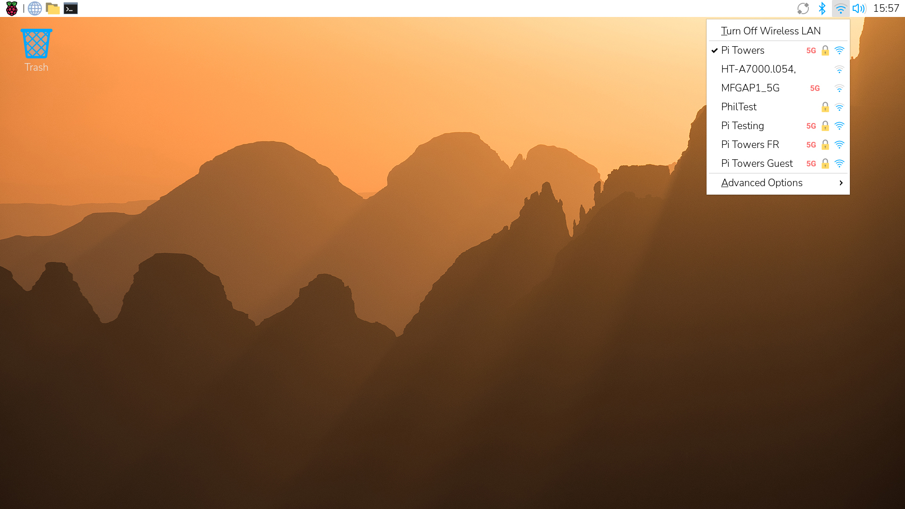
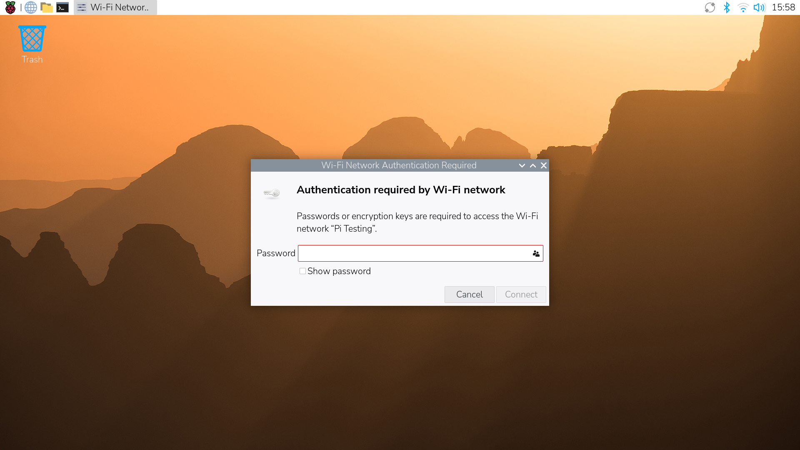
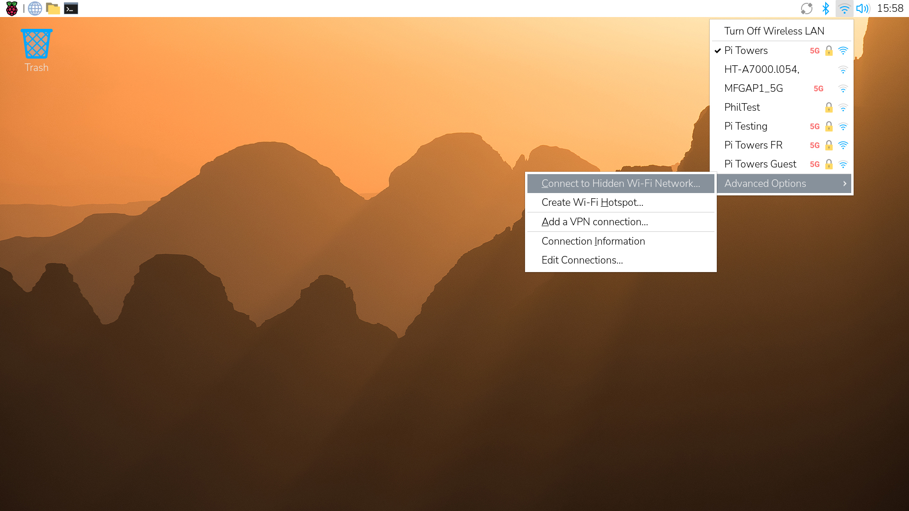

# 系统配置

## 配置方法

树莓派的关键设置是安装流程的一部分，可使用树莓派启动盘制作工具完成，详见[使用树莓派启动盘制作工具安装](ru-men.md)。安装完成后，你可以更改现有设置，也可以配置其他设置；具体方式取决于你的用例和技术水平，详见下文"配置方式"一节。

配置树莓派设置有多种方法。每种方法使用的界面不同，但它们通常都是通过修改 `/boot/firmware/config.txt` 及其他相关配置文件来生效的。三种主要配置方式为：

* 桌面图形用户界面（GUI）
* 交互式 `raspi-config` 文本用户界面（TUI）
* 直接命令行界面（CLI）

如果你的系统包含桌面环境，就可以在桌面 GUI 中配置常用设置。若需要更精细的控制，或者你正在使用精简版树莓派系统，或采用无头设置，可以使用树莓派系统内置的交互式 `raspi-config` TUI——这是一款基于终端的配置工具，用于管理常见的系统设置。

桌面 GUI 对用户最友好，但选择哪种方式取决于多个因素，例如你使用的是否为无头计算机（未连接显示输出的树莓派），以及你对命令行的熟悉程度。例如，如果使用的是没有连接显示器的无头树莓派，你就无法访问图形桌面环境。此时，你必须使用 `raspi-config` 配置工具，或者在命令行中手动编辑相关配置文件。

还有些设置只能通过命令行或控制台模式进行配置。虽然它们不会出现在桌面 GUI 或 `raspi-config` TUI 中，但本页仍会在相应类别下对它们加以说明。

### 桌面 GUI

如果你的系统包含桌面环境，桌面 GUI 就会为树莓派系统提供一层可视化交互界面。连接显示器后，你可以通过图标、菜单、窗口和指针来操控树莓派。

大多数设置都通过**控制中心（Control Centre）**管理，但有些选项位于桌面的其他位置。例如，你可以在树莓派桌面系统托盘右上角的无线图标中配置 Wi-Fi。

要打开控制中心，请选择系统托盘左上角的树莓派图标，然后进入**首选项（Preferences） > 控制中心（Control Centre）**。


>**注意**
>
>树莓派系统 *Bookworm* 使用的配置工具叫**树莓派配置（Raspberry Pi Configuration）**，而不是**控制中心**。

### 交互式 `raspi-config` TUI

树莓派系统内置 `raspi-config`，这是一款基于终端的配置工具，用于管理常见的系统设置。它提供结构化的菜单式界面，你可以用键盘在其中切换。


在以下情形中，你可能会用到 `raspi-config` TUI：

* 你想要或需要比桌面 GUI 更精细的控制。
* 你正在使用精简版树莓派系统。
* 你正在无头环境中运行树莓派。

要打开 `raspi-config` 工具，请在树莓派设备上启动终端，然后输入 `sudo raspi-config`。接着：

* 使用键盘上的上下方向键在设置列表中移动。
* 按**回车键**（或 **Return 键**）选定当前高亮的设置。你也可以用右方向键或 **Tab 键**把高亮移到 `<Select>` 上，再按**回车键**（或 **Return 键**）来选定。
* 用左方向键或 **Tab 键**返回设置列表。
* 输入相应字母可按字母顺序向前跳转。例如，在时区列表中输入 *E* 可跳到 *Europe*。
* 要关闭 `raspi-config`，用右方向键或 **Tab 键**选中 `<Finish>`，再按**回车键**（或 **Return 键**）。

### 直接命令行

你可以在终端或控制台模式下，通过编辑系统文件或运行命令来手动配置某些设置。另一些更高级的设置（例如自定义全屏启动画面）则只能通过命令行手动配置。

## 桌面外观

树莓派系统提供多种桌面样式，并允许你自定义桌面外观。本节总结如何在树莓派上配置桌面外观，包括：

* 选择桌面样式
* 自定义桌面背景和主题
* 配置任务栏
* 配置停靠栏
* 配置桌面小部件

由于这些选项都与桌面相关，因此都在桌面上通过**控制中心**进行配置。

### 选择桌面样式

树莓派系统提供三种桌面样式：

* **任务栏（Taskbar）。** 这是树莓派系统 Trixie 的默认样式。打开菜单的树莓派图标、启动器应用程序、已打开的应用程序和小部件全部显示在一条任务栏中。默认情况下，任务栏位于屏幕顶部。
* **任务栏/停靠栏（Taskbar/Dock）。** 打开应用程序搜索的树莓派图标、启动器应用程序和已打开的应用程序显示在停靠栏中，小部件显示在任务栏中。默认情况下，停靠栏位于屏幕底部，任务栏位于顶部。
* **停靠栏（Dock）。** 打开应用程序搜索的树莓派徽标、启动器应用程序、已打开的应用程序和小部件全部显示在停靠栏中。默认情况下，停靠栏位于屏幕底部。

要选择桌面样式，请完成以下步骤：

1. 选择任务栏左上角的树莓派图标，然后进入**首选项 > 控制中心**。
2. 在左侧菜单中打开**默认值（Defaults）**标签页。
3. 在**样式（Style）**下拉菜单中，选择你想要使用的桌面样式。

本文档在说明如何进入**控制中心**或其他应用程序时，均假定你使用的是默认桌面样式。使用停靠栏时，要查找应用程序，请选择停靠栏中的树莓派图标，然后在网格中定位该应用程序，或在搜索栏中输入其名称。本文档中的截图均展示默认桌面样式和外观。

### 自定义桌面背景和主题

你可以自定义树莓派系统桌面，更改桌面背景、显示颜色以及桌面显示的文件系统位置，还可以自定义桌面上窗口的外观。

你可以在**控制中心**中配置桌面外观和行为：

1. 选择任务栏左上角的树莓派图标，然后进入**首选项 > 控制中心**。
2. 在左侧菜单中打开**桌面（Desktop）**标签页。
3. 选择要配置的属性：

   * **活动桌面（Active Desktop）。** 启用后在桌面上显示图标。此开关还会解锁本标签页中的**桌面文件夹（Desktop Folder）**、**显示主文件夹（Show Home Folder）**、**显示回收站（Show Wastebasket）**和**显示已挂载磁盘（Show Mounted Disks）**等设置。
   * **布局（Layout）。** 配置桌面背景图片适应桌面区域的方式。
   * **图片（Picture）。** 选择要在桌面上显示的图像。
   * **颜色（Colour）。** 在取色器中选择任务栏背景的颜色和透明度，然后选择**选择（Select）**。
   * **文字颜色（Text Colour）。** 在取色器中选择任务栏文字的颜色和透明度，然后选择**选择**。
   * **桌面文件夹（Desktop Folder）。** 选择文件系统中用作桌面文件来源的文件夹。只有在选中**活动桌面**时才能编辑此设置。
   * **显示主文件夹（Show Home Folder）。** 启用后在桌面上显示指向你主文件夹的链接。只有在选中**活动桌面**时才能编辑此设置。
   * **显示回收站（Show Wastebasket）。** 启用后在桌面上显示回收站。只有在选中**活动桌面**时才能编辑此设置。
   * **显示已挂载磁盘（Show Mounted Disks）。** 启用后在桌面上显示已挂载的磁盘。只有在选中**活动桌面**时才能编辑此设置。

你可以在**控制中心**中配置桌面和窗口主题：

1. 选择任务栏左上角的树莓派图标，然后进入**首选项 > 控制中心**。
2. 在左侧菜单中打开**主题（Theme）**标签页。
3. 配置以下任意属性：

   * **字体（Font）。** 选择系统文字使用的字体。
   * **高亮颜色（Highlight Colour）。** 选择活动窗口标题栏和菜单高亮使用的背景色。
   * **高亮文字颜色（Highlight Text Colour）。** 选择高亮区域中文字使用的颜色。
   * **鼠标指针（Mouse Cursor）。** 选择鼠标指针的大小。
   * **主题（Theme）。** 在**浅色（Light）**和**深色（Dark）**模式之间选择。

### 配置任务栏

当桌面样式为**任务栏**或**任务栏/停靠栏**时，树莓派系统桌面会显示任务栏。

你可以在**控制中心**中配置任务栏的大小、位置、颜色、自动隐藏行为和独占模式：

1. 选择任务栏左上角的树莓派图标，然后进入**首选项 > 控制中心**。
2. 在左侧菜单中打开**任务栏（Taskbar）**标签页。
3. 配置以下任意属性：

   * **大小（Size）。** 选择图标尺寸（例如 48 x 48）。此设置也会改变任务栏的高度。
   * **位置（Position）。** 选择任务栏出现在屏幕**顶部（Top）**还是**底部（Bottom）**。
   * **颜色（Colour）。** 在取色器中选择任务栏背景的颜色和透明度，然后选择**选择**。
   * **文字颜色（Text Colour）。** 在取色器中选择任务栏文字的颜色和透明度，然后选择**选择**。
   * **自动隐藏（Autohide）。** 启用后，当指针未悬停在任务栏上时会将其隐藏。
   * **独占（Exclusive）。** 启用后，防止最大化窗口遮盖任务栏。

### 配置停靠栏

当桌面样式为**任务栏/停靠栏**或**停靠栏**时，树莓派系统桌面会显示停靠栏。

你可以在**控制中心**中配置停靠栏的大小、位置、颜色、自动隐藏行为和独占模式：

1. 选择任务栏左上角的树莓派图标，然后进入**首选项 > 控制中心**。
2. 在左侧菜单中打开**停靠栏（Dock）**标签页。
3. 配置以下任意属性：

   * **大小（Size）。** 选择图标尺寸（例如 48 x 48）。此设置也会改变停靠栏的高度。
   * **位置（Position）。** 选择停靠栏出现在屏幕**顶部（Top）**还是**底部（Bottom）**。
   * **颜色（Colour）。** 在取色器中选择停靠栏背景的颜色和透明度，然后选择**选择**。
   * **文字颜色（Text Colour）。** 在取色器中选择停靠栏文字的颜色和透明度，然后选择**选择**。此设置还会把通知徽章的背景颜色改为与文字形成对比的颜色。
   * **自动隐藏（Autohide）。** 启用后，当指针未悬停在停靠栏上时会将其隐藏。
   * **独占（Exclusive）。** 启用后，防止最大化窗口遮盖停靠栏。

### 配置桌面小部件

树莓派系统桌面上的小部件用于指示服务状态、提供对系统功能和应用程序的访问，并决定任务栏或停靠栏的布局。

你可以在**控制中心**中配置小部件的位置和行为：

1. 选择任务栏左上角的树莓派图标，然后进入**首选项 > 控制中心**。
2. 在左侧菜单中打开**小部件（Widgets）**标签页。
3. 在此标签页中，你可以：

   * **向任务栏或停靠栏添加小部件。** 未显示在桌面上的小部件会列在**可用（Available）**区域。要把其中一个小部件添加到桌面：
     * 从**可用**列表中选择该小部件。
     * 在**小部件**标签页中，切换到目标位置的标签页：**任务栏**或**停靠栏**。
     * 根据放置位置，选择**左（Left）**列或**右（Right）**列下方的**添加（Add）**按钮。
   * **在停靠栏或任务栏中重新排列小部件的顺序。**
   * **从任务栏或停靠栏移除小部件。** 要从桌面移除某个小部件，请在**任务栏**或**停靠栏**标签页的小部件列表中选中它，然后选择**移除（Remove）**。
   * **配置小部件的外观或行为。**
     * 根据小部件在桌面上的位置，从**任务栏**、**停靠栏**或**可用**区域中找到并选中它。
     * 如果可用，选择**配置（Configure...）**。此时会打开**配置 <名称>（Configure <Name>）**窗口，其中 *<名称>* 是该小部件的名称。

       有些小部件无法配置。这种情况下，**配置...**按钮不可用。
     * 在**配置 <名称>**窗口中，按需配置各项设置。

更改桌面样式可能会改变部分小部件的位置，把它们从任务栏移到停靠栏，或从停靠栏移到任务栏。你对单个部件的配置会覆盖这些默认行为。

## 音频与显示输出

树莓派系统支持多种音频输出和显示模式。本节总结如何在树莓派上配置音频和显示设置，包括：

* 通过桌面和命令行[更改音频输出](#音频与显示输出)。
* 通过桌面和命令行[选择音频设备配置文件](#音频与显示输出)。
* 通过桌面配置[显示设置](#音频与显示输出)（分辨率、刷新率、方向和缩放）；如果你是控制台模式用户，请改用内核命令行。
* 通过桌面、交互式 `raspi-config` TUI 和命令行[配置屏幕节能](#音频与显示输出)。
* 使用交互式 `raspi-config` TUI 配置[视频输出](#音频与显示输出)（复合视频或 HDMI）。
* 通过桌面和交互式 `raspi-config` TUI 配置[屏幕键盘](#音频与显示输出)，并选择它出现在哪台显示器上。

### 更改音频输出

树莓派系统支持多种音频输出模式供你选择：**HDMI**、**3.5 mm 耳机插孔**（如果你的设备有）和 **USB 音频设备**。默认情况下，树莓派会把音频输出到第一台 HDMI 设备。如果没有检测到 HDMI 设备，它会自动把音频切换到耳机插孔或已连接的 USB 设备。你可以在桌面 GUI 或命令行中更改音频输出位置。

**桌面**

树莓派桌面上的音频输出选择器允许你在连接到树莓派的多个音频设备之间选择。在较新的树莓派设备上，这可以包括通过某个 HDMI 接口或 USB 接口输出的音频。

如果你通过树莓派显示器背面的插孔连接了音频设备，它在列表中仍显示为 HDMI，因为该显示器连接的是树莓派上的 HDMI 接口。

通过桌面更改音频输出目的地：

1. 在桌面系统托盘右上角右键单击音量图标。这将打开音频输出选择器。
2. 选择你想使用的设备的音频输出。

**命令行**

1. **列出音频设备。** 在树莓派上打开终端，然后运行以下命令：

```bash
$ wpctl status
```

2. **找到目标"接收端（sink）"。** 找到标记为 `Sinks` 的部分，其中列出了可用的音频输出设备。每个设备都有一个数字 ID。默认设备用星号（*）标示。
3. **更改默认选项。** 要切换到其他设备，请运行以下命令，把 `<ID>` 替换为你在上一步中找到的编号：

```bash
$ wpctl set-default <ID>
```

4. **确认更改。** 再次运行 status 命令，检查你所选设备旁边是否出现星号（*）。

```bash
$ wpctl status
```

### 选择音频设备配置文件

设备配置文件定义了音频设备的配置方式及其对外暴露的能力。不同的配置文件针对不同的用例做了优化。你可以从桌面选择设备配置文件；在较新的树莓派设备上，也可以从命令行选择。

**桌面**

1. 在桌面系统托盘右上角右键单击音量图标。
2. 选择**设备配置文件（Device Profiles）**。
3. 从以下选项中选择：

   * **关闭（Off）。** 关闭树莓派的音频输出。
   * **数字立体声（Digital Stereo）。** 输出标准的双声道（左右）音频。这是默认配置文件，适用于大多数扬声器、耳机和显示器。
   * **专业音频（Pro Audio）。** 在每个音频设备上暴露最大数量的通道，允许对信号路由进行更精细的控制。除非你需要对音频输出进行细粒度控制，否则我们不建议选择此配置文件。

**命令行**

较新版本的树莓派系统允许你使用 `pactl` 命令管理设备配置文件。要使用 `pactl`，必须先安装 `pulseaudio`。然后，通过命令行更改设备配置文件：

1. **列出声卡。** 在树莓派上打开终端，然后运行以下命令列出音频设备：

```bash
$ pactl list cards
```

2. **找到声卡和活动配置文件。** 在输出中搜索目标音频设备（声卡）。该音频设备通常就是你在树莓派上已经启用的设备，其 ID 通常是一个较短的数字。检查各 ID 的配置文件，找出未设置为 `Active Profile: off` 的那一个。
3. **查看可用配置文件。** 在输出中目标音频设备的 `Profiles` 下，查找诸如 `off`、`output:hdmi-stereo` 和 `pro-audio` 之类的选项。
4. **设置新配置文件。** 使用以下语法设置该音频设备的设备配置文件，把 `<CARD_ID>` 和 `<PROFILE_NAME>` 替换为相应的值：`pactl set-card-profile <CARD_ID> <PROFILE_NAME>`。

   例如：

```bash
$ pactl set-card-profile 48 output:hdmi-stereo
```

5. **确认更改。** 再次列出音频设备，验证更改是否生效：

```bash
$ pactl list cards
```

### 配置显示设置

对于大多数 HDMI 显示器，树莓派系统会使用你的树莓派和显示器所支持的最高分辨率和刷新率。请在打开树莓派之前连接好线缆。

| 型号 | HDMI 类型 | 线缆转接 | 最大显示器数 | 最大分辨率 |
| :--- | :---: | :--- | :---: | :--- |
| 树莓派 Zero、Zero W 和 Zero 2 W | mini HDMI | 需要 mini HDMI 转 HDMI 线缆或转接头 | 1 | 取决于显示器；通常最高 1920 x 1080 像素 |
| 树莓派 4B、400 和计算模块 4 | 双 micro HDMI | 每台要连接的显示器都需要一根 micro HDMI 转 HDMI 线缆或转接头 | 2（CM4S 除外） | 两台 4K 30 Hz，或一台 4K 60 Hz |
| 树莓派 5、500、500+ 和计算模块 5 | 双 micro HDMI | 每台要连接的显示器都需要一根 micro HDMI 转 HDMI 线缆或转接头 | 2 | 两台 4K 60 Hz |

树莓派 4B、400 和计算模块 4 支持以下两种模式之一：

* 两台分辨率最高 3840 × 2160 像素（4K；超高清）、刷新率 30 Hz 的显示器，或两台分辨率最高 1920 × 1080 像素（全高清）、刷新率 60 Hz 的显示器。
* 如果你在 `/boot/firmware/config.txt` 中设置 `hdmi_enable_4kp60=1`，连接到 HDMI0 接口的显示器可以支持分辨率最高 3840 × 2160 像素（4K；超高清）、刷新率 60 Hz；第二台显示器仍支持分辨率最高 3840 × 2160 像素（4K；超高清）、刷新率 30 Hz，或分辨率最高 1920 × 1080 像素（全高清）、刷新率 60 Hz。

树莓派 5、500、500+ 和计算模块 5 无需额外配置，即可支持两台分辨率最高 3840 × 2160 像素（4K；超高清）、刷新率 60 Hz 的显示器。

你可以通过桌面和控制台调整显示分辨率和屏幕方向。

>**注意**
>
>树莓派系统 Bookworm 是最后一个支持用 `raindrop` 或 `arandr` 配置显示行为的版本。

命令行说明专门适用于精简版树莓派系统或没有图形桌面环境的系统。如果你使用桌面 GUI，请改用桌面说明。

在没有桌面环境的系统（以控制台模式运行）上，必须手动配置显示设置。较新版本的树莓派系统允许你使用内核模式设置（KMS）来配置显示。具体做法是把 `video=` 参数添加到内核命令行文件（`cmdline.txt`）中。有关此文件的更多信息，请参阅[配置内核命令行](#启动行为)。

**桌面**

1. 选择系统托盘左上角的树莓派图标，然后进入**首选项 > 控制中心**。
2. 在左侧菜单中打开**屏幕（Screens）**标签页。
3. 用以下任一方法选择要配置的屏幕：

   * 右键单击代表该屏幕的方框。
   * 打开**屏幕（Screens）**下拉菜单并选择要配置的屏幕。

4. 选择要配置的属性：

   * **分辨率（Resolution）。** 选择屏幕分辨率（例如 1920 × 1080）。
   * **刷新率（Frequency）。** 选择刷新率（例如 60 Hz）。
   * **方向（Orientation）。** 在**正常（Normal）**、**向左（Left）**、**倒置（Inverted）**和**向右（Right）**之间选择。
   * **缩放（Scaling）。** 在原始屏幕的 1.0、1.5、2.0 和 3.0 倍之间选择。

5. 选择**控制中心**右下角的**应用（Apply）**。更改会显示 10 秒钟，并要求你确认更改无误后才会继续。
6. 要确认更改，请选择**确定（OK）**。如果不确认，屏幕会恢复到之前的设置。

**命令行（基础分辨率）**

使用以下格式指定显示器、分辨率和刷新率，把 `<display>` 替换为显示接口，把 `<width>x<height>` 替换为屏幕分辨率，把 `<refresh_rate>` 替换为以 Hz 为单位的刷新率：

```bash
$ video=<display>:<width>x<height>M@<refresh_rate>
```

例如，`video=HDMI-A-1:1920x1080M@60` 表示：使用 HDMI-A-1 显示接口，分辨率 1920 × 1080，刷新率 60 Hz。

如果不指定分辨率，树莓派会根据显示器的扩展显示识别数据（EDID）来猜测。它会依据 Linux 内核中的信息，自动选择显示器所支持的最佳分辨率。

显示接口可以是以下任意一种：

* `HDMI-A-1`：第一个 HDMI 显示输出（软件中通常叫 HDMI 1）。在树莓派 4B 和 5 上，对应板卡丝印标为 HDMI0 的 HDMI 接口；在单 HDMI 接口的型号上，对应标为 HDMI 的接口。
* `HDMI-A-2`：第二个 HDMI 显示输出（软件中通常叫 HDMI 2）。在树莓派 4B 和 5 上，对应板卡丝印标为 HDMI1 的 HDMI 接口。
* `DSI-1`：DSI 或 DPI。
* `Composite-1`：复合视频。

**命令行（旋转与镜像）**

旋转和镜像参数必须显式指定，方法是在基础分辨率配置后追加参数，这些参数遵循标准 Linux 帧缓冲选项。

在基础分辨率配置后追加以下内容：

* `rotate=<number>`，把 `<number>` 替换为以度为单位的旋转角度（例如 90 度），即可旋转显示输出。所有已连接的显示器共用同一组旋转设置。
* `reflect_<axis>`，把 `<axis>` 替换为 `x`、`y` 或 `xy`，即可水平、垂直或双向镜像显示。

例如，`video=HDMI-A-1:1920x1080M@60,rotate=90,reflect_x` 表示：使用 HDMI-A-1 显示接口，分辨率 1920 × 1080，刷新率 60 Hz，旋转 90 度并水平镜像。

>**注意**
>
>在控制台模式下使用多台显示器时，所有已连接的显示器共用同一组旋转设置。

### 配置屏幕节能

你可以配置树莓派在一段时间无操作后关闭屏幕信号（屏幕节能）。启用屏幕节能后，树莓派系统默认在无操作十分钟（600 秒）后关闭屏幕。

你可以通过桌面 GUI、`raspi-config` TUI 和命令行配置屏幕节能。启用屏幕节能后，你还可以选择通过编辑配置文件来修改无操作超时时间。

**桌面**

1. 选择系统托盘左上角的树莓派图标，然后进入**首选项 > 控制中心**。
2. 在左侧菜单中打开**显示（Display）**标签页。
3. 用开关打开或关闭**屏幕节能（Screen Blanking）**。

   通过开关打开屏幕节能后，系统会在 `/home/<username>/.config/labwc/` 中创建一个 `autostart` 文件。无操作时间默认为 10 分钟（600 秒），你可以按照下文所述编辑此文件来更改超时时间。

4. 选择**控制中心**右下角的**关闭（Close）**。

**`raspi-config`**

1. 打开终端并运行 `sudo raspi-config`。
2. 用键盘切换到 `2 Display Options > D2 Screen Blanking` 并选定。
3. 对问题 *Would you like to enable screen blanking?* 回答 `Yes` 或 `No`。
4. 选择 `<OK>`，完成后选择 `<Finish>`。

**命令行**

你可以使用内核参数 `consoleblank` 从命令行控制屏幕节能。

与通过**控制中心**和 `raspi-config` 修改的屏幕节能设置（只影响桌面会话）不同，`consoleblank` 参数在树莓派以显示器加键盘的纯文本终端会话运行时同样生效。通过在内核命令行中设置 `consoleblank`，你可以指定控制台在关闭屏幕前等待多长时间。

1. 使用以下命令以管理员身份在文本编辑器中打开 `/boot/firmware/cmdline.txt`：

```bash
$ sudo nano /boot/firmware/cmdline.txt
```

2. 设置树莓派系统关闭控制台屏幕前等待的秒数。所有参数必须保持在同一行内。你可以：

   * 设置屏幕关闭前的无操作秒数。例如，添加 `consoleblank=600` 会在无操作 600 秒（10 分钟）后关闭屏幕。
   * 添加 `consoleblank=0` 使屏幕永不关闭。

3. 使用以下命令重启树莓派，使更改生效：

```bash
$ sudo reboot
```

重启后，控制台屏幕关闭超时会遵循你的新设置。

你可以使用以下命令显示当前的控制台屏幕关闭时间（秒）：

```bash
$ cat /sys/module/kernel/parameters/consoleblank
```

#### 更改屏幕节能超时时间

你可以通过编辑 `/home/<username>/.config/labwc` 中的 `autostart` 文件来更改屏幕节能超时时间：

1. 在文本编辑器中打开 `/home/<username>/.config/labwc/autostart`，把 `<username>` 替换为你的实际用户名。
2. 把 `timeout 600` 改成以秒为单位的合适超时值（例如，5 分钟用 `timeout=300`）。最小超时值为 1 秒。
3. 保存文件并退出编辑器。
4. 重启树莓派使更改生效。

>**技巧**
>
>如果你的显示器在关闭后立即被唤醒（先显示"NO SIGNAL"然后又恢复），请在 `/boot/firmware/cmdline.txt` 的单行末尾追加 `vc4.force_hotplug=1`，以防止虚假的热插拔唤醒。

### 在 Wayland 中打开或关闭显示器

在 Wayland 桌面会话中，你可以直接使用 `wlr-randr` 打开或关闭已连接的显示器：

1. 通过 SSH 连接到设备。
2. 运行以下命令关闭连接到 HDMI0 的显示器：

```bash
$ export WAYLAND_DISPLAY=wayland-1
$ wlr-randr --output HDMI-A-1 --off
```

3. 运行以下命令重新打开该显示器：

```bash
$ export WAYLAND_DISPLAY=wayland-1
$ wlr-randr --output HDMI-A-1 --on
```

### 配置指针可见性

没有更改指针可见性的全局设置，但在 Wayland 上运行的图形应用程序可以在自己的窗口内以编程方式隐藏指针（例如在 Pygame 中通过 `pygame.mouse.set_visible(0)`）。

### 配置视频输出

对于树莓派各旗舰型号，你可以使用交互式 `raspi-config` TUI 把视频输出配置为复合视频或 HDMI。除树莓派 5 外，启用复合视频输出会在所有型号上禁用 HDMI 输出。使用交互式 `raspi-config` TUI 启用或禁用复合视频输出：

1. 打开终端并运行 `sudo raspi-config`。
2. 用键盘切换到 `2 Display Options > D4 Composite` 并选定。
3. 对问题 *Would you like composite video output to be enabled?* 回答 `Yes` 或 `No`。
4. 选择 `<OK>` 确认此选择。
5. 完成后选择 `<Finish>`。
6. 重启树莓派使更改生效。

### 配置屏幕键盘

你可以通过桌面 GUI 和交互式 `raspi-config` TUI 配置树莓派显示屏幕键盘，并选择该键盘显示在哪块屏幕上。在 `raspi-config` TUI 中，以下两项设置是分开配置的：

* 进入 `D6 Onscreen Keyboard` 启用或禁用屏幕键盘。
* 进入 `D7 Keyboard` 指定屏幕键盘显示在哪块屏幕上。

**桌面**

1. 选择系统托盘左上角的树莓派图标，然后进入**首选项 > 控制中心**。
2. 在左侧菜单中打开**显示（Display）**标签页。
3. 从**屏幕键盘（On-screen keyboard）**下拉菜单中选择以下选项之一：

   * **始终启用（Enabled always）**：键盘始终显示在屏幕上。
   * **检测到触摸屏时启用（Enabled if touchscreen found）**：当树莓派连接了触摸屏时，键盘才显示在屏幕上。
   * **禁用（Disabled）**：键盘不显示在屏幕上。

4. 如果树莓派连接了多块屏幕，请从**屏幕键盘位置（On-Screen Keyboard Location）**下拉菜单中选择显示键盘的屏幕。
5. 选择**控制中心**右下角的**关闭**。

**`raspi-config`（启用或禁用）**

1. 打开终端并运行 `sudo raspi-config`。
2. 用键盘切换到 `2 Display Options > D6 Onscreen Keyboard` 并选定。
3. 从以下选项中选择：

   * `S1 Always On`：键盘始终显示在屏幕上。
   * `S2 Autodetect`：当树莓派连接了触摸屏时，键盘才显示在屏幕上。
   * `S3 Always Off`：键盘不显示在屏幕上。

4. 选择 `<OK>`，再次选择 `<OK>` 确认你的选择。
5. 完成后选择 `<Finish>`。

**`raspi-config`（指定屏幕）**

1. 打开终端并运行 `sudo raspi-config`。
2. 用键盘切换到 `2 Display Options > D6 Onscreen Keyboard` 并选定。
3. 选择你希望键盘出现所在的显示器。
4. 选择 `<OK>`，再次选择 `<OK>` 确认你的选择。
5. 完成后选择 `<Finish>`。

## 网络

树莓派系统为配置网络设置提供了灵活的选项。本节总结如何管理和自定义树莓派的网络配置，包括：

* 通过桌面和交互式 `raspi-config` TUI 更改树莓派的[主机名](#网络)。
* 使用适合你用例的手动方法管理 [DHCP 和静态 IP](#网络)。
* 通过桌面和命令行[设置网络优先级](#网络)。
* 使用交互式 `raspi-config` TUI 启用或禁用[可预测的网络接口名称](#网络)。这是一项默认关闭的高级选项。
* 使用交互式 `raspi-config` TUI 启用或禁用[链路本地地址回退](#网络)。这是一项默认关闭的高级选项。
* 使用交互式 `raspi-config` TUI 配置[代理服务器](#网络)。这是一项默认关闭的高级选项。

### 更改主机名

设置主机名有以下几个好处：

* 设置主机名（例如 `my-pi`）后，你可以通过 *mDNS* 访问树莓派，而不必使用较长且会变化的 IP 地址。例如，可以用 `ssh pi@my-pi.local` 代替 `ssh pi@192.168.1.42`。
* 如果同一网络中有多台树莓派设备，使用唯一的主机名（例如 `my-pi`、`pi-hole` 和 `retro-pi`）可以确保你始终连接到正确的树莓派。

主机名不区分大小写，且只能包含：

* 从 *a* 到 *z* 的 ASCII 字母。
* 从 *0* 到 *9* 的数字。
* 连字符（*-*）。

不允许使用其他符号、标点或空格。

**桌面**

1. 选择系统托盘左上角的树莓派图标，然后进入**首选项 > 控制中心**。
2. 在左侧菜单中打开**系统（System）**标签页。
3. 选择**更改主机名（Change Hostname）**。
4. 在**输入新主机名（Enter new hostname）**输入框中输入新的主机名。
5. 选择窗口右下角的**确定（OK）**。
6. 选择**控制中心**右下角的**关闭**。

**`raspi-config`**

1. 打开终端并运行 `sudo raspi-config`。
2. 用键盘切换到 `1 System Options > S4 Hostname` 并选定。
3. 选择 `<OK>` 继续。此时会打开一个显示当前主机名的界面。
4. 删除当前主机名并输入新的主机名。
5. 选择 `<OK>`，完成后选择 `<Finish>`。

### 管理 DHCP 和静态 IP

在典型的家庭网络中，DHCP（动态主机配置协议）由你的路由器管理。它会在设备连接时自动为设备分配 IP 地址和其他网络设置（如网关和 DNS 服务器）。

使用 DHCP 可以让树莓派无需手动配置 IP 地址和其他网络设置，就能通过 Wi-Fi 或以太网连接到网络。

默认情况下，IP 地址是临时的，会随着路由器按需重新分配而随时间变化。如果你在树莓派上运行服务（例如 Web 服务器或 SSH 访问），建议让设备始终使用同一个 IP 地址。实现这一点有两种主要方式：

* **DHCP 保留（推荐）。** 有时也叫静态租约（static lease），DHCP 保留是在路由器上配置的。它确保你的树莓派基于其 MAC 地址始终获得相同的 IP 地址，并把所有 IP 管理集中在路由器上。设置步骤因路由器厂商和界面而异。
* **在设备上设置静态 IP。** 你可以使用 `nmcli` 在树莓派上直接手动配置静态 IP 地址。这需要手动设置 IP 地址、子网掩码、网关和 DNS。我们不建议这样做，因为配置错误会导致连接问题。你必须确保所选 IP 在路由器 DHCP 池之外，且不与其他设备冲突。

### 设置网络优先级

当树莓派检测到多个已知网络时，默认可以连接其中任意一个。你可以为网络设置优先级，控制树莓派更倾向于连接哪个网络。设置网络优先级后，树莓派会尝试连接信号范围内优先级最高的非负网络：

* 数字越大优先级越高；树莓派会首先尝试连接数值最大的正数网络。
* 设为 *0* 的网络具有中性优先级，这也是默认值。设为 *0* 的网络会在其他优先级数字更高的正数网络之后被选择。
* 数字为负的网络优先级较低；只有在没有其他已知网络可用时，树莓派才会连接负优先级的网络。

例如，考虑以下四个网络：

* Snake（-1）
* Rabbit（0）
* Dog（1）
* Cat（100）

如果以上网络都在信号范围内，树莓派会首先尝试连接 *Cat* 网络。如果失败，它会尝试连接 *Dog* 网络，然后是 *Rabbit* 网络。如果树莓派没有检测到其他已知网络，它会尝试连接 *Snake* 网络。

**桌面**

1. 选择系统托盘右上角的无线图标。该图标显示当前连接的 Wi-Fi 信号强度，并用于打开**网络管理器（Network Manager）**。
2. 选择**高级选项（Advanced Options） > 编辑连接（Edit Connections）**。这将打开**网络连接（Network Connections）**窗口。
3. 找到并选择你想设置优先级的网络。
4. 选择窗口底部的蓝色齿轮图标。
5. 打开**常规（General）**标签页。
6. 确保选中了**按优先级自动连接（Connect automatically with priority）**。
7. 设置数字优先级值。该值控制当多个已知网络可用时，树莓派更倾向于连接哪个网络。
8. 选择窗口右下角的**保存（Save）**，然后关闭**网络连接**窗口。

**命令行**

在设置网络优先级之前，请运行以下命令查看已知网络的现有优先级：

```bash
$ nmcli --fields AUTOCONNECT-PRIORITY,NAME connection
```

输出类似于：

```text
AUTOCONNECT-PRIORITY  NAME
0                     myNetwork
0                     lo
0                     Pi Towers
0                     Example
-999                  Wired connection 1
```

使用 `nmcli connection modify` 设置网络优先级。以下示例把名为 Pi Towers 的网络（带英文引号）的优先级设置为 10：

```bash
$ sudo nmcli connection modify "Pi Towers" connection.autoconnect-priority 10
```

### 启用或禁用可预测的网络接口名称

你可以启用或禁用更具体的接口名称，使网络设备命名在重启和硬件变更之间保持一致。这是一项默认关闭的高级用户选项，因为它在某些设备上会取代传统的 `eth0` 和 `wlan0` 命名方案。命名行为可能因树莓派型号和配置而异。

1. 打开终端并运行 `sudo raspi-config`。
2. 用键盘切换到 `6 Advanced Options > A2 Network Interface Names` 并选定。
3. 对问题 *Would you like to enable predictable network interface names?* 回答 `Yes` 或 `No`。
4. 选择 `<OK>` 确认此选择，完成后选择 `<Finish>`。
5. 重启树莓派使更改生效。

### 启用或禁用链路本地地址回退

你可以启用或禁用链路本地地址回退，以分配一个临时的 `169.254.x.x` 地址。即使 DHCP 服务器可用，也可能会分配这种地址：系统会先分配一个链路本地地址，获得 DHCP 租约后再将其替换。如果没有收到 DHCP 响应，链路本地地址将继续使用。

这是一项默认关闭的高级用户选项，因为它可能干扰网络配置，而且在大多数有 DHCP 的网络中通常并不需要。只有在你理解这一行为的前提下才启用此选项。

1. 打开终端并运行 `sudo raspi-config`。
2. 用键盘切换到 `6 Advanced Options > A14 Link-local Fallback` 并选定。
3. 对问题 *Would you like to enable link-local fallback?* 回答 `Yes` 或 `No`。
4. 选择 `<OK>` 确认此选择，完成后选择 `<Finish>`。
5. 重启树莓派使更改生效。

### 配置树莓派使用代理服务器

代理服务器是客户端设备与互联网之间的中介。要将树莓派配置为使用代理服务器，你需要：

* 代理服务器的 IP 地址或主机名及端口。
* 代理服务器的用户名和密码（如果需要）。

这是一项高级配置，只有在你的网络需要代理时才应配置（例如在受管理的企业或受限环境中）。

1. 打开终端并运行 `sudo raspi-config`。
2. 用键盘切换到 `6 Advanced Options > A3 Network Proxy Settings` 并选定。
3. 配置代理所需的环境变量。根据需要选择以下一个或多个选项。每个选项必须单独配置，也就是说，你要配置的每个选项都必须从第 1 步重新开始：

   * `P1 All` 对所有网络流量应用相同的代理设置。
   * `P2 HTTP` 把所有 HTTP 流量发送到代理。
   * `P3 HTTPS` 把所有 HTTPS（安全）流量发送到代理。
   * `P4 FTP` 把所有 FTP 流量发送到代理。
   * `P5 Exceptions` 指定应绕过代理的地址。

4. 选择 `<OK>`，再次选择 `<OK>`。
5. 完成后选择 `<Finish>`。
6. 重启树莓派使更改生效。

对于 `P1` 到 `P4` 选项，请按以下格式输入代理信息，把 `<proxy_ip_address>` 替换为代理的 IP 地址，把 `<proxy_port>` 替换为代理的端口：

```text
http://<proxy_ip_address>:<proxy_port>
```

如果你的代理需要用户名和密码，请按以下格式添加，把 `<username>` 和 `<password>` 替换为用于验证代理的用户名和密码：

```text
http://<username>:<password>@<proxy_ip_address>:<proxy_port>
```

对于 `P5` 选项，请输入以逗号分隔的可绕过代理的地址列表。根据需要添加更多域名或 IP 段。

```text
no_proxy=“localhost,127.0.0.1”
```

## 无线连接

本节介绍如何：

* 配置 Wi-Fi 连接，具体包括：

  * [启用无线网络（设置 WLAN 区域）](#无线连接)，这是连接无线网络的前提，可以通过桌面和交互式 `raspi-config` TUI 完成。
  * [查找要连接的网络](#无线连接)，可以通过桌面和命令行完成。
  * [连接到无线网络](#无线连接)，可以通过桌面和命令行完成。
  * [启用或禁用 WLAN 省电](#无线连接)，这是一项通过交互式 `raspi-config` TUI 设置的高级选项。

* 连接[蓝牙外设](#无线连接)（例如鼠标或键盘），可以通过桌面完成。

Wi-Fi 连接需要树莓派内置无线功能，或者在其上插入无线 USB 适配器。

### 启用无线网络（设置 WLAN 区域）

搭载双频无线的树莓派设备出于安全考虑会自动禁用网络功能，直到设置了无线局域网（WLAN）区域。这适用于树莓派 3B+ 及后续型号、计算模块 4 及后续型号，以及所有键盘计算机（树莓派 400、500 和 500+）。

设置 WLAN 区域即指定你使用树莓派所在的国家/地区。这可以让树莓派为 5 GHz 网络选择正确的频段。设置 WLAN 区域后，你就可以使用树莓派设备的内置无线网络模块。除非你想更改，否则 WLAN 区域只需设置一次。

>**重要**
>
>选择正确的 Wi-Fi 管辖区至关重要，因为它决定了可用信道、发射功率和整体网络性能；错误的设置可能导致法律问题、干扰增加、容量下降和连接质量变差。

通常，在使用树莓派启动盘制作工具把操作系统安装到启动介质时会设置 WLAN 区域，但你之后也可以通过桌面 GUI 或终端（通过 `raspi-config` TUI 以及 `nmcli` 命令）进行设置或更改。

**桌面**

1. 选择左上角的树莓派图标。
2. 选择**首选项 > 控制中心**。
3. 打开**本地化（Localisation）**标签页。
4. 选择列表底部的**设置 WLAN 区域（Set WLAN Country）**。
5. 从**国家/地区（Country）**下拉菜单中选择你的国家/地区。
6. 选择**确定**，然后选择**关闭**。

**`raspi-config` 与 `nmcli`**

1. 打开终端并运行 `sudo raspi-config`。
2. 用键盘切换到 `5 Localisation options > L4 WLAN Country` 并选定。
3. 在国家/地区列表中切换，选择适用于你的国家/地区。
4. 选择 `<OK>`。此时会打开确认窗口，再次选择 `<OK>`。
5. 在新的终端中，运行以下命令检查树莓派上的 Wi-Fi 无线模块是否已启用：

```bash
$ nmcli radio wifi
```

6. 如果命令返回 `enabled`，就可以继续配置 Wi-Fi 连接了。如果返回 `disabled`，请使用以下命令启用 Wi-Fi：

```bash
$ nmcli radio wifi on
```

### 查找网络

在连接无线网络之前，你必须先找到或指定一个可用的网络。在树莓派系统上，你可以使用桌面 GUI 中的**网络管理器**或通过命令行查看附近的 Wi-Fi 网络。

**桌面**

要从桌面查看可用的 Wi-Fi 网络，请选择系统托盘右上角的无线图标。该图标显示当前连接的 Wi-Fi 信号强度，并用于打开**网络管理器**。从树莓派系统 *Bookworm* 开始，Network Manager 是默认的网络配置工具。

网络管理器会显示可用无线网络的列表。每个可用网络旁边的图标分别表示：

* 该网络是否运行在 5 GHz 频段（*5G* 图标）。
* 该网络是否加密（挂锁图标）。
* 该网络的信号强度（四格 Wi-Fi 图标）。



如果出现提示说找不到接入点（AP）的消息，例如"No APs found - scanning"，请等待几秒，让网络管理器找到你的网络。

如果你的无线网络因为隐藏了 SSID 而没有出现在菜单中，请按照[连接到无线网络](#无线连接)中的说明操作。

**命令行**

要从终端查看可用的 Wi-Fi 网络，请运行以下命令：

```bash
$ nmcli dev wifi list
```

输出类似于：

```text
IN-USE  BSSID              SSID            MODE   CHAN  RATE        SIGNAL  BARS  SECURITY
        90:72:40:1B:42:05  myNetwork       Infra  132   405 Mbit/s  89      ****  WPA2
        90:72:42:1B:78:04  myNetwork5G     Infra  11    195 Mbit/s  79      ***   WPA2
        9C:AB:F8:88:EB:0D  Pi Towers       Infra  1     260 Mbit/s  75      ***   WPA2 802.1X
        B4:2A:0E:64:BD:BE  Example         Infra  6     195 Mbit/s  37      **    WPA1 WPA2
```

在输出的 SSID 列中查找你想连接的网络名称。使用 SSID 和密码连接到网络，详见[连接到无线网络](#无线连接)。

### 连接到无线网络

你可以通过桌面和使用 `nmcli`（NetworkManager 命令行界面）命令来建立无线连接。

`nmcli` 是一种配置系统网络设置的命令行方式。下文的命令行说明只用到少数几条 `nmcli` 命令。实际上，`nmcli` 提供了许多用于管理无线连接的命令，你可能会用得上。更多信息请参阅 [nmcli 网络管理器文档](https://networkmanager.dev/docs/api/latest/nmcli.html)。

>**注意**
>
>以下说明适用于 WEP、WPA、WPA2 和 WPA3 网络，但可能不适用于企业网络。

**桌面**

要从桌面 GUI 更改或添加无线网络，请按照[查找网络](#无线连接)中的说明打开网络管理器，并且你要连接的无线网络不是隐藏网络：

1. 选择相应的无线网络。如果你的无线网络因为是隐藏网络而未列出，请改用隐藏网络的操作说明。

   * 如果你尚未选择无线网络，或之前已将其关闭，请选择**打开无线局域网（Turn On Wireless LAN）**，然后从菜单中选择一个无线网络。
   * 如果你已连接到某个无线网络，请从菜单中选择另一个。

2. 如果有提示，输入该无线网络的密码。



3. 选择窗口右下角的**连接（Connect）**。

**桌面（隐藏网络）**

如果你的无线网络因为隐藏了 SSID 而没有出现在网络管理器菜单中：

1. 按照[查找网络](#无线连接)中的说明打开网络管理器，然后选择**高级选项 > 连接到隐藏的无线网络（Connect to Hidden Wireless Network）**。



2. 输入网络的名称。
3. 从下拉菜单中选择网络的安全方式。这会在窗口中添加一些随选择不同而变化的字段，例如用户名和密码。
4. 选择窗口右下角的**连接**。

**命令行**

要从命令行更改或添加无线网络，你首先需要网络的 SSID 名称，可以按照[查找网络](#无线连接)中的命令行说明找到它。

拿到 SSID 后，运行以下命令，把 `<example_ssid>` 替换为你要连接的网络名称：

```bash
$ sudo nmcli --ask dev wifi connect <example_ssid>
```

出现提示时输入网络密码。随后树莓派会自动连接到该网络。

如果出现错误输出，提示 *Secrets were required, but not provided*，说明你输入的密码不正确。请重新运行上述命令，并正确输入密码。

如果你要连接的网络不使用密码，请改用以下命令，把 `<example_ssid>` 替换为你要连接的网络名称：

```bash
$ sudo nmcli dev wifi connect <example_ssid>
```

>**警告**
>
>不安全的无线网络可能会把你的个人信息置于风险之中。请尽可能使用安全的无线网络或 VPN。

如果你要连接的是隐藏网络，请改用以下命令，把 `<example_ssid>` 替换为你要连接的网络名称：

```bash
$ sudo nmcli --ask dev wifi connect <example_ssid> hidden yes
```

要检查你是否已连接到网络，请运行以下命令：

```bash
$ nmcli dev wifi list
```

如果你所连接网络的 SSID 所在行的 `IN-USE` 列中出现星号（*），即表示树莓派已成功连接。

>**注意**
>
>如果你是高级用户，还可以通过编辑 `/etc/NetworkManager/system-connections` 目录中的 Network Manager 连接文件来手动编辑连接配置。在这里，你可以编辑 SSID（网络名称）、密码、安全类型（例如 WPA2）、IP 地址和 DNS 设置等内容。

### 启用或禁用 WLAN 省电

WLAN 省电是 `raspi-config` 中的一项高级选项，除非树莓派工程师指示，否则我们不建议设置。禁用省电会立即生效，并对后续连接持续有效。启用此设置请谨慎：它可能改善连接稳定性，但会增加功耗。

1. 打开终端并运行 `sudo raspi-config`。
2. 用键盘切换到 `6 Advanced Options > A13 WLAN Power Save` 并选定。
3. 对问题 *Would you like to enable WLAN power saving?* 回答 `Yes` 或 `No`。
4. 选择 `<OK>` 确认此选择，完成后选择 `<Finish>`。

### 连接蓝牙外设

如果你的蓝牙设备不带 USB 适配器，可以在桌面 GUI 中连接。要发现并配对蓝牙键盘或鼠标：

1. 在顶部菜单中，选择紧挨 Wi-Fi 图标左侧的蓝牙图标。
2. 选择**添加设备（Add Device）**。这将打开**添加新设备（Add New Device）**窗口。
3. 等待设备出现在窗口中，然后选中它。
4. 选择窗口右下角的**配对（Pair）**。
5. 选择**确定**，确认要与该设备配对。

## 键盘、系统与本地化

本节介绍如何：

* 通过桌面[管理键盘快捷键](#键盘系统与本地化)：查看、编辑、添加和删除在树莓派上执行指定操作的组合键。
* 通过桌面或交互式 `raspi-config` TUI [更改默认浏览器](#键盘系统与本地化)：在 Chromium 和 Firefox 之间选择；如果安装期间未选择，默认浏览器为 Chromium。
* 通过桌面或交互式 `raspi-config` TUI 配置本地化设置，包括：

  * [语言环境（locale）](#键盘系统与本地化)，即系统级语言和区域设置（国家/地区和字符集）。
  * [时区](#键盘系统与本地化)，由用于设置本地时间的地理区域和城市决定。
  * [键盘](#键盘系统与本地化)，通过指定键盘的物理型号、语言布局和按键变体。

* 使用交互式 `raspi-config` TUI 配置高级系统设置，包括：

  * [扩展文件系统](#键盘系统与本地化)，如果你把操作系统克隆到了更大的存储设备，而你使用的操作系统又不会自动扩展文件系统来利用这些空间，此功能可能会很有用。
  * [配置日志记录](#键盘系统与本地化)，用于设置日志的存储位置。
  * [启用或禁用测试版（Beta）访问](#键盘系统与本地化)，如果你是树莓派系统的自愿测试用户，可以打开此项。
  * [在 Wayland 和 X11 之间切换](#键盘系统与本地化)。我们不建议切换到 X11，因为我们已不再为其开发。

如果你要找的是在树莓派上设置 WLAN 区域的说明，请参阅[启用无线网络（设置 WLAN 区域）](#无线连接)。设置 WLAN 区域的说明放在"无线连接"一节，因为它是连接无线网络的前提。

### 管理键盘快捷键

键盘快捷键是预先定义的组合按键，用于在计算机上触发某个操作。

一个快捷键只能触发一个操作，但同一个操作可以由多个快捷键触发。例如，你可能有 *Alt+F4* 和 *Ctrl+W* 两个快捷键，都能关闭窗口。如果你试图把另一个操作分配给这两个快捷键之一，或者试图重复创建同一个快捷键，新的快捷键操作会覆盖旧的操作。

#### 快捷键配置

配置快捷键就是把组合键分配给某个系统操作。你可以使用**预设（Preset）**（预定义操作）或**操作（Action）**（用户自定义操作）来配置快捷键。操作说明见[编辑键盘快捷键](#键盘系统与本地化)或[添加键盘快捷键](#键盘系统与本地化)。

##### 预设

预设是树莓派预定义的操作，例如*打开终端（Open Terminal）*或*显示关机选项（Show Shutdown Options）*。为快捷键选择预设后，相应的命令会自动填入**命令（Command）**文本框。例如，*打开终端*的预定义命令是 `lab-sensible-terminal`。

##### 操作

操作更灵活，允许你定义树莓派尚未定义的自定义系统操作，例如 *NextWindow* 和 *HideCursor*。

有些操作需要额外的输入，选择该操作后会提示你提供。如果操作不需要额外输入，则不会显示参数选项或文本框。如果需要，会根据所选操作显示一个带预定义参数选项的下拉菜单，或一个自由输入的文本框：

* **固定参数列表。** *最大化（Maximize）*或*贴边（SnapToEdge）*等操作要求你从参数列表中选择一个选项。例如，选择*最大化*作为快捷键操作后，会出现一个**方向（Direction）**列表，选项有 *both*、*horizontal* 或 *vertical*。
* **自由文本输入。** *执行（Execute）*或*显示菜单（ShowMenu）*等操作会显示一个用于自定义输入的文本框。例如，选择*执行*作为快捷键操作后，会出现一个**命令（Command）**文本框，你可以在其中输入原本要在终端中输入的命令，例如输入 *vlc* 打开 VLC 媒体播放器。

要查看操作列表，请按照[查看现有键盘快捷键](#键盘系统与本地化)的说明进行，然后在**快捷键（Shortcuts）**标签页右下角选择**帮助（Help）**。这会打开一份 `labwc` 操作列表，这些操作可以分配给菜单、键盘快捷键和鼠标绑定。创建或编辑快捷键时**操作**菜单中的每个可用操作，都在这份 `labwc` 操作列表中有文档说明。

#### 查看现有键盘快捷键

要查看现有的键盘快捷键：

1. 选择系统托盘左上角的树莓派图标，然后进入**首选项 > 控制中心**。
2. 在左侧菜单中打开**快捷键（Shortcuts）**标签页。

这会打开一个现有键盘快捷键的表格，包含两列：

* 左侧的**按键（Key）**列显示触发操作的组合键。组合中的每个按键用连字符分隔，例如 *Alt-Shift-Tab*。
* 右侧的**功能（Function）**列显示相应组合键触发的操作，例如*上一个窗口（Previous Window）*。

完成后，选择**控制中心**右下角的**关闭**。

#### 编辑键盘快捷键

以下说明介绍了更改现有键盘快捷键行为的步骤，包括：

* 快捷键是在组合键释放之前还是之后触发。默认是在树莓派检测到组合键时立即触发操作。
* 快捷键触发的操作，可以是预设或操作，见[快捷键配置](#键盘系统与本地化)。

如果你想更改快捷键本身，则必须改为[删除现有快捷键](#键盘系统与本地化)，然后[添加带有预期操作的新快捷键](#键盘系统与本地化)。

要编辑现有键盘快捷键的行为：

1. 选择系统托盘左上角的树莓派图标，然后进入**首选项 > 控制中心**。
2. 在左侧菜单中打开**快捷键**标签页。
3. 选择要编辑的键盘快捷键。
4. 选择窗口底部的**编辑（Edit）**。这将打开**编辑快捷键（Edit Shortcut）**窗口。
5. 选择快捷键是在释放组合键中的任意按键之后生效，还是之前生效。

   * 如果希望快捷键在释放组合键中的任意按键后生效，请选择**释放时激活（Activate on Release）**。
   * 如果希望快捷键在完整组合键按下后立即生效，请保持**释放时激活**不选中。

6. 选择**预设**或**操作**。如果选择操作，请在提示时提供所需的额外输入。有关预设和操作的更多信息，见[快捷键配置](#键盘系统与本地化)。
7. 完成后，在**编辑快捷键**窗口右下角选择**确定**。
8. 选择**控制中心**右下角的**关闭**。

#### 添加键盘快捷键

要添加新的键盘快捷键：

1. 选择系统托盘左上角的树莓派图标，然后进入**首选项 > 控制中心**。
2. 在左侧菜单中打开**快捷键**标签页。
3. 检查你想添加的快捷键是否已存在于表格中。如果你创建了相同快捷键但操作不同，新的快捷键操作会覆盖旧的快捷键操作。
4. 选择窗口底部的**新建（New）**。这将打开**编辑快捷键**窗口。
5. 输入你想用作快捷键的组合键，然后松开。
6. 选择快捷键是在释放组合键中的任意按键之后生效，还是之前生效。

   * 如果希望快捷键在释放组合键中的任意按键后生效，请选择**释放时激活**。
   * 如果希望快捷键在完整组合键按下后立即生效，请保持**释放时激活**不选中。

7. 选择**预设**或**操作**。如果选择操作，请在提示时提供所需的额外输入。有关预设和操作的更多信息，见[快捷键配置](#键盘系统与本地化)。
8. 完成后，在**编辑快捷键**窗口右下角选择**确定**。
9. 选择**控制中心**右下角的**关闭**。

#### 删除键盘快捷键

要删除现有的键盘快捷键：

1. 选择系统托盘左上角的树莓派图标，然后进入**首选项 > 控制中心**。
2. 在左侧菜单中打开**快捷键**标签页。
3. 选择要删除的键盘快捷键。
4. 选择窗口底部的**删除（Delete）**。这将打开确认窗口。
5. 在确认窗口中选择**确定**。
6. 选择**控制中心**右下角的**关闭**。

### 更改默认浏览器

你可以通过桌面和交互式 `raspi-config` TUI 更改树莓派上的默认浏览器。你可以在 *Chromium* 和 *Firefox* 之间选择。

**桌面**

1. 选择系统托盘左上角的树莓派图标，然后进入**首选项 > 控制中心**。
2. 在左侧菜单中打开**系统**标签页。
3. 在 *Chromium* 和 *Firefox* 之间选择。
4. 选择**控制中心**右下角的**关闭**。

**`raspi-config`**

1. 打开终端并运行 `sudo raspi-config`。
2. 用键盘切换到 `1 System Options > S9 Browser` 并选定。
3. 在 `Chromium` 和 `Firefox` 之间选择。
4. 选择 `<OK>`，再次选择 `<OK>`。
5. 完成后选择 `<Finish>`。

### 配置语言环境

语言环境（locale）是在多种语言和区域之间切换的框架。它让树莓派能够显示你偏好的语言、日期格式、货币符号和字符集。新安装的系统默认选择 *UTF-8* 语言环境。*C*、*C.UTF-8* 和 *POSIX* 语言环境也可用，你还可以按需生成其他语言环境。

配置语言环境时，你配置的是系统级的默认语言环境，它会更改树莓派所有用户使用的语言。

通过桌面配置语言环境需要分别设置以下三项：

* 语言（Language），例如 *en* 表示英语。
* 区域（国家/地区，Region），例如 *GB* 表示英国。
* 字符集（现代网页和操作系统的字符编码标准），例如 *UTF-8* 表示支持 Unicode。

使用 `raspi-config` TUI 配置语言环境时，语言、区域和字符集要用一个字符串设置。例如，*en_GB.UTF-8* 把语言环境设置为英国英语加 UTF-8 字符编码。

**桌面**

1. 选择系统托盘左上角的树莓派图标，然后进入**首选项 > 控制中心**。
2. 在左侧菜单中打开**本地化**标签页。
3. 选择 *Locale* 旁边的**设置语言环境（Set Locale）**。
4. 从**语言（Language）**下拉菜单中选择你的语言，例如 *en (English)*。
5. 从**国家/地区（Country）**下拉菜单中选择你的国家/地区，例如 *GB (United Kingdom)*。
6. 从**字符集（Character Set）**下拉菜单中选择一个可用字符集，例如 *UTF-8*。
7. 在 *Locale* 窗口右下角选择**确定**。
8. 选择**控制中心**右下角的**关闭**。
9. 重启树莓派使更改生效。

**`raspi-config`**

1. 打开终端并运行 `sudo raspi-config`。
2. 用键盘切换到 `5 Localisation > L1 Locale` 并选定。
3. 选择 `<OK>` 继续。
4. 选择要安装到树莓派上的语言环境（可以多选）。

   * 在列表中向下移动，高亮要安装的语言、国家和字符集组合。例如，`en_GB.UTF-8 UTF-8` 表示英国英语加 UTF-8 字符集。
   * 用键盘上的**空格键**选定高亮的语言、国家和字符集组合。
   * 你的选择以列表中语言环境名称左侧方括号内的星号标示。

5. 用键盘上的 **Tab 键**退出列表并选择 `<OK>`。
6. 为系统环境选择默认语言环境，例如 `None`、`C.UTF-8` 或 `en_GB.UTF-8`。
7. 选择 `<OK>`，完成后选择 `<Finish>`。
8. 重启树莓派使更改生效。

### 配置时区

配置时区需要先选择地理区域（例如 *Europe*），然后根据城市所在位置选择与你的时区对应的城市（例如 *London*）。选择正确的时区后，夏令时切换会自动处理。

**桌面**

1. 选择系统托盘左上角的树莓派图标，然后进入**首选项 > 控制中心**。
2. 在左侧菜单中打开**本地化**标签页。
3. 选择 *Timezone* 旁边的**设置时区（Set Timezone）**。
4. 从**区域（Area）**下拉菜单中选择合适的地理区域。例如，如果你住在英国，选择 *Europe*。
5. 选择与你的时区对应的城市。例如，如果你住在英国，选择 *London*。
6. 在 *Timezone* 窗口右下角选择**确定**。
7. 选择**控制中心**右下角的**关闭**。

**`raspi-config`**

1. 打开终端并运行 `sudo raspi-config`。
2. 用键盘切换到 `5 Localisation > L2 Timezone` 并选定。
3. 选择 `<OK>` 继续。
4. 在列表中向下移动，高亮合适的地理区域。例如，如果你住在英国，高亮 `Europe`。
5. 用键盘上的 **Tab 键**退出列表并选择 `<OK>`。
6. 在列表中向下移动，高亮与你的时区对应的城市。例如，如果你住在英国，高亮 `London`。
7. 用键盘上的 **Tab 键**退出列表并选择 `<OK>`。
8. 完成后选择 `<Finish>`。

### 配置键盘

你可以通过更改以下任意设置来自定义和配置键盘：

* **型号（Model）。** 设备的物理硬件设计和按键数量。例如，如果你使用的是带数字小键盘的标准全尺寸键盘，请选择 *Generic 105-key PC*。
* **布局（Layout）。** 分配给键盘按键的主要语言和符号排列。例如，选择 *English (UK)* 即英式布局，其 *"* 和 *@* 符号的位置与美式键盘相反。

  * 你还可以选择**备用布局（Alternate Layout）**，该选项只能通过桌面控制中心使用。这是你可以用指定的切换键切换到的替代键盘布局。例如，你可以选择 *English (US)* 作为备用布局。
  * 如果你选择了备用布局，请设置**切换键（Toggle Key）**，用于在**布局**和你设置的**备用布局**之间切换。此配置只能通过桌面控制中心进行，需要指定一个按键或组合键，例如 *Ctrl + Alt*。
  * 你还可以选择性地设置**指示灯（Indicator）**（一个键盘 LED），在**备用布局**处于活动状态时点亮，该选项只能通过桌面控制中心使用。通常是 *Caps*、*Num* 或 *Scroll*。

* **变体（Variant）。** 只能通过桌面控制中心使用。

  * 选择针对专用硬件或地区偏好的特定布局修改。例如，对于 *Alt* 和 *Cmd* 键被重新映射的 Apple 键盘，选择 *English (UK, Macintosh)*。如果你没有特定的修改需求，变体与布局相同。
  * 你还可以选择**备用变体（Alternative Variant）**，它是针对专用硬件或地区偏好的特定布局修改。例如，为切罗基英语选择 *Cherokee*。

* **AltGr**。只能通过终端中的 `sudo raspi-config` 使用。这是一个修饰键，用于输入键盘布局语言中不常见的字符，例如外币符号和带变音符号的字母。

由于桌面**控制中心**和 `sudo raspi-config` 各有一套配置项，你可能需要同时执行两个流程才能完成键盘自定义。

**桌面**

1. 选择系统托盘左上角的树莓派图标，然后进入**首选项 > 控制中心**。
2. 在左侧菜单中打开**本地化**标签页。
3. 选择 *Keyboard* 旁边的**设置键盘（Set Keyboard）**。
4. 从**型号（Model）**下拉菜单中选择合适的键盘型号。
5. 从**布局（Layout）**下拉菜单中选择合适的键盘布局。
6. 从**变体（Variant）**下拉菜单中选择合适的键盘变体。
7. 可选：选择**添加备用键盘（Add alternate keyboard）**。这会再显示四个下拉菜单。

   * 从**备用布局（Alternate Layout）**下拉菜单中选择备用键盘的布局。
   * 从**备用变体（Alternate Variant）**下拉菜单中选择备用键盘的变体。
   * 从**切换键（Toggle Key）**菜单中选择可以在不同键盘配置之间切换的按键或按键组合，例如 *Left Alt + Caps*。
   * 如果你的键盘带有指示灯，请从**指示灯（Indicator）**下拉菜单中选择备用键盘激活时点亮的 LED：*None*、*Caps*、*Num* 或 *Scroll*。

   >**注意**
   >
   >不要把 *Num* 设为树莓派独立 USB 键盘或树莓派 400 的指示灯 LED。否则会导致键盘右侧按下时输出字母而不是数字。

8. 在 *Keyboard* 窗口右下角选择**确定**。
9. 选择**控制中心**右下角的**关闭**。
10. 重启树莓派使更改生效。

**`raspi-config`**

1. 打开终端并运行 `sudo raspi-config`。
2. 用键盘切换到 `5 Localisation > L3 Keyboard` 并选定。
3. 在列表中向下移动，高亮合适的**键盘型号（Keyboard model）**。
4. 用键盘上的 **Tab 键**退出列表并选择 `<OK>`。
5. 在列表中向下移动，高亮合适的**键盘布局（Keyboard layout）**。
6. 用键盘上的 **Tab 键**退出列表并选择 `<OK>`。
7. 选择一个按键作为键盘上的 *AltGr* 键。
8. 选择 `<OK>` 继续。
9. 选择一个组合键（compose key）。它会让树莓派把随后的一组按键解释为一个组合，生成键盘上找不到的字符。组合键在 Unicode 模式下不起作用。如果你不在 Unicode 模式下，无论此时选择什么，你始终可以使用 *Control+Period* 作为组合键。
10. 选择 `<OK>` 继续。
11. 如果你使用 Wayland，选择默认选项 `<No>` 继续。如果你使用 X，并且希望确保 *Control+Alt+Backspace* 结束 X 服务器，请选择 `<Yes>`。

### 扩展文件系统

扩展文件系统是一项高级选项，通常只在你换用更大的启动介质且使用的不是树莓派系统时才需要。扩展操作系统分区可以让树莓派用满新启动介质的全部容量。

在大多数情况下，树莓派系统会在首次启动时自动执行扩展。

>**警告**
>
>没有确认步骤。当你选择扩展文件系统时，分区扩展会立即开始。

使用交互式 `raspi-config` TUI 扩展文件系统：

1. 打开终端并运行 `sudo raspi-config`。
2. 用键盘切换到 `6 Advanced Options > A1 Expand Filesystem` 并选定。
3. `raspi-config` 会自动调整根分区大小，然后显示一条确认信息，说明文件系统将在下次重启时扩展。
4. 选择 `<OK>`，完成后选择 `<Finish>`。
5. 重启树莓派使更改生效。

### 配置日志记录

日志记录是一项高级选项，通常只在你需要更改系统日志数据的存储或管理方式时才需要，例如减少磁盘写入、让日志在重启后保留，或出于性能原因禁用日志记录。

使用交互式 `raspi-config` TUI 配置日志记录：

1. 打开终端并运行 `sudo raspi-config`。
2. 用键盘切换到 `6 Advanced Options > A12 Logging` 并选定。
3. 从以下选项中选择：

   * `1 Default`：使用系统的默认日志配置。
   * `2 Volatile`：仅把日志存储在内存中，通常位于 `/run/log/journal` 下。日志是临时的，重启后即被清除。
   * `3 Persistent`：把日志存储在磁盘上，通常位于 `/var/log/journal` 下，意味着日志在重启后仍然保留，方便你日后排查问题。此模式还支持为每个用户单独保存日志文件（日志拆分）。
   * `4 Auto`：根据系统配置和可用存储自动确定合适的日志行为。如果 `/var/log/journal` 存在，则使用持久化日志；如果不存在，则使用易失性日志。
   * `5 None`：关闭系统日志。

4. 选择 `<OK>`，再次选择 `<OK>`。
5. 完成后选择 `<Finish>`。

### 启用或禁用测试版（Beta）访问

测试版访问允许你使用仍在测试中的较新的预发布软件包和引导加载程序更新。此选项面向想试用最新功能并帮助发现问题的高级用户。

>**注意**
>
>这与使用 `rpi-update` 不同：`rpi-update` 提供未经测试的固件更新，只有在明确被建议时才应使用。测试版访问是一种更安全的自愿加入方式，可以从专用存储库测试较新的软件。

使用交互式 `raspi-config` TUI 启用或禁用测试版访问：

1. 打开终端并运行 `sudo raspi-config`。
2. 用键盘切换到 `6 Advanced Options > A6 Beta Access` 并选定。
3. 从以下选项中选择：

   * `B1 Beta Software`：启用测试版存储库，允许安装较新的预发布软件包和最新的引导加载程序更新。
   * `B2 Release Software`：使用标准、稳定的软件存储库，适合大多数用户。

4. 选择 `<OK>`，再次选择 `<OK>`。
5. 在新的终端中，使用 `sudo apt update` 更新软件包列表，使更改生效。

### 在 Wayland 和 X11 之间切换

从树莓派系统 Bookworm 开始，所有树莓派型号默认使用 `labwc` 运行 Wayland。

>**警告**
>
>我们不建议从 Wayland 切换到 X，因为我们已不再积极开发 X11。

使用交互式 `raspi-config` TUI 在 Wayland 和 X11 之间切换：

1. 打开终端并运行 `sudo raspi-config`。
2. 用键盘切换到 `6 Advanced Options > A7 Wayland` 并选定。
3. 从以下选项中选择：

   * `W1 X11`（不推荐）。
   * `W2 Labwc`（Wayland，推荐）。

4. 选择 `<OK>`，再次选择 `<OK>`。
5. 完成后选择 `<Finish>`。

## 用户访问与管理

本节介绍如何在树莓派上管理用户和密码，包括：

* 通过命令行[查看现有用户](#用户访问与管理)，了解树莓派设备上存在哪些用户。
* 通过命令行[添加用户](#用户访问与管理)，在树莓派上创建拥有独立账户和主目录的新用户。
* 通过命令行[验证用户](#用户访问与管理)，检查新用户是否存在并拥有主目录。
* 通过命令行[授予用户权限](#用户访问与管理)，让树莓派上的用户账户获得用户组成员身份和超级用户权限。
* 通过命令行[切换用户](#用户访问与管理)，更改树莓派上的活动用户。
* 通过命令行[检查权限](#用户访问与管理)，查看用户所属的组。
* 通过命令行从树莓派上[删除用户](#用户访问与管理)。
* 通过桌面、TUI 或命令行[更改密码](#用户访问与管理)。
* 通过桌面或 TUI 关闭自动登录，实现[启动时要求输入密码](#用户访问与管理)。
* 通过桌面或 TUI[关闭超级用户命令的密码要求](#用户访问与管理)。

### 快速参考

这是本节流程中引用的部分命令的简短列表。

| 功能 | 命令 |
| :--- | :--- |
| 列出所有现有用户。 | `$ ls -l /home` |
| 检查当前用户的组权限。 | `$ groups` |
| 添加新用户。 | `$ sudo adduser` |
| 切换到其他用户。 | `$ sudo su - <username>` |
| 删除用户及其主目录。 | `$ sudo deluser --remove-home <username>` |
| 更改当前用户的密码。 | `$ passwd` |
| 打开配置中心。 | `$ sudo raspi-config` |

### 查看现有用户

要列出树莓派设备上的现有用户及其主目录，请运行以下命令：

```bash
$ ls -l /home
```

你可以使用以下命令进入此处列出的某位用户的主目录，把 `<username>` 替换为该用户的用户名：

```bash
$ cd /home/<username>
$ ls -la
```

### 添加用户

要在树莓派上添加新用户：

1. 输入以下命令，把 `<username>` 替换为新用户的用户名：

```bash
$ sudo adduser <username>
```

2. 出现提示时，为新用户输入密码。
3. 可选：添加新用户的其他信息，例如全名、房间号等。如果不想填写，按键盘上的**回车键**（或 **Return 键**）跳过。
4. 按 *Y* 再按**回车键**（或 **Return 键**），确认信息正确。

### 验证用户是否存在

创建新用户时，其主目录会自动创建在 `/home/<username>`。要检查新用户的主目录，请运行以下命令：`/home/<username>/`，把 `<username>` 替换为该用户的用户名。输出类似于：

```text
-bash: /home/<username>: Is a directory
```

### 授予用户权限

你可以通过把用户加入系统组来授予其特定权限。

运行以下命令，把 `<username>` 替换为新用户的用户名。在以下命令中包含 `sudo` 组会赋予该用户超级用户权限。

```bash
$ sudo usermod -a -G adm,dialout,cdrom,sudo,audio,video,plugdev,games,users,input,render,netdev,lpadmin,gpio,i2c,spi <username>
```

要检查更改是否成功应用，请[切换到该用户账户](#用户访问与管理)，然后按照下文所述[检查其权限](#用户访问与管理)。

### 切换用户

要切换到其他用户，请运行以下命令，把 `<username>` 替换为该用户的用户名：

```bash
$ sudo su - <username>
```

### 检查权限

要检查用户所属的组，请先[切换到该用户账户](#用户访问与管理)，然后运行以下命令：

```bash
$ groups
```

### 删除用户

要从树莓派上删除用户，请输入以下命令，把 `<username>` 替换为该用户的用户名。此命令会同时删除用户及其主目录。如果要保留该用户的主目录，请运行不带 `--remove-home` 选项的命令。

```bash
$ sudo deluser --remove-home <username>
```

按 *Y* 再按键盘上的**回车键**（或 **Return 键**），确认信息正确。

### 更改密码

你可以通过桌面、TUI 或命令行更改当前用户的密码。

**桌面**

1. 选择系统托盘左上角的树莓派图标，然后进入**首选项 > 控制中心**。
2. 在左侧菜单中打开**系统**标签页。
3. 选择**更改密码（Change Password）**。
4. 在**输入新密码（Enter new password）**输入框中输入新密码。
5. 在**确认新密码（Confirm new password）**输入框中再次输入相同的密码。
6. 选择**控制中心**右下角的**关闭**。
7. 重启树莓派以应用新密码。

**`raspi-config`**

1. 打开终端并运行 `sudo raspi-config`。
2. 用键盘切换到 `1 System Options > S3 Password` 并选定。
3. 选择 `<OK>`，确认要更改当前指定用户的密码。
4. 输入密码，然后按键盘上的**回车键**（或 **Return 键**）。终端不会在你输入时显示字符。
5. 再次输入相同的密码，然后按键盘上的**回车键**（或 **Return 键**）。如果操作正确，会出现成功消息，告知密码更新成功。
6. 选择 `<OK>`，完成后选择 `<Finish>`。
7. 重启树莓派以应用新密码。

**命令行**

如需完全通过命令行更改密码，你可以使用 `passwd` 命令行工具手动设置密码：

1. 打开终端并运行 `passwd`。
2. 输入当前密码，然后按键盘上的**回车键**（或 **Return 键**）。终端不会在你输入时显示字符。
3. 输入新密码，然后按键盘上的**回车键**（或 **Return 键**）。
4. 再次输入相同的密码，然后按键盘上的**回车键**（或 **Return 键**）。如果操作正确，会出现成功消息，告知密码更新成功。
5. 重启树莓派以应用新密码。

### 启动时要求输入密码

你可以通过关闭**自动登录（Auto Login）**，要求用户在启动树莓派时输入密码。

关闭自动登录时，你可以分别选择是否在登录**控制台**和**桌面**时要求输入密码。

**桌面**

1. 选择系统托盘左上角的树莓派图标，然后进入**首选项 > 控制中心**。
2. 在左侧菜单中打开**系统**标签页。
3. 要让树莓派在启动进入控制台时要求输入密码，请用相应开关关闭**控制台自动登录（Console Auto Login）**。
4. 要让树莓派在启动进入桌面时要求输入密码，请用相应开关关闭**桌面自动登录（Desktop Auto Login）**。
5. 选择**控制中心**右下角的**关闭**。
6. 重启树莓派以应用更改。

**`raspi-config`**

1. 打开终端并运行 `sudo raspi-config`。
2. 用键盘切换到 `1 System Options > S6 Auto Login` 并选定。
3. 对问题 *Would you like to automatically log in to the console?* 回答 `Yes` 或 `No`。选择 `No` 会让树莓派在启动进入命令行（CLI）时要求输入密码。
4. 选择 `<OK>` 确认此选择。
5. 对问题 *Would you like to automatically log in to the desktop?* 回答 `Yes` 或 `No`。选择 `No` 会让树莓派在启动进入桌面时要求输入密码。
6. 选择 `<OK>` 确认此选择。
7. 完成后选择 `<Finish>`。
8. 重启树莓派以应用更改。

### 关闭超级用户命令的密码要求

在树莓派系统中，给命令加上 `sudo` 前缀会以超级用户（管理员）权限运行该命令。默认情况下，树莓派系统要求你在运行 sudo 命令时输入密码。这可以防止未经授权的用户在你的设备上运行 `sudo` 命令。

你可以在安装之后，通过桌面或交互式 `raspi-config` TUI 覆盖此设置。

**桌面**

1. 选择系统托盘左上角的树莓派图标，然后进入**首选项 > 控制中心**。
2. 在左侧菜单中打开**系统**标签页。
3. 使用 *Admin Password* 旁边的开关，关闭 `sudo` 命令的密码要求。
4. 选择**控制中心**右下角的**关闭**。
5. 重启树莓派以应用更改。

**`raspi-config`**

1. 打开终端并运行 `sudo raspi-config`。
2. 用键盘切换到 `1 System Options > S10 Admin Password` 并选定。
3. 对问题 *Would you like the admin (sudo) password to be enabled?* 回答 `Yes` 或 `No`。选择 `No` 会关闭 `sudo` 命令的密码要求。
4. 选择 `<OK>` 确认此选择。
5. 完成后选择 `<Finish>`。
6. 重启树莓派以应用更改。

## 远程访问

本节介绍如何在不守在树莓派旁边的情况下，从另一台计算机控制树莓派。具体包括：

* 启用或禁用 [SSH](#远程访问)，用于远程访问树莓派的命令行。你可以通过桌面、交互式 `raspi-config` TUI 或在命令行中手动完成。
* 启用或禁用 [Connect](#远程访问)，这是树莓派的一项服务，无需手动网络配置即可远程访问树莓派的桌面和终端。你可以通过桌面、交互式 `raspi-config` TUI 或在命令行中手动启用。
* 启用或禁用 [VNC](#远程访问)（虚拟网络计算），用于远程访问树莓派设备的桌面。你可以通过桌面和交互式 `raspi-config` TUI 完成。

### 启用或禁用 SSH

启用 SSH 后，你可以从另一台计算机远程访问树莓派的命令行。你可以通过桌面、交互式 `raspi-config` TUI 或在命令行中手动启用 SSH，也可以在使用树莓派启动盘制作工具安装时启用。更多信息请参阅[使用树莓派启动盘制作工具安装](ru-men.md)。

启用 SSH 后，下一步是使用 SSH 客户端从另一台计算机连接到树莓派。更多信息请参阅[远程访问](yuan-cheng-fang-wen.md)文档。

**桌面**

1. 选择系统托盘左上角的树莓派图标，然后进入**首选项 > 控制中心**。
2. 在左侧菜单中打开**接口（Interfaces）**标签页。
3. 使用 *SSH* 旁边的开关打开或关闭它。
4. 选择**控制中心**右下角的**关闭**。
5. 重启树莓派以应用更改。

**`raspi-config`**

1. 打开终端并运行 `sudo raspi-config`。
2. 用键盘切换到 `3 Interface Options > I1 SSH` 并选定。
3. 对问题 *Would you like the SSH server to be enabled?* 回答 `Yes` 或 `No`。
4. 选择 `<OK>`，完成后选择 `<Finish>`。

**命令行**

要在命令行中手动启用或禁用 SSH，请打开终端并运行 `touch /boot/firmware/ssh`。然后重启树莓派，可以运行 `sudo reboot`。

### 启用或禁用 Connect

树莓派 Connect 允许你从另一台计算机远程访问树莓派的桌面。你可以通过桌面、交互式 `raspi-config` TUI 或在命令行中手动启用树莓派 Connect。

启用树莓派 Connect 后，下一步是关联树莓派设备。更多信息请参阅[远程访问](yuan-cheng-fang-wen.md)和[树莓派 Connect](../fu-wu/shu-mei-pai-yuan-cheng-fang-wen-raspberry-pi-connect.md)文档。

**桌面**

树莓派 Connect 通过桌面 GUI 右上角系统托盘中的树莓派 Connect 图标启用和禁用。该图标是两个由一个圆连接的小方块。

* 要从桌面启用树莓派 Connect，请选择系统托盘右上角的树莓派 Connect 图标，然后选择**打开树莓派 Connect（Turn On Raspberry Pi Connect）**。
* 要从桌面禁用树莓派 Connect，请选择系统托盘右上角的树莓派 Connect 图标，然后选择**关闭树莓派 Connect（Turn off Raspberry Pi Connect）**。

**`raspi-config`**

1. 打开终端并运行 `sudo raspi-config`。
2. 用键盘切换到 `3 Interface Options > RPi Connect` 并选定。
3. 对问题 *Would you like to enable screen sharing over Raspberry Pi Connect?* 回答 `Yes` 或 `No`。
4. 对问题 *Would you like to enable remote shell access over Raspberry Pi Connect?* 回答 `Yes` 或 `No`。
5. 选择 `<OK>`，完成后选择 `<Finish>`。

**命令行**

要在命令行中启用树莓派 Connect，请打开终端并运行以下命令：

```bash
$ rpi-connect on
```

要在命令行中禁用树莓派 Connect，请打开终端并运行以下命令：

```bash
$ rpi-connect off
```

### 启用或禁用 VNC

启用 VNC 后，你可以从另一台计算机访问树莓派计算机的桌面。你可以通过桌面和交互式 `raspi-config` TUI 启用 VNC。

启用 VNC 后，下一步是使用 VNC 客户端从另一台计算机连接到树莓派。更多信息请参阅[远程访问](yuan-cheng-fang-wen.md)文档。

**桌面**

1. 选择系统托盘左上角的树莓派图标，然后进入**首选项 > 控制中心**。
2. 在左侧菜单中打开**接口**标签页。
3. 使用 *VNC* 旁边的开关打开或关闭它。
4. 选择**控制中心**右下角的**关闭**。

**`raspi-config`**

1. 打开终端并运行 `sudo raspi-config`。
2. 用键盘切换到 `3 Interface Options > I3 VNC` 并选定。
3. 对问题 *Would you like the VNC server to be enabled?* 回答 `Yes` 或 `No`。
4. 选择 `<OK>`，完成后选择 `<Finish>`。

## 硬件通信

本节介绍如何在树莓派上启用硬件通信协议，让树莓派能够与传感器、显示器和微控制器等外部设备交互。具体包括：

* [SPI](#硬件通信)，用于与小显示器等外设进行高速通信。你可以通过桌面和交互式 `raspi-config` TUI 完成。
* [I2C](#硬件通信)，用于与传感器、RTC 模块和某些扩展板等低速设备通信。你可以通过桌面和交互式 `raspi-config` TUI 完成。
* [单总线（one-wire）](#硬件通信)，用于与温度传感器和 LED 等简单设备通信。你可以通过桌面和交互式 `raspi-config` TUI 完成。
* [串口](#硬件通信)，用于与其他设备进行 UART 通信。你可以通过桌面和交互式 `raspi-config` TUI 完成。
* [配置 UART](#硬件通信)，用于多种目的，例如选择用于通信的 UART 和调整串口设置。其中大部分操作通过命令行完成。

### 启用或禁用 SPI

启用 SPI（串行外设接口）后，树莓派可以使用高速同步协议与兼容设备通信。具体来说，启用 SPI 会做两件事：

* 打开树莓派上的 SPI 接口。
* 在启动时加载 SPI 内核模块，让已连接的设备可以通信。

你可以通过桌面和交互式 `raspi-config` TUI 启用 SPI。

**桌面**

1. 选择系统托盘左上角的树莓派图标，然后进入**首选项 > 控制中心**。
2. 在左侧菜单中打开**接口**标签页。
3. 使用 *SPI* 旁边的开关打开或关闭它。
4. 选择**控制中心**右下角的**关闭**。

**`raspi-config`**

1. 打开终端并运行 `sudo raspi-config`。
2. 用键盘切换到 `3 Interface Options > I4 SPI` 并选定。
3. 对问题 *Would you like the SPI interface to be enabled?* 回答 `Yes` 或 `No`。
4. 选择 `<OK>`，完成后选择 `<Finish>`。

### 启用或禁用 I2C

启用 I2C（内部集成电路总线）后，树莓派可以与传感器和实时时钟等低速外设通信。具体来说，启用 I2C 会做两件事：

* 打开树莓派上的 I2C 接口。
* 在启动时加载 I2C 内核模块，让已连接的设备可以通信。

你可以通过桌面和交互式 `raspi-config` TUI 启用 I2C。

**桌面**

1. 选择系统托盘左上角的树莓派图标，然后进入**首选项 > 控制中心**。
2. 在左侧菜单中打开**接口**标签页。
3. 使用 *I2C* 旁边的开关打开或关闭它。
4. 选择**控制中心**右下角的**关闭**。

**`raspi-config`**

1. 打开终端并运行 `sudo raspi-config`。
2. 用键盘切换到 `3 Interface Options > I5 I2C` 并选定。
3. 对问题 *Would you like the ARM I2C interface to be enabled?* 回答 `Yes` 或 `No`。
4. 选择 `<OK>`，完成后选择 `<Finish>`。

### 启用或禁用单总线接口

启用单总线（one-wire）接口后，树莓派可以与温度传感器等简单设备通信。你可以通过桌面和交互式 `raspi-config` TUI 启用或禁用单总线接口。

**桌面**

1. 选择系统托盘左上角的树莓派图标，然后进入**首选项 > 控制中心**。
2. 在左侧菜单中打开**接口**标签页。
3. 使用 *1-Wire* 旁边的开关打开或关闭它。
4. 选择**控制中心**右下角的**关闭**。
5. 重启树莓派使更改生效。

**`raspi-config`**

1. 打开终端并运行 `sudo raspi-config`。
2. 用键盘切换到 `3 Interface Options > I7 1-Wire` 并选定。
3. 对问题 *Would you like the one-wire interface to be enabled?* 回答 `Yes` 或 `No`。
4. 选择 `<OK>`，完成后选择 `<Finish>`。
5. 重启树莓派使更改生效。

### 启用或禁用串口

启用串口后，树莓派可以通过 UART（通用异步收发传输器）与微控制器等其他设备通信。串口有两个独立的设置，各自控制不同的内容：

* **串口硬件（Serial port hardware）。** 启用用于通信的 UART 引脚（TX/RX）。
* **串口控制台（Serial console）。** 在串口连接上发送内核启动消息并提供登录 shell。

你可以通过桌面和交互式 `raspi-config` TUI 分别启用或禁用这两个串口选项。对于大多数硬件项目，你会启用串口硬件并禁用串口控制台。

**桌面**

1. 选择系统托盘左上角的树莓派图标，然后进入**首选项 > 控制中心**。
2. 在左侧菜单中打开**接口**标签页。
3. 按需用开关打开以下设置：

   * **串口（Serial Port）**，用于启用和禁用 UART 硬件。
   * **串口控制台（Serial Console）**，用于启用和禁用串口上的登录 shell。

4. 选择**控制中心**右下角的**关闭**。
5. 重启树莓派使更改生效。

**`raspi-config`**

1. 打开终端并运行 `sudo raspi-config`。
2. 用键盘切换到 `3 Interface Options > I6 Serial Port` 并选定。
3. 对问题 *Would you like a login shell to be accessible over serial?* 回答 `Yes` 或 `No`。此项控制串口控制台。
4. 如果第一个问题你选择了 No，系统接下来会要求你对问题 *Would you like the serial port hardware to be enabled?* 回答 `Yes` 或 `No`。此项控制 UART 硬件。
5. 选择 `<OK>`，完成后选择 `<Finish>`。
6. 重启树莓派使更改生效。

### 配置 UART

UART（通用异步收发传输器）是一种用于串行通信的硬件通信协议。树莓派设备上的 UART 可以让你与外设通信，并通过串口控制台访问 Linux 终端。

#### 前提信息

要在树莓派上使用 UART，你必须确保启用了正确的 UART、将其分配到了合适的引脚，并且它没有与串口控制台或蓝牙等其他系统服务冲突。

##### UART 类型

树莓派支持两种类型的 UART：

* **PL011。** 一款功能齐全、兼容 16550 的 UART，提供硬件定时的串行通信。
* **mini UART。** 一款轻量级 UART，提供简单高效的串行接口。

与 [PL011](https://support.arm.com/documentation/ddi0183/g/) 不同，mini UART 没有中断检测、没有帧错误检测、没有奇偶校验位，也没有接收超时中断。mini UART 的 FIFO 也更小。再加上缺乏流量控制，这使得 mini UART 在较高波特率下更容易丢失字符。它的功能通常也弱于 PL011，主要是因为其波特率与 VPU 时钟速度相关联。关于 mini UART 的更多信息，请参阅[SoC 外设文档](https://pip.raspberrypi.com/documents/RP-008249-DS)。

mini UART 和 BCM2835 的 PL011 实现均不支持 DCD、DSR、DTR 和 RI 信号。

>**警告**
>
>所有 UART 都工作在 3.3 V；连接到 5 V 系统会造成损坏。对于 5 V 系统，请使用电平转换器或 USB 转 3.3 V 串口适配器。

可用的 UART 接口因树莓派型号而异。下表总结了常见树莓派设备的默认 UART 配置。

| 型号 | UART |
| :--- | :--- |
| 树莓派 Zero、1、2、3；计算模块 1、3、3+ | `UART0`：PL011<br>`UART1`：mini UART |
| 树莓派 4、400 和计算模块 4、4S | `UART0`：PL011<br>`UART1`：mini UART<br>`UART2` 到 `UART5`：PL011（默认禁用） |
| 树莓派 5、500、500+ 和计算模块 5 | `UART0` 到 `UART4` 以及 `UART10`（也称调试 UART）：PL011（默认禁用）<br>没有 mini UART |

在计算模块上，所有 UART 默认都是禁用的，可以通过设备树叠加层启用，例如：

```bash
$ dtoverlay=uart1,txd1_pin=32,rxd1_pin=33
```

##### 主串口和副串口

**主串口（primary UART）**是树莓派暴露的主要串行接口。连接外部设备和建立 Linux 串口控制台时，你通常使用的就是这个 UART。

对于树莓派 5 以外的所有树莓派设备，主串口被路由到特定的 GPIO 引脚：

* **GPIO 14**（发送）是 GPIO 排针上的 8 号引脚。
* **GPIO 15**（接收）是 GPIO 排针上的 10 号引脚。

在树莓派 5 上，默认通过专用的调试排针（`UART10`）暴露主串口。这个专用调试排针是一个标有 `UART` 的三针排针。不过，以下 `config.txt` 设置可以改变主串口：

* 如果 [enable_rp1_uart](config.txt.md) 设为 1，树莓派 5 会把后续的固件调试消息（包括所有文件访问）通过 GPIO 14 和 15 上的 UART 输出。
* 如果专用调试排针上没有插入 UART 线缆，且 [enable_uart](config.txt.md) 设为 1，树莓派 5 会自动把内核日志调试输出路由到 GPIO 14 和 15 上的 UART。

**副串口（secondary UART）**是系统内部可用的另一个串行接口；默认情况下它通常不会通过 GPIO 排针引脚暴露。在带内置无线的型号上，这个 UART 通常在内部连接到蓝牙控制器。这使系统无需占用外部 GPIO 引脚就能与蓝牙硬件通信。

| 型号 | 主串口（Linux 控制台） | 副串口（带无线的树莓派设备上的蓝牙） |
| :--- | :---: | :---: |
| 树莓派 Zero | `UART0` | `UART1` |
| 树莓派 Zero W 和 Zero 2 W | `UART1` | `UART0` |
| 树莓派 1 和 2 | `UART0` | `UART1` |
| 树莓派 3 和 4 | `UART1` | `UART0` |
| 树莓派 5 | `UART10` | 专用 UART |
| 计算模块 1、3、3+ 和 4 | `UART0` | `UART1` |

##### Linux 设备名称

在 Linux 中，UART 通过 `/dev/` 下的文件访问。每个 UART 都显示为一个设备节点。这些节点充当接口，软件通过读写文件来收发数据。

| 设备节点 | 类型 | 说明 |
| :--- | :---: | :--- |
| `/dev/ttyS0` | 硬件 | mini UART |
| `/dev/ttyAMA0` | 硬件 | 第一个 PL011（`UART0`） |
| `/dev/ttyAMA10` | 硬件 | 树莓派 5 上的调试 UART |
| `/dev/serial0` | 符号链接 | 主串口：视型号而定，指向 `/dev/ttyS0`、`/dev/ttyAMA0` 或 `/dev/ttyAMA10`（树莓派 5）。 |
| `/dev/serial1` | 符号链接 | 副串口：指向 `/dev/ttyAMA0` 或 `/dev/ttyS0`。 |

由于不同树莓派型号的主串口使用不同的硬件，树莓派系统会创建指向正确硬件端口的符号链接。

对于 *Bookworm* 及后续版本，`/dev/serial1` 默认可能不存在。要启用它，请在 `config.txt` 中添加：

```bash
$ dtparam=krnbt=off
```

此选项将来可能不适用于所有型号。只有在你的用例没有其他替代方案时才使用此选项。

##### mini UART 与核心频率

由于 mini UART 的时钟源自 VPU 核心时钟，当核心频率动态变化时，它的可靠性会受影响；核心时钟频率变化时，UART 的波特率也会随之变化。核心频率可变时，如果 mini UART 是主串口或蓝牙已关闭，它会被禁用。要启用它，请设置固定的 VPU 时钟：

```bash
$ enable_uart=1
```

下表总结了"mini UART 为主串口还是副串口"与"核心时钟固定还是可变"组合时的各种配置选项及其结果。

| mini UART 被设置为 | 核心时钟 | 结果 |
| :--- | :---: | :--- |
| 主串口 | 可变 | mini UART 被禁用 |
| 主串口 | 固定（`enable_uart=1`） | mini UART 被启用；核心频率固定为 250 MHz（如果强制超频则为超频频率） |
| 副串口 | 可变 | mini UART 被禁用 |
| 副串口 | 固定（`core_freq=250`） | mini UART 被启用 |

系统会根据被指定为主串口的硬件类型自动决定是否启用 UART。如果主接口是 PL011，系统默认"开"；如果主接口是对频率更敏感的 mini UART，系统默认"关"，除非显式覆盖，以避免动态调频带来的问题。

| 主串口 | `enable_uart` 默认值 |
| :--- | :---: |
| mini UART | 0 |
| PL011（`UART0` 或 `UART10`） | 1 |

#### 禁用 Linux 串口控制台

默认情况下，主串口被分配给 Linux 控制台。如果你想将主串口用于连接其他串行设备，必须在保持 UART 启用的同时禁用控制台。你可以通过桌面和交互式 `raspi-config` TUI 完成：

**桌面**

1. 选择系统托盘左上角的树莓派图标，然后进入**首选项 > 控制中心**。
2. 在左侧菜单中打开**接口**标签页。
3. 用 *Serial Port* 旁边的开关打开串口硬件。
4. 用 *Serial Console* 旁边的开关关闭串口控制台。
5. 选择**控制中心**右下角的**关闭**。
6. 重启树莓派使更改生效。

**`raspi-config`**

1. 打开终端并运行 `sudo raspi-config`。
2. 用键盘切换到 `3 Interface Options > I6 Serial Port` 并选定。
3. 对问题 *Would you like a login shell to be accessible over serial?* 回答 `No`。这将禁用串口控制台。
4. 对问题 *Would you like the serial port hardware to be enabled?* 回答 `Yes`。这将启用串口硬件。
5. 选择 `<OK>`，完成后选择 `<Finish>`。
6. 重启树莓派使更改生效。

#### 为 Linux 启用早期控制台（early console）

对于内核调试或监控启动早期阶段，Linux 控制台可能无法立即使用。为其中一个 UART 启用早期控制台支持，有助于诊断启动问题和硬件初始化问题。

要启用早期控制台支持，请根据你的树莓派型号和 UART，向 `cmdline.txt` 添加相应的 `earlycon` 参数。

>**注意**
>
>`earlycon=uart8250` 通过 mini UART 输出。`earlycon=pl011` 通过完整的 PL011 UART 输出。

| 型号 | 参数字符串（添加到 `cmdline.txt`） |
| :--- | :--- |
| 树莓派 5（通过调试排针） | `earlycon=pl011,0x107d001000,115200n8` |
| 树莓派 4、400、计算模块 4 和 4S | `earlycon=uart8250,mmio32,0xfe215040`<br>`earlycon=pl011,mmio32,0xfe201000` |
| 树莓派 2、3、3+、Zero 2 W、计算模块 3 和 3+ | `earlycon=uart8250,mmio32,0x3f215040`<br>`earlycon=pl011,mmio32,0x3f201000` |
| 树莓派 1、Zero、Zero W 和计算模块 1 | `earlycon=uart8250,mmio32,0x20215040`<br>`earlycon=pl011,mmio32,0x20201000` |

默认波特率为 115200 bps。

>**警告**
>
>选择错误的早期控制台可能导致树莓派无法启动。

#### 为 UART 配置设备树叠加层

你可以使用设备树叠加层来配置 UART 功能，例如启用额外的 UART、在 PL011 和 mini UART 之间切换蓝牙，或重新映射 UART 使用的 GPIO 引脚。

在 `config.txt` 中指定叠加层时，只使用叠加层名称。源文件名中的 `-overlay.dts` 后缀要省略。

你可以在[内核 GitHub](https://github.com/raspberrypi/linux) 中找到各种 UART 设备树叠加层定义。最有用的两个叠加层是：

* [disable-bt](https://github.com/raspberrypi/linux/blob/rpi-6.12.y/arch/arm/boot/dts/overlays/disable-bt-overlay.dts)
* [miniuart-bt](https://github.com/raspberrypi/linux/blob/rpi-6.12.y/arch/arm/boot/dts/overlays/miniuart-bt-overlay.dts)

##### 禁用蓝牙并将 UART0 设为主串口

要禁用蓝牙调制解调器初始化服务，并把第一个 PL011（UART0）设为主串口：

1. 禁用蓝牙调制解调器服务：

```bash
$ sudo systemctl disable hciuart
```

2. 打开配置文件：

```bash
$ sudo nano /boot/firmware/config.txt
```

3. 向配置文件中添加叠加层：

```bash
dtoverlay=disable-bt
```

4. 保存文件（*Ctrl+O*）并退出（*Ctrl+X*）。
5. 重启树莓派使更改生效。

##### 将蓝牙切换到 mini UART 并将 UART0 设为主串口

要保持蓝牙启用但把它重新分配给 mini UART，同时把第一个 PL011（UART0）设为主串口：

1. 打开配置文件：

```bash
$ sudo nano /boot/firmware/config.txt
```

2. 在配置文件中设置固定的 VPU 核心时钟，添加以下二者之一：

   * `force_turbo=1`（把时钟锁定在最高频率）
   * `core_freq=250`（把时钟锁定在标准速度）

3. 向配置文件中添加叠加层：

```bash
dtoverlay=miniuart-bt
```

4. 保存文件（*Ctrl+O*）并退出（*Ctrl+X*）。
5. 重启树莓派使更改生效。

这可能会降低蓝牙可用的最大波特率。

##### 在树莓派 4、400、CM4 和 CM4S 上启用额外的 UART

叠加层 `uart2`、`uart3`、`uart4` 和 `uart5` 用于在树莓派 4、400、计算模块 4 和计算模块 4S 上启用四个额外的 UART。

对于树莓派 5、500、500+ 和计算模块 5，则使用 `uart0-pi5`、`uart1-pi5`、`uart2-pi5`、`uart3-pi5` 和 `uart4-pi5` 叠加层。

要查看这些 UART 可用的引脚和选项，请使用以下帮助命令，把 `uartx` 中的 `x` 替换为你要查询的 UART 编号：

```bash
dtoverlay -h uartx
```

或者，参阅 `/boot/firmware/overlays/README` 了解设备树叠加层的详细信息。

然后，要应用某个叠加层，请将其添加到 `config.txt`：

1. 打开配置文件：

```bash
$ sudo nano /boot/firmware/config.txt
```

2. 向 `config.txt` 添加叠加层，把 `uartx` 中的 `x` 替换为相应的 UART 编号：

```bash
dtoverlay=uartx
```

3. 保存文件（*Ctrl+O*）并退出（*Ctrl+X*）。
4. 重启树莓派使更改生效。

## 性能

本节介绍如何：

* 在树莓派 1 或 2 上[配置 CPU 超频](#性能)。你可以使用 `raspi-config` TUI 完成。
* 为带外壳的树莓派 4 [设置外壳风扇行为](#性能)，该外壳自带内置风扇。你可以通过桌面和 `raspi-config` TUI 配置外壳风扇行为。
* 为连接到树莓派 5、500 或 500+ 的大功率 USB 设备[启用或禁用 USB 电流限制](#性能)。你可以通过桌面和 `raspi-config` TUI 启用或禁用此设置。
* [启用或禁用堆叠文件系统（OverlayFS）](#性能)，为你的存储设备写保护，让树莓派变为只读。你可以通过桌面和 `raspi-config` TUI 完成。
* 为树莓派 5 [设置 PCIe 端口速度](#性能)，这是一项可以使用 `raspi-config` TUI 和命令行设置的高级选项。
* [配置关机行为](#性能)，仅适用于树莓派 4 和 5 系列设备，是一项用于在树莓派关机时节省电量（关闭电源）的高级选项。你可以使用 `raspi-config` TUI 配置。

### 配置 CPU 超频

你可以在树莓派 1 或 2 上配置 CPU 超频，以提升 CPU 密集型任务的性能。超频会增加发热量和功耗。

使用交互式 `raspi-config` TUI 在树莓派 1 或 2 上配置 CPU 超频：

1. 打开终端并运行 `sudo raspi-config`。
2. 用键盘切换到 `4 Performance Options > P1 Overclock` 并选定。
3. 选择超频预设：

   * 对于树莓派 1，可选：

     * `None`：CPU 运行在 700 MHz，GPU 250 MHz，RAM 400 MHz，不加额外电压。
     * `Modest`：CPU 运行在 800 MHz，GPU 250 MHz，RAM 400 MHz，不加额外电压。
     * `Medium`：CPU 运行在 900 MHz，GPU 250 MHz，RAM 450 MHz，并加 2 档过压。
     * `High`：CPU 运行在 950 MHz，GPU 250 MHz，RAM 450 MHz，并加 6 档过压。
     * `Turbo`：CPU 运行在 1000 MHz，GPU 500 MHz，RAM 600 MHz，并加 6 档过压。

   * 对于树莓派 2，可选：

     * `None`：CPU 运行在 900 MHz，GPU 250 MHz，RAM 450 MHz，不加额外电压。
     * `High`：CPU 运行在 1000 MHz，GPU 500 MHz，RAM 500 MHz，并加 2 档过压。

4. 选择 `<OK>`，完成后选择 `<Finish>`。
5. 重启树莓派使更改生效。

### 设置外壳风扇行为

以下说明只适用于配有外壳的树莓派 4，该外壳自带附加风扇。

**桌面**

1. 选择系统托盘左上角的树莓派图标，然后进入**首选项 > 控制中心**。
2. 在左侧菜单中打开**性能（Performance）**标签页。
3. 使用 *Case Fan* 旁边的开关将其打开。
4. 在 *FAN GPIO* 旁输入一个数字，指定风扇连接的 GPIO。例如，如果风扇插在 GPIO 14 上，输入 *14*。
5. 在 *Fan Temperature* 旁输入一个数字，指定风扇在多少摄氏度时启动。例如，如果希望风扇在 80ºC 开始工作，输入 *80*。
6. 选择**控制中心**右下角的**关闭**。
7. 重启树莓派使更改生效。

**`raspi-config`**

1. 打开终端并运行 `sudo raspi-config`。
2. 用键盘切换到 `4 Performance Options > P3 Fan` 并选定。
3. 对问题 *Would you like to enable fan temperature control?* 回答 `Yes` 或 `No`。
4. 如果你选择 `Yes`：

   * 指定风扇连接的 GPIO。例如，如果风扇插在 GPIO 14 上，输入 `14`。
   * 指定风扇在多少摄氏度时启动。例如，如果希望风扇在 80ºC 开始工作，输入 `80`。

5. 选择 `<OK>`，再次选择 `<OK>`。
6. 完成后选择 `<Finish>`。
7. 重启树莓派使更改生效。

### 启用或禁用 USB 电流限制

仅在你没有使用树莓派官方 5 号电源适配器（Raspberry Pi 5 power supply unit）时适用。USB 电流限制控制向树莓派 USB 接口供应多少电力。解除限制可以使用大功率 USB 设备。此设置适用于树莓派 5、500 和 500+。

>**警告**
>
>如果已连接的 USB 设备所需的功率超过电源能够安全提供的功率，禁用 USB 电流限制可能导致系统不稳定、崩溃或数据丢失。

**桌面**

1. 选择系统托盘左上角的树莓派图标，然后进入**首选项 > 控制中心**。
2. 在左侧菜单中打开**性能**标签页。
3. 使用 *Disable USB Current Limit* 旁边的开关打开或关闭。
4. 选择**控制中心**右下角的**关闭**。
5. 重启树莓派使更改生效。

**`raspi-config`**

1. 打开终端并运行 `sudo raspi-config`。
2. 用键盘切换到 `4 Performance Options > P4 USB Current` 并选定。
3. 对问题 *Would you like the current limit to be disabled?* 回答 `Yes` 或 `No`。
4. 选择 `<OK>`，完成后选择 `<Finish>`。
5. 重启树莓派使更改生效。

### 启用或禁用堆叠文件系统（OverlayFS）

堆叠文件系统（OverlayFS）用 RAM 代替较慢的存储设备，提升写入密集型工作负载的性能。不过，树莓派重启或断电后，任何更改都会丢失。

堆叠文件系统有两个独立的设置，各自控制不同的内容：

* **将根文件系统设为只读。** 这使用存储在 RAM 中的临时叠加层。系统运行期间对 `/boot` 之外文件的任何更改都不会永久保存，树莓派断电或重启后即消失。
* **为启动分区写保护。** 这会阻止对 `/boot` 目录的任何修改，该目录包含启动树莓派所需的固件和配置文件。

**桌面**

1. 选择系统托盘左上角的树莓派图标，然后进入**首选项 > 控制中心**。
2. 在左侧菜单中打开**性能**标签页。
3. 选择 *Overlay File System* 旁边的**配置（Configure）**。
4. 按需用开关打开以下设置：

   * *Use Overlay*，启用只读根文件系统叠加层。
   * *Write-protect Boot Partition*，阻止对 `/boot` 的修改。

5. 在 *Overlay File System* 窗口右下角选择**确定**。
6. 选择**控制中心**右下角的**关闭**。
7. 重启树莓派使更改生效。

**`raspi-config`**

1. 打开终端并运行 `sudo raspi-config`。
2. 用键盘切换到 `4 Performance Options > P2 Overlay File System` 并选定。
3. 对问题 *Would you like the overlay file system to be enabled?* 回答 `Yes` 或 `No`。此项启用或禁用根文件系统的只读状态。
4. 对问题 *Would you like the boot partition to be write-protected?* 回答 `Yes` 或 `No`。此项决定 `/boot` 目录能否被修改。
5. 选择 `<OK>`，完成后选择 `<Finish>`。
6. 重启树莓派使更改生效。

### 设置 PCIe 端口速度

设置 PCIe 端口速度只适用于树莓派 5。这是 `raspi-config` 中的一项高级选项，除非 PCIe 扩展板有要求，否则我们不建议设置。这是因为树莓派 5 认证的 PCIe 速度为 Gen 2.0，因此 PCIe Gen 3.0 默认禁用。如果连接的扩展板或排线无法承受提高的频率，强制使用更高速率可能导致数据损坏或系统不稳定。

使用交互式 `raspi-config` TUI 启用 PCIe Gen 3：

1. 打开终端并运行 `sudo raspi-config`。
2. 用键盘切换到 `6 Advanced Options > A8 PCIe Speed` 并选定。
3. 对问题 *Would you like PCIe Gen 3 to be enabled?* 回答 `Yes` 或 `No`。
4. 选择 `<OK>` 继续。
5. 重启树莓派使更改生效。

### 配置关机行为

这是 `raspi-config` 中的一项高级选项，用于在树莓派关机时节省电量（关闭电源）。默认选项取决于你的树莓派型号。

* 在树莓派 400、500、500+ 和计算模块 5 上，默认为*完全断电（Full power off）*。
* 在树莓派 4B、5 和计算模块 4 上，默认为 *VPU 睡眠模式（VPU sleep mode）*。

使用交互式 `raspi-config` TUI 配置关机行为：

1. 打开终端并运行 `sudo raspi-config`。
2. 用键盘切换到 `6 Advanced Options > A11 Shutdown Behaviour` 并选定。
3. 在以下选项之间选择：

   * `B1 Full power off`
   * `B2 VPU sleep mode`

4. 选择 `<OK>` 继续，完成后选择 `<Finish>`。
5. 重启树莓派使更改生效。

## LED 行为

树莓派设备上的板载 LED 提供了一种监控系统状态和诊断问题的简单方式。视型号而定，这些 LED 指示电源状态、存储卡活动和故障状况，有些还提供面向自定义用途的额外可配置性。

### 前提信息

不同的树莓派型号使用不同的 LED 硬件配置，其确切行为和可配置性也随之不同。

下表按树莓派型号对电源 LED 和活动 LED 做了概要汇总。树莓派 400 和 500 还有两个额外的 LED，在此表之后详细说明。

| 型号 | LED 数量 | LED 颜色 | 存储卡活动指示 |
| :--- | :---: | :--- | :--- |
| 树莓派 1、2、3、4 | 2（1 个电源 LED 和 1 个活动 LED） | 红色和绿色 | 活动期间绿色 LED 闪烁 |
| 树莓派 Zero 系列 | 1 | 绿色 | 活动期间 LED 熄灭闪烁 |
| 树莓派 400 | 1 | 绿色 | 无活动指示 |
| 树莓派 5、500、500+ | 1 个双色电源兼活动 LED | 红色或绿色，视活动而定 | 存储卡活动期间绿色 LED 熄灭闪烁 |

#### 树莓派 1、2、3 和 4 的 LED

树莓派 1、2、3 和 4 使用两个独立的 LED：

* 红色为电源（`PWR`），在 5 V 电源稳定时表示正常工作。欠压时红色 LED 会熄灭或闪烁。
* 绿色为存储卡活动（`ACT`），熄灭表示没有存储活动，闪烁表示正在访问存储卡。

关闭这些树莓派型号时，绿色活动 LED 会短暂地连续短闪几下，表示现在可以安全拔掉 USB 电源线了。

#### 树莓派 Zero 的 LED

树莓派 Zero、Zero W 和 Zero 2 W 使用一个绿色 LED，同时表示电源和存储卡活动。你可以将该 LED 配置为以下两种方式之一：

* 在有存储卡活动时短暂熄灭闪烁。这是默认行为。
* 只要板卡通电就保持常亮，无论存储卡活动与否。

操作说明见[更改树莓派 Zero 的 LED 行为](#性能)。

#### 树莓派 400 的 LED

树莓派 400 有一个绿色电源 LED，以及两个键盘专用的指示灯，顺序如下：

* 一个 num-lock LED，键盘上以方框中的数字 *1* 标示。
* 一个 caps-lock LED，键盘上以方框中的大写字母 *A* 标示。
* 一个电源 LED（见上表），键盘上以电源符号标示。通电时此 LED 点亮，系统开机期间保持常亮。系统关机后，所有 LED 都熄灭。

关于树莓派 400 的更多详细信息，请参阅[键盘计算机](jian-pan-ji-suan-ji.md)。

#### 树莓派 500 的 LED

树莓派 500 使用一个双色（红色和绿色）LED 指示电源和活动，位于电源键上方偏左处。它与另外两个指示灯并列，顺序如下：

* 一个用户可编程 LED，键盘上以一个由圆形、方形和三角形组成的图标标示。它的功能没有硬连线到系统事件，也就是说你可以把这个 LED 用作自定义项目的状态灯，例如通知提醒和进度指示。操作说明见[配置树莓派 500 的 LED](#性能)。
* 一个 caps-lock LED，键盘上以方框中的大写字母 *A* 标示。
* 一个双色电源 LED（见上表），键盘上以电源符号标示。此 LED：

  * 首次通电时亮红色。
  * 随固件启动推进变为绿色。
  * 系统运行期间保持绿色。
  * 从存储卡启动时，用熄灭闪烁表示存储活动。

操作系统关机后，该 LED 变为红色，表示低功耗待机状态。

>**注意**
>
>树莓派 500 上的电源键可以让计算机进入软关机状态。在这种状态下，CPU 和大多数系统活动停止，但电源轨仍然带电，再次按电源键即可重启系统，也可以照常断电再通电来重启。

关于树莓派 500 的更多详细信息，请参阅[键盘计算机](jian-pan-ji-suan-ji.md)。

#### 树莓派 5 和 500+ 的 LED

树莓派 5 和 500+ 使用一个双色（红色和绿色）LED 指示电源和活动。

在树莓派 5 上，电源 LED 位于电源按钮旁边；如果装配了树莓派 5 外壳，电源按钮和 LED 会整合在同一块可按压的透镜后面。

在树莓派 500+ 上，电源 LED 位于电源键下方。

在树莓派 5 和 500+ 上，双色电源 LED（见上表）：

* 首次通电时亮红色。
* 随固件启动推进变为绿色。
* 系统运行期间保持绿色。
* 用熄灭闪烁表示存储卡活动。如果你是从树莓派 500+ 的内置 SSD 启动，或从树莓派 5 上 M.2 HAT+ 的 SSD 启动，它不会闪烁。

操作系统关机后，该 LED 变为红色，表示低功耗待机状态。

>**注意**
>
>树莓派 5 上的电源按钮和树莓派 500+ 上的电源键可以让计算机进入软关机状态。在这种状态下，CPU 和大多数系统活动停止，但电源轨仍然带电，再次按电源按钮或电源键即可重启系统，也可以照常断电再通电来重启。

关于树莓派 500+ 的更多详细信息，请参阅[键盘计算机](jian-pan-ji-suan-ji.md)。

### 更改树莓派 Zero 的 LED 行为

树莓派 Zero、Zero W 和 Zero 2 W 只有一个电源 LED，用于指示电源和存储活动。

你可以使用交互式 `raspi-config` TUI 更改树莓派 Zero、Zero W 或 Zero 2 W 上电源 LED 的行为：

1. 打开终端并运行 `sudo raspi-config`。
2. 用键盘切换到 `1 System Options > S8 Power LED` 并选定。
3. 对问题 *Would you like the power LED to flash during disk activity?* 回答 `Yes` 或 `No`。

   * 选择 `Yes` 会让 LED 在有存储活动时闪烁。
   * 选择 `No` 会让 LED 在板卡通电期间保持常亮。

4. 选择 `<OK>` 确认此选择，完成后选择 `<Finish>`。

### 配置树莓派 500 的 LED

树莓派 500 上的用户可配置 LED 可以通过 `pinctrl` 工具控制，该工具用于操作 GPIO 引脚和外设。

* `pinctrl USER_LED op dh` 打开用户 LED。
* `pinctrl USER_LED op dl` 关闭用户 LED。

你还可以用 Python 调用 `pinctrl`：

```python
import subprocess
from time import sleep

while True:
    subprocess.run(['pinctrl', 'USER_LED', 'op', 'dh'])
    print("On")
    sleep(1)
    subprocess.run(['pinctrl', 'USER_LED', 'op', 'dl'])
    print("Off")
    sleep(1)
```

### 查看 LED 警告代码

如果树莓派设备无法启动或意外关机，板载 LED 通常会以特定的闪烁模式提供诊断信号。长闪总是出现在指示具体问题的短闪之前；有时根本没有长闪。在大多数情况下，模式会在暂停两秒后重复。

| 长闪 | 短闪 | 状态 |
| :---: | :---: | :--- |
| 0 | 3 | 无法启动的一般故障 |
| 0 | 4 | 未找到 `start*.elf` |
| 0 | 7 | 未找到内核镜像 |
| 0 | 8 | SDRAM 故障 |
| 0 | 9 | SDRAM 容量不足 |
| 0 | 10 | 处于 HALT 状态 |
| 1 | 2 | 检测到存储卡过流 |
| 2 | 1 | 分区不是 FAT |
| 2 | 2 | 无法读取分区 |
| 2 | 3 | 扩展分区不是 FAT |
| 2 | 4 | 文件签名/哈希值不匹配（树莓派 4 和 5） |
| 3 | 1 | SPI EEPROM 错误（树莓派 4 和 5） |
| 3 | 2 | SPI EEPROM 写保护（树莓派 4 和 5） |
| 3 | 3 | I2C 错误（树莓派 4 和 5） |
| 3 | 4 | 安全启动配置无效 |
| 4 | 3 | 未找到 RP1 |
| 4 | 4 | 主板类型不受支持 |
| 4 | 5 | 致命固件错误 |
| 4 | 6 | A 类电源故障 |
| 4 | 7 | B 类电源故障 |

## 启动行为

启动行为决定树莓派在开机时加载什么。你可以把它配置为启动完整的桌面图形用户界面（GUI），或以文本命令行界面（CLI）启动，后者也称为控制台模式。操作说明见[启动到控制台或桌面](#启动行为)。

你还可以控制在启动过程中显示什么内容。具体来说，你可以打开或关闭标准的 Plymouth 启动画面，也可以用自定义的早期启动画面替换默认的早期启动树莓派徽标画面。操作说明见[配置启动画面](#启动行为)。

本节还介绍内核命令行，它是在启动过程中向 Linux 内核传递底层指令的主要机制。引导加载程序负责初始化硬件（通过 `config.txt`），而内核命令行定义操作系统接管后的行为方式（通过 `cmdline.txt`）。操作说明见[配置内核命令行](#启动行为)。

>**注意**
>
>如果你想了解自动登录，请参阅[启动时要求输入密码](#用户访问与管理)。

### 启动到控制台或桌面

你可以在启动树莓派时选择进入控制台还是桌面，通过桌面和交互式 `raspi-config` TUI 完成。

**桌面**

1. 选择系统托盘左上角的树莓派图标，然后进入**首选项 > 控制中心**。
2. 在左侧菜单中打开**系统**标签页。
3. 在 *Boot* 旁选择*进入桌面（To desktop）*或*进入命令行（To CLI）*。选择*进入命令行*会关闭桌面自动登录；如果以后改回*进入桌面*，则需要输入密码。
4. 选择**控制中心**右下角的**关闭**。
5. 重启树莓派以应用更改。

**`raspi-config`**

1. 打开终端并运行 `sudo raspi-config`。
2. 用键盘切换到 `1 System Options > S5 Boot` 并选定。
3. 在以下选项之间选择：

   * `B1 Console Text console`
   * `B2 Desktop Desktop GUI`

4. 选择 `<OK>` 继续。
5. 重启树莓派以应用更改。

### 配置启动画面

树莓派系统可以在启动过程中显示两种启动画面：

* **标准 Plymouth 启动画面。** 这是一种图形化启动画面，你可以打开或关闭它。如果标准 Plymouth 启动画面被关闭，系统会改为显示文本控制台日志消息。
* **自定义早期启动画面。** 一张全屏图片，出现在标准 Plymouth 启动画面之前，替换树莓派徽标。

#### 显示或移除 Plymouth 启动画面

你可以选择在启动时显示树莓派图形启动画面而不是控制台日志消息（文本），通过桌面 GUI 或交互式 `raspi-config` TUI 完成。

**桌面**

1. 选择系统托盘左上角的树莓派图标，然后进入**首选项 > 控制中心**。
2. 在左侧菜单中打开**系统**标签页。
3. 使用 *Splash Screen* 旁边的开关添加或移除启动时的图形启动画面。
4. 选择**控制中心**右下角的**关闭**。

**`raspi-config`**

1. 打开终端并运行 `sudo raspi-config`。
2. 用键盘切换到 `1 System Options > S7 Splashscreen` 并选定。
3. 对问题 *Would you like to show the splash screen at boot?* 回答 `Yes` 或 `No`。

   * 选择 `Yes` 会在启动序列中保留启动画面。
   * 选择 `No` 会从启动序列中移除启动画面。

4. 选择 `<OK>`，完成后选择 `<Finish>`。

#### 自定义早期启动画面

早期启动画面是一张全屏图片，出现在启动过程的最初几秒，先于标准 Plymouth 启动画面。它提供系统正在加载的视觉反馈；你可以选择是否显示它，并且可以对它进行自定义。

全屏启动图片必须满足以下文件要求：

* **最大尺寸。** 1920 × 1080 像素。

  * 如果图片小于屏幕，图片周围的剩余区域会用取自图片左上角像素 `(0, 0)` 的纯色填充。
  * 不做缩放。如果屏幕小于图片，图片会被裁剪并居中显示。

* **最大颜色数。** 224 种不同的颜色。
* **颜色深度。** 24 位（每通道 8 位，无 alpha 通道）。
* **格式。** 未压缩的 TGA。

你可以使用 ImageMagick 的 `convert` 命令把图片转换为内核要求的 TGA 格式。例如，把 `image.png` 转换为格式合适的 `splash-image.tga` 文件：

```bash
$ sudo apt install imagemagick
$ convert image.png -colors 224 -depth 8 -type TrueColor -alpha off -compress none -define tga:bits-per-sample=8 splash-image.tga
```

在树莓派上启用全屏启动图片有两种方法。根据你的技术水平，你可以：

* **使用 APT 软件包。** 这种方法更简单，只需最少的配置即可启用启动画面。你安装一个现成的软件包（`rpi-splash-screen-support`），它会自动完成大部分设置：复制图片、设置内核参数并配置系统。
* **编辑 `cmdline.txt` 系统文件。** 这种方法更技术化，但可以让你控制每一步。你在命令行中手动配置启动图片，然后更新 `initramfs` 使其包含启动图片。

##### 使用 APT 软件包

安装 `rpi-splash-screen-support` 软件包可以简化全屏启动图片的设置。该软件包提供 `configure-splash` 工具，它会设置必要的内核参数并更新你的 `initramfs`。

1. 使用以下命令安装软件包：

```bash
$ sudo apt install rpi-splash-screen-support
```

2. APT 软件包安装完成后，运行以下命令配置启动图片，把 `<splash-image.tga>` 替换为图片文件的名称或路径。路径可以是相对路径或绝对路径：

```bash
$ sudo configure-splash <splash-image.tga>
```

3. 运行以下命令重启树莓派，查看启动图片：

```bash
$ sudo reboot
```

如果启动时图片是倒立的，请编辑[上文](#启动行为)的 `convert` 命令，在 `splash-image.tga` 之前加上 `-flip` 标志。然后运行 `configure-splash` 更新图片方向。

##### 编辑 `cmdline.txt` 系统文件

以下方法需要编辑系统文件并手动更新 `initramfs`。

1. 使用以下命令以管理员身份在文本编辑器中打开 `/boot/firmware/cmdline.txt`：

```bash
$ sudo nano /boot/firmware/cmdline.txt
```

2. 禁用屏幕上的控制台消息，防止启动消息遮盖你的启动图片。编辑 `cmdline.txt`，移除以下内容：

   * `console=tty1`
   * `quiet`（如果存在）

3. 编辑 `cmdline.txt`，添加以下参数：

   * `fullscreen_logo_name=logo.tga fullscreen_logo=1`，启用全屏启动画面。
   * `vt.global_cursor_default=0`，移除启动图片中的闪烁光标。

   你的条目末尾应类似于：

```text
fullscreen_logo_name=logo.tga fullscreen_logo=1 vt.global_cursor_default=0
```

4. 把图片文件放到正确的位置。

   * 内核要求图片文件位于 `/lib/firmware`。
   * TGA 文件在启动时从 `initramfs` 中读取。
   * 文件名必须与 `cmdline.txt` 中 fullscreen_logo_name 一致。

关于把 TGA 图片嵌入 `initramfs` 的示例代码，请参阅 GitHub 上的[树莓派启动画面支持工具](https://github.com/raspberrypi/rpi-splash-screen-support/blob/master/configure-splash)。

>**注意**
>
>*第 2 步*并不能阻止 `getty` 启动登录提示。你的启动图片会在启动过程中显示，但当系统准备好登录时，控制台会接管，启动画面随之消失。系统就绪时，`getty` 会清除启动画面并在其上写入登录提示。

### 配置内核命令行

当树莓派（或任何 Linux 系统）启动时，内核会收到一组启动参数，称为*内核命令行*。通过内核命令行，你可以配置系统的各个方面，从排查 USB 延迟问题到自定义显示分辨率。

#### 访问和编辑 `cmdline.txt`

Linux 内核在启动时接收一组参数。在树莓派上，这些参数存储在启动分区中一个名为 `cmdline.txt` 的特定文件里。使用以下命令修改启动参数：

```bash
$ sudo nano /boot/firmware/cmdline.txt
```

>**重要**
>
>`cmdline.txt` 中的所有参数必须保持在同一行内。不要使用换行符，也不要在参数之间按**回车键**（或 **Return 键**），因为内核会忽略第一行之后的所有内容。

#### 查看当前设置

使用以下命令查看 Linux 内核当前的启动参数：

```bash
$ cat /proc/cmdline
```

它读取 `/proc` 中的一个特定文件，反映的是内核的实时状态。这可能与原始 `cmdline.txt` 不完全一致，因为树莓派固件会在启动内核之前对内核命令行做修改。

#### 定义核心参数

以下标准条目定义了树莓派如何识别硬件并加载操作系统。

| 标准条目 | 说明 | 备注 |
| :--- | :--- | :--- |
| `console` | 定义启动消息发送到哪里。 | 通常有两个条目：`console=serial0,115200`（串口模式）<br>`console=tty1`（主屏幕） |
| `root` | 定义根文件系统（操作系统所在位置）的位置。 | 例如，`root=/dev/mmcblk0p2` 表示多媒体卡块设备 0 的分区 2（存储卡上的第二个分区）。 |
| `rootfstype` | 指定分区的格式（`rootfs` 使用的文件系统类型）。 | 例如，`rootfstype=ext4`。 |
| `quiet` | 把默认内核日志级别设为 `KERN_WARNING`。 | 启动过程中抑制除非常严重的日志消息之外的所有消息。 |

#### 其他内核命令行条目

本节包含可以在内核命令行中使用的其他一些条目。此列表并不完整。

| 条目 | 说明 |
| :--- | :--- |
| `splash` | 让启动过程通过 Plymouth 模块使用启动画面。 |
| `plymouth.ignore-serial-consoles` | 正常情况下，Plymouth 会抑制串口控制台上的启动消息。此条目强制 Plymouth 忽略串口控制台，让启动消息保持可见。 |
| `dwc_otg.lpm_enable=0` | 在处理器 USB 控制器使用的 `dwc_otg` USB 驱动程序中禁用链接电源管理（Link Power Management，LPM）。在树莓派 4 及后续机型上，此控制器只影响 USB-C 电源输入，不影响 USB-A 接口。 |
| `dwc_otg.speed=1` | 把 USB 控制器速度设为全速（USB 1.0）。对排查 USB 问题有用，但比高速（USB 2.0）慢。仅在进行诊断时使用此条目。 |
| `smsc95xx.turbo_mode` | 仅适用于树莓派 1B、1B+、2B、3B 和 3B+。启用或禁用有线以太网驱动程序的 turbo 模式。设置 `smsc95xx.turbo_mode=N` 会禁用 turbo 模式。 |
| `usbhid.mousepoll` | 调整鼠标轮询间隔。设置 `usbhid.mousepoll=0` 可能有助于解决无线鼠标缓慢或不稳定的问题。 |
| `drm.edid_firmware=HDMI-A-1:edid/your_edid.bin` | 使用位于 `/usr/lib/firmware/edid/` 的自定义 EDID 文件覆盖显示器内置的 EDID。 |

## 固件

本节介绍如何：

* 在较新的树莓派型号上使用交互式 `raspi-config` TUI [更改启动顺序](#固件)。
* 使用交互式 `raspi-config` TUI 或直接在命令行[更新引导加载程序](#固件)。
* 直接在命令行[管理引导加载程序配置](#固件)。
* 使用交互式 `raspi-config` TUI [启用或禁用网络安装界面](#固件)。

### 更改启动顺序

启动顺序决定树莓派尝试从哪里启动。在树莓派 4 及后续机型上，你可以指定在未检测到存储卡或 SSD 时是否从 USB 或网络启动。默认从存储卡优先启动。

使用 `raspi-config` TUI 更改启动顺序：

1. 打开终端并运行 `sudo raspi-config`。
2. 切换到 `6 Advanced Options > A4 Boot Order` 并选定。
3. 从以下选项中选择：

   * `B1 SD Card Boot`（推荐）：优先从存储卡启动系统。如果找不到可启动的存储卡，引导加载程序会尝试 NVMe，然后是 USB。
   * `B2 NVMe/USB Boot`：优先从 NVMe 存储启动。如果找不到可启动的 NVMe 设备，引导加载程序会尝试 USB，然后是存储卡。
   * `B3 Network Boot`：优先从存储卡启动。如果找不到可启动的存储卡，引导加载程序会尝试通过网络启动（PXE）。

4. 终端会短暂运行一些代码，然后返回 TUI，确认你的选择已经落实。选择 `<OK>`，然后选择 `<Finish>`。

### 更新引导加载程序

在树莓派系统上，当重要的缺陷修复和改进发布时，引导加载程序版本会自动更新。CM4 和 CM4S 不支持自动引导加载程序更新，因为它们的启动 ROM 无法从 eMMC 加载 `recovery.bin` 文件。对于这些型号，建议使用 `rpiboot` 和 `flashrom` 等手动更新工具。详情请运行：

```bash
$ rpi-eeprom-update -h
```

在树莓派 4 及后续机型上，你可以手动切换到最新的启动 ROM 软件；也可以恢复出厂默认版本。具体来说，支持引导加载程序版本更新的设备包括：

* 树莓派 4B 起的各旗舰型号。
* CM5 起的各计算模块。
* 所有键盘计算机（树莓派 400、500 和 500+）。

你可以使用 `raspi-config` TUI 在最新和默认引导加载程序之间切换来更新引导加载程序。也可以使用命令行直接更新引导加载程序，无需切换。

如果你想重置引导加载程序而不是更新版本，请参阅[重置引导加载程序](shu-mei-pai-ying-jian.md)。

**`raspi-config`**

首先，打开终端并运行以下代码更新树莓派系统，获取最新版本的 rpi-eeprom 软件包：

```bash
$ sudo apt update && sudo apt full-upgrade
```

然后：

1. 用键盘切换到 `6 Advanced Options > A5 Bootloader Version` 并选定。
2. 选择以下发布通道之一：

   * `E1 Latest`：最新引导加载程序版本和新引导加载程序功能。此选项更适合想使用最新未测试功能的高级用户。
   * `E2 Default`：稳定的出厂默认设置。此选项提供关键的缺陷修复、硬件支持和最新的已测试功能。

3. 选择 `Yes` 确认你的选择。
4. 重启树莓派以应用更改。

**命令行**

1. 运行以下命令检查最新的引导加载程序版本，将其写入 EEPROM，并在下次重启时应用：

```bash
$ sudo rpi-eeprom-update -a
```

2. 运行以下命令重启树莓派：

```bash
$ sudo reboot
```

3. 重启后，运行以下命令验证更新（见[检查引导加载程序](#固件)）：

```bash
$ sudo rpi-eeprom-update
```

4. 检查你是否拥有最新版本的引导加载程序。如果你的引导加载程序已是最新，`CURRENT` 日期与 `LATEST` 日期一致。例如：

```text
BOOTLOADER: up to date
   CURRENT: Mon 22 Jan 10:41:21 UTC 2026 (1705920081)
    LATEST: Mon 22 Jan 10:41:21 UTC 2026 (1705920081)
   RELEASE: latest (/lib/firmware/raspberrypi/bootloader-2711/latest)
            Use raspi-config to change the release.

  VL805_FW: Using bootloader EEPROM
     VL805: up to date
   CURRENT: 000138c0
    LATEST: 000138c0
```

### 管理引导加载程序配置

本节介绍如何在命令行中读取引导加载程序版本和管理引导加载程序配置。开发者和系统管理员可以在 [rpi-eeprom GitHub 存储库](https://github.com/raspberrypi/rpi-eeprom/)中找到用于创建 `rpi-eeprom` 镜像的脚本和预编译二进制文件。

#### 检查引导加载程序版本和配置

运行以下命令检查当前的引导加载程序版本：

```bash
$ sudo rpi-eeprom-update
```

输出会告诉你树莓派上当前安装的版本（CURRENT）、最新可用版本（LATEST），以及系统使用的发布通道（RELEASE）。例如：

```text
*** UPDATE AVAILABLE ***
BOOTLOADER: update available
   CURRENT: Thu 18 Jan 13:59:23 UTC 2024 (1705586363)
    LATEST: Mon 22 Jan 10:41:21 UTC 2024 (1705920081)
   RELEASE: latest (/lib/firmware/raspberrypi/bootloader-2711/latest)
            Use raspi-config to change the release.

  VL805_FW: Using bootloader EEPROM
     VL805: up to date
   CURRENT: 000138c0
    LATEST: 000138c0
```

#### 读取当前的引导加载程序配置

运行以下命令查看当前正在运行的引导加载程序所使用的配置：

```bash
$ rpi-eeprom-config
```

运行以下命令从引导加载程序镜像中读取配置：

```bash
$ rpi-eeprom-config pieeprom.bin
```

#### 编辑引导加载程序配置

以下命令会把当前的引导加载程序配置加载到文本编辑器中。

关闭编辑器后，`rpi-eeprom-config` 会把更新后的配置应用到最新可用的引导加载程序版本，并使用 `rpi-eeprom-update` 安排在系统重启时进行更新：

```bash
$ sudo rpi-eeprom-config --edit
$ sudo reboot
```

如果更新后的配置与原来相同或为空，引导加载程序保持不变。

#### 应用已保存的配置

运行以下命令，把已保存的配置文件（例如 `boot.conf`）应用到最新的引导加载程序版本。

```bash
$ sudo rpi-eeprom-config --apply boot.conf
$ sudo reboot
```

这会安排更改在重启后生效。

### 启用或禁用网络安装界面

网络安装的用户界面（UI）控制树莓派在未检测到本地启动介质时，是否显示基于网络的操作系统安装菜单。在树莓派 4 及后续机型上，启用此选项让你可以与引导加载程序交互来执行网络安装（PXE 启动）。禁用此选项会隐藏网络安装过程。

使用交互式 `raspi-config` TUI 更改网络安装界面设置：

1. 打开终端并运行 `sudo raspi-config`。
2. 用键盘切换到 `6 Advanced Options > A9 Network Install UI` 并选定。
3. 从以下选项中选择：

   * `B1 Always`：开机后始终显示网络安装界面几秒钟。
   * `B2 On demand`：仅当按下键盘上的 *Shift* 键或发生错误时显示网络安装界面。

4. 选择 `<OK>`，完成后选择 `<Finish>`。

## 外置存储

你可以把外置硬盘、固态硬盘或 U 盘连接到树莓派上的任意 USB 接口，然后挂载文件系统，访问其中存储的数据。

默认情况下，树莓派会自动挂载一些常见的文件系统（如 FAT、NTFS 和 HFS+），挂载位置为 `/media/pi/<HARD-DRIVE-LABEL>`。

>**注意**
>
>精简版树莓派系统没有实现自动挂载。

要让存储设备始终挂载到你选择的特定位置，必须手动挂载。

### 挂载存储设备

你可以把存储设备挂载到特定的文件夹位置。惯例是在 `/mnt` 文件夹内进行，例如 `/mnt/mydisk`。注意，该文件夹必须为空。

把存储设备插入树莓派上的 USB 接口，然后使用以下命令列出树莓派上的所有磁盘分区：

```bash
$ sudo lsblk -o UUID,NAME,FSTYPE,SIZE,MOUNTPOINT,LABEL,MODEL
```

树莓派自身使用挂载点 `/` 和 `/boot/firmware/`。你的存储设备会与其他已连接的存储设备一同出现在此列表中。

使用 SIZE、LABEL 和 MODEL 列来辨别指向你存储设备的磁盘分区名称，例如 `sda1`。FSTYPE 列包含文件系统类型。如果你的存储设备使用 exFAT 文件系统，请安装 exFAT 驱动程序：

```bash
$ sudo apt update
$ sudo apt install exfat-fuse
```

如果你的存储设备使用 NTFS 文件系统，你将只能以只读方式访问它。如果你想要对设备执行写操作，可以安装 ntfs-3g 驱动程序：

```bash
$ sudo apt update
$ sudo apt install ntfs-3g
```

运行以下命令获取磁盘分区的位置：

```bash
$ sudo blkid
```

例如，`/dev/sda1`。

创建一个目标文件夹，用作存储设备的挂载点。这里使用的挂载点名称是 `mydisk`。你可以指定自己喜欢的名称：

```bash
$ sudo mkdir /mnt/mydisk
```

把存储设备挂载到你创建的挂载点上：

```bash
$ sudo mount /dev/sda1 /mnt/mydisk
```

通过列出内容，验证存储设备是否挂载成功：

```bash
$ ls /mnt/mydisk
```

### 自动挂载存储设备

你可以修改 `fstab` 文件，定义树莓派启动时存储设备自动挂载的位置。在 `fstab` 文件中，磁盘分区由全局唯一标识符（UUID）标识。

获取磁盘分区的 UUID：

```bash
$ sudo blkid
```

从列表中找到磁盘分区并记下 UUID（例如 `5C24-1453`）。使用 nano 之类的命令行编辑器打开 `fstab` 文件：

```bash
$ sudo nano /etc/fstab
```

在 `fstab` 文件中添加以下行：

```bash
UUID=5C24-1453 /mnt/mydisk fstype defaults,auto,users,rw,nofail 0 0
```

把 `fstype` 替换为你在上述步骤中找到的文件系统类型，例如 `ntfs`。

如果文件系统类型是 FAT 或 NTFS，请紧跟 `nofail` 之后添加 `,umask=000`，让所有用户对存储设备上的每个文件都拥有完全的读写权限。

现在你已在 `fstab` 中设置了一个条目，树莓派启动时无论存储设备是否接入都可以开机。在拔下设备之前，你必须先关闭树莓派，或者手动卸载它。

>**注意**
>
>如果树莓派启动时存储设备没有接入，启动时间会额外增加 90 秒。你可以紧跟 `nofail` 之后添加 `,x-systemd.device-timeout=30` 来缩短时间。这会把超时时间改为 30 秒，即系统只等待 30 秒，然后就会放弃挂载磁盘。

要了解每个 Linux 命令的更多信息，请使用 `man` 命令查阅相应的手册页。例如 `man fstab`。

### 卸载存储设备

树莓派关机时，系统会负责卸载存储设备，使其可以安全拔出。如果你想手动卸载设备，可以使用以下命令：

```bash
$ sudo umount /mnt/mydisk
```

如果你收到"target is busy"（目标正忙）的报错，说明存储设备没有被卸载。如果没有显示错误，现在就可以安全拔出设备了。

#### 解决"target is busy"

"target is busy" 消息表示存储设备上有文件正被某个程序使用。要关闭这些文件，请按以下步骤操作。

关闭所有在存储设备上打开了文件的程序。如果你打开着一个终端，请确保你没有处于存储设备挂载的文件夹或其子文件夹中。

如果你仍然无法卸载存储设备，可以使用 `lsof` 工具检查哪个程序在设备上打开了文件。首先需要用 `apt` 安装 `lsof`：

```bash
$ sudo apt update
$ sudo apt install lsof
```

使用 lsof：

```bash
$ lsof /mnt/mydisk
```

## 进一步参考

本节提供树莓派启动过程和硬件配置相关内容的背景信息。

### 文件夹 `boot` 的内容

树莓派系统把引导文件放在存储卡上的第一个分区中，该分区使用 FAT 文件系统。

启动时，每台树莓派都会从启动分区加载各种文件，以便在 Linux 内核启动之前启动各个处理器。

启动时，Linux 会把启动分区挂载为 `/boot/firmware/`。

#### `bootcode.bin`

引导加载程序（bootloader），启动时由 SoC 加载。它执行一些最基本的设置，然后加载某个 `start*.elf` 文件。

树莓派 4 和 5 不使用 `bootcode.bin`。它已被[板载 EEPROM](shu-mei-pai-ying-jian.md) 中的引导代码取代。

#### `start*.elf`

被加载到 SoC 中 VideoCore GPU 上的二进制固件模块，随后由它们接管启动过程。

`start.elf`

　　基本固件。

`start_x.elf`

　　含附加编解码器。

`start_db.elf`

　　用于调试。

`start_cd.elf`

　　精简版固件，移除了对硬件模块（如编解码器和 3D）以及对调试日志支持的支持；它还对初始帧缓冲区施加了限制。

`start4.elf`、`start4x.elf`、`start4db.elf` 和 `start4cd.elf` 是树莓派 4 系列（4B、400、计算模块 4 和计算模块 4S）专用的等效固件文件。

要了解如何使用这些文件的详细信息，请参阅 [`config.txt` 文档](config.txt.md)。

树莓派 5 不使用 `elf` 文件。固件自包含在引导加载程序 EEPROM 中。

#### `fixup*.dat`

与上节所列 `start*.elf` 文件成对出现的链接器文件。

#### `cmdline.txt`

启动时传给内核的[内核命令行](#启动行为)。

#### `config.txt`

包含许多用于设置树莓派的配置参数。更多信息请参阅 [`config.txt` 文档](config.txt.md)。

>**重要**
>
>树莓派 5 要求启动分区中必须有一个非空的 `config.txt` 文件。

#### `issue.txt`

文本格式的维护信息，包含发行版的日期和 Git 提交 ID。

#### `initramfs*`

>**注意**
>
>构建和更新 `initramfs` 被视为只有经验丰富的用户才应尝试的高级技术。树莓派官方不支持它，因此我们不提供相关说明。

初始内存盘的内容。它在挂载真实的根文件系统之前，先把临时根文件系统加载到内存中。

树莓派系统 *Bookworm* 及后续版本默认包含一个 `initramfs` 文件。要启用初始内存盘，请在 [`config.txt`](config.txt.md) 中使用 [`auto_initramfs`](config.txt.md) 关键字进行配置。

树莓派系统 *Trixie* 默认包含 `auto_initramfs` 关键字。

#### `ssh`（`ssh.txt`）

此文件存在时，会在启动时启用 SSH。除非你在树莓派启动盘制作工具中启用了 SSH，否则默认是禁用的。

文件内容无所谓：即使是空文件也会启用 SSH。

#### DTB 文件（`*.dtb`）

设备树 blob 文件包含各种树莓派型号的硬件定义。启动时，这些文件会[根据检测到的树莓派型号](#进一步参考)来设置内核。

#### 内核文件（`*.img`）

与树莓派型号对应的[内核](linux-nei-he.md)镜像文件：

| 文件名 | 处理器 | 树莓派型号 | 注释 |
| :---: | :---: | :--- | :--- |
| `kernel.img` | BCM2835 | Pi Zero、Pi 1、CM1 | |
| `kernel7.img` | BCM2836、BCM2837 | Pi Zero 2 W、Pi 2、Pi 3、CM3、Pi 3+、CM3+ | 早期版本的树莓派 2 使用 BCM2836 |
| `kernel7l.img` | BCM2711 | Pi 4、CM4、CM4S、Pi 400 | 大物理地址扩展（LPAE） |
| `kernel8.img` | BCM2837、BCM2711、BCM2712 | Pi Zero 2 W、Pi 2（后期版本）、Pi 3、CM3、Pi 3+、CM3+、Pi 4、CM4、CM4S、Pi 400、CM5、Pi 5、Pi 500、Pi 500+ | [64 位内核](config.txt.md)。早期版本（搭载 BCM2836）的树莓派 2 不支持 64 位内核。 |
| `kernel_2712.img` | BCM2712 | Pi 5、CM5、Pi 500、Pi 500+ | 针对树莓派 5 优化的 [64 位内核](config.txt.md)。 |

>**注意**
>
>`lscpu` 会把运行 32 位内核的系统 CPU 架构报告为 `armv7l`，把运行 64 位内核的系统报告为 `aarch64`。`armv7l` 中的 `l` 指的是小端 CPU 架构，而不是 `kernel7l.img` 文件名中 `l` 所表示的 `LPAE`。

#### 文件夹 `overlays`（叠加层）

包含设备树叠加层。它们用于配置各种硬件设备（如第三方声卡）。`config.txt` 中的条目用于选择这些叠加层。更多信息请参阅[设备树、叠加层和参数](#进一步参考)。

### 设备树、叠加层和参数

树莓派内核和固件使用设备树（Device Tree，DT）来描述硬件。这些设备树可以包含控制板载功能的设备树参数（DT 参数）。设备树叠加层（DT overlay）可以描述和配置可选的外部硬件，也支持参数以实现更多控制。

固件加载程序（`start.elf` 及其衍生文件）负责加载 DTB（设备树 blob——某种机器可读的设备树文件）。它根据主板修订版本号选择要加载的 DTB，并进行修改以进一步定制。这种运行时定制避免了对许多仅有细微差异的 DTB 的需求。

加载程序会扫描 `config.txt` 中用户提供的参数，以及所有叠加层及其参数，然后应用它们。加载程序会检查结果，以（例如）确定使用哪个 UART（如果有的话）作为控制台。最后它启动内核，传递指向合并后 DTB 的指针。

#### 设备树

设备树（DT）是对系统中硬件的描述。

它包括基本 CPU 的名称、内存配置以及所有外设（内部和外部）。它不用于描述软件——尽管通过列出硬件模块，它通常会触发驱动程序模块的加载。

>**注意**
>
>记住这一点很有帮助：设备树应当与操作系统无关，因此任何 Linux 特有的内容都不应出现在里面。

设备树以节点层次结构的形式表示硬件配置。每个节点可以包含属性和子节点。属性是由字节构成的命名数组，可以包含字符串、数字（大端序）、任意字节序列以及三者的任意组合。打个比方：在文件系统中，节点相当于目录，属性相当于文件。树中节点和属性的位置可以用路径表示，使用斜杠作分隔符，单个斜杠（`/`）代表根。

##### DTS 基础语法

设备树通常以一种名为设备树源代码（DTS）的文本形式编写，存储在后缀为 `.dts` 的文件中。DTS 的语法和 C 语言类似：使用大括号分组，每行以分号结尾。注意，DTS 要求在右大括号后也添加分号：把它当作 C 语言的 `struct`（结构体）而不是函数来思考。编译后的二进制格式称为扁平化设备树（FDT）或设备树 blob（DTB），存储在 `.dtb` 文件中。

下面是一个 `.dts` 格式的简单树：

```c
/dts-v1/;
/include/ "common.dtsi";

/ {
    node1 {
        a-string-property = "A string";
        a-string-list-property = "first string", "second string";
        a-byte-data-property = [0x01 0x23 0x34 0x56];
        cousin: child-node1 {
            first-child-property;
            second-child-property = <1>;
            a-string-property = "Hello, world";
        };
        child-node2 {
        };
    };
    node2 {
        an-empty-property;
        a-cell-property = <1 2 3 4>; /* 每个数字（cell）都是 uint32 */
        child-node1 {
            my-cousin = <&cousin>;
        };
    };
};

/node2 {
    another-property-for-node2;
};
```

此树包含：

* 必需的头：`/dts-v1/`
* 对另一个 DTS 文件的引用，按惯例命名为 `*.dtsi`，类似于 C 语言中的 `.h` 头文件
* 单个根节点：`/`
* 一对子节点：`node1` 和 `node2`
* node1 的子节点：`child-node1` 和 `child-node2`
* 一个标签（`cousin`）及对该标签的引用（`&cousin`）
* 散布在树中的几个属性
* 一个重复的节点（`/node2`）

属性是简单的键值对，值可以为空，也可以包含任意字节流。虽然数据结构中并未编码数据类型，但设备树源文件中有几种基本的数据表示形式。

文本字符串（以 NUL 结尾）用英文双引号表示：

```c
string-property = "a string";
```

cell（单元）是由尖括号界定的 32 位无符号整数：

```c
cell-property = <0xbeef 123 0xabcd1234>;
```

任意字节数据用方括号界定，以十六进制输入：

```c
binary-property = [01 23 45 67 89 ab cd ef];
```

不同表示形式的数据可以用逗号连接：

```c
mixed-property = "a string", [01 23 45 67], <0x12345678>;
```

逗号也用于创建字符串列表：

```c
string-list = "red fish", "blue fish";
```

##### 关于 `/include/` 的补充说明

指令 `/include/` 实现了简单的文本包含，很像 C 语言的 `#include` 指令，但设备树编译器的一个特性导致了不同的使用方式。鉴于节点是命名的，可能带有绝对路径，同一个节点有可能在 DTS 文件（及其包含的文件）中出现两次。发生这种情况时，节点和属性会被合并，属性会根据需要交错和覆盖（后面的值覆盖先前的值）。

在上面的示例中，`/node2` 的第二次出现会给原始节点添加一个新属性：

```c
/node2 {
    an-empty-property;
    a-cell-property = <1 2 3 4>; /* 每个数字（cell）都是 uint32 */
    another-property-for-node2;
    child-node1 {
        my-cousin = <&cousin>;
    };
};
```

因此，一个 `.dtsi` 可以覆盖树中的多个位置，或者为它们提供默认值。

##### 标签和引用

树中的一部分经常需要引用另一部分，有四种方式可以实现：

**路径字符串**

　　类似于文件系统路径。例如，在 BCM2835 和 BCM2836 中，I2S 设备的完整路径是 `/soc/i2s@7e203000`。标准 API 不会创建指向属性的路径（如 `/soc/i2s@7e203000/status`）：你应该先找到一个节点，然后再选择该节点的属性。

**Phandle**

　　分配给节点的唯一 32 位整数，存储在节点的 `phandle` 属性中。出于历史原因，你可能还会看到一个多余的、与之匹配的 `linux,phandle`。Phandle 按顺序编号，从 1 开始；0 不是有效的 phandle。它们通常由设备树编译器在遇到对节点的整数上下文引用（通常以标签形式）时分配。使用 phandle 对节点的引用被简单编码为相应的整数（cell）值；没有任何标记表明它们应被解释为 phandle，因为这由应用程序自行定义。

**标签（Label）**

　　正如 C 语言中的标签为代码中的位置命名一样，设备树标签为层次结构中的节点命名。编译器会获取对标签的引用，在字符串上下文（`&node`）中将其转换为路径，在整数上下文（`<&node>`）中将其转换为 phandle；原始标签不会出现在编译输出中。注意，标签不包含结构；它们只是扁平全局命名空间中的标记。

**别名（Aliases）**

　　与标签类似，区别在于它们会以索引的形式出现在 FDT 输出中。它们作为 `/aliases` 节点的属性存储，每个属性把一个别名名称映射到一个路径字符串。尽管别名节点出现在源代码中，但路径字符串通常显示为对标签的引用（`&node`），而不是完整写出。把路径字符串解析为节点的设备树 API 通常会查看路径的首字符，把不以斜杠开头的路径视为别名，必须先使用 `/aliases` 表转换为路径。

##### 设备树语义

如何构建设备树，以及如何最好地利用它来捕获某些硬件的配置，是一个庞大而复杂的主题。有许多可用资源，其中一些列在下面，但有几点值得强调：

* `compatible` 属性是硬件描述和驱动程序软件之间的纽带。当操作系统遇到带有 `compatible` 属性的节点时，它会在自己的设备驱动程序数据库中查找最佳匹配。在 Linux 中，这通常会导致驱动程序模块被自动加载，前提是该模块已被适当标记且未被列入黑名单。

* `status` 属性指示设备是启用还是禁用。如果 `status` 是 `ok`、`okay` 或不存在，则设备已启用。否则，`status` 应为 `disabled`，表示设备被禁用。把设备放在 `.dtsi` 文件中并把状态设为 `disabled` 可能很有用：派生配置随后可以包含该 `.dtsi`，并把所需设备的状态设为 `okay`。

#### 设备树叠加层

现代片上系统（SoC）是非常复杂的设备；完整的设备树可能长达数百行。再进一步，把 SoC 放在带有其他组件的主板上只会让情况更复杂。为了保持可管理性——特别是当存在共享组件的相关设备时——把公共元素放入 `.dtsi` 文件，以便从多个 `.dts` 文件中引用，是合理的做法。

当像树莓派这样的系统还支持可选的插件配件（如扩展板）时，问题会进一步扩大。归根结底，每种可能的配置都需要一个设备树来描述，但考虑到所有不同的基础型号和大量可用的配件，组合的数量会开始迅速增长。

我们需要一种方法来描述这些可选组件：使用部分设备树，然后通过获取基础设备树并添加若干可选元素来构建完整的树。你可以这样做，这些可选元素就被称为"叠加层"。

除非你想学习如何为树莓派设备编写叠加层，否则你可能更愿意直接跳到[使用设备树](#进一步参考)。

##### 片段

设备树叠加层包含若干片段（fragment），每个片段都针对一个节点及其子节点。虽然概念听起来很简单，但语法乍看之下相当奇怪：

```c
// 启用 i2s 接口
/dts-v1/;
/plugin/;

/ {
    compatible = "brcm,bcm2835";

    fragment@0 {
        target = <&i2s>;
        __overlay__ {
            status = "okay";
            test_ref = <&test_label>;
            test_label: test_subnode {
                dummy;
            };
        };
    };
};
```

字符串 `compatible` 标识此叠加层是为 BCM2835 设计的，这是树莓派 SoC 的基础架构；如果叠加层使用了树莓派 4 的功能，则正确的值是 `brcm,bcm2711`，否则 `brcm,bcm2835` 可用于所有树莓派叠加层。接下来是第一个（在本例中也是唯一的）片段。片段应从零开始按顺序编号。不遵守这一点可能导致部分或全部片段被忽略。

每个片段由两部分组成：一个 `target` 属性，标识要应用叠加层的节点；以及 `__overlay__` 本身，其主体会被添加到目标节点。上面的示例可以解释为好像是这样写的：

```c
/dts-v1/;
/plugin/;

/ {
    compatible = "brcm,bcm2835";
};

&i2s {
    status = "okay";
    test_ref = <&test_label>;
    test_label: test_subnode {
        dummy;
    };
};
```

只要 `dtc` 的版本足够新，你就可以完全按上面的写法编写示例并获得相同的输出，但一些自制工具尚不兼容这种格式。任何你希望被收录进标准树莓派系统内核的叠加层，目前都应以旧格式编写。

把该叠加层与标准树莓派基础设备树（例如 `bcm2708-rpi-b-plus.dtb`）合并的效果——前提是叠加层在其后加载——是将 I2S 接口的状态改为 `okay`，从而启用它。但如果你尝试用以下命令编译此叠加层：

```bash
$ dtc -I dts -O dtb -o 2nd.dtbo 2nd-overlay.dts
```

……你会得到一个报错：

```text
Label or path i2s not found
```

这应该不难理解，因为没有对基础 `.dtb` 或 `.dts` 文件的引用，编译器找不到 `i2s` 标签。

再试一次，这次使用原始示例，并添加 `-@` 选项以允许未解析的引用（同时用 `-Hepapr` 去除一些杂乱）：

```bash
$ dtc -@ -Hepapr -I dts -O dtb -o 1st.dtbo 1st-overlay.dts
```

如果 `dtc` 在 `/plugin/;` 行返回致命错误 `Unable to parse input tree`，说明它不具备叠加层工作所需的扩展。运行 `sudo apt install device-tree-compiler` 可以解决此问题。

合适的编译器也可以在内核树中以 `scripts/dtc/dtc` 的形式获得。它在使用 `dtbs` make 目标时构建：

```bash
$ make ARCH=arm dtbs
```

>**注意**
>
>直接使用 `dtc` 编译只适用于独立叠加层。然而，Linux 内核源码树中的叠加层和 `.dts` 文件通常依赖 C 预处理器（`cpp`）来展开宏并解析 `#include` 指令。试图用原始 `dtc` 直接编译树内叠加层会因语法错误而失败。正确做法是使用内核 Makefile 构建这些叠加层（例如 `make ARCH=arm dtbs` 或 `make ARCH=arm64 dtbs`），或者使用 `kdtc`——来自 `raspberrypi/utils` 存储库的封装工具，它在调用 `dtc` 之前先把输入文件交给 `cpp` 处理。
>
>在简单模式下，`kdtc <输入> <输出>` 会自动检测格式。如果在内核 git 树内运行，会自动推断内核目录：

```bash
$ kdtc arch/arm/boot/dts/overlays/vc4-kms-v3d-pi5-overlay.dts vc4-kms-v3d-pi5.dtbo
```

>在内核树之外运行时，使用 `-k` 提供路径：

```bash
$ kdtc -k /path/to/kernel doofer-overlay.dts doofer.dtbo
```

转储 DTB 文件的内容，看看编译器生成了什么：

```bash
$ fdtdump 1st.dtbo
```

输出应类似如下：

```c
/dts-v1/;
// magic:		0xd00dfeed
// totalsize:		0x207 (519)
// off_dt_struct:	0x38
// off_dt_strings:	0x1c8
// off_mem_rsvmap:	0x28
// version:		17
// last_comp_version:	16
// boot_cpuid_phys:	0x0
// size_dt_strings:	0x3f
// size_dt_struct:	0x190

/ {
    compatible = "brcm,bcm2835";
    fragment@0 {
        target = <0xffffffff>;
        __overlay__ {
            status = "okay";
            test_ref = <0x00000001>;
            test_subnode {
                dummy;
                phandle = <0x00000001>;
            };
        };
    };
    __symbols__ {
        test_label = "/fragment@0/__overlay__/test_subnode";
    };
    __fixups__ {
        i2s = "/fragment@0:target:0";
    };
    __local_fixups__ {
        fragment@0 {
            __overlay__ {
                test_ref = <0x00000000>;
            };
        };
    };
};
```

在冗长的文件结构描述之后，就是我们的片段。但请仔细观察——我们写的 `&i2s` 现在变成了 `0xffffffff`，这暗示发生了一些奇怪的事情（较旧版本的 dtc 可能会写成 `0xdeadbeef`）。编译器还添加了一个 `phandle` 属性，包含一个（对该叠加层而言）唯一的小整数，以指示该节点拥有标签，并把对该标签的所有引用替换为同一个整数。

在片段之后有三个新节点：

* `__symbols__` 列出了叠加层中使用的标签（这里是 `test_label`），以及带标签节点的路径。这个节点是处理未解析符号的关键。
* `__fixups__` 包含一个属性映射列表，把未解析符号的名称映射到片段内需要修补的 cell 路径列表，待目标节点被定位后用其 phandle 修补。在本例中，路径指向 `target` 的 `0xffffffff` 值，但片段可能包含其他未解析引用，需要额外修复。
* `__local_fixups__` 保存叠加层内部对标签引用的位置——即 `test_ref` 属性。这是必需的，因为执行合并的程序必须确保 phandle 编号连续且唯一。

上文 1.3 节提到"原始标签不会出现在编译输出中"，但使用 `-@` 开关时情况并非如此。相反，每个标签都会在 `__symbols__` 节点中生成一个属性，把标签映射到路径，与 `aliases` 节点完全一样。实际上，两者机制如此相似，以至于在解析符号时，如果没有 `__symbols__` 节点，树莓派加载程序会搜索"aliases"节点。这曾一度很有用，因为提供足够的别名可以让非常老版本的 `dtc` 也能构建基础 DTB 文件，但幸运的是那已经是遥远的历史了。

##### 设备树参数

为了避免大量的设备树叠加层，并减少外设用户修改 DTS 文件的需要，树莓派加载程序支持一项新功能——设备树参数。它允许使用命名参数对设备树做小修改，类似于内核模块从 `modprobe` 和内核命令行接收参数的方式。参数可以由基础 DTB 和叠加层暴露，包括扩展板叠加层。

参数通过在根节点中添加一个 `__overrides__` 节点在 DTS 中定义。它包含若干属性，属性名就是所选的参数名，属性值是一个序列，包含目标节点的 phandle（对标签的引用）和一个指示目标属性的字符串；支持字符串、整数（cell）和布尔属性。

###### 字符串参数

字符串参数的声明方式如下：

```c
name = <&label>,"property";
```

其中 `label` 和 `property` 会被适当的值替换。字符串参数可能导致其目标属性增长、收缩或被创建。

注意，名为 `status` 的属性会被特殊对待；非零/true/yes/on 值会被转换为字符串 `"okay"`，而零/false/no/off 会变为 `"disabled"`。

###### 整数参数

整数参数的声明方式如下：

```c
name = <&label>,"property.offset"; // 8 位
name = <&label>,"property;offset"; // 16 位
name = <&label>,"property:offset"; // 32 位
name = <&label>,"property#offset"; // 64 位
```

这里，`label`、`property` 和 `offset` 会被适当的值替换；偏移量相对于属性起始位置以字节为单位指定（默认为十进制），前面的分隔符决定了参数的大小。与早期实现不同，整数参数可以引用不存在的属性或超出属性末尾的偏移量。

###### 布尔参数

设备树把布尔值编码为零长度属性；如果属性存在则为 true，否则为 false。它们的定义方式如下：

```c
boolean_property; // 把 "boolean_property" 设为 true
```

属性不被定义即被赋值为 `false`。布尔参数的声明方式如下，把 `label` 和 `property` 占位符替换为适当的值：

```c
name = <&label>,"property?";
```

反转布尔（inverted boolean）在应用之前反转输入值，应用方式与常规布尔相同；它们的声明方式类似，但用 `!` 表示反转：

```c
name = <&label>,"<property>!";
```

布尔参数可以导致属性被创建或删除，但它们无法删除基础 DTB 中已经存在的属性。

###### 字节字符串参数

字节字符串属性是任意字节序列，例如 MAC 地址。它们接受十六进制字节的字符串，字节之间可以带或不带英文冒号。

```c
mac_address = <&ethernet0>,"local_mac_address[";
```

选择 `[` 是为了与声明字节字符串的设备树语法匹配：

```text
local_mac_address = [aa bb cc dd ee ff];
```

###### 具有多个目标的参数

在某些情况下，能够在设备树的多个位置设置相同的值会很方便。与其笨拙地创建多个参数，不如把多个目标连接起来添加到单个参数中，如下所示：

```c
__overrides__ {
    gpiopin = <&w1>,"gpios:4",
              <&w1_pins>,"brcm,pins:0";
    ...
};
```

（示例取自 `w1-gpio` 叠加层）

>**注意**
>
>甚至可以用单个参数针对不同类型的属性。你可以合理地把一个"enable"参数同时连接到 `status` 字符串、包含 0 或 1 的 cell 以及一个真正的布尔属性。

###### 文字赋值

设备树参数机制允许从同一参数修补多个目标，但其效用受到限制，因为必须把相同的值写入所有位置（格式转换和反转布尔提供的取反除外）。嵌入式文字赋值的加入允许参数写入任意值，而不管用户提供的参数值如何。

赋值出现在声明的末尾，用 `=` 表示：

```c
str_val  = <&target>,"strprop=value";              // 1
int_val  = <&target>,"intprop:0=42"                // 2
int_val2 = <&target>,"intprop:0=",<42>;            // 3
bytes    = <&target>,"bytestr[=b8:27:eb:01:23:45"; // 4
```

第 1、2 和 4 行相当直观，但第 3 行更有趣，因为该值以整数（cell）值的形式出现。设备树编译器会在编译时对整数表达式求值，这可能很方便（尤其在使用宏值时），不过该 cell 也可以包含对标签的引用：

```c
// 强制 LED 使用内部 GPIO 控制器上的 GPIO。
exp_led = <&led1>,"gpios:0=",<&gpio>,
          <&led1>,"gpios:4";
```

应用叠加层时，标签会按通常方式针对基础 DTB 进行解析。建议像这样把多部分参数拆分到多行以便于阅读——随着 cell 值赋值的加入，这变得更加必要。

请记住，参数只有被应用才起作用——查找表中的默认值会被忽略，除非使用参数名称而不指定值。

###### 查找表

查找表允许在参数输入值被使用之前对其进行转换。它们充当关联数组，有点像 switch/case 语句：

```c
phonetic = <&node>,"letter{a=alpha,b=bravo,c=charlie,d,e,='tango uniform'}";
bus      = <&fragment>,"target:0{0=",<&i2c0>,"1=",<&i2c1>,"}";
```

不带 `=值` 的键表示用键本身作为值；前面没有键的 `=` 表示没有匹配项时的默认值；以逗号开始或结束列表（或在任意位置使用 `空键=值` 对）表示未匹配的输入值应原样使用；否则，找不到匹配项会报错。

>**注意**
>
>在单元格整数值之后的表字符串中，逗号分隔符是隐式的——显式添加一个会创建一个空对（见上文）。

>**注意**
>
>由于查找表操作的是输入值，而文字赋值会忽略它们，因此不可能把两者结合使用：查找声明中 `}` 结束之后的任何字符都被视为错误。

###### 叠加层/片段参数

如上所述的设备树参数机制存在许多限制，包括缺乏创建整数数组的简便方法，以及无法创建新节点。克服其中一些限制的一种方法是有条件地包含或排除某些片段。

通过把 `__overlay__` 节点重命名为 `__dormant__`，可以把片段从最终合并过程中排除（禁用）。参数声明语法已扩展，允许原本非法的零目标 phandle，以指示后面的字符串包含片段或叠加层范围的操作。到目前为止，已实现四种操作：

```c
+<n>    // 启用片段 <n>
-<n>    // 禁用片段 <n>
=<n>    // 如果指定的参数值为 true，则启用片段 <n>，否则禁用它
!<n>    // 如果指定的参数值为 false，则启用片段 <n>，否则禁用它
```

示例：

```c
just_one    = <0>,"+1-2"; // 启用 1，禁用 2
conditional = <0>,"=3!4"; // 如果值为 true，则启用 3、禁用 4；
                          // 否则禁用 3、启用 4。
```

叠加层 `i2c-rtc` 就使用了这种技术。

###### 特殊属性

有些属性名在被参数定位时会得到特殊处理。你可能已经注意到的一个——`status`——会把布尔值转换为 `okay`（true）或 `disabled`（false）。

对 `bootargs` 属性赋值会追加到其末尾而不是覆盖它——这正是向内核命令行添加设置的方式。

`reg` 属性用于指定设备地址——内存映射硬件块的位置、I2C 总线上的地址等。子节点的名称应该用十六进制地址限定，使用 `@` 作为分隔符：

```c
bmp280@76 {
    reg = <0x77>;
    ...
};
```

对 `reg` 属性赋值时，父节点名称中的地址部分会被替换为所赋的值。这可以防止多次使用同一叠加层时发生节点名称冲突——`i2c-gpio` 叠加层就使用了这种技术。

`name` 属性是一个伪属性——它不应出现在设备树中，但对它赋值会导致其父节点的名称被更改为所赋的值。与 `reg` 属性一样，这可以用来给节点提供唯一的名称。

###### 叠加层映射文件

树莓派 4（基于 BCM2711 SoC 构建）的问世带来了许多变化；其中一些是新增的接口，一些是对现有接口的修改（或删除）。有些专为树莓派 4 设计的新叠加层在旧硬件上毫无意义，例如启用新 SPI、I2C 和 UART 接口的叠加层；而其他一些叠加层即使控制的功能在新设备上仍然相关，也无法正确应用。

因此，需要一种针对具有不同硬件的多个平台定制叠加层的方法。在单个 .dtbo 文件中支持所有平台将需要大量使用隐藏的（"休眠"）片段，并切换到按需符号解析机制，以免不需要的缺失符号导致失败。一个更简单的解决方案是添加一个功能，根据当前平台把叠加层名称映射到几个实现文件之一。

叠加层映射是固件在启动时加载的文件。它以 DTS 源格式编写——`overlay_map.dts`，被编译为 `overlay_map.dtb`，存放在叠加层目录中。

这是当前映射文件的节选（完整版本见 [overlay_map.dts](https://github.com/raspberrypi/linux/blob/rpi-6.6.y/arch/arm/boot/dts/overlays/overlay_map.dts)）：

```c
/ {
    disable-bt {
        bcm2835;
        bcm2711;
        bcm2712 = "disable-bt-pi5";
    };

    disable-bt-pi5 {
        bcm2712;
    };

    uart5 {
        bcm2711;
    };

    pi3-disable-bt {
        renamed = "disable-bt";
    };

    lirc-rpi {
        deprecated = "use gpio-ir";
    };
};
```

每个节点以一个需要特殊处理的叠加层的名称命名。每个节点的属性要么是平台名称，要么是少数特殊指令之一。叠加层映射支持以下平台名称：

* `bcm2835`，适用于所有基于 BCM2835、BCM2836、BCM2837 和 RP3A0 SoC 构建的树莓派设备
* `bcm2711`，适用于树莓派 4B、CM4、CM4S 和 400
* `bcm2712`，适用于树莓派 5、CM5、500 和 500+

不带值的平台名称（空属性）表示当前叠加层与该平台兼容；例如，`uart5` 与 `bcm2711` 平台兼容。平台名称的非空值是要代替所请求叠加层使用的替代叠加层的名称；在 BCM2712 上请求 `disable-bt` 会导致加载 `disable-bt-pi5`。叠加层节点中未包含的任何平台都与该叠加层不兼容。映射中未提及的任何叠加层都被推定与所有平台兼容。

第二个示例节点——`disable-bt-pi5`——本可以从 `disable-bt` 的内容推断出来，但这种智能只用于文件的构建，而不用于它的解释。

`uart5` 叠加层只在 BCM2711 上才有意义。

如果某个平台没有为叠加层列出，可能适用某个特殊指令：

* `renamed` 指令指示叠加层的新名称（应与原名大体兼容），同时记录一条关于更名的警告。
* `deprecated` 指令包含一条简短的解释性错误消息，它将在通用前缀 `overlay '...' is deprecated:` 之后被记录。

把重命名和特定于平台的实现链接起来是可能的，但要小心避免循环！

切记：只需列出例外——叠加层节点的缺失意味着所有平台都应使用默认文件。

从固件访问诊断消息的内容在[调试](#进一步参考)中介绍。

`dtoverlay` 和 `dtmerge` 工具已扩展以支持映射文件：

* `dtmerge` 从基础 DTB 的 compatible 字符串中提取平台名称。
* `dtoverlay` 从 `/proc/device-tree` 处的实时设备树中读取 compatible 字符串，但你可以使用 `-p` 选项提供替代的平台名称（在不同平台上进行演练时很有用）。

它们都把错误、警告和所有调试输出发送到 STDERR。

###### 示例

以下是一些不同类型属性的示例，以及修改它们的参数：

```c
/ {
    fragment@0 {
        target-path = "/";
        __overlay__ {

            test: test_node {
                string = "hello";
                status = "disabled";
                bytes = /bits/ 8 <0x67 0x89>;
                u16s = /bits/ 16 <0xabcd 0xef01>;
                u32s = /bits/ 32 <0xfedcba98 0x76543210>;
                u64s = /bits/ 64 < 0xaaaaa5a55a5a5555 0x0000111122223333>;
                bool1; // 默认为 true
                       // bool2 默认为 false
                mac = [01 23 45 67 89 ab];
                spi = <&spi0>;
            };
        };
    };

    fragment@1 {
        target-path = "/";
        __overlay__ {
            frag1;
        };
    };

    fragment@2 {
        target-path = "/";
        __dormant__ {
            frag2;
        };
    };

    __overrides__ {
        string =      <&test>,"string";
        enable =      <&test>,"status";
        byte_0 =      <&test>,"bytes.0";
        byte_1 =      <&test>,"bytes.1";
        u16_0 =       <&test>,"u16s;0";
        u16_1 =       <&test>,"u16s;2";
        u32_0 =       <&test>,"u32s:0";
        u32_1 =       <&test>,"u32s:4";
        u64_0 =       <&test>,"u64s#0";
        u64_1 =       <&test>,"u64s#8";
        bool1 =       <&test>,"bool1!";
        bool2 =       <&test>,"bool2?";
        entofr =      <&test>,"english",
                      <&test>,"french{hello=bonjour,goodbye='au revoir',weekend}";
        pi_mac =      <&test>,"mac[{1=b8273bfedcba,2=b8273b987654}";
        spibus =      <&test>,"spi:0[0=",<&spi0>,"1=",<&spi1>,"2=",<&spi2>;

        only1 =       <0>,"+1-2";
        only2 =       <0>,"-1+2";
        enable1 =     <0>,"=1";
        disable2 =    <0>,"!2";
    };
};
```

更多示例请参阅 [树莓派 Linux GitHub 存储库](https://github.com/raspberrypi/linux/tree/rpi-6.1.y/arch/arm/boot/dts/overlays)中托管的大量叠加层源文件。

###### 扩展板（HAT）映射文件

扩展板映射文件用于为 EEPROM 中内置叠加层的扩展板重新映射叠加层名称。

此后设备树和内核驱动程序的变化意味着，这些命名叠加层中的某些已无法与当前软件配合工作，或完全不再适用。

扩展板映射让固件无需重新烧写 EEPROM 就能解决这个问题。它把已识别的扩展板与必须为其加载的叠加层关联起来。如果接入的扩展板与映射中的条目匹配，固件会忽略该扩展板 EEPROM 中内置的叠加层，改为加载映射中指定的叠加层。

与叠加层映射一样，扩展板映射由固件在启动时加载。它以 DTS 源格式编写（`hat_map.dts`），编译为 `hat_map.dtb`，存放在叠加层目录中。

以下是映射文件的节选。完整文件见 [hat_map.dts 源文件](https://github.com/raspberrypi/linux/blob/rpi-6.12.y/arch/arm/boot/dts/overlays/hat_map.dts)：

```c
/ {
    pisound {
        uuid = [ ... ];
        overlay = "pisound";
    };

    hifiberry-amp4 {
        uuid = [ fcb6ec42 a182 419d a314 7eeae416f608 ];
        overlay = "hifiberry-dacplus-std";
    };

    sensehat-v2 {
        product = "Sense HAT";
        vendor = "Raspberry Pi";
        pver = < 0x0002 >;
        overlay = "rpi-sense-v2";
    };

    hailo-8l {
        product = "Raspberry Pi AI Hat, Model Hailo-8L";
        vendor = "Hailo Technologies";
        overlay = "none,pciex1,pciex1_gen=3";
    };
};
```

每个节点描述一块扩展板。节点名只是一个标签。节点属性使用从其 EEPROM 读取的值来识别扩展板，并指定要加载的叠加层：

* `uuid`——EEPROM 厂商信息原子中的产品 UUID。大多数条目以这种方式识别扩展板。
* `vendor` 和 `product`——EEPROM 厂商信息原子中的厂商和产品字符串。可以用它们代替 UUID 来识别扩展板。
* `pver`——厂商信息原子中的产品版本。它可以与厂商和产品字符串结合使用，以区分同一产品的不同版本，例如 Sense HAT 的两个版本。
* `overlay`——代替 EEPROM 内置叠加层加载的叠加层。与 `config.txt` 中的 `dtoverlay` 行一样，值可以在叠加层名称后附带参数，以逗号分隔。

>**注意**
>
>较早的固件可能不支持此功能。我们建议将较早的固件与同一版本的内核和叠加层搭配使用。

##### 导出标签

固件中的叠加层处理以及使用 `dtoverlay` 工具的运行时叠加层应用，都把叠加层中定义的标签视为该叠加层私有。这避免了为标签发明全局唯一的名称（让它们可以保持简短），并允许同一叠加层被多次使用而不发生冲突（前提是使用一些技巧——见[特殊属性](#进一步参考)）。

有时，用一个叠加层创建标签、再从另一个叠加层中使用它会非常有用。自 2020 年 2 月 14 日发布的固件起，可以把某些标签声明为全局——使用 `__exports__` 节点：

```c
    ...
    public: ...

    __exports__ {
        public; // 把标签 "public" 导出到基础设备树（DT）
    };
};
```

应用此叠加层时，加载程序会剥离除已导出符号之外的所有符号（在本例中为 `public`），并重写路径使其相对于包含该标签的片段的目标。在此之后加载的叠加层随后就可以引用 `&public`。

##### 叠加层应用顺序

在大多数情况下，片段的应用顺序无关紧要，但对于会给自己打补丁的叠加层（片段的目标是叠加层中的标签，称为叠加层内部片段）来说，应用顺序就变得重要了。在较旧的固件上，片段严格按从上到下的顺序应用。自 2020 年 2 月 14 日发布的固件起，片段分两轮应用：

* 首先应用以其他片段为目标的片段并将其隐藏。
* 然后应用常规片段。

这种拆分对运行时叠加层尤其重要，因为第一步在 `dtoverlay` 工具中执行，第二步由内核执行（内核无法处理叠加层内部片段）。

#### 在树莓派上使用设备树

##### DTB、叠加层和 `config.txt`

在树莓派上，加载程序（`start.elf` 镜像之一）的任务是把叠加层与适当的基础设备树相结合，然后把完全解析的设备树传给内核。基础设备树与 `start.elf` 一起位于 FAT 分区中（Linux 下为 `/boot/firmware/`），命名为 `bcm2711-rpi-4-b.dtb`、`bcm2710-rpi-3-b-plus.dtb` 等。注意，某些型号（3A+、A、A+）会分别使用对应的"b"款等效型号（3B+、B、B+）。此选择是自动的，因此同一张存储卡镜像可以用于多种设备。

>**注意**
>
>设备树与 ATAG 相互斥，把设备树 blob 传给不认识它的内核会导致启动失败。固件始终会尝试加载设备树并传给内核，因为自 rpi-4.4.y 起，所有内核离开 DTB 都无法工作。你可以在 `config.txt` 中添加 `device_tree=` 来覆盖此行为，这将强制使用 ATAG，对简单的裸机内核可能很有用。

加载程序现在支持使用 bcm2835_defconfig 进行构建，该配置选择了已并入上游的 BCM2835 支持。此配置会构建 `bcm2835-rpi-b.dtb` 和 `bcm2835-rpi-b-plus.dtb`。如果这些文件与内核一起被复制，加载程序将尝试默认加载其中某个 DTB。

为了管理设备树和叠加层，加载程序支持若干 `config.txt` 指令：

```ini
dtoverlay=acme-board
dtparam=foo=bar,level=42
```

这会使加载程序在固件分区中查找 `overlays/acme-board.dtbo`，树莓派系统把固件分区挂载在 `/boot/firmware/`。然后它会搜索参数 `foo` 和 `level`，并把指定的值分配给它们。

加载程序还会搜索带有已烧写 EEPROM 的接入扩展板，并从中加载配套的叠加层——直接加载或按名称从"overlays"目录加载；这一切都无需用户干预。

有多种方法可以判断内核正在使用设备树：

* 启动过程中的"Machine model:"内核消息带有特定于主板的值，如"Raspberry Pi 2 Model B"，而不是"BCM2709"。
* 存在 `/proc/device-tree`，其中包含与设备树节点和属性完全对应的子目录和文件。

使用设备树时，内核会自动搜索并加载支持所指示已启用设备的模块。因此，为设备创建适当的设备树叠加层，可以让设备用户免于编辑 `/etc/modules`；所有配置都在 `config.txt` 中进行，而如果是扩展板，连这一步都不需要。不过请注意，`i2c-dev` 之类的分层模块仍需显式加载。

反过来，由于平台设备只有在 DTB 请求时才会被创建，因此不再需要把那些因主板支持代码中定义的平台设备而被加载的模块列入黑名单。事实上，当前的树莓派系统镜像不包含任何黑名单文件（某些 WLAN 设备除外，因为它们有多个可用驱动程序）。

##### 设备树参数

如上所述，设备树参数是对设备配置做小修改的便捷方式。当前的基础 DTB 支持用于启用和控制板载音频、I2C、I2S 和 SPI 接口的参数，无需使用专用叠加层。使用时，参数看起来像这样：

```ini
dtparam=audio=on,i2c_arm=on,i2c_arm_baudrate=400000,spi=on
```

>**注意**
>
>多个赋值可以放在同一行，但要确保不超过 80 个字符的限制。

如果你有一个定义了某些参数的叠加层，可以在后续行上指定这些参数：

```ini
dtoverlay=lirc-rpi
dtparam=gpio_out_pin=16
dtparam=gpio_in_pin=17
dtparam=gpio_in_pull=down
```

……或者把它们附加到叠加层行上：

```ini
dtoverlay=lirc-rpi,gpio_out_pin=16,gpio_in_pin=17,gpio_in_pull=down
```

叠加层参数的作用域只持续到下一个叠加层被加载。如果叠加层和基础 DTB 导出了同名参数，叠加层中的参数优先；但建议避免这样做。要改为暴露基础 DTB 导出的参数，请用以下命令结束当前叠加层作用域：

```ini
dtoverlay=
```

##### 特定于主板的标签和参数

树莓派主板有两个 I2C 接口。它们名义上被划分：一个给 ARM CPU，一个给 VideoCore GPU。在几乎所有型号上，`i2c1` 属于 CPU，`i2c0` 属于 GPU——后者用于控制摄像头并读取扩展板 EEPROM。然而，有两个早期版本的 Model B 恰好相反。

为了让所有树莓派设备都能使用同一组叠加层和设备树参数，固件创建了一些特定于主板的设备树参数。它们是：

```text
i2c/i2c_arm
i2c_vc
i2c_baudrate/i2c_arm_baudrate
i2c_vc_baudrate
```

它们分别是 `i2c0`、`i2c1`、`i2c0_baudrate` 和 `i2c1_baudrate` 的别名。建议只在确有需要时才使用 `i2c_vc` 和 `i2c_vc_baudrate`，例如给扩展板烧写 EEPROM 时（更好的做法是使用 `i2c-gpio` 叠加层提供的软件 I2C 总线）。启用 `i2c_vc` 可能会导致树莓派摄像头或树莓派触摸显示屏无法正常工作。

对于编写叠加层的人，相同的别名已应用于 I2C 设备树节点上的标签。因此，你应该写：

```c
fragment@0 {
    target = <&i2c_arm>;
    __overlay__ {
        status = "okay";
    };
};
```

任何使用数字变体的叠加层都会被修改为使用新别名。

##### 扩展板（HAT）与设备树

树莓派扩展板（HAT）是为带 40 针排针的树莓派设计的、搭载嵌入式 EEPROM 的扩展板。EEPROM 包含启用该板所需的设备树叠加层（或要从文件系统加载的叠加层名称），该叠加层还可以暴露参数。

扩展板叠加层由固件在基础 DTB 之后自动加载，因此其参数在其他叠加层被加载之前、或在使用 `dtoverlay=` 结束叠加层作用域之前都可访问。如果出于某种原因你想抑制扩展板叠加层的加载，请把 `dtoverlay=` 放在任何其他 `dtoverlay` 或 `dtparam` 指令之前。

##### 动态设备树

自 Linux 4.4 起，树莓派内核支持叠加层和参数的动态加载。兼容内核管理一个应用在基础 DTB 之上的叠加层堆栈。更改会立即反映在 `/proc/device-tree` 中，并可能导致模块被加载、平台设备被创建和销毁。

上面"堆栈"一词的使用很重要——叠加层只能在堆栈顶部添加和移除；更改堆栈中更靠下的内容，必须先移除其上方的所有内容。

有一些用于管理叠加层的新命令：

###### 命令 `dtoverlay`

`dtoverlay` 是一个命令行工具，可在系统运行时加载和移除叠加层，还可以列出可用叠加层并显示其帮助信息。

使用 `dtoverlay -h` 获取使用信息：

```text
Usage:
  dtoverlay <overlay> [<param>=<val>...]
                           Add an overlay (with parameters)
  dtoverlay -D [<idx>]     Dry-run (prepare overlay, but don't apply -
                           save it as dry-run.dtbo)
  dtoverlay -r [<overlay>] Remove an overlay (by name, index or the last)
  dtoverlay -R [<overlay>] Remove from an overlay (by name, index or all)
  dtoverlay -l             List active overlays/params
  dtoverlay -a             List all overlays (marking the active)
  dtoverlay -h             Show this usage message
  dtoverlay -h <overlay>   Display help on an overlay
  dtoverlay -h <overlay> <param>..  Or its parameters
    where <overlay> is the name of an overlay or 'dtparam' for dtparams
Options applicable to most variants:
    -d <dir>    Specify an alternate location for the overlays
                (defaults to /boot/firmware/overlays or /flash/overlays)
    -v          Verbose operation
```

与 `config.txt` 中的等效指令不同，所有叠加层参数必须包含在同一条命令行中——`dtparam` 命令只用于基础 DTB 的参数。

改变内核状态（添加和移除内容）的命令变体需要 root 权限，因此可能需要在命令前加上 `sudo`。只有运行时应用的叠加层和参数才能被卸载——由固件应用的叠加层或参数会被"固化"在系统中，因此不会出现在 `dtoverlay` 的列表中，也无法被移除。

###### 命令 `dtparam`

`dtparam` 创建并加载一个叠加层，其效果与在 `config.txt` 中使用 dtparam 指令基本相同。在使用上，它基本等同于叠加层名称为 `-` 的 `dtoverlay`，但存在一些差异：`dtparam` 会列出基础 DTB 所有已知参数的帮助信息。dtparam 命令的帮助信息仍可通过 `dtparam -h` 获取。指示要移除的参数时，只能使用索引号（不能用名称）。并非所有 Linux 子系统都会响应运行时的设备添加——I2C、SPI 和声音设备可以工作，但有些则不行。

###### 运行时可用叠加层的编写指南

设备对象的创建或删除由节点的添加或移除、或节点状态在禁用与启用之间切换触发。"status"属性缺失意味着节点已启用。

不要在会覆盖基础 DTB 中现有节点的片段内创建节点——内核会重命名新节点使其唯一。如果你想修改现有节点的属性，请创建一个针对它的片段。

ALSA 不会阻止其编解码器和其他组件在使用期间被卸载。如果移除叠加层删除了声卡仍在使用的编解码器，可能导致内核异常。实验发现，设备按叠加层中片段顺序的相反顺序被删除，因此把卡的节点放在组件节点之后可以实现有序关闭。

###### 注意事项

在运行时加载叠加层是内核新近增加的功能，撰写本文时，尚无从用户空间执行此操作的公认方式。把这一机制的细节隐藏在命令背后，用户就不会受到将来不同内核接口被标准化后的影响。

* 有些叠加层在运行时的效果比其他叠加层更好。设备树中有些部分只在启动时使用——用叠加层修改它们不会有任何效果。
* 应用或移除某些叠加层可能导致意外行为，因此应谨慎进行。这也是它需要 `sudo` 的原因之一。
* 如果有程序正在使用 ALSA，卸载 ALSA 声卡的叠加层可能会卡住——LXPanel 音量滑块插件就表现出这种效应。为了使声卡叠加层能够被移除，`lxpanelctl` 工具新增了两个选项——`alsastop` 和 `alsastart`，它们分别由辅助脚本 `dtoverlay-pre` 和 `dtoverlay-post` 在叠加层加载或卸载之前和之后调用。
* 移除叠加层不会导致已加载的模块被卸载，但可能使某些模块的引用计数降为零。运行两次 `rmmod -a` 会触发未使用模块的卸载。
* 叠加层必须按相反顺序移除。这些命令允许你移除较早的叠加层，但所有中间的叠加层会被移除并重新应用，这可能产生意想不到的后果。
* 只有树顶层和总线节点子级的设备树节点会被探测。对于运行时添加的节点，还有进一步限制：总线必须注册子级添加和移除的通知。然而，有一些例外情况会打破这条规则并引起混淆：内核会显式扫描整棵树来寻找某些设备类型——时钟和中断控制器是主要的两种——以便（对时钟而言）尽早初始化它们，或（对中断控制器而言）按特定顺序初始化。这种搜索机制只在启动期间进行，因此对运行时由叠加层添加的节点无效。因此，除非保证叠加层不会在运行时使用，否则建议把固定时钟节点放在树的根部。

##### 支持的叠加层和参数

受支持的叠加层和参数列表，请参阅 `/boot/firmware/overlays` 中叠加层 `.dtbo` 文件旁的 [README](https://github.com/raspberrypi/firmware/blob/master/boot/overlays/README) 文件。它会不断更新以收录新增内容和变更。

#### 固件参数

固件使用特殊的 [`/chosen`](https://www.kernel.org/doc/html/latest/devicetree/usage-model.html#runtime-configuration) 节点，在引导加载程序和/或固件与操作系统之间传递参数。

* 除非另有说明，每个属性都存储为 32 位无符号整数。
* 设备树中的数字以二进制形式存储，且为大端序。

读取 32 位无符号整数属性的 shell 命令示例：

```bash
printf "%d" "0x$(od "/proc/device-tree/chosen/bootloader/partition" -v -An -t x1 | tr -d ' ' )"
```

`overlay_prefix`

　　（**字符串**）由 `config.txt` 选择的 [overlay_prefix](config.txt.md) 字符串。

`os_prefix`

　　（**字符串**）由 `config.txt` 选择的 [os_prefix](config.txt.md) 字符串。

`rpi-boardrev-ext`

　　来自 [OTP 第 33 行](shu-mei-pai-ying-jian.md) 的扩展主板修订代码。

`rpi-country-code`

　　[PiWiz](https://github.com/raspberrypi-ui/piwiz) 使用的区域码。仅适用于键盘计算机型号。

`rpi-duid`

　　（**字符串**）仅适用于树莓派 5。PCB 上二维码的字符串表示。

`rpi-sdram-size-gbit`

　　以 Gbit 为单位的物理 SDRAM 容量。与 `/proc/meminfo` 不同，此值不受内存预留（carveout）或 `total_mem` 参数的影响。在报告设备能力的脚本中，请使用此值（如果已定义），而不是主板修订代码中的 *Memory size* 字段，后者无法表示 3 GB 这类非 2 的幂的容量。

`rpi-machine-id`

　　（**字符串**）128 位机器标识符，表示为 32 个字符的十六进制字符串，由 64 位序列号的哈希生成，在树莓派 4 和树莓派 5 上还结合了出厂时烧写的以太网 MAC 地址。它提供了一个稳定、唯一的身份，适合在自动化或供应（provisioning）系统中使用。

`rpi-min-boot-ver`

　　主板硬件要求的最低引导加载程序制造版本，在生产期间烧写进 OTP。应用更新之前，`rpi-eeprom-update` 会从 EEPROM 镜像中提取 `MFG_VER` 字段，并与该值进行比较。如果镜像版本低于主板的最低版本，更新将被拒绝。EEPROM 镜像中嵌入的 `MFG_VER` 字段可以用 `strings pieeprom.bin | grep 'MFG_VER:'` 查看。仅适用于树莓派 4 和树莓派 5。

`rpi-serial64`

　　（**字符串**）64 位序列号的字符串表示。在树莓派 5 起的各旗舰型号上，它与普通序列号（`/proc/device-tree/serial-number`）相同。在较早的型号上，默认序列号仍是 32 位，但使用较新的固件时，64 位序列号现在已经可用，并可通过此节点查看。

##### 通用引导加载程序属性 `/chosen/bootloader`

`boot-mode`

　　用于加载内核的引导模式。可用的引导模式值请参阅 [BOOT_ORDER](shu-mei-pai-ying-jian.md) 文档。

`partition`

　　启动过程中使用的分区号。如果加载了 `boot.img` 内存盘（ramdisk），则这指的是内存盘从中加载的分区，而不是内存盘内部的分区号。

`pm_rsts`

　　启动过程中 `PM_RSTS` 寄存器的值。

`tryboot`

　　如果启动时设置了 `tryboot` 标志，则置为 `1`。

##### 启动变量 `/chosen/bootloader`

仅适用于树莓派 5。

`arg1`

　　上一次启动时用户自定义的重启参数的值。见 [boot_arg1](config.txt.md)。

`count`

　　操作系统启动时 8 位 `boot_count` 变量的值。见 [boot_count](config.txt.md)。

##### 电源属性 `/chosen/power`

仅适用于树莓派 5。

`max_current`

　　电源能够提供的最大电流（以 mA 为单位）。固件报告由 USB-C、USB-PD 或 PoE 接口指示的值。对于台式电源（例如连接到 GPIO 排针的电源），请在引导加载程序配置中定义 `PSU_MAX_CURRENT`，以指示电源的电流能力。

`power_reset`

　　仅适用于树莓派 5。指示 PMIC 被重置原因的位字段。

| 位 | 原因 |
| :---: | :---: |
| 0 | 过压 |
| 1 | 欠压 |
| 2 | 过温 |
| 3 | 启用信号 |
| 4 | 看门狗 |

`rpi_power_supply`

　　（**一对 32 位整数**）树莓派官方 27 W 电源适配器的 USB VID 和 Product VDO（如已接入）。

`usb_max_current_enable`

　　如果启动时 USB 接口限流器被设为低限，则为 0；如果启用了高限，则为非零值。如果电源声称最大电流为 5 A，或在 `config.txt` 中强制设置 `usb_max_current_enable=1`，高限会自动启用。

`usb_over_current_detected`

　　如果在 USB 启动期间发生过 USB 过流事件，则为非零值。

`usbpd_power_data_objects`

　　（**包含多个 32 位整数的二进制数据块**）引导加载程序在 USB-PD 协商期间接收到的原始二进制 USB-PD 对象（仅限固定供电）。要为缺陷报告捕获此内容，请运行 `hexdump -C /proc/device-tree/chosen/power/usbpd_power_data_objects`。

格式由 [USB PD](https://usb.org/document-library/usb-power-delivery) 规范定义。

##### BCM2711 和 BCM2712 特定的引导加载程序属性 `/chosen/bootloader`

以下属性特定于 BCM2711 和 BCM2712 的 SPI EEPROM 引导加载程序。

`build_timestamp`

　　EEPROM 引导加载程序的构建时间（UTC），以 Unix 时间戳值存储。构建时间戳嵌入在 EEPROM 二进制文件中，可以用 `strings pieeprom.bin | grep BUILD_TIMESTAMP` 提取。

`capabilities`

　　此位字段描述当前引导加载程序支持的功能。你可以使用此字段，在引导加载程序 EEPROM 配置中启用某项功能（例如 USB 启动）之前检查是否受支持。

| 位 | 功能 |
| :---: | :--- |
| 0 | 使用 VLI USB 主机控制器的 [USB 启动](shu-mei-pai-ying-jian.md) |
| 1 | [网络启动](yuan-cheng-fang-wen.md) |
| 2 | [TRYBOOT_A_B](shu-mei-pai-ying-jian.md) 模式 |
| 3 | [TRYBOOT](shu-mei-pai-ying-jian.md) |
| 4 | 使用 BCM2711 USB 主机控制器的 [USB 启动](shu-mei-pai-ying-jian.md) |
| 5 | [RAM 磁盘——boot.img](config.txt.md) |
| 6 | [NVMe 启动](shu-mei-pai-ying-jian.md) |
| 7 | [安全启动](https://github.com/raspberrypi/usbboot/blob/master/Readme.md#secure-boot) |

`update_timestamp`

　　应用 EEPROM 更新的 UTC 时间，以 Unix 时间戳值存储。此值由 `rpi-eeprom-update` 设置，并存储在 EEPROM 镜像旁边的 `.sig` 文件中。引导加载程序用它来避免在自我更新期间应用过期的更新。

`signed`

　　如果启用了安全启动，此位字段为非零。各个位指示当前的安全启动配置。

| 位 | 说明 |
| :---: | :--- |
| 0 | EEPROM 配置文件中定义了 `SIGNED_BOOT`。 |
| 1 | 保留 |
| 2 | ROM 开发密钥已被吊销。见 [revoke_devkey](config.txt.md)。 |
| 3 | 客户公钥摘要已被写入 OTP。见 [program_pubkey](config.txt.md)。 |
| 4…31 | 保留 |

`version`

　　（**字符串**）引导加载程序的 Git 版本字符串。

##### BCM2711 和 BCM2712 USB 启动属性 `/chosen/bootloader/usb`

如果系统是从 USB 启动的，则定义以下属性。它们可用于唯一标识 USB 启动设备。

`usb-version`

　　USB 主协议版本（2 或 3）。

`route-string`

　　由 USB 3.0 规范定义的设备 USB 路由字符串标识符。

`root-hub-port-number`

　　启动设备连接到的根集线器端口号——可能经由其他 USB 集线器连接。

`lun`

　　大容量存储设备的逻辑单元号（LUN）。

##### NVMEM 节点

固件通过 [NVMEM](https://www.kernel.org/doc/html/latest/driver-api/nvmem.html) 子系统提供引导加载程序 EEPROM 部分的只读内存映射。

每个区域在 `/sys/bus/nvmem/devices/` 下显示为一个 NVMEM 设备，并在 `/sys/firmware/devicetree/base/aliases` 下显示为一个命名别名。

以下是从 [rpi-eeprom-update](https://github.com/raspberrypi/rpi-eeprom/blob/master/rpi-eeprom-update) 中读取 NVMEM 模式的 shell 脚本示例代码：

```bash
blconfig_alias="/sys/firmware/devicetree/base/aliases/blconfig"
blconfig_nvmem_path=""

if [ -f "${blconfig_alias}" ]; then
   blconfig_ofnode_path="/sys/firmware/devicetree/base"$(strings "${blconfig_alias}")""
   blconfig_ofnode_link=$(find -L /sys/bus/nvmem -samefile "${blconfig_ofnode_path}" 2>/dev/null)
   if [ -e "${blconfig_ofnode_link}" ]; then
      blconfig_nvmem_path=$(dirname "${blconfig_ofnode_link}")
      fi
   fi
fi
```

`blconfig`

　　别名，指向存储引导加载程序 EEPROM 配置文件副本的 NVMEM 设备。

`blpubkey`

　　别名，指向以二进制格式存储引导加载程序 EEPROM 公钥副本（如果已定义）的 NVMEM 设备。可以使用 [rpi-bootloader-key-convert](https://github.com/raspberrypi/usbboot/blob/master/tools/rpi-bootloader-key-convert) 工具把数据转换为 PEM 格式，以便与 OpenSSL 一起使用。

更多信息请参阅[安全启动](https://github.com/raspberrypi/usbboot#secure-boot)。

#### 故障排除

##### 调试

加载程序会跳过缺失的叠加层和错误的参数，但如果存在严重错误——例如基础 DTB 缺失或损坏、或叠加层合并失败——加载程序将退回到非设备树启动。如果发生这种情况，或者如果你的设置不符合预期，值得检查加载程序的警告或错误：

```bash
$ sudo vclog --msg
```

在 `config.txt` 中添加 `dtdebug=1` 可以启用额外的调试。

你可以像这样创建当前设备树状态的人类可读表示：

```bash
$ dtc -I fs /proc/device-tree
```

这对查看叠加层合并到底层树上的效果可能很有用。

如果内核模块没有按预期加载，请检查它们是否被列入了 `/etc/modprobe.d/raspi-blacklist.conf` 黑名单；使用设备树时不应需要黑名单。如果没有发现异常，你还可以在 `/lib/modules/<version>/modules.alias` 中搜索 `compatible` 值，检查模块是否导出了正确的别名。否则，你的驱动程序很可能缺少以下二者之一：

```text
.of_match_table = xxx_of_match,
```

或者：

```text
MODULE_DEVICE_TABLE(of, xxx_of_match);
```

如果这些都失败了，可能是 `depmod` 失败，或者更新后的模块尚未安装到目标文件系统上。

##### 使用 `dtmerge`、`dtdiff`、`ovmerge` 和 `kdtc` 测试叠加层

除了 `dtoverlay` 和 `dtparam` 命令之外，还有一个用于把叠加层应用到 DTB 的工具——`dtmerge`。要使用它，你首先需要获取基础 DTB，可以通过两种方式获得：

从 `/proc/device-tree` 中的实时设备树状态生成：

```bash
$ dtc -I fs -O dtb -o base.dtb /proc/device-tree
```

这会包含你迄今为止应用的所有叠加层和参数——无论是在 `config.txt` 中还是运行时加载的——这可能符合也可能不符合你的预期。或者：

从 `/boot/firmware/` 中的源 DTB 复制。这不会包含叠加层和参数，但也不会包含固件的其他任何修改。为了允许测试所有叠加层，`dtmerge` 工具会创建一些特定于主板的别名（"i2c_arm" 等），这意味着合并结果与原始 DTB 的差异会比预期多。解决此问题的方法是使用 dtmerge 来复制：

```bash
$ dtmerge /boot/firmware/bcm2710-rpi-3-b.dtb base.dtb -
```

（`-` 表示不存在的叠加层名称。）

现在你可以尝试应用某个叠加层或参数：

```bash
$ dtmerge base.dtb merged.dtb - sd_overclock=62
$ dtdiff base.dtb merged.dtb
```

它将返回：

```diff
--- /dev/fd/63  2016-05-16 14:48:26.396024813 +0100
+++ /dev/fd/62  2016-05-16 14:48:26.396024813 +0100
@@ -594,7 +594,7 @@
                };

                sdhost@7e202000 {
-                       brcm,overclock-50 = <0x0>;
+                       brcm,overclock-50 = <0x3e>;
                        brcm,pio-limit = <0x1>;
                        bus-width = <0x4>;
                        clocks = <0x8>;
```

你还可以比较不同的叠加层或参数：

```bash
$ dtmerge base.dtb merged1.dtb /boot/firmware/overlays/spi1-1cs.dtbo
$ dtmerge base.dtb merged2.dtb /boot/firmware/overlays/spi1-2cs.dtbo
$ dtdiff merged1.dtb merged2.dtb
```

得到：

```diff
--- /dev/fd/63  2016-05-16 14:18:56.189634286 +0100
+++ /dev/fd/62  2016-05-16 14:18:56.189634286 +0100
@@ -453,7 +453,7 @@

                        spi1_cs_pins {
                                brcm,function = <0x1>;
-                               brcm,pins = <0x12>;
+                               brcm,pins = <0x12 0x11>;
                                phandle = <0x3e>;
                        };

@@ -725,7 +725,7 @@
                        #size-cells = <0x0>;
                        clocks = <0x13 0x1>;
                        compatible = "brcm,bcm2835-aux-spi";
-                       cs-gpios = <0xc 0x12 0x1>;
+                       cs-gpios = <0xc 0x12 0x1 0xc 0x11 0x1>;
                        interrupts = <0x1 0x1d>;
                        linux,phandle = <0x30>;
                        phandle = <0x30>;
@@ -743,6 +743,16 @@
                                spi-max-frequency = <0x7a120>;
                                status = "okay";
                        };
+
+                       spidev@1 {
+                               #address-cells = <0x1>;
+                               #size-cells = <0x0>;
+                               compatible = "spidev";
+                               phandle = <0x41>;
+                               reg = <0x1>;
+                               spi-max-frequency = <0x7a120>;
+                               status = "okay";
+                       };
                };

                spi@7e2150C0 {
```

[utils](https://github.com/raspberrypi/utils) 存储库还提供了额外的设备树工具：

* `ovmerge`：与 `dtmerge` 不同，`ovmerge` 以源形式合并文件并应用叠加层。因为叠加层从未被编译，标签得以保留，结果通常更易读。它还有许多其他功能，例如列出每个文件的包含层次结构。
* `kdtc`：一个 `dtc` 的封装工具，先把输入文件交给 C 预处理器（`cpp`）处理，以展开 `#define` 宏并解析 `#include` 指令。这让你无需运行完整的内核构建即可编译单个树内内核叠加层：

```bash
$ kdtc arch/arm/boot/dts/overlays/vc4-kms-v3d-pi5-overlay.dts vc4-kms-v3d-pi5.dtbo
```

`kdtc` 还可以把 `.dtbo` 文件反编译到标准输出：

```bash
$ kdtc mystery.dtbo
```

##### 强制使用特定设备树

如果你有默认 DTB 无法满足的特殊需求，或者只是想尝试编写自己的设备树，你可以让加载程序加载指定的 DTB 文件：

```ini
device_tree=my-pi.dtb
```

##### 禁用设备树

树莓派 Linux 内核要求使用设备树。对于裸机和其他操作系统，可以在 `config.txt` 中添加以下内容来禁用设备树：

```ini
device_tree=
```

##### 快捷方式与语法变体

加载程序认识一些快捷方式：

```ini
dtparam=i2c_arm=on
dtparam=i2s=on
```

可以简写为：

```ini
dtparam=i2c,i2s
```

（`i2c` 是 `i2c_arm` 的别名，`=on` 为默认值。）它仍然接受长格式版本：`device_tree_overlay` 和 `device_tree_param`。

##### `config.txt` 中可用的其他设备树命令

`device_tree_address`

　　用于覆盖固件加载设备树（不是 dt-blob）的地址。默认情况下，固件会选择一个合适的位置。

`device_tree_end`

　　为已加载的设备树设置一个（排他的）上限。默认情况下，设备树可以增长到可用内存的末尾，这几乎总是所需要的行为。

`dtdebug`

　　如果非零，为固件的设备树处理打开一些额外的日志记录。

`enable_uart`

　　启用[主串口/控制台 UART](#硬件通信)。如果主串口是 `ttyAMA0`，`enable_uart` 默认为 1（启用），否则默认为 0（禁用）。这会阻止核心频率变化，否则会使 `ttyS0` 不可用。因此，`enable_uart=1` 意味着 `core_freq=250`（除非 `force_turbo=1`）。在某些情况下这会损失性能，因此默认关闭。

`overlay_prefix`

　　指定加载叠加层的子目录/前缀——默认为 "overlays/"。注意末尾的"/"。如有需要，你可以在最后一个"/"之后添加内容，为每个文件名添加前缀，尽管这不太可能是必要的。

设备树还可以控制更多接口。更多细节请参阅[使用设备树](#进一步参考)。

##### 更多帮助

如果你通读了本文档仍未找到设备树问题的答案，还有其他求助途径。作者通常出没于树莓派论坛，尤其是[设备树](https://forums.raspberrypi.com/viewforum.php?f=107)论坛。

### 修改默认引脚配置

通过用户提供的设备树 blob 自定义默认引脚配置的做法已被弃用。

更改引脚配置的推荐途径是使用设备树。保留以下说明仅供旧版用途。

#### 启动序列期间的设备引脚

在启动序列期间，GPIO 引脚会经历各种操作。

* 上电——引脚默认为输入状态并带有默认上拉/下拉，详见 [BCM2835 数据表](https://pip.raspberrypi.com/documents/RP-008249-DS)
* 由 bootrom 设置
* 由 `bootcode.bin` 设置
* 由 `dt-blob.bin` 设置（本页内容）
* 由 `config.txt` 中的 [GPIO 命令](config.txt.md)设置
* 附加固件引脚（例如 UART）
* 内核/设备树

软重置时同样适用此过程，但默认上拉/下拉除外——它们只在上电复位时应用。

完成此过程可能需要几秒钟。在此期间，GPIO 引脚的状态可能不符合已连接外设的预期（由 `dt-blob.bin` 或 `config.txt` 定义）。由于不同的 GPIO 引脚有不同的默认上拉/下拉状态，你应对你的外设采取以下**其中一项**措施：

* 选择复位时默认上拉/下拉符合外设要求的 GPIO 引脚
* 延迟外设启动，直到相关操作完成
* 添加合适的上拉/下拉电阻

#### 提供自定义设备树 blob

为了把设备树源代码（`.dts`）文件编译成设备树 blob（`.dtb`）文件，必须安装设备树编译器，方法是运行 `sudo apt install device-tree-compiler`。然后可以按如下方式使用 `dtc` 命令：

```bash
$ sudo dtc -I dts -O dtb -o /boot/firmware/dt-blob.bin dt-blob.dts
```

同样，如有需要，也可以把 `.dtb` 文件转换回 `.dts` 文件：

```bash
$ dtc -I dtb -O dts -o dt-blob.dts /boot/firmware/dt-blob.bin
```

#### `dt-blob` 的各个部分

`dt-blob.bin` 用于在启动时配置二进制 blob（VideoCore）。Linux 内核目前不使用它。dt-blob 可以配置所有版本的树莓派（包括计算模块）使用替代设置。dt-blob 中以下部分有效：

##### `videocore`

本部分包含 VideoCore blob 的所有信息。所有后续部分都必须包含在此部分之内。

##### `pins_*`

基于特定树莓派型号，有若干独立的 `pins_*` 部分，即：

* `pins_rev1`：Rev1 引脚设置。由于 I2C 引脚移动过，存在一些差异。
* `pins_rev2`：Rev2 引脚设置。包括 P5 上的附加编解码器引脚。
* `pins_bplus1`：树莓派 1 Model B+ 修订版 1.1，包括完整的 40 针连接器。
* `pins_bplus2`：树莓派 1 Model B+ 修订版 1.2，交换了 low-power 和 lan-run 引脚。
* `pins_aplus`：树莓派 1 Model A+，没有以太网。
* `pins_2b1`：树莓派 2 Model B 修订版 1.0；通过 I2C0 控制开关电源（SMPS）。
* `pins_2b2`：树莓派 2 Model B 修订版 1.1；通过 42 和 43 上的软件 I2C 控制开关电源（SMPS）。
* `pins_3b1`：树莓派 3 Model B 修订版 1.0
* `pins_3b2`：树莓派 3 Model B 修订版 1.2
* `pins_3bplus`：树莓派 3 Model B+
* `pins_3aplus`：树莓派 3 Model A+
* `pins_pi0`：树莓派 Zero
* `pins_pi0w`：树莓派 Zero W
* `pins_pi02w`：树莓派 Zero 2 W
* `pins_cm0`：树莓派计算模块 Zero
* `pins_cm`：树莓派计算模块 1。它的默认值即芯片的默认值，因此是了解芯片默认上拉/下拉的有用信息来源。
* `pins_cm3`：树莓派计算模块 3
* `pins_cm3plus`：树莓派计算模块 3+
* `pins_cm4`：树莓派计算模块 4
* `pins_4b`：树莓派 4 Model B
* `pins_cm4s`：树莓派计算模块 4S

每个 `pins_*` 部分都可以包含 `pin_config` 和 `pin_defines` 部分。

##### `pin_config`

`pin_config` 部分用于配置各个引脚。此部分中的每一项都必须是一个命名的引脚部分，例如 `pin@p32`，表示 GPIO32。还有一个特殊部分 `pin@default`，包含 `pin_config` 部分中未明确命名的所有内容的默认设置。

##### `pin@pinname`

此部分可以包含以下各项的任意组合：

* `polarity`
  * `active_high`
  * `active_low`
* `termination`
  * `pull_up`
  * `pull_down`
  * `no_pulling`
* `startup_state`
  * `active`
  * `inactive`
* `function`
  * `input`
  * `output`
  * `sdcard`
  * `i2c0`
  * `i2c1`
  * `spi`
  * `spi1`
  * `spi2`
  * `smi`
  * `dpi`
  * `pcm`
  * `pwm`
  * `uart0`
  * `uart1`
  * `gp_clk`
  * `emmc`
  * `arm_jtag`
* `drive_strength_mA`

　　驱动强度用于设置引脚组的强度。你只能为该引脚组指定一个驱动强度。有效值为 `<8>` 和 `<16>`。

##### `pin_defines`

此部分用于把特定的 VideoCore 功能分配给特定引脚。它让用户可以把摄像头电源使能引脚移到其他位置，或改变 HDMI 热插拔位置：这些都是 Linux 无法控制的内容。

#### 时钟配置

通过此接口可以更改时钟的配置，尽管结果可能难以预测！时钟系统的配置非常复杂。有五个独立的锁相环（PLL），每个 PLL 都有自己的固定（PLLC 情况下可变）压控振荡器（VCO）频率。每个 VCO 然后有多个不同的通道，可以设置为对 VCO 频率的不同分频。每个时钟目的地都可以配置为来自某个时钟通道，但源到目的地的映射是受限的，因此并非所有通道都能路由到所有时钟目的地。

以下是一些可用于修改特定时钟的示例配置。当有人提出时钟配置需求时，我们会向此资源添加更多示例。

```c
clock_routing {
   vco@PLLA  {    freq = <1966080000>; };
   chan@APER {    div  = <4>; };
   clock@GPCLK0 { pll = "PLLA"; chan = "APER"; };
};

clock_setup {
   clock@PWM { freq = <2400000>; };
   clock@GPCLK0 { freq = <12288000>; };
   clock@GPCLK1 { freq = <25000000>; };
};
```

以上内容会把 PLLA 的源 VCO 设置为运行在 1.96608 GHz（该 VCO 的范围是 600 MHz – 2.4 GHz），把 APER 通道改为 4 分频，并配置 GPCLK0 从 PLLA 经 APER 取源。这用于给音频编解码器提供其产生 48000 频段所需的 12288000 Hz。

#### 设备树源文件示例

固件存储库包含一个[树莓派主分支 blob](https://github.com/raspberrypi/firmware/blob/master/extra/dt-blob.dts)，其他 blob 通常由它派生。


