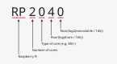
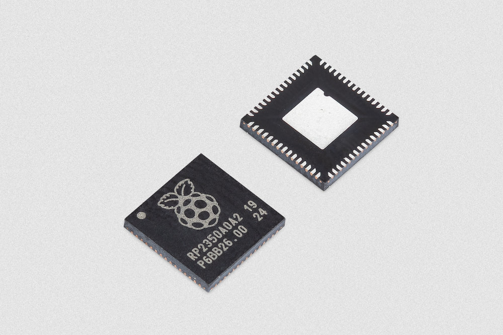
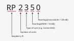

# 微控制器芯片

树莓派设计自己的**微控制器**，这些是用于小型嵌入式项目的独立硅芯片，可提供实时硬件控制。这些芯片用于树莓派 **Pico** 开发板，也可用于第三方微控制器开发板。有关树莓派 Pico 的更多信息，请参阅 [Pico 微控制器开发板](shu-mei-pai-pico-he-pico-w.md)。

树莓派微控制器可以使用以下方式编程：

* **C** 或 **C++**，注重性能，可完全控制硬件。
* **MicroPython**，提供更简单的脚本编写方式，便于快速开发。

有关使用 RP2040 或 RP2350 进行开发的更多信息，请参阅 [C/C++ SDK](c-c++-sdk.md#设置-sdk) 和 [MicroPython](micropython.md#什么是-micropython) 文档。

## 微控制器概述

树莓派微控制器是硅芯片，在嵌入式系统中处理特定的实时任务，例如控制电机或读取传感器。树莓派提供两款微控制器：

* [RP2040](#rp2040) 是初代通用双核树莓派微控制器：一款简单、高性价比的微控制器单元（MCU）。
* [RP2350](#rp2350) 是一款高性能双核微控制器，适用于需要灵活硬件控制的应用；它是更强大的 MCU，具备高级特性、更大的内存和更强的安全性。RP2350 有四种变体，详见 [RP2350 变体](#rp2350-变体)。

### 主要特性

RP2040 和 RP2350 均具有以下核心特性：

* **双核处理器**，用于并行处理。
* **片上 SRAM**，用于实时工作负载。
* **确定性总线结构**，通过多主 AHB 交叉开关将 CPU、DMA 和外设连接到多组 SRAM。
* **内置 USB 控制器和 PHY**，使微控制器可以作为 USB 设备或 USB 主机运行。
* **灵活的通用输入/输出（GPIO）**，可配置为数字输入/输出，或分配给 UART、SPI、I2C 或 PWM 等外设功能。
* **可编程 I/O（PIO）**，树莓派微控制器的独特特性，提供扩展的外设支持。
* **内置硬件外设**，用于 UART、SPI、I2C、PWM 等接口，减少软件开销并提高效率。
* **高性能、低功耗和低漏电**，这得益于微控制器采用的现代 40 nm 制造工艺。
* **低功耗模式**，支持依靠电池长时间运行。
* **编程选项**，可使用 C/C++ SDK 或 MicroPython；你可以通过 MicroPython 移植版运行 Python，并使用 ROM 中内置的 UF2 引导加载程序进行拖放式编程。

### 特性对比

下表对比了 RP2040 和 RP2350 微控制器。有关每款微控制器特性的更多详细信息，请参阅 [RP2040](#rp2040) 和 [RP2350](#rp2350) 的专门章节。

**表：树莓派微控制器对比（RP2040 和 RP2350）**

| 特性 | RP2040 | RP2350 |
| ---- | ------ | ------ |
| **类型** | 通用 MCU | 高性能 MCU |
| **处理器核心** | 双核 Arm Cortex-M0+ | 双核 Arm Cortex-M33（更高性能，支持 TrustZone）或 Hazard3（RISC-V） |
| **时钟速度** | 最高 133 MHz | 最高 150 MHz |
| **片上 SRAM** | 264 kB，分为六个独立存储单元 | 520 kB 多组高性能 SRAM |
| **闪存（非易失性存储器）** | 无片上闪存；通过专用外部（QSPI.XIP）总线支持最高 16 MB 的片外闪存。 | 视变体可选片上闪存；通过专用外部（QSPI.XIP）总线支持最高 32 MB 的片外闪存。详见 [RP2350 变体](#rp2350-变体)。 |
| **外部易失性工作存储器（PSRAM）** | 不支持。 | 通过使用 QSPI.XIP 总线的 QMI 存储器接口提供支持。 |
| **GPIO 引脚** | 30 个 GPIO 引脚，其中 4 个可用作模拟输入。 | 根据变体：30 个 GPIO 引脚，其中 4 个可用作模拟输入；或 48 个 GPIO 引脚，其中 8 个可用作模拟输入。详见 [RP2350 变体](#rp2350-变体)。 |
| **可编程输入/输出（PIO）** | 两个 PIO 块，每块有四个状态机（共八个）。 | 三个 PIO 块，每块有四个状态机（共十二个）。 |
| **外设** | 见 [RP2040 特性](#rp2040-特性)。 | 扩展的集合；见 [RP2350 特性](#rp2350-特性)。 |
| **直接存储器访问（DMA）控制器** | 12 通道 DMA 控制器，支持外设节奏控制和链式传输。 | 16 通道 DMA，具有更高的吞吐量和灵活性。 |
| **AHB 交叉开关** | 全连接的多主 AHB-Lite 交叉开关，将 CPU、DMA 和外设连接到多组 SRAM 和闪存。 | AHB5 交叉开关，提供更高的吞吐量和带宽。 |
| **插值器** | 双插值器块，用于快速整数运算和查表。 | 双插值器块，用于快速整数运算和查表。 |
| **整数除法器** | 独立的硬件整数除法器，通过内存映射寄存器访问。 | 无，因为处理器在 CPU 中支持硬件除法。 |
| **模数转换（ADC）** | 4 个模拟输入，带内部温度传感器，500 kS/s，12 位转换。 | 根据变体：4 个或 8 个模拟输入，带内部温度传感器，500 kS/s，12 位转换。 |
| **核心稳压器架构** | 片上可编程低压差（LDO）稳压器，用于生成核心电压。 | 活动运行时使用片上降压转换器（SMPS），睡眠状态可选用低静态电流的可编程 LDO 模式。 |
| **片上锁相环（PLL）** | 两个 PLL，用于生成核心时钟和 USB 时钟。 | 两个 PLL，用于生成核心时钟和 USB 时钟。 |
| **安全特性** | 无（基础 MCU）。 | Arm TrustZone；加密加速器。 |
| **开发板** | 树莓派 Pico；第三方基于 RP2040 的开发板。 | 树莓派 Pico 2；第三方基于 RP2350 的开发板。 |
| **编程** | C/C++ SDK、MicroPython | C/C++ SDK、MicroPython |

## RP2040

RP2040 是树莓派初代双核微控制器。它采用 7 x 7 mm QFN-56 封装，专为低成本、低功耗的嵌入式控制应用而设计。它为电机控制、信号处理、人机界面和嵌入式数据采集等任务提供确定性的实时性能、灵活的 I/O 和适中的计算能力。有关 RP2040 的更多详细信息，请参阅 [RP2040 数据手册](https://pip.raspberrypi.com/documents/RP-008371-DS)。

RP2040 为**树莓派 Pico**、**Pico W**、**Pico H**、**Pico WH** 以及其他第三方基于 RP2040 的微控制器开发板提供动力。更多信息，请参阅 [树莓派 Pico](shu-mei-pai-pico-he-pico-w.md) 和 [基于 RP2040 的开发板](#基于-rp2040-的开发板)。

### RP2040 命名

树莓派硅芯片遵循以 **RP**（指 Raspberry Pi）开头、后跟数字的命名惯例。具体而言，微控制器名称 **RP2040** 的来源如下：

* **RP** 表示该芯片是树莓派硅芯片。
* **2** 表示处理器核心的数量。
* **0** 表示核心处理器的类型（Cortex-M0+）。
* **4** 表示 RAM 容量，以对数因子表示，对应 264 kB 的片上 SRAM。
* **0** 表示非易失性存储器的容量，以对数因子表示（0 表示没有板载闪存）。

### RP2040 特性

RP2040 是一款独立微控制器，专为嵌入式系统、实时控制和 I/O 管理而设计。具体而言，RP2040 提供以下特性：

* **对称双核处理器复合体。** 双核 Arm Cortex-M0+ 处理器最高运行频率为 133 MHz，提供对称多处理能力。CPU 核心提供同等的低功耗和高效处理性能，并可并行运行任务。这对于实时控制、多任务处理和一般嵌入式任务非常有用。
* **大容量片上存储器。** 264 kB 的片上 SRAM 分为六个独立存储单元，为运行代码和存储数据提供快速的内部存储器，并允许 CPU 和外设同时访问。
* **支持外部闪存。** RP2040 没有内置闪存，因此不会在内部存储程序。相反，RP2040 可以通过快速 QSPI 接口直接从外部闪存运行代码，并使用缓存来保持高性能。这让你可以选择产品所需的闪存容量，并使用价格低廉、广泛可用的芯片。
* **温度监控。** 4 通道 ADC，带内部温度传感器，500 kS/s，12 位转换；用于读取传感器和电压，包括板载温度传感器。
* **通过可编程 I/O（PIO）实现灵活的硬件控制。** 一个可编程的微型处理器子系统，可用于在硬件中实现自定义外设，由两个 PIO 块组成，每块有四个状态机（共八个）。
* **固定功能外设。** 用于标准协议的内置硬件块，可处理常见任务，无需在软件中实现，包括：
    * 两个 UART，用于串行通信。
    * 两个 SPI 控制器，用于数据传输。
    * 两个 I2C 控制器，用于与低速外设通信。
    * 16 个 PWM 通道。
    * 一个 USB 1.1 控制器和 PHY，支持主机和设备模式。

### 内部温度传感器

RP2040 内部的温度传感器是一款低分辨率、需用户校准的传感器。如果你不校准该传感器，它不太可能准确。

准确的温度测量关键取决于了解 **ADC 参考电压（VREF）**。由于温度转换公式对 VREF 高度敏感，即使该值有很小的误差，也可能导致显著的测温误差。RP2040 不包含用于确定 VREF 的内部固定电压参考，因此参考电压必须通过以下方式之一提供：

* 从外部测量（注意它可能随时间变化）。
* 由外部精密电压参考提供。

>**注意**
>
>温度升高时，RP2040 传感器电压会下降。

有关 RP2040 内部温度传感器的更多信息，请参阅 [RP2040 数据手册：树莓派微控制器](https://pip.raspberrypi.com/documents/RP-008371-DS)。

### 睡眠模式功耗

即使在深度睡眠状态下，RP2040 的典型电流消耗也约为 180 μA。睡眠电流取决于 PVT：

* **工艺**；因芯片而异。
* **电压**；电流呈线性变化。
* **温度**；电流呈非线性变化。

对于需要最小电流消耗的使用场景，我们建议你完全关闭系统或系统中 RP2040 部分的电源。有关如何操作的信息，请参阅[低待机电流应用中的 RP2040 电源切换](https://pip.raspberrypi.com/documents/RP-004339-WP)，并根据你的使用场景进行调整。

### 基于 RP2040 的开发板

你可以将第一代树莓派 **Pico** 微控制器开发板用作开发板，以及用作其他基于 RP2040 开发板的参考设计。有关第三方基于 RP2040 开发板的讨论，请参阅[树莓派论坛](https://forums.raspberrypi.com/viewforum.php?f=147)。

树莓派 Pico 和 Pico W 的设计文件公开提供，没有任何限制。树莓派授予许可，允许出于任何目的使用、复制、修改和分发以下设计，无论是否收费：

* [树莓派 Pico](https://pip.raspberrypi.com/documents/RP-008379-DS)（Cadence Allegro）
* [树莓派 Pico W](https://pip.raspberrypi.com/documents/RP-008380-DS)（Cadence Allegro）

树莓派还提供 RP2040 微控制器的设计文件：

* [Minimal Viable Board](https://pip.raspberrypi.com/documents/RP-008296-DS)（KiCad），RP2040 的参考设计。
* [VGA Carrier Board](https://pip.raspberrypi.com/documents/RP-008395-DS)（KiCad），使用树莓派 Pico 开发板进行多媒体开发的参考（也与 RP2350 相关）。

>**重要**
>
>设计按“原样”提供，作者对该设计不作任何担保，包括所有适销性和适用性隐含担保。在任何情况下，作者均不对因使用、数据或利润损失而导致的任何特殊、直接、间接或后果性损害或任何损害负责，无论是因合同、过失或其他侵权行为引起，还是与设计的使用或性能有关。

## RP2350

RP2350 是一款高性能双核微控制器，有四种变体，区别在于封装尺寸和是否包含板载闪存，详见 [RP2350 变体](#rp2350-变体)。

与 [RP2040](#rp2040) 相比，RP2350 提供更高的核心时钟速度、两倍的 SRAM、更强大的 Arm 核心、新的安全特性和扩展的接口能力，详见 [RP2350 特性](#rp2350-特性)。有关 RP2350 的更多详细信息，请参阅 [RP2350 数据手册](https://pip.raspberrypi.com/documents/RP-008373-DS)。

RP2350 为**树莓派 Pico 2**、**Pico 2 W**、**带排针的 Pico 2**、**带排针的 Pico 2 W** 以及其他基于 RP2350 的开发板提供动力。更多信息，请参阅 [树莓派 Pico 2](shu-mei-pai-pico-he-pico-w.md) 和[基于 RP2350 的开发板](#基于-rp2350-的开发板)。

### RP2350 变体

RP2350 有四种变体，区别在于封装尺寸和是否包含堆叠闪存。有关这些变体如何命名的更多信息，请参阅 [RP2350 命名](#rp2350-命名)。

| 变体 | 封装 | 封装尺寸（mm） | 内部闪存 | GPIO 引脚 | 模拟输入 | PWM 通道 |
| ---- | ---- | -------------- | -------- | --------- | -------- | -------- |
| **RP2350A** | QFN-60 | 7 x 7 | 无 | 30 | 4 | 16 |
| **RP2350B** | QFN-80 | 10 x 10 | 无 | 48 | 8 | 24 |
| **RP2354A** | QFN-60 | 7 x 7 | 堆叠 2 MB 闪存 | 30 | 4 | 16 |
| **RP2354B** | QFN-80 | 10 x 10 | 堆叠 2 MB 闪存 | 48 | 8 | 24 |

### RP2350 命名

**RP2350** 遵循与其他树莓派硅芯片相同的命名惯例，但末尾的数字和字母会根据变体而变化。具体而言，RP2350 各变体名称的来源如下：

* **RP** 表示该芯片是树莓派硅芯片。
* **2** 表示处理器核心的数量。
* **3** 表示核心处理器的类型（Cortex-M33）。
* **5** 表示 RAM 容量，以对数因子表示，对应 520 kB 的片上 SRAM。
* 最后一位数字（**0** 或 **4**）表示非易失性存储器的容量，以对数因子表示。
    * **0** 表示没有板载闪存。
    * **4** 表示有 2 MB 堆叠闪存。
* 末尾的字母表示微控制器封装的尺寸，由引脚数量决定：
    * **A** 表示较小的芯片封装，有 60 个引脚，其中 30 个是 GPIO 引脚。
    * **B** 表示较大的芯片封装，有 80 个引脚，其中 48 个是 GPIO 引脚。

### RP2350 特性

RP2350 是一款独立微控制器，专为嵌入式系统、实时控制和 I/O 管理而设计。具体而言，RP2350 提供以下特性：

* **对称双核处理器选项。** 可选择以下低功耗、高效的 CPU 架构，最高运行频率为 150 MHz，并可并行运行任务。更多信息，请参阅[架构切换](#架构切换)：
    * 双核 Arm Cortex-M33
    * 双核 Hazard3 RISC-V 处理器。
* **扩展的片上存储器。** 520 kB 的片上 SRAM 分为十个独立存储单元，为运行代码和存储数据提供快速的内部存储器，并允许 CPU 和外设同时访问。
* **扩展的外部闪存支持。**
    * 能够通过带缓存的快速 QSPI 接口直接从外部闪存运行代码（与 RP2040 类似）。
    * 能够通过 QMI 接口连接外部 PSRAM（伪静态 RAM）芯片。
* **温度监控。** 根据变体，4 通道或 8 通道 ADC，带内部温度传感器，500 kS/s，12 位转换；用于读取传感器和电压，包括板载温度传感器。
* **通过可编程 I/O（PIO）实现灵活的硬件控制。** 一个可编程的微型处理器子系统，可用于在硬件中实现自定义外设，由三个 PIO 块组成，每块有四个状态机（共十二个）。
* **固定功能外设。** 用于标准协议的内置硬件块，可处理常见任务，无需在软件中实现，包括：
    * 两个 UART，用于串行通信。
    * 两个 SPI 控制器，用于数据传输。
    * 两个 I2C 控制器，用于与低速外设通信。
    * 根据变体，16 个或 24 个 PWM 通道。
    * 一个 USB 1.1 控制器和 PHY，支持主机和设备模式。
    * 一个 HSTX 外设，用于视频等高速数字输出。
* **可选内部闪存。** 根据变体，RP2350 可以从外部闪存运行代码，也可以包含片上闪存，用于程序存储和更快的访问：
    * **RP2350A** 和 **RP2350B** 没有内置闪存，因此不会在内部存储程序。不过，你可以：
        * 通过带缓存的快速 QSPI 接口直接从外部闪存运行代码，以保持高性能。
        * 使用一次性可编程（OTP）存储器来引导和存储软件。此操作不可逆。
    * **RP2354A** 和 **RP2354B** 包含 2 MB 堆叠闪存。
* **安全性。** 基于面向 Cortex-M 的 Arm TrustZone 构建的全面安全架构，包括：
    * 支持签名引导。
    * 8 kB 片上反熔丝一次性可编程（OTP）存储器。
    * SHA-256 加速。
    * 硬件真随机数生成器（TRNG）。
    * 加密代码存储和从闪存引导。

### 架构切换

RP2350 包含一对开源硬件 Hazard3 RISC-V 核心；当你为微控制器编程时，可以在启动时用它们替换 Cortex-M33 核心。

引导 ROM 可以自动检测第二阶段二进制文件所构建的架构，并将芯片重新引导到适当的模式。除了某些安全特性和双精度浮点加速器之外，芯片的所有特性在 RISC-V 模式下均可用。

### 基于 RP2350 的开发板

你可以将树莓派 **Pico 2** 系列微控制器开发板用作开发板，以及用作其他基于 RP2350 开发板的参考设计。有关第三方基于 RP2350 开发板的讨论，请参阅[树莓派论坛](https://forums.raspberrypi.com/viewforum.php?f=147)。

树莓派为 RP2350 微控制器提供以下设计文件：

* [RP2350A Minimal Viable Board](https://pip.raspberrypi.com/documents/RP-010328-CA)（KiCad），创建最小 RP2350A 开发板的参考。
* [RP2350B Minimal Viable Board](https://pip.raspberrypi.com/documents/RP-010329-CA)（KiCad），创建最小 RP2350B 开发板的参考。
* [VGA Carrier Board](https://pip.raspberrypi.com/documents/RP-008395-DS)（KiCad），使用树莓派 Pico 开发板进行多媒体开发的参考（也与 RP2040 相关）。

>**重要**
>
>设计按“原样”提供，作者对该设计不作任何担保，包括所有适销性和适用性隐含担保。在任何情况下，作者均不对因使用、数据或利润损失而导致的任何特殊、直接、间接或后果性损害或任何损害负责，无论是因合同、过失或其他侵权行为引起，还是与设计的使用或性能有关。

## USB 标识符

许多 RP2040 和 RP2350 芯片使用树莓派 USB 标识符（供应商 ID 和产品 ID）的组合。如果你基于 RP2040 或 RP2350 制作自己的第三方开发板，在以下情况下可能需要一个唯一的 USB 产品 ID（PID）：

* 你需要为 Windows 用户提供自定义驱动程序。
* 你希望你的设备能够作为单独产品被唯一识别。

树莓派已获得 USB-IF 的许可，可为其供应商 ID（`0x2E8A`）下用于 RP2040 和 RP2350 的常见硅组件授权 USB PID 值。这意味着你可以在我们的供应商 ID（`0x2E8A`）下分配唯一的 PID。要预留与树莓派供应商 ID 关联的 USB PID，请按照[树莓派 USB PID Git 仓库](https://github.com/raspberrypi/usb-pid)中的说明操作。

如果你不需要唯一的 PID，仍然可以使用以下任一 USB 文本字段唯一区分设备：`iManufacturer`、`iProduct` 和 `iSerial`。

## RP1

RP1 是内置于树莓派 5 和计算模块 5 中的 I/O 控制器，并非独立的微控制器。有关 RP1 的详细信息，请参阅 [I/O 控制器](../shu-mei-pai/io-kong-zhi-qi.md)。
