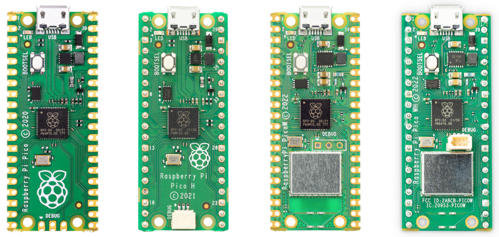
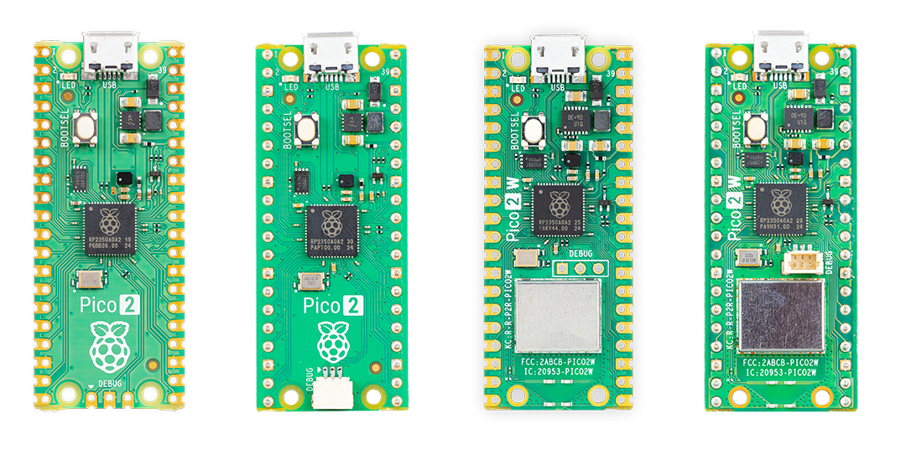
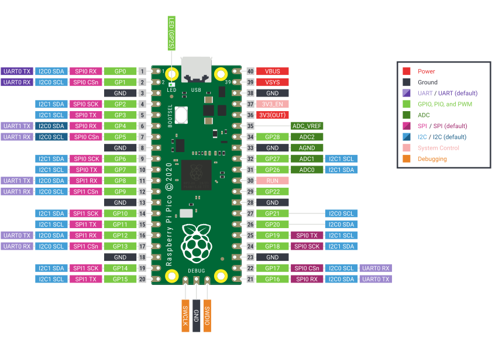
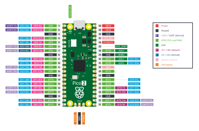
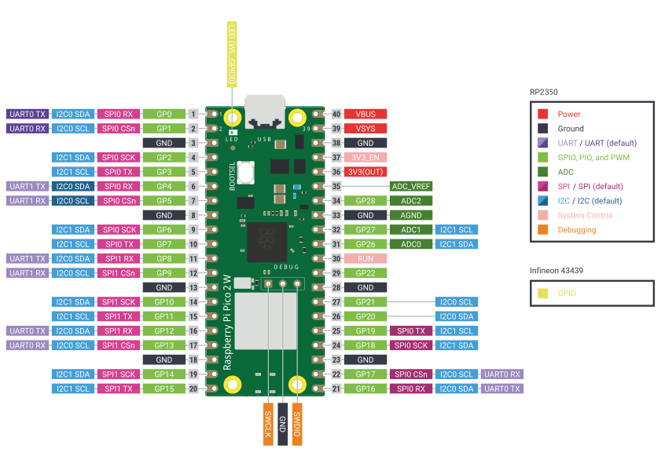

# Pico 系列微控制器

树莓派 Pico 是一款使用树莓派微控制器（RP2040 或 RP2350）的开发板。树莓派 Pico 使用 MicroPython、C 或 C++ 编程；与其他树莓派设备不同，它不运行 Linux，也不支持可移动存储。树莓派 Pico 通过把二进制文件烧录到板载闪存中来编程。

树莓派 Pico 系列有两代产品：

* [树莓派 Pico](#树莓派-pico)（Pico 1）
* [树莓派 Pico 2](#树莓派-pico-2)

每一代都有四种变体，区别在于：

* **无线连接。** 名称中带有 W 后缀的变体包含 Wi-Fi 和蓝牙。
* **预装排针。** 变体分为镀边模块（可直接焊接）和预装排针两种形式。

## 型号

下表按时间倒序汇总了树莓派 Pico 微控制器开发板，列出各自的 SoC、内存和存储，方便快速查阅。

你可以根据型号名称判断哪些型号预装排针、哪些型号带无线连接：

* **无线连接。** 名称带有 W 后缀的型号具备以下无线连接功能：
  * 双频（2.4 GHz 或 5 GHz）802.11ac Wi-Fi（10 Mb/s）。
  * 蓝牙（5.2 和 BLE）。
* **预装排针。** 名称带有 H 或 with headers 后缀的型号在 GPIO 排针上预装了排针引脚；如果型号名称中没有这两种后缀，则需要手动焊接引脚，或使用第三方的排针套件。
  * 第一代带有 H 后缀的树莓派 Pico 在 GPIO 排针上预焊了排针引脚。
  * 树莓派 Pico 2 使用 with headers 后缀，而不使用 H 后缀。

有关每个型号的更多信息，请参阅本页中 [树莓派 Pico](#树莓派-pico) 和 [树莓派 Pico 2](#树莓派-pico-2) 的专门章节。

| 型号 | SoC | 内存 | 存储 |
| ---- | --- | ---- | ---- |
| 带排针的树莓派 Pico 2 W | [RP2350](rp2040.md#rp2350) | 520 kB | 4 MB |
| 带排针的树莓派 Pico 2 | [RP2350](rp2040.md#rp2350) | 520 kB | 4 MB |
| 树莓派 Pico 2 W | [RP2350](rp2040.md#rp2350) | 520 kB | 4 MB |
| 树莓派 Pico 2 | [RP2350](rp2040.md#rp2350) | 520 kB | 4 MB |
| 树莓派 Pico WH | [RP2040](rp2040.md#rp2040) | 264 kB | 2 MB |
| 树莓派 Pico W | [RP2040](rp2040.md#rp2040) | 264 kB | 2 MB |
| 树莓派 Pico H | [RP2040](rp2040.md#rp2040) | 264 kB | 2 MB |
| 树莓派 Pico | [RP2040](rp2040.md#rp2040) | 264 kB | 2 MB |

## 树莓派 Pico

第一代树莓派 Pico 基于 [RP2040](rp2040.md#rp2040) 微控制器芯片，共有四种变体，见表 1。有关这些变体的更多详细信息，请参阅[非无线树莓派 Pico 开发板](#非无线树莓派-pico-开发板)（树莓派 Pico 和 Pico H）和[无线树莓派 Pico 开发板](#无线树莓派-pico-开发板)（树莓派 Pico W 和 Pico WH）。

**表 1：树莓派 Pico 变体**

|  | 无线 | 排针 |
| ---- | ---- | ---- |
| 树莓派 Pico | 无 | 无 |
| 树莓派 Pico H | 无 | 有（预焊） |
| 树莓派 Pico W | 有（Wi-Fi 和蓝牙） | 无 |
| 树莓派 Pico WH | 有（Wi-Fi 和蓝牙） | 有（预焊） |

图 1 从顶视图展示了四种树莓派 Pico 变体。从外观上看，这些变体最明显的区别在于：

* 是否有无线组件。
* 是否预焊排针引脚。
* 串行线调试（SWD）接口的位置和类型。

有关这些差异的更多信息，请参阅[非无线树莓派 Pico 开发板](#非无线树莓派-pico-开发板)和[无线树莓派 Pico 开发板](#无线树莓派-pico-开发板)。

### 非无线树莓派 Pico 开发板

树莓派 Pico 和 Pico H 是基于 RP2040 芯片的第一代非无线微控制器开发板。两款开发板的硬件能力完全相同，物理上的差别仅在于树莓派 Pico H 预焊了排针引脚，以及开发板底部调试连接器的样式。更多信息请参阅[调试连接器（SWD）](#调试连接器swd)。

树莓派 Pico 和 Pico H 的引脚分布和开发板布局与树莓派 Pico 2 和带排针的树莓派 Pico 2 相同。更多信息请参阅[非无线开发板布局](#非无线开发板布局)。

#### 主要特点

树莓派 Pico 和 Pico H 具有以下主要特点：

* **RP2040 微控制器芯片**，包括：
  * **双核 M0+ 处理器。**
  * **灵活的时钟，最高可达 133 MHz。**
  * **264 kB SRAM。**
  * **USB 1.1 控制器和 PHY，支持设备模式和主机模式。**
  * **低功耗睡眠和休眠模式。**
  * **精确的时钟和定时器。**
  * **硬件加速的浮点库。**
  * **温度传感器。**
  * **八个可编程 I/O（PIO）状态机，支持自定义外设。**
    * **灵活、可由用户编程的高速 I/O。**
    * **可模拟存储卡和 VGA 等接口。**
* **开发板特性**：
  * **通过 USB 大容量存储进行拖放式编程。**
  * **2 MB 板载闪存。**
  * **26 个多功能 GPIO 引脚。** 更多信息请参阅[非无线开发板布局](#非无线开发板布局)。
  * **调试连接器。** 更多信息请参阅[调试连接器（SWD）](#调试连接器swd)。
* **外设接口**：
  * **两个 SPI**
  * **两个 I2C**
  * **两个 UART**
  * **三个 12 位 ADC**
  * **16 个 PWM 通道**

#### 非无线树莓派 Pico 开发板的相关资源

树莓派还提供了与树莓派 Pico 和 Pico H 相关的其他技术文档：

* [RP2040 数据手册：树莓派微控制器](https://pip.raspberrypi.com/documents/RP-008371-DS)
* [树莓派 Pico 数据手册：基于 RP2040 的微控制器开发板](https://pip.raspberrypi.com/documents/RP-008307-DS)
* [使用 RP2040 进行硬件设计：用 RP2040 微控制器构建开发板和产品](https://pip.raspberrypi.com/documents/RP-008279-DS)
* [树莓派 Pico 系列微控制器入门：使用树莓派 Pico 系列及其他基于树莓派微控制器的开发板进行 C/C++ 开发](https://pip.raspberrypi.com/documents/RP-008276-DS)

此外，树莓派还提供了以下硬件设计支持资源：

* [设计文件](https://pip.raspberrypi.com/documents/RP-008379-DS)（Cadence Allegro）：用于研究或复刻开发板布局的 PCB 设计文件。
* [STEP 文件](https://pip.raspberrypi.com/documents/RP-008311-DS)：开发板的三维 CAD 模型，可用于外壳和机械设计。
* [Fritzing](https://fritzing.org) 部件：用于 Fritzing（一款用于布局和原理图的电子设计工具）的元件：
  * [树莓派 Pico 的 Fritzing 部件](https://pip.raspberrypi.com/documents/RP-008310-DS)
  * [树莓派 Pico H 的 Fritzing 部件](https://pip.raspberrypi.com/documents/RP-008314-DS)

>**重要**
>
>树莓派 Pico 和 Pico H 的设计文件无限制公开。树莓派授权出于任何目的、收费或免费地使用、复制、修改和分发这些设计。设计按“原样”提供，作者不对该设计作任何保证，包括对适销性和适用性的所有默示保证。无论是因合同、疏忽或其他侵权行为，还是因使用或实施本设计而引起的任何特殊的、直接的、间接的或后果性的损害，或因使用、数据或利润损失而造成的任何损害，作者均不承担责任。

### 无线树莓派 Pico 开发板

树莓派 Pico W 和 Pico WH 是基于 RP2040 芯片的第一代无线微控制器开发板。两款开发板的硬件能力完全相同，物理上的差别仅在于树莓派 Pico WH 预焊了排针引脚，以及微控制器下方调试连接器的样式。更多信息请参阅[调试连接器（SWD）](#调试连接器swd)。

树莓派 Pico W 和 Pico WH 的引脚分布和开发板布局与树莓派 Pico 2 W 和带排针的树莓派 Pico 2 W 相同。更多信息请参阅[无线开发板布局](#无线开发板布局)。

#### 主要特点

树莓派 Pico W 和 Pico WH 具备与树莓派 Pico 和 Pico H 相同的主要特点，并增加了无线功能。具体而言，树莓派 Pico W 和 Pico WH 具有以下主要特点：

* **RP2040 微控制器芯片**，包括：
  * **双核 M0+ 处理器。**
  * **灵活的时钟，最高可达 133 MHz。**
  * **264 kB SRAM。**
  * **USB 1.1 控制器和 PHY，支持设备模式和主机模式。**
  * **低功耗睡眠和休眠模式。**
  * **精确的时钟和定时器。**
  * **硬件加速的浮点库。**
  * **温度传感器。**
  * **八个可编程 I/O（PIO）状态机，支持自定义外设。**
    * **灵活、可由用户编程的高速 I/O。**
    * **可模拟存储卡和 VGA 等接口。**
* **开发板特性**：
  * **通过 USB 大容量存储进行拖放式编程。**
  * **2 MB 板载闪存。**
  * **26 个多功能 GPIO 引脚。** 更多信息请参阅[无线开发板布局](#无线开发板布局)。
  * **调试连接器。** 更多信息请参阅[调试连接器（SWD）](#调试连接器swd)。
* **外设接口**：
  * **两个 SPI**
  * **两个 I2C**
  * **两个 UART**
  * **三个 12 位 ADC**
  * **16 个 PWM 通道**
* **无线连接**：
  * **Wi-Fi（802.11n）**：
    * **单频（2.4 GHz）。**
    * **WPA3，一种现代的无线连接安全协议。**
    * **软接入点，可广播 Wi-Fi 网络，支持最多四个客户端。**
  * **蓝牙 5.2**：
    * **支持蓝牙低功耗（BLE）中央和外围角色。**
    * **支持经典蓝牙。**

有关树莓派 Pico W 和 Pico WH 无线硬件和功能的更多信息，请参阅[无线型号](#无线型号)。

#### 无线树莓派 Pico 开发板的相关资源

树莓派还提供了与树莓派 Pico W 和 Pico WH 相关的其他技术文档：

* [RP2040 数据手册：树莓派微控制器](https://pip.raspberrypi.com/documents/RP-008371-DS)
* [树莓派 Pico W 数据手册：基于 RP2040 的微控制器开发板](https://pip.raspberrypi.com/documents/RP-008312-DS)
* [使用 RP2040 进行硬件设计：用 RP2040 微控制器构建开发板和产品](https://pip.raspberrypi.com/documents/RP-008279-DS)
* [Pico W 系列设备的 Wi-Fi 和蓝牙连接](https://pip.raspberrypi.com/documents/RP-008257-DS)

此外，树莓派还提供了以下硬件设计支持资源：

* [设计文件](https://pip.raspberrypi.com/documents/RP-008380-DS)（Cadence Allegro）：用于研究或复刻开发板布局的 PCB 设计文件。
* [STEP 文件](https://pip.raspberrypi.com/documents/RP-008318-DS)：开发板的三维 CAD 模型，可用于外壳和机械设计。
* [Fritzing](https://fritzing.org) 部件：用于 Fritzing（一款用于布局和原理图的电子设计工具）的元件：[树莓派 Pico W 的 Fritzing 部件](https://pip.raspberrypi.com/documents/RP-008316-DS)。

>**重要**
>
>树莓派 Pico W 和 Pico WH 的设计文件无限制公开。树莓派授权出于任何目的、收费或免费地使用、复制、修改和分发这些设计。设计按“原样”提供，作者不对该设计作任何保证，包括对适销性和适用性的所有默示保证。无论是因合同、疏忽或其他侵权行为，还是因使用或实施本设计而引起的任何特殊的、直接的、间接的或后果性的损害，或因使用、数据或利润损失而造成的任何损害，作者均不承担责任。

## 树莓派 Pico 2

树莓派 Pico 2 基于 [RP2350](rp2040.md#rp2350) 微控制器芯片，共有四种变体，见表 2。与树莓派 Pico H 和 Pico WH 不同，树莓派 Pico 2 不把 headers 缩写为 H。

**表 2：树莓派 Pico 2 变体**

|  | 无线 | 排针 |
| ---- | ---- | ---- |
| 树莓派 Pico 2 | 无 | 无 |
| 带排针的树莓派 Pico 2 | 无 | 有（预焊） |
| 树莓派 Pico 2 W | 有（Wi-Fi 和蓝牙） | 无 |
| 带排针的树莓派 Pico 2 W | 有（Wi-Fi 和蓝牙） | 有（预焊） |

图 2 从顶视图展示了四种树莓派 Pico 2 变体。从外观上看，这些变体最明显的区别在于：

* 是否有无线组件。
* 是否预焊排针引脚。
* 串行线调试（SWD）接口的位置和类型。

有关这些差异的更多信息，请参阅[非无线树莓派 Pico 2 开发板](#非无线树莓派-pico-2-开发板)和[无线树莓派 Pico 2 开发板](#无线树莓派-pico-2-开发板)。

### 非无线树莓派 Pico 2 开发板

树莓派 Pico 2 和带排针的树莓派 Pico 2 是基于 RP2350 芯片的非无线微控制器开发板。两款开发板的硬件能力完全相同，物理上的差别仅在于带排针的树莓派 Pico 2 预焊了排针引脚，以及开发板底部调试连接器的样式。更多信息请参阅[调试连接器（SWD）](#调试连接器swd)。

树莓派 Pico 2 和带排针的树莓派 Pico 2 的引脚分布和开发板布局与树莓派 Pico 和 Pico H 相同。更多信息请参阅[非无线开发板布局](#非无线开发板布局)。

#### 主要特点

树莓派 Pico 2 和带排针的树莓派 Pico 2 具有以下主要特点：

* **RP2350 微控制器芯片**，包括：
  * **可选 CPU 架构，可并行运行任务。** 更多信息请参阅[架构切换](rp2040.md#架构切换)：
    * **双核 Arm Cortex-M33。**
    * **双核 Hazard3 RISC-V 处理器。**
  * **灵活的时钟，最高可达 150 MHz。**
  * **520 kB SRAM。**
  * **USB 1.1 控制器和 PHY，支持设备模式和主机模式。**
  * **低功耗睡眠和休眠模式。**
  * **精确的时钟和定时器。**
  * **温度传感器。**
  * **十二个可编程 I/O（PIO）状态机，支持自定义外设。**
    * **灵活、可由用户编程的高速 I/O。**
    * **可模拟存储卡和 VGA 等接口。**
* **开发板特性**：
  * **通过 USB 大容量存储进行拖放式编程。**
  * **4 MB 板载闪存。**
  * **26 个多功能 GPIO 引脚。** 更多信息请参阅[非无线开发板布局](#非无线开发板布局)。
  * **与树莓派 Pico 1 硬件和软件兼容。**
  * **两个定时器（带 4 个报警）和一个 AON 定时器。**
  * **调试连接器。** 更多信息请参阅[调试连接器（SWD）](#调试连接器swd)。
* **外设接口**：
  * **两个 SPI**
  * **两个 I2C**
  * **两个 UART**
  * **三个 12 位 ADC**
  * **16 个 PWM 通道**

#### 相关资源

树莓派还提供了与树莓派 Pico 2 和带排针的树莓派 Pico 2 相关的其他技术文档：

* [RP2350 数据手册：树莓派微控制器](https://pip.raspberrypi.com/documents/RP-008373-DS)
* [树莓派 Pico 2 数据手册：基于 RP2350 的微控制器开发板](https://pip.raspberrypi.com/documents/RP-008299-DS)
* [使用 RP2350 进行硬件设计：用 RP2350 微控制器构建开发板和产品](https://pip.raspberrypi.com/documents/RP-008280-DS)
* [树莓派 Pico 系列微控制器入门：使用树莓派 Pico 系列及其他基于树莓派微控制器的开发板进行 C/C++ 开发](https://pip.raspberrypi.com/documents/RP-008276-DS)

此外，树莓派还提供了以下硬件设计支持资源：

* [STEP 文件](https://pip.raspberrypi.com/documents/RP-009061-CA)：开发板的三维 CAD 模型，可用于外壳和机械设计。
* [Fritzing](https://fritzing.org) 部件：用于 Fritzing（一款用于布局和原理图的电子设计工具）的元件：[树莓派 Pico 2 的 Fritzing 部件](https://pip.raspberrypi.com/documents/RP-008300-DS)。

>**重要**
>
>树莓派 Pico 2 和带排针的树莓派 Pico 2 的设计文件无限制公开。树莓派授权出于任何目的、收费或免费地使用、复制、修改和分发这些设计。设计按“原样”提供，作者不对该设计作任何保证，包括对适销性和适用性的所有默示保证。无论是因合同、疏忽或其他侵权行为，还是因使用或实施本设计而引起的任何特殊的、直接的、间接的或后果性的损害，或因使用、数据或利润损失而造成的任何损害，作者均不承担责任。

### 无线树莓派 Pico 2 开发板

树莓派 Pico 2 W 和带排针的树莓派 Pico 2 W 是基于 RP2350 芯片的无线微控制器开发板。两款开发板的硬件能力完全相同，物理上的差别仅在于带排针的树莓派 Pico 2 W 预焊了排针引脚，以及微控制器下方调试连接器的样式。更多信息请参阅[调试连接器（SWD）](#调试连接器swd)。

树莓派 Pico 2 W 和带排针的树莓派 Pico 2 W 的引脚分布和开发板布局与树莓派 Pico W 和 Pico WH 相同。更多信息请参阅[无线开发板布局](#无线开发板布局)。

#### 主要特点

树莓派 Pico 2 W 和带排针的树莓派 Pico 2 W 具备与树莓派 Pico 2 和带排针的树莓派 Pico 2 相同的主要特点，并增加了无线功能。具体而言，树莓派 Pico 2 W 和带排针的树莓派 Pico 2 W 具有以下主要特点：

* **RP2350 微控制器芯片**，包括：
  * **可选 CPU 架构，可并行运行任务。** 更多信息请参阅[架构切换](rp2040.md#架构切换)：
    * **双核 Arm Cortex-M33。**
    * **双核 Hazard3 RISC-V 处理器。**
  * **灵活的时钟，最高可达 150 MHz。**
  * **520 kB SRAM。**
  * **USB 1.1 控制器和 PHY，支持设备模式和主机模式。**
  * **低功耗睡眠和休眠模式。**
  * **精确的时钟和定时器。**
  * **温度传感器。**
  * **十二个可编程 I/O（PIO）状态机，支持自定义外设。**
    * **灵活、可由用户编程的高速 I/O。**
    * **可模拟存储卡和 VGA 等接口。**
* **开发板特性**：
  * **通过 USB 大容量存储进行拖放式编程。**
  * **4 MB 板载闪存。**
  * **26 个多功能 GPIO 引脚。** 更多信息请参阅[非无线开发板布局](#非无线开发板布局)。
  * **与树莓派 Pico 1 硬件和软件兼容。**
  * **两个定时器（带 4 个报警）和一个 AON 定时器。**
  * **调试连接器。** 更多信息请参阅[调试连接器（SWD）](#调试连接器swd)。
* **外设接口**：
  * **两个 SPI**
  * **两个 I2C**
  * **两个 UART**
  * **三个 12 位 ADC**
  * **16 个 PWM 通道**
* **无线连接**：
  * **Wi-Fi（802.11n）**：
    * **单频（2.4 GHz）。**
    * **WPA3，一种现代的无线连接安全协议。**
    * **软接入点，可广播 Wi-Fi 网络，支持最多四个客户端。**
  * **蓝牙 5.2**：
    * **支持蓝牙低功耗（BLE）中央和外围角色。**
    * **支持经典蓝牙。**

有关树莓派 Pico 2 W 和带排针的树莓派 Pico 2 W 无线硬件和功能的更多信息，请参阅[无线型号](#无线型号)。

#### 无线树莓派 Pico 2 开发板的相关资源

树莓派还提供了与树莓派 Pico 2 W 和带排针的树莓派 Pico 2 W 相关的其他技术文档：

* [RP2350 数据手册：树莓派微控制器](https://pip.raspberrypi.com/documents/RP-008373-DS)
* [树莓派 Pico 2 W 数据手册：基于 RP2350 的微控制器开发板](https://pip.raspberrypi.com/documents/RP-008304-DS)
* [使用 RP2350 进行硬件设计：用 RP2350 微控制器构建开发板和产品](https://pip.raspberrypi.com/documents/RP-008280-DS)
* [Pico W 系列设备的 Wi-Fi 和蓝牙连接](https://pip.raspberrypi.com/documents/RP-008257-DS)

此外，树莓派还提供了一张支持硬件设计的[原理图](https://pip.raspberrypi.com/documents/RP-008306-DS)。

>**重要**
>
>树莓派 Pico 2 W 和带排针的树莓派 Pico 2 W 的设计文件无限制公开。树莓派授权出于任何目的、收费或免费地使用、复制、修改和分发这些设计。设计按“原样”提供，作者不对该设计作任何保证，包括对适销性和适用性的所有默示保证。无论是因合同、疏忽或其他侵权行为，还是因使用或实施本设计而引起的任何特殊的、直接的、间接的或后果性的损害，或因使用、数据或利润损失而造成的任何损害，作者均不承担责任。

## 无线型号

无线树莓派 Pico 型号（树莓派 Pico W、Pico WH、Pico 2 W 和带排针的树莓派 Pico 2 W）把 Wi-Fi 和蓝牙连接直接集成到开发板上，无需外置射频模块，适合联网和物联网（IoT）应用。

### 无线硬件与天线

无线树莓派 Pico 型号使用 Infineon CYW43439 无线芯片，通过一个最高 33 MHz 的 SPI 接口连接到板载微控制器。无线树莓派 Pico 型号还采用一块从 ABRACON（前身为 ProAnt）获得授权的板载天线。

由于无线子系统共享部分引脚，一些接口信号与其他开发板功能复用：

* SPI 时钟线（`CLK`）与 `VSYS` 电压监视器共用，因此只有在没有 SPI 事务进行时，ADC 才能读取 `VSYS`。
* Infineon CYW43439 的 `DIN/OUT` 和 `IRQ` 信号共用一个引脚，因此只有在没有 SPI 事务进行时，才能检查中断请求（IRQ）。

要获得最佳的无线性能，请保持天线周围空旷。在天线附近或下方放置金属会显著降低信号增益和带宽；在天线两侧放置接地金属则可以改善天线的带宽。

### 无线软件许可

软件库 `libcyw43` 和 `BTstack` 可免费用于非商业项目。不过，树莓派已为树莓派 Pico 和微控制器用户谈妥了特殊的商业使用权。也就是说，使用以下硬件构建的项目可获得免费的商业使用许可：

* 无线树莓派 Pico 开发板（树莓派 Pico W、Pico WH、Pico 2 W 和带排针的树莓派 Pico 2 W）。
* RP2040 与 CYW43439，或 RP2350 与 CYW43439 的组合。

`libcyw43` 的完整商业许可请参阅 [GitHub 上的 cyw43-driver](https://github.com/georgerobotics/cyw43-driver/blob/055d64274b014dd7b1c2fc94d26e8a18face7124/LICENSE.RP)。`BTstack` 的完整商业许可请参阅 [GitHub 上的 pico_btstack](https://github.com/raspberrypi/pico-sdk/blob/master/src/rp2_common/pico_btstack/LICENSE.RP)。

## 开发板布局

树莓派 Pico 开发板为支持微控制器芯片提供最少的外部电路。本节介绍树莓派 Pico 开发板的物理布局和引脚分配（引脚分布）。非无线树莓派 Pico 开发板共用一套布局和引脚分布，无线树莓派 Pico 开发板也是如此。

### 非无线开发板布局

图 3 和图 4 从顶视图展示了非无线树莓派 Pico 和 Pico 2 开发板及其引脚分布。除细微的外观差别外，所有非无线开发板（树莓派 Pico、Pico H、Pico 2 和带排针的树莓派 Pico 2）的主体布局都是相同的。这些非无线开发板之间唯一主要的外观差别是有没有预焊排针，以及 SWD 接口的具体形式；更多信息请参阅[调试连接器（SWD）](#调试连接器swd)。

大致来说，非无线树莓派 Pico 开发板的布局如下：

* 用于供电和数据传输的 Micro USB 端口位于开发板上边缘。
* LED（连接到 `GP25`）位于 Micro USB 端口左侧。
* **BOOTSEL** 按钮位于 USB 端口下方、开发板左侧。
* 微控制器芯片位于开发板中部附近。
* **DEBUG** 焊盘（SWD 接口）位于开发板下边缘。更多信息请参阅[调试连接器（SWD）](#调试连接器swd)。
* 40 个引脚位于开发板左右两侧边缘，每侧 20 个。更多信息请参阅[引脚功能](#引脚功能)。

### 无线开发板布局

图 5 和图 6 从顶视图展示了无线树莓派 Pico 和 Pico 2 开发板及其引脚分布。除细微的外观差别外，所有无线开发板（树莓派 Pico W、Pico WH、Pico 2 W 和带排针的树莓派 Pico 2 W）的主体布局都是相同的。这些无线开发板之间唯一主要的外观差别是有没有预焊排针，以及 SWD 接口的具体形式；更多信息请参阅[调试连接器（SWD）](#调试连接器swd)。

大致来说，无线树莓派 Pico 开发板的布局如下：

* 用于供电和数据传输的 Micro USB 端口位于开发板上边缘。
* LED（通过 `WL_GPIO0` 连接到无线芯片）位于 Micro USB 端口左侧。
* **BOOTSEL** 按钮位于 USB 端口下方、开发板左侧。
* 微控制器芯片位于开发板中部附近。
* **DEBUG** 焊盘（SWD 接口）位于微控制器下方偏右的位置。更多信息请参阅[调试连接器（SWD）](#调试连接器swd)。
* 40 个引脚位于开发板左右两侧边缘，每侧 20 个。更多信息请参阅[引脚功能](#引脚功能)。

### 引脚功能

微控制器的大多数引脚都引出到开发板左右两侧边缘的用户 I/O 引脚上。有四个微控制器 I/O 引脚用于内部功能：驱动 LED、控制板载开关式电源（SMPS）的供电，以及检测系统电压。除接地（`GND`）引脚外，非无线 Pico 开发板左右两侧的 40 个引脚包括：

* 26 个功能交叠的 GPIO 引脚（SPI、I2C、UART 等），可根据不同项目需求进行配置。
* 电源引脚，位于开发板右上角，包括：
  * `3V3(OUT)`，引脚 36（3.3 V 稳压输出）。
  * `VSYS`，引脚 39（2 V 至 5 V 系统输入）。
  * `VBUS`，引脚 40（来自 USB 的 5 V 输入）。
* 特殊用途引脚：
  * `3V3_EN`，引脚 37。把该引脚拉到接地会关闭树莓派 Pico。
  * `ADC_VREF`，引脚 35。为 ADC 转换器提供参考电压。
  * `AGND`，引脚 33（同时也是 `GND` 引脚）。模拟地，用于为传感器提供无噪声的接地。
  * `RUN`，引脚 30。微控制器复位引脚。

## 调试连接器（SWD）

所有树莓派 Pico 开发板都带有三针 **串行线调试（SWD）** 排针，用于对板上内置的微控制器进行编程和调试。

三针连接器始终承载 `SWDIO`（串行线调试数据）、`GND`（接地）和 `SWCLK`（串行线调试时钟）。该连接器上没有电源引脚。你的树莓派 Pico 开发板必须通过 USB 或 `VSYS` 单独供电。

连接器的位置和类型因开发板变体而异，汇总见表 3。要比较各 SWD 排针之间的外观差别，请参阅[树莓派 Pico](#树莓派-pico)简介中的图 1 和[树莓派 Pico 2](#树莓派-pico-2)简介中的图 2。

**表 3：各树莓派 Pico 开发板变体的调试连接器位置和类型**

|  | 位置 | 类型 |
| ---- | ---- | ---- |
| 树莓派 Pico 和 Pico 2 | 开发板下边缘 | 三个镀边通孔焊盘 |
| 树莓派 Pico H 和带排针的树莓派 Pico 2 | 开发板下边缘 | 带定位的三针连接器（JST 风格） |
| 树莓派 Pico W 和 Pico 2 W | 中部、微控制器芯片正下方 | 三个通孔焊盘 |
| 树莓派 Pico WH 和带排针的树莓派 Pico 2 W | 中部、微控制器芯片正下方 | 带定位的三针连接器（JST 风格） |

### 调试连接器的位置

调试连接器的位置取决于开发板是非无线变体还是无线变体：

* 在非无线变体（树莓派 Pico、Pico H、Pico 2 和带排针的树莓派 Pico 2）上，连接器位于开发板底部。展示非无线开发板上调试连接器位置的图，请参阅[非无线开发板布局](#非无线开发板布局)。
* 在无线变体（树莓派 Pico W、Pico WH、Pico 2 W 和带排针的树莓派 Pico 2 W）上，连接器位于微控制器芯片下方、靠近开发板中部的位置。展示无线开发板上调试连接器位置的图，请参阅[无线开发板布局](#无线开发板布局)。

### 调试连接器的类型

连接器的类型取决于开发板是否预焊排针：

* 没有预焊排针的开发板（树莓派 Pico、Pico W、Pico 2 和 Pico 2 W）使用三个镀边通孔焊盘。
* 预焊排针的开发板（树莓派 Pico H、Pico WH、带排针的树莓派 Pico 2 和带排针的树莓派 Pico 2 W）使用小型带定位三针连接器（JST 风格）。有关该连接器的信息，请参阅[树莓派 3 针调试连接器规范](https://pip.raspberrypi.com/documents/RP-008189-DS)。

带排针的树莓派 Pico 开发板上的调试连接器无需任何改装，即可配合树莓派调试套件使用。更多信息请参阅[树莓派调试套件（Raspberry Pi Debug Probe）](shu-mei-pai-tiao-shi-tao-jian-raspberry-pi-debug-probe.md)。

## 软件实用工具

本节介绍可用于树莓派 Pico 系列设备的软件工具和实用程序，包括设备检查、调试和闪存管理工具。

### 识别开发板上烧录的程序

如果你不确定树莓派 Pico 上当前烧录的是什么程序，并且该程序是使用 Pico C 或 C++ SDK 构建的，那么二进制文件中通常包含应用程序名称和版本信息等元数据。

使用 `picotool` 命令行工具提取并显示这些信息。更多信息请参阅我们的 [picotool GitHub 仓库](https://github.com/raspberrypi/picotool)。完整的用法说明请参阅[树莓派 Pico 系列微控制器入门：使用树莓派 Pico 系列及其他基于树莓派微控制器的开发板进行 C/C++ 开发](https://pip.raspberrypi.com/documents/RP-008276-DS)。

### 使用一台 Pico 系列设备调试另一台

一台树莓派 Pico 系列设备可以用来调试另一台设备，方法是运行 `debugprobe`，它能让树莓派 Pico 充当 USB 到 SWD 和 UART 的转换器。安装 `debugprobe` 固件的步骤如下：

1. 从 debugprobe GitHub 仓库下载最新发布的固件：
   * 第一代树莓派 Pico 使用 `debugprobe_on_pico.uf2`。
   * 树莓派 Pico 2 使用 `debugprobe_on_pico2.uf2`。
2. 在打算用作调试器的树莓派 Pico 上，按住 **BOOTSEL** 按钮，同时将其连接到计算机。会出现一个名为 RPI-RP2（Pico）或 RP2350（Pico 2）的 USB 大容量存储设备，并挂载为一个卷。
3. 把相应的 UF2 文件复制到挂载的卷上。传输完成后，卷会自动弹出。
4. 等待设备重启。你的设备现在运行 `debugprobe` 固件，可以开始用作调试器了。

更详细的说明请参阅[树莓派 Pico 系列微控制器入门：使用树莓派 Pico 系列及其他基于树莓派微控制器的开发板进行 C/C++ 开发](https://pip.raspberrypi.com/documents/RP-008276-DS)。

### 重置闪存

`BOOTSEL` 模式驻留在树莓派 Pico 开发板上微控制器芯片内的只读内存中，无法被改写。因此，在连接开发板时按住 **BOOTSEL** 按钮，设备总会呈现为 USB 大容量存储设备，这就确保了开发板不会通过软件被永久变砖。

如果你想擦除外部闪存，可以在树莓派 Pico 设备处于 `BOOTSEL` 模式时，把一个特殊的 [UF2 文件](https://github.com/raspberrypi/pico-sdk-prebuilts/releases/latest/download/nuke_universal.uf2)复制到设备上。擦除外部闪存的代码请参阅我们的 [pico-examples GitHub 仓库](https://github.com/raspberrypi/pico-examples/blob/master/flash/nuke/nuke.c)。

### 软件开发资源

树莓派还提供了与树莓派 Pico 开发相关的其他技术文档：

* [树莓派 Pico C/C++ SDK：用于在树莓派微控制器上进行 C/C++ 开发的库和工具](https://pip.raspberrypi.com/documents/RP-009085-KB)
* [树莓派 Pico 系列 Python SDK：树莓派微控制器的 MicroPython 环境](https://pip.raspberrypi.com/documents/RP-008355-DS)

树莓派 Pico C/C++ SDK 的 API 级 Doxygen 文档请参阅 [Pico C SDK](c-c++-sdk.md)。
