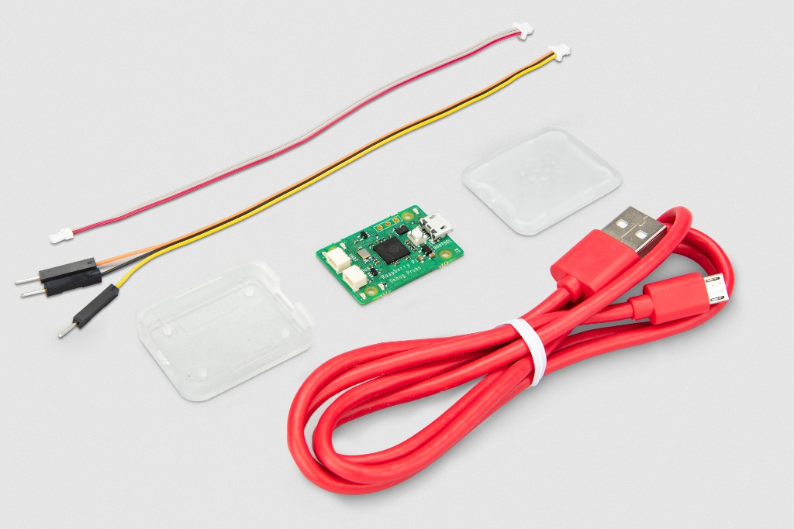
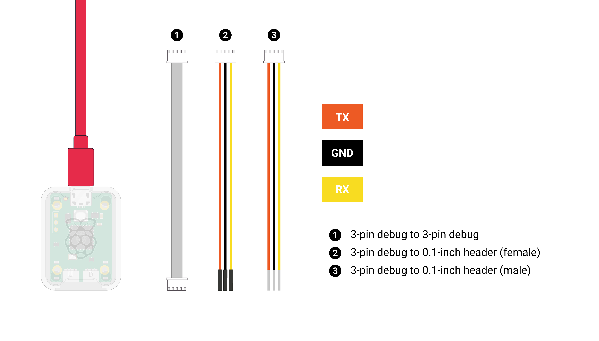
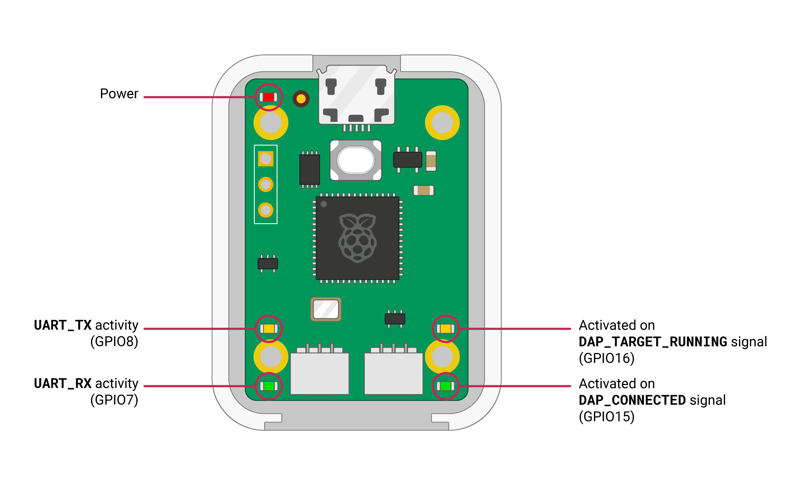
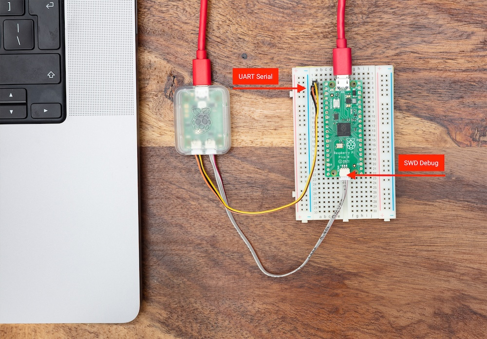
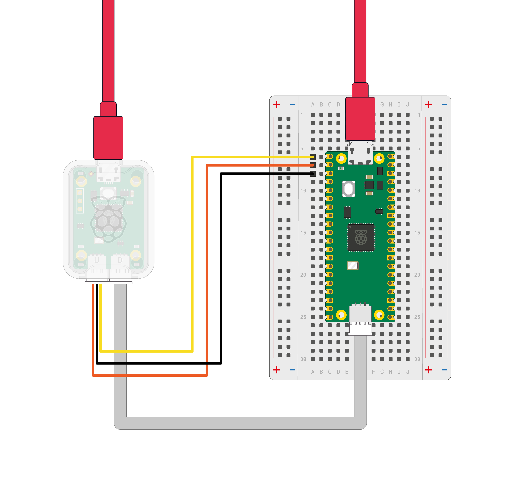
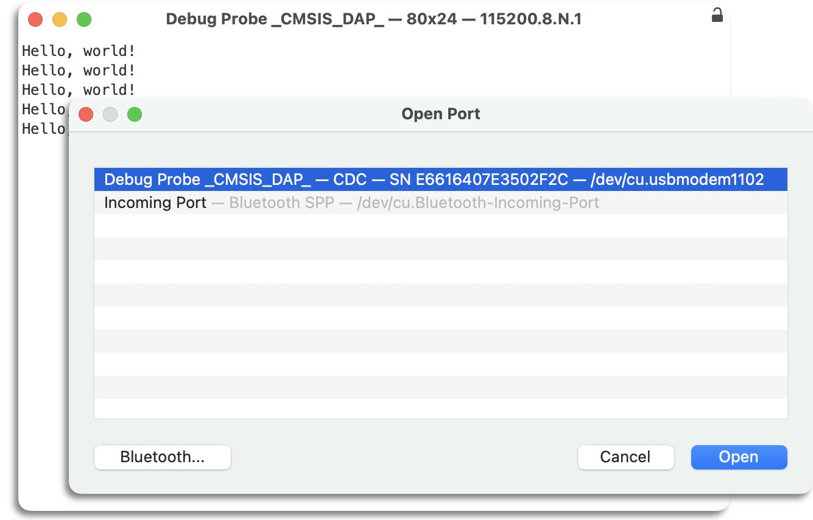
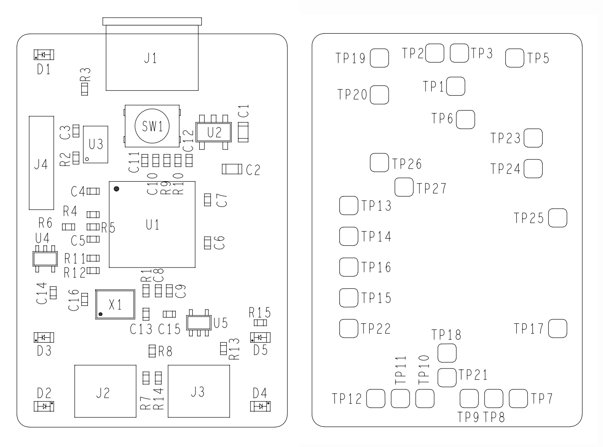

# 树莓派调试套件（Raspberry Pi Debug Probe）

## 调试套件简介



树莓派调试套件（Raspberry Pi Debug Probe）是一款同时提供 UART 串口和标准 Arm 串行线调试（SWD）接口的 USB 设备。该调试套件专为简单、免焊接、即插即用的调试而设计，具有以下功能：

* USB 转 Arm [串行线调试](https://support.arm.com/documentation/ihi0031/a/The-Serial-Wire-Debug-Port--SW-DP-/Introduction-to-the-ARM-Serial-Wire-Debug--SWD--protocol)（SWD）端口
* USB 转 UART 桥接器
* 兼容 [CMSIS-DAP](https://support.arm.com/documentation/101451/0100/About-CMSIS-DAP) 标准
* 可与 [OpenOCD](https://openocd.org/) 及其他支持 CMSIS-DAP 的工具搭配使用
* 开源固件，易于升级

>**注意**
>
>有关树莓派三针调试连接器的更多信息，请参阅[规格说明](https://rpltd.co/debug-spec)。

这使得在 Windows、macOS 和 Linux 等没有 GPIO 排针、无法直连 Pico 串口 UART 或 SWD 端口的平台上，也能轻松使用树莓派 Pico。

### 调试套件本体

调试套件在标称 3.3V 的 I/O 电压下运行。



调试套件随附一根 USB 电源线和三根调试线：

* 三针 JST-SH 连接器转三针 JST-SH 连接器的电缆
* 三针 JST-SH 连接器转 0.1 英寸排针（母）的电缆
* 三针 JST-SH 连接器转 0.1 英寸排针（公）的电缆

两根 0.1 英寸排针电缆分别用于面包板（公头）或直接连接到带排针的板子（母头），颜色如下：

* 橙色：TX/SC（调试套件输出）
* 黑色：GND
* 黄色：RX/SD（输入到调试套件或 I/O）

带有三针 JST-SH 连接器的电缆，用于配合较新的树莓派主板在 SWD 调试端口和 UART 连接器上使用的[标准三针连接器](https://rpltd.co/debug-spec)。

>**警告**
>
>当目标设备由独立的电源或计算机供电时，请在连接信号线之前确保两者有共同的参考地。要么先断开目标设备的电源，要么先在目标设备与树莓派调试套件之间连接 GND；待 GND 连接好之后，再连接 RX、TX、SC 和 SD。两个系统之间潜在的电压差可能损坏调试套件。

调试套件有五个 LED：一个红色 LED 指示电源，另外四个为活动指示 LED。



>**注意**
>
>当目标设备连接时，OpenOCD 会同时点亮两个 DAP LED，并在调用 `DAP_DISCONNECT` 时将它们熄灭。

## 入门指南



根据你的实际配置，有多种方式可以将调试套件连接到 [Pico 系列设备](shu-mei-pai-pico-he-pico-w.md)。下面的示例将调试套件连接到带有更新式三针 JST-SH SWD 连接器的树莓派 Pico H。

[观看安装演示视频](https://www.youtube.com/watch?v=4RCZBZsfsek)

按如下方式连接：

* 将调试套件的 “D” 端口连接到 Pico H 的 SWD JST-SH 连接器
* 将调试套件的 “U” 端口通过三针 JST-SH 连接器转 0.1 英寸排针（公）的电缆连接：
  * 调试套件的 `RX` 连接到 Pico H 的 `TX` 引脚
  * 调试套件的 `TX` 连接到 Pico H 的 `RX` 引脚
  * 调试套件的 `GND` 连接到 Pico H 的 `GND` 引脚

>**注意**
>
>如果你使用的是不带 JST-SH 连接器的非 H 版 Pico 或 Pico W，仍然可以将其连接到调试套件。在板子的 `SWCLK`、`GND` 和 `SWDIO` 排针上焊接一个公头连接器。使用调试套件随附的另一根三针 JST-SH 连接器转 0.1 英寸排针（母）的电缆，连接到调试套件的 “D” 端口。将 Pico 或 Pico W 上的 `SWCLK`、`GND` 和 `SWDIO` 分别连接到调试套件上的 `SC`（橙色线）、`GND`（黑色线）和 `SD`（黄色线）引脚。



## 安装工具

要使用调试套件，需要 OpenOCD 和 GNU 项目调试器（GDB）。集成开发环境（IDE）也可能对你有帮助。

在树莓派系统、大多数 Linux 变体、macOS 和 Microsoft Windows 上，我们建议你安装我们的 VS Code 扩展。该扩展捆绑了 OpenOCD、Arm 工具链、GDB 以及 Pico 系列微控制器的寄存器定义。

更多信息请参阅我们的《[树莓派 Pico 入门指南](https://pip.raspberrypi.com/documents/RP-008276-DS)》第 3 章。

或者，也可以按照该指南的附录 C 手动安装这些工具。

>**注意**
>
>不建议在 Windows 上手动安装这些工具。

## 开始调试会话

调试套件让你可以通过 SWD 端口和 OpenOCD 加载二进制文件：无需在每次向 Pico 推送新二进制文件时先拔下设备，再按住 BOOTSEL 按钮。使用调试套件上传新的二进制文件完全是自动化的。

随后使用 GDB 调试运行在 Pico 上的二进制文件。

我们推荐使用树莓派 Pico VSCode 扩展，它集成了 OpenOCD 和 GDB，可用于上传和调试程序。更多信息请参阅《[树莓派 Pico 入门指南](https://pip.raspberrypi.com/documents/RP-008276-DS)》第 4 章。

### 单独上传程序

构建好二进制文件后：

```bash
$ sudo openocd -f interface/cmsis-dap.cfg -f target/rp2040.cfg -c "adapter speed 5000" -c "program blink.elf verify reset exit"
```

>**注意**
>
>当你使用调试套件上传二进制文件时，使用的是文件的 ELF 版本，而不是拖放时使用的 UF2 文件。

### 单独调试会话

这种方式会以服务器模式使用 `openocd`，并连接 GDB，从而通过控制台界面提供断点和单步调试。

>**重要**
>
>要进行调试，你必须以 `Debug` 而非 `Release` 构建类型来构建二进制文件：

```bash
$ cd ~/pico/pico-examples/
$ rm -rf build
$ mkdir build
$ cd build
$ export PICO_SDK_PATH=../../pico-sdk
$ cmake -DCMAKE_BUILD_TYPE=Debug ..
$ cd blink
$ make -j4
```

在调试构建中，当你在调试器下运行程序时，你会获得更多信息，因为编译器在构建程序时会带上告诉 GDB 你的程序正在做什么的信息。

>**注意**
>
>在非树莓派设备上，需要一个能够调试 Arm 处理器的 GDB 变体。请根据你的操作系统和设备选用以下替代方案：
>
>* 在 Linux 设备上，使用 `gdb-multiarch`。
>* 在 macOS 和 Windows 设备上，使用来自 [Arm GitLab 仓库](https://gitlab.arm.com/tooling/gnu-toolchains-for-arm)工具链的 `arm-none-eabi-gdb`。

要启动 OpenOCD 服务器，请运行以下命令：

```bash
$ sudo openocd -f interface/cmsis-dap.cfg -f target/rp2040.cfg -c "adapter speed 5000"
```

然后打开第二个终端窗口，切换到包含你构建的二进制文件的目录，并启动一个调试器，将其连接到 OpenOCD 服务器：

```bash
$ gdb blink.elf
> target remote localhost:3333
> monitor reset init
> continue
```

## 串行连接

确保调试套件已连接到树莓派 Pico 的 UART 引脚。


树莓派 Pico UART0 的默认引脚如下：

| 默认 UART0 | 物理引脚 | GPIO 引脚 |
| :---: | :---: | :---: |
| GND | 3 | 不适用 |
| UART0_TX | 1 | GP0 |
| UART0_RX | 2 | GP1 |

连接后，树莓派 Pico UART 上的通信流量将由调试套件中继到你的计算机，并呈现为一个 CDC UART。在树莓派上，它会显示为 `/dev/ttyACM0`；在其他平台上，该串口的显示方式有所不同（例如在 macOS 上显示为 `/dev/cu.usbmodemXXXX`）。

如果你还没有安装 minicom，请先安装：

```bash
$ sudo apt install minicom
```

然后打开串口：

```bash
$ minicom -b 115200 -o -D /dev/ttyACM0
```

>**技巧**
>
>要退出 `minicom`，请先按 **CTRL-A**，再按 **X**。

要测试串行通信，你可以构建并上传 “Hello World” 示例应用程序。

进入 `pico-examples` 目录树中的 `hello_world` 目录并运行 `make`。随后你可以使用 `openocd` 将其上传到树莓派 Pico。构建 `hello_serial` 示例程序的完整流程请参阅《[树莓派 Pico 入门指南](https://pip.raspberrypi.com/documents/RP-008276-DS)》第 4 章。

```bash
$ cd pico-examples
$ mkdir build
$ cd build
$ export PICO_SDK_PATH=../../pico-sdk
$ cmake ..
$ cd hello_world/serial
$ make -j4
$ sudo openocd -f interface/cmsis-dap.cfg -f target/rp2040.cfg -c "adapter speed 5000" -c "program hello_serial.elf verify reset exit"
$ minicom -b 115200 -o -D /dev/ttyACM0
```

打开 `minicom` 后，你会看到控制台上打印出 “Hello, world!”。

对于支持该功能的终端程序，USB 串口 UART 的描述信息会包含在 USB 设备描述中。



该描述中的唯一序列号意味着在 Windows 上，你的 COM 端口编号对每个设备是“粘性”的，你可以据此编写 `udev` 规则，将命名的设备节点与特定的调试套件关联起来。

## RTT 连接

你还可以将应用程序配置为直接通过 SWD 接口发送输出，而无需 UART 连接。这使用了一种称为 Segger 实时传输（Real-Time Transport，RTT）的机制。

为此，你必须在应用程序中启用 RTT stdio 驱动，并使用调试套件连接到 RTT。

>**注意**
>
>必须使用应用程序的**调试构建**，才能通过 SWD 发送输出。

### 启用 RTT stdio 驱动

C/C++ SDK 为 RTT 提供了一个 stdio 驱动，就像 UART 和 USB 的 stdio 驱动一样。更多信息请参阅 [`pico_stdio_rtt`](https://www.raspberrypi.com/documentation/pico-sdk/runtime.html#group_pico_stdio_rtt)。

要在构建中启用该驱动，请在你的 `CMakeLists.txt` 文件中加入以下一行（或者链接 `pico_stdio_rtt`，效果相同）：

```cmake
pico_enable_stdio_rtt(<your_project_name> 1)
```

调用 `stdio_init_all()` 之后，应用程序通过 `printf()` 发送的任何输出都会发送到 RTT。如果你还想把输出同时复制到 UART，也可以启用该功能。

### 从 VSCode 连接 RTT

OpenOCD 和 VSCode 的 [Cortex-Debug](https://marketplace.visualstudio.com/items?itemName=marus25.cortex-debug) 扩展都支持 RTT；这两者都会在[安装工具](#安装工具)的过程中完成设置。

要为调试会话启用 RTT，需要在其启动配置中添加一个配置节。打开你项目的 `.vscode` 文件夹，将以下几行添加到 `launch.json` 文件中，放入合适的配置节，例如 `"Pico Debug (Cortex-Debug)"`：

```json
"rttConfig": {
    "enabled": true,
    "address": "auto",
    "decoders": [
        {
            "label": "",
            "port": 0,
            "type": "console"
        }
    ]
}
```

更多信息请参阅 [cortex-debug 启动属性](https://github.com/Marus/cortex-debug/blob/master/debug_attributes.md)。

如果你现在在一个启用了 RTT 的应用程序上启动调试会话，并打开 **TERMINAL**（终端）标签页，你会在右侧看到一个列表，其中包含 `RTT Ch:0 console`。选中它，即可查看你的应用程序发送到 `pico_stdio_rtt` 驱动的输出。

### 在单独调试会话中连接 RTT

如果你使用的是[开始调试会话](#开始调试会话)一节中描述的单独调试会话，可以通过以下步骤连接到 RTT：

1. 构建并上传启用了 RTT 的应用程序。
2. 连接调试套件，并在单独的终端中启动 `openocd` 和 `gdb`。更多信息请参阅[单独调试会话](#单独调试会话)。
3. 在 `gdb` 提示符下输入以下命令：

```bash
(gdb) target remote localhost:3333
(gdb) monitor reset init
(gdb) monitor rtt setup 0x20000000 2048 "SEGGER RTT"
(gdb) monitor rtt start
(gdb) monitor rtt server start 60000 0
(gdb) continue
```

>**注意**
>
>前缀为 `monitor` 的 `gdb` 命令会被透传给 `openocd`。关于这里所用命令的更多信息，请参阅 OpenOCD 手册的[第 15.6 节](https://openocd.org/doc/html/General-Commands.html)。

OpenOCD 会在目标上搜索 RTT 控制块，然后在本地创建一个监听 60000 端口的 TCP 套接字。

4. 打开第三个窗口，使用 `nc`（netcat）或类似工具连接到该本地套接字，即可查看应用程序的 RTT 输出：

```bash
$ nc localhost 60000
```

## 更新调试套件固件

调试套件固件由树莓派以 UF2 文件的形式分发。

调试套件固件的最新版本是 2.3.1。如果你运行的是较旧的版本，或者不小心覆盖了调试套件上的固件，可以在 [debugprobe GitHub 仓库](https://github.com/raspberrypi/debugprobe/releases/latest)中找到最新版本的固件。

要检查调试套件的固件版本，请运行：

```bash
$ lsusb -v -d 2e8a:000c | grep bcdDevice
```

对于 2.3.1 版的调试套件固件，该命令会报告 `bcdDevice 2.31`。

>**注意**
>
>`openocd` 报告的 `Info : CMSIS-DAP: FW Version = 2.0.0` 一行只表示 CMSIS-DAP 协议级别（与调试套件固件版本不同）。

按以下步骤更新调试套件的固件版本：

1. 从最新版本下载 `debugprobe.uf2`。
2. 掀开调试套件外壳的顶部。
3. 在把调试套件插入计算机的同时按住 BOOTSEL 按钮，以挂载名为 “RPI-RP2”（Pico）或 “RP2350”（Pico 2）的卷。
4. 将 `debugprobe.uf2` 复制到挂载的卷上。文件复制完成后，卷会自动卸载。
5. 调试套件会重新启动，现在运行的是更新后的调试套件固件，可以开始调试了。

## 原理图

调试套件的原理图和机械图纸可在以下位置获取：

* [原理图](https://pip.raspberrypi.com/documents/RP-008194-DS)（PDF）
* [机械图](https://pip.raspberrypi.com/documents/RP-008192-DS)（PDF）

原理图上标示的测试点（TP）位于下图所示位置。


