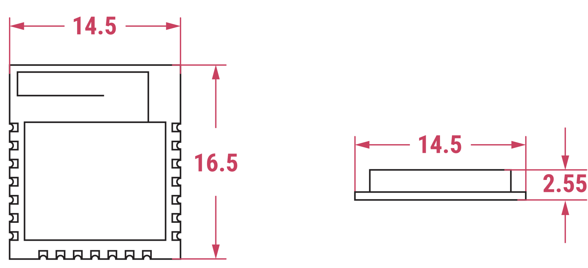

# 无线电模块

树莓派推出了两款无线电模块，其中只有一款可作为独立的微控制器配件购买：

* **树莓派无线电模块 1（RM1）** 内置于树莓派 4 和 5，以及计算模块 4 和 5。它不作为独立的无线电模块提供，也不单独出售。
* **树莓派无线电模块 2（RM2）** 是一款独立的无线电模块，旨在为树莓派[微控制器](rp2040.md)添加无线连接。为提高灵活性，它还提供 GPIO 扩展选项。

本页仅介绍 RM2。

## RM2 主要特性

RM2 是一款紧凑、自成一体的 Wi-Fi 和蓝牙无线电模块，提供可靠的 **2.4 GHz Wi-Fi（802.11b/g/n）** 和 **蓝牙 5.2** 连接。具体而言，RM2 具有以下主要特性：

* **Wi-Fi 支持。** Wi-Fi 4（802.11b/g/n），单频段（2.4 GHz）。
* **蓝牙 5.2 支持。** 经典蓝牙和低功耗蓝牙（BLE）。
* **紧凑的外形。** 采用 **Infineon CYW43439** 组合芯片，构成 1 x 1 单板配置。
* **牢固焊接。** 采用半孔引脚，支持多种安装方式。
* **兼容性。** 与 Pico W 和 Pico 2 W SDK 完全软件兼容。
* **简单的 GPIO 扩展器。** 三个由主机控制的 GPIO，提供额外的 I/O 能力。
* **模块化无线认证（因地区而异）。** 简化法规要求的合规流程。更多信息，请参阅[合规性](#合规性)。
* **最小的 I/O 开销。** 低引脚数的 gSPI 主机接口以最少的 I/O 需求简化集成。
* **高效的单天线设计：**
    * SISO（单输入、单输出）配置支持高效的单天线无线性能。
    * Wi-Fi 和蓝牙共用 2.4 GHz 天线。
* **连接性。** 集成的内部 PA 和 LNA，提升信号覆盖范围和可靠性。
* **速度。** 支持 20 MHz 信道，数据速率最高可达 96 Mbps（PHY 速率）。
* **宽工作温度范围。** –30°C 至 +70°C。
* **低功耗：**
    * IEEE 节能（PM1 DTIM1 平均速率 1）：1.19 mA
    * 接收活动速率 MCS7（-50 dBm 时）：43 mA
    * 发送活动速率 MCS7（16 dBm 时）：271 mA

## 技术规格

机械图展示了 RM2 的大致形状和尺寸。

RM2 的尺寸约为 14.5 x 16.5 mm，厚度约为 2.55 mm。RM2 的 PCB 由阻燃 FR4 材料制成，具有 21 个边缘镀层的半孔引脚，可牢固焊接到其他电路板上。该模块使用 1.5 mm 间距的镀金触点，以实现可靠的电气连接。

## 合规性

RM2 的设计符合国际无线电法规，并在主要全球市场获得预认证。RM2 由树莓派进行了全面测试和调校，这意味着其设计无需在生产线上进行进一步的射频调校或模块编程。你可以通过我们的[产品信息门户（PIP）](https://pip.raspberrypi.com/)获取相关产品测试报告、认证和集成测试软件。

RM2 已获准在以下地区使用：

* 欧盟（EU）
* 英国（UK）
* 美国（USA）
* 加拿大
* 印度
* 马来西亚

在 **欧盟**、**英国**、**美国** 和 **加拿大**，主机设备（集成 RM2 的产品）的制造商可以利用 RM2 的现有认证，简化并减少额外的审批要求。这称为 **完整模块化认证**，意味着你无需在这些地区进行完整的无线电认证；只需最少的额外测试，即可将 RM2 集成到你的产品中。

在 **印度** 和 **马来西亚**，不授予模块化认证。这意味着 RM2 的认证仅适用于无线电模块本身，不扩展到包含它的主机设备。任何包含 RM2 的主机设备都必须获得自己的单独认证。

如果你需要模块集成方面的支持，或计划在上述地区之外使用 RM2，请联系全球市场准入团队：gma@raspberrypi.com。
